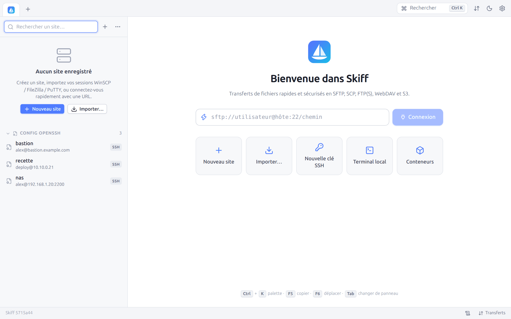

# 1. Installation et démarrage

[← Sommaire](README.md) · [Chapitre suivant →](02-premiers-pas.md)

## 1.1 Installer Skiff

Chaque système a son installateur :

| Système | Fichier | Installation |
|---|---|---|
| Windows 10/11 (x64, ARM64) | `skiff-setup-<version>-windows-amd64.exe` (ou `-arm64.exe`) | Double-cliquez. Skiff s'installe pour votre compte, **sans droits d'administrateur**, dans `%LOCALAPPDATA%\Programs\Skiff`, avec un raccourci dans le menu Démarrer (et sur le bureau si vous cochez la case) |
| macOS 11 et plus (Intel et Apple Silicon) | `Skiff-<version>-macos.dmg` | Ouvrez l'image disque et glissez **Skiff** sur le dossier **Applications** |
| Debian, Ubuntu, Linux Mint… (x64, ARM64) | `skiff_<version>_amd64.deb` (ou `_arm64.deb`) | `sudo apt install ./skiff_<version>_amd64.deb` : apt installe aussi WebKitGTK si besoin |
| Autres Linux (x64, ARM64) | `Skiff-<version>-x86_64.AppImage` (ou `-aarch64`) | Rendez le fichier exécutable (`chmod +x Skiff-*.AppImage`, ou **Propriétés → Autoriser l'exécution**), puis lancez-le. Rien n'est installé |

Tous ouvrent la **fenêtre native** : WebView2 sous Windows (préinstallé sur Windows 10/11), WKWebView sous macOS, WebKitGTK sous Linux.

**Premier lancement sous Windows et macOS.** Les installateurs ne sont pas encore signés par un certificat d'éditeur. Windows affiche alors « Windows a protégé votre ordinateur » : cliquez sur **Informations complémentaires**, puis sur **Exécuter quand même**. macOS indique qu'il ne peut pas vérifier l'application : ouvrez **Réglages Système → Confidentialité et sécurité** et cliquez sur **Ouvrir quand même** en face de Skiff. Ces deux avertissements n'apparaissent qu'une fois.

**L'AppImage** contient deux versions de Skiff. Elle lance la fenêtre native quand le système a WebKitGTK 4.1, sinon la variante qui ouvre une fenêtre de navigateur. Elle a besoin de FUSE pour s'ouvrir (présent sur presque toutes les distributions) ; à défaut, lancez-la avec l'option `--appimage-extract-and-run`. Elle ajoute son entrée au menu des applications à son premier lancement (voir [Lancer Skiff](#13-lancer-skiff)).

### Binaires seuls

Skiff tient aussi dans un exécutable unique, sans installation : interface, moteur de transferts, clients des protocoles, terminal et serveur web sont inclus.

| Plateforme | Binaire | Fenêtre |
|---|---|---|
| Windows 10/11 (x64, ARM64) | `skiff-windows-amd64.exe`, `skiff-windows-arm64.exe` | Fenêtre native **WebView2** |
| Linux (x64, ARM64) | `skiff-linux-amd64-desktop` | Fenêtre native **WebKitGTK** (paquet `libwebkit2gtk-4.1` à l'exécution) |
| Linux, FreeBSD, macOS, toutes | `skiff-<os>-<arch>` (variante portable) | Fenêtre d'application Chrome, Edge ou Brave si l'un d'eux est installé, sinon le navigateur par défaut |

La variante portable ne dépend d'aucune bibliothèque : elle sert aussi pour le [mode web distant](14-mode-web.md) sur un serveur ou un NAS.

## 1.2 Compiler depuis les sources

Prérequis : Go 1.27 ou plus récent, Node 22 ou plus récent et pnpm (uniquement pour compiler l'interface).

```bash
./build.sh            # compile l'interface puis bin/skiff (équivalent : make)
./build.sh portable   # bin/skiff sans fenêtre native (aucune dépendance)
./build.sh release    # tous les binaires de toutes les plateformes dans dist/
./build.sh packages   # les installateurs que cette machine sait faire, dans dist/
```

Sous Linux, pour obtenir la fenêtre native, installez d'abord les en-têtes de WebKitGTK. `build.sh` les détecte tout seul :

```bash
sudo apt install -y libgtk-3-dev libwebkit2gtk-4.1-dev pkg-config
```

Sans ces en-têtes, la compilation réussit quand même et produit la variante qui ouvre une fenêtre de navigateur.

`./build.sh packages` fait, sous Linux, le paquet `.deb`, l'AppImage et les installateurs Windows ; sous macOS, l'image disque `.dmg`. Chacun peut aussi être fait seul :

| Commande | Résultat | Nécessite |
|---|---|---|
| `./build.sh deb` | `dist/skiff_<version>_<arch>.deb` | Linux, les en-têtes de WebKitGTK, `dpkg-deb` |
| `./build.sh appimage` | `dist/Skiff-<version>-<arch>.AppImage` | Linux, les en-têtes de WebKitGTK, `mksquashfs` (paquet `squashfs-tools`) ; le runtime AppImage est téléchargé une fois depuis `github.com/AppImage/type2-runtime`, vérifié par sa somme SHA-256 et gardé dans `build/cache` (ou donné par la variable `APPIMAGE_RUNTIME`) |
| `./build.sh setup-windows` | `dist/skiff-setup-<version>-windows-amd64.exe` et `-arm64.exe` | NSIS (`apt install nsis`, `brew install makensis` ou `choco install nsis`), depuis n'importe quel système |
| `./build.sh dmg` | `dist/Skiff-<version>-macos.dmg` (application universelle) | macOS, avec les outils en ligne de commande de Xcode |

Plusieurs commandes peuvent se suivre : `./build.sh deb appimage` ne compile qu'une fois. La version vient de `git describe` : un tag `v1.2.0` donne `1.2.0`, et sans tag, `0.1.0~git.<commit>`.

La CI GitHub Actions (`.github/workflows/build.yml`) compile les binaires et les installateurs des trois systèmes et publie une release à chaque tag `v*`.

## 1.3 Lancer Skiff

```bash
skiff                                  # ouvre la fenêtre
skiff sftp://alex@serveur.example.com  # ouvre la fenêtre et se connecte
```

Au premier lancement, aucun site n'est enregistré. L'écran d'accueil propose de créer un site, d'importer vos sessions WinSCP, FileZilla, PuTTY ou OpenSSH, ou de se connecter tout de suite avec une URL.



Les installateurs mettent Skiff dans le menu Démarrer (Windows), le dossier Applications et le Launchpad (macOS) ou le menu des applications (paquet `.deb`, pour tous les utilisateurs).

**Sous Linux, sans le paquet** (AppImage ou binaire seul), au premier lancement de la fenêtre, Skiff ajoute son entrée au menu des applications et son icône, pour votre utilisateur : `~/.local/share/applications/skiff.desktop` et `~/.local/share/icons/hicolor/512x512/apps/skiff.png`. Sans elles, GNOME et KDE (sous Wayland surtout) affichent une icône générique dans le dock et le sélecteur de fenêtres. L'entrée suit le binaire, ou le fichier AppImage, s'il change de place ; une entrée `skiff.desktop` écrite à la main n'est jamais modifiée. Rien n'est ajouté en [mode portable](#15-mode-portable). Quand le paquet `.deb` est installé, c'est son entrée qui compte : Skiff n'en ajoute pas, et retire celle qu'il avait ajoutée, qui la masquerait.

La suite est décrite au chapitre [Premiers pas](02-premiers-pas.md). Les autres commandes (`serve`, `run`, `shell`, `keygen`, `import`, `task`, `desktop-entry`, `version`) sont décrites au chapitre [Scripts et ligne de commande](13-scripts-cli.md).

## 1.4 Dossier de configuration

Skiff range ses réglages dans un seul dossier :

| Système | Emplacement par défaut |
|---|---|
| Linux, FreeBSD | `~/.config/Skiff` (ou `$XDG_CONFIG_HOME/Skiff`) |
| Windows | `%APPDATA%\Skiff` |
| macOS | `~/Library/Application Support/Skiff` |

Le chemin exact est affiché en bas de la fenêtre **Préférences** et dans **Préférences → À propos de Skiff**.

| Fichier | Contenu |
|---|---|
| `sites.json` | Sites, dossiers et espaces de travail. Les mots de passe y sont chiffrés. |
| `settings.json` | Préférences, favoris, historique des dossiers, commandes personnalisées |
| `secret.key` | Clé de chiffrement des mots de passe quand il n'y a pas de mot de passe maître (droits 600) |
| `master.json` | Paramètres de dérivation du mot de passe maître (sel, coût Argon2id), sans le mot de passe |
| `known_hosts` | Clés d'hôte SSH acceptées (format OpenSSH) |
| `trusted_certs.json` | Certificats TLS auxquels vous avez fait confiance |
| `keychain.json` | [Trousseau Skiff](11-securite.md#117-trousseau-skiff-et-transfert-dagent) : clés privées chiffrées comme les mots de passe |
| `tasks.json`, `task-runs.json` | [Tâches planifiées](07-synchronisation.md#74-tâches-planifiées) et leur historique |
| `devices.json`, `sync-tombstones.json` | Réglages de la [synchronisation entre appareils](12-preferences.md#128-appareils) (phrase secrète chiffrée) et suppressions à propager |
| `logs/` | Journaux de session, si l'option est activée |
| `web-cert.pem`, `web-key.pem` | Certificat auto-signé du mode web |

`sites.json` peut être copié entre machines sans exposer les mots de passe : sans `secret.key` (ou sans le mot de passe maître), ils restent illisibles. Pour partager sites, mots de passe et préférences entre vos ordinateurs, utilisez plutôt [Préférences → Appareils](12-preferences.md#128-appareils). Voir [Sécurité](11-securite.md).

## 1.5 Mode portable

Comme le fichier `WinSCP.ini` de WinSCP, Skiff peut garder toute sa configuration à côté de l'exécutable, par exemple sur une clé USB. Il suffit de créer, dans le dossier du binaire :

- soit un dossier `skiff-data` ;
- soit un fichier vide `skiff.portable` (le dossier `skiff-data` est alors créé au premier lancement).

Avec l'AppImage, ce dossier ou ce fichier se place à côté du fichier `.AppImage`.

Le bas de la fenêtre des préférences indique alors « (mode portable) ».

## 1.6 Variables d'environnement

| Variable | Effet |
|---|---|
| `SKIFF_HOME` | Force le dossier de configuration (prioritaire sur tout le reste) |
| `SSH_AUTH_SOCK` | Socket de l'agent SSH à utiliser (Linux, macOS) |
| `LANG`, `LC_ALL` | Langue du système, utilisée par l'interface quand la préférence **Langue** est sur **Auto** |
| `SKIFF_BROWSER` | Navigateur qui ouvre les pages web des [ports du serveur](09-terminal-tunnels.md#99-ports-du-serveur) (`firefox`, `chromium`…) ; par défaut, celui du système |

En option `/ini=<dossier>`, la syntaxe de `winscp.com` permet aussi de choisir le dossier de configuration (voir [Scripts](13-scripts-cli.md#135-compatibilité-winscpcom)).

## 1.7 Mise à jour et désinstallation

La configuration (sites, mots de passe, préférences) est conservée par les mises à jour et, sauf demande contraire, par la désinstallation.

| Installé avec | Mettre à jour | Désinstaller |
|---|---|---|
| L'installateur Windows | Lancez le nouvel installateur, même si Skiff est ouvert : la nouvelle version démarre au prochain lancement | **Paramètres → Applications → Applications installées → Skiff → Désinstaller**. Le programme de désinstallation demande s'il faut aussi supprimer `%APPDATA%\Skiff` (non par défaut) |
| L'image disque macOS | Glissez la nouvelle version sur **Applications** et remplacez l'ancienne | Mettez **Skiff** à la corbeille, puis, si vous le souhaitez, le dossier `~/Library/Application Support/Skiff` |
| Le paquet `.deb` | `sudo apt install ./skiff_<nouvelle version>_amd64.deb` | `sudo apt remove skiff` |
| L'AppImage | Remplacez le fichier (gardez le même nom pour que l'entrée du menu reste valable, ou relancez-la : l'entrée suit) | `./Skiff-*.AppImage desktop-entry -remove` (retire l'entrée du menu et l'icône), puis supprimez le fichier |
| Un binaire seul | Remplacez le binaire | Sous Linux, `skiff desktop-entry -remove`, puis supprimez le binaire |

Pour effacer aussi la configuration, supprimez le [dossier de configuration](#14-dossier-de-configuration).

---

[← Sommaire](README.md) · [Chapitre suivant →](02-premiers-pas.md)
