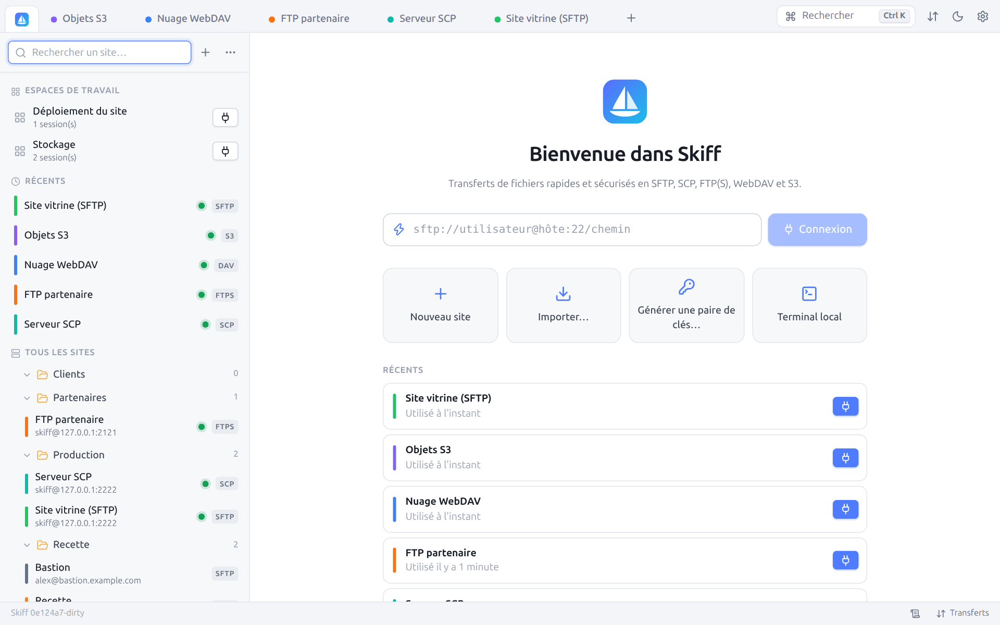
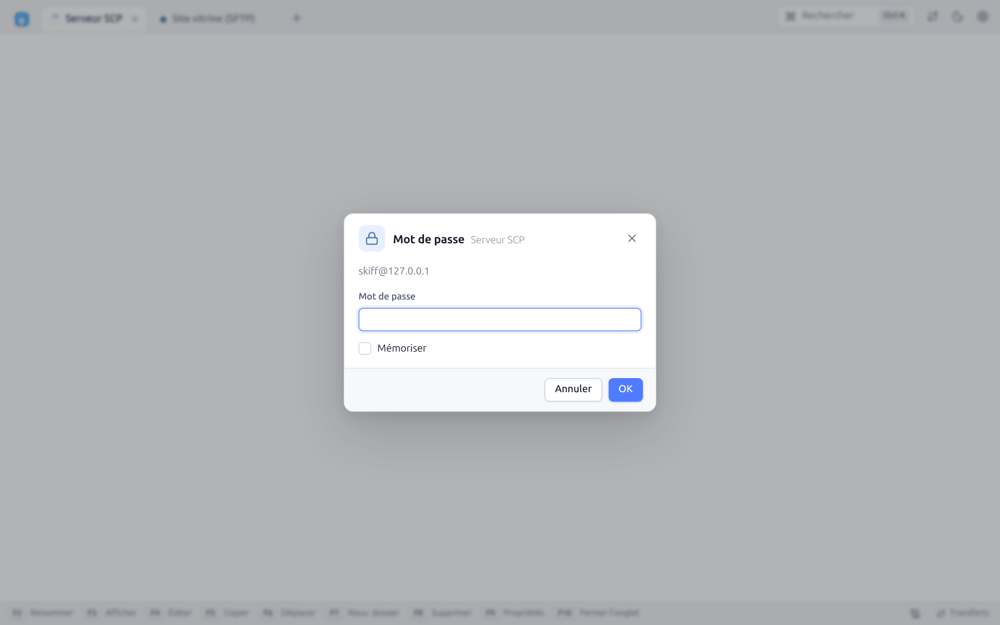
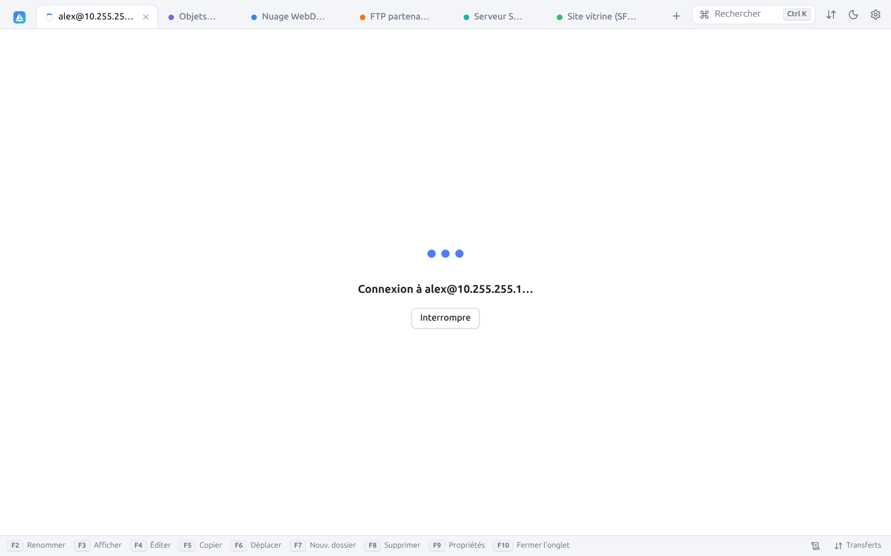

# 2. Premiers pas

[← Installation](01-installation.md) · [Sommaire](README.md) · [Gestionnaire de sites →](03-sites.md)

## 2.1 L'écran d'accueil

L'onglet **Sites**, toujours en première position, sert d'écran d'accueil. Une fois quelques sites enregistrés, il ressemble à ceci :



| Zone | Rôle |
|---|---|
| Barre latérale | Recherche de sites, espaces de travail, sites **récents** et arbre de **tous les sites** (voir [Gestionnaire de sites](03-sites.md)) |
| Champ de connexion rapide | Tapez une URL (`sftp://utilisateur@hôte:22/chemin`) puis `Entrée` ou **Connexion** |
| **Nouveau site** | Ouvre un formulaire de site vide |
| **Importer…** | Importe les sessions de WinSCP, PuTTY, FileZilla, OpenSSH ou un fichier (voir [Import](03-sites.md#35-importer-des-sites)) |
| **Générer une paire de clés…** | Ouvre le [générateur de clés SSH](11-securite.md#115-générateur-de-clés-ssh) |
| **Terminal local** | Ouvre un terminal sur l'ordinateur (voir [Terminal](09-terminal-tunnels.md#92-terminal-local)) |
| **Récents** | Les cinq derniers sites utilisés, avec un bouton de connexion |
| Pied de page | Rappel des raccourcis essentiels : `Ctrl+K` palette, `F5` copier, `F6` déplacer, `Tab` changer de panneau |

La barre d'onglets en haut contient, à droite :

- **Rechercher** (`Ctrl+K`) : la [palette de commandes](10-recherche-journal.md#104-palette-de-commandes) ;
- **File de transferts** (icône ⇅) : ouvre ou ferme le panneau des transferts, avec un badge du nombre de transferts actifs ;
- **Changer de thème** (lune / soleil) : passe du thème clair au thème sombre ;
- **Préférences** (roue dentée, `Ctrl+,`).

En bas, la barre d'état affiche la version de Skiff, un accès au journal et au panneau **Transferts**.

## 2.2 Connexion rapide par URL

Pour une connexion ponctuelle, sans enregistrer de site, tapez une URL dans le champ de connexion rapide (ou dans la palette `Ctrl+K`) :

```text
sftp://alex@serveur.example.com
sftp://alex@serveur.example.com:2222/var/www
scp://root@10.0.0.5
ftpes://depot@ftp.example.com/          (FTP + TLS explicite)
ftps://depot@ftp.example.com/           (FTP + TLS implicite)
davs://alex@cloud.example.com/remote.php/dav/files/alex/
s3://AKIAEXEMPLE@s3.eu-west-3.amazonaws.com/mon-bucket/
```

Le chemin éventuel devient le dossier distant d'ouverture. Le détail des URL acceptées est au chapitre [Protocoles](15-protocoles.md#158-url-de-session). Une connexion rapide peut ensuite être enregistrée comme site.

## 2.3 Première connexion à un serveur SSH

À la première connexion à un serveur SSH, Skiff ne connaît pas encore sa **clé d'hôte**. Il affiche son empreinte et vous demande de la vérifier :


| Bouton | Effet |
|---|---|
| **Accepter** | Se connecte et enregistre la clé dans le `known_hosts` de Skiff. Les connexions suivantes ne demandent plus rien. |
| **Se connecter une fois** | Se connecte sans enregistrer la clé sur le disque. La clé reste acceptée jusqu'à la fermeture de Skiff (reconnexions comprises) ; la question reviendra au prochain démarrage. |
| **Annuler** | Abandonne la connexion |

Comparez l'empreinte SHA-256 avec celle que donne l'administrateur du serveur (`ssh-keygen -lf /etc/ssh/ssh_host_ed25519_key.pub`). Si la clé change plus tard, Skiff affiche une alerte rouge (voir [Sécurité](11-securite.md#111-clés-dhôte-ssh)).

Si aucun mot de passe n'est enregistré et qu'aucune clé ne convient, Skiff le demande :



Cochez **Mémoriser** pour enregistrer le mot de passe (chiffré) dans le site. Pour une authentification clavier-interactive (code OTP, changement de mot de passe expiré), la boîte affiche les questions du serveur une par une.

Pendant la connexion, l'onglet affiche une animation et un bouton **Interrompre** :



## 2.4 Visite de l'interface

Une fois connecté, l'onglet de session montre l'interface **Commander** : le dossier local à gauche, le serveur à droite.


De haut en bas :

1. **Barre d'onglets** : le logo Skiff ouvre l'onglet **Sites**, puis viennent un onglet par session, éditeur, diff ou terminal. La pastille d'une session connectée prend la couleur du site (vert par défaut) ; elle devient orange pendant une connexion et rouge si la connexion est perdue ou a échoué. `+` (`Ctrl+N`) ouvre une nouvelle session depuis l'onglet **Sites**.
2. **Barre d'outils de la session** : état et protocole (`SFTP`), identité `utilisateur@hôte`, puis **Synchroniser**, **Comparer les dossiers**, **Rechercher des fichiers**, **Garder le dossier distant à jour** (éclair), **Navigation synchronisée** (maillons), **Terminal**, **Exécuter une commande**, **Tunnels**. À droite : fichiers cachés, arborescence, aperçu, disposition, journal, informations serveur et **Déconnexion**. Chaque bouton est détaillé au chapitre [Interface](04-interface.md#42-barre-doutils-de-la-session).
3. **Deux panneaux de fichiers** : chacun a son sélecteur de connexion (**Local**, **Site vitrine (SFTP)**…), ses boutons de navigation, son fil d'Ariane et ses outils (filtre, dossier personnel, favori, historique, actualiser). Le panneau actif est souligné en bleu.
4. **Barre de statut de chaque panneau** : nombre d'éléments, taille totale, fichiers masqués, sélection, espace libre du disque ou du serveur.
5. **Barre des touches de fonction** : `F2` Renommer, `F3` Afficher, `F4` Éditer, `F5` Copier, `F6` Déplacer, `F7` Nouv. dossier, `F8` Supprimer, `F9` Propriétés, `F10` Fermer l'onglet. Chaque touche est cliquable. À droite : protocole et sécurité de la connexion, journal, **Transferts** (avec la vitesse en cours).

`Tab` passe d'un panneau à l'autre. Les fichiers se transfèrent avec `F5`, par glisser-déposer ou par le menu contextuel (voir [Transferts](06-transferts.md)).

## 2.5 Reprendre là où vous en étiez

- **Rouvrir les sessions de la dernière fois** (Préférences → Panneaux) rouvre au démarrage les onglets de la fermeture précédente, avec leurs dossiers. Une connexion rapide redemande son mot de passe, qui n'est pas enregistré.
- **Se reconnecter automatiquement en cas de coupure** (activé par défaut) relance la connexion quand le réseau revient.
- Les [espaces de travail](03-sites.md#33-espaces-de-travail) enregistrent un ensemble d'onglets pour le rouvrir d'un clic.

---

[← Installation](01-installation.md) · [Sommaire](README.md) · [Gestionnaire de sites →](03-sites.md)
