# 3. Gestionnaire de sites

[← Premiers pas](02-premiers-pas.md) · [Sommaire](README.md) · [Interface et navigation →](04-interface.md)

Un **site** regroupe tout ce qu'il faut pour se connecter à un serveur : protocole, hôte, identifiants, dossiers d'ouverture, proxy, hôtes de rebond, tunnels et options propres au protocole. C'est l'équivalent du gestionnaire de sites de WinSCP.

## 3.1 La liste des sites

L'onglet **Sites** affiche la liste à gauche et le formulaire du site sélectionné à droite.

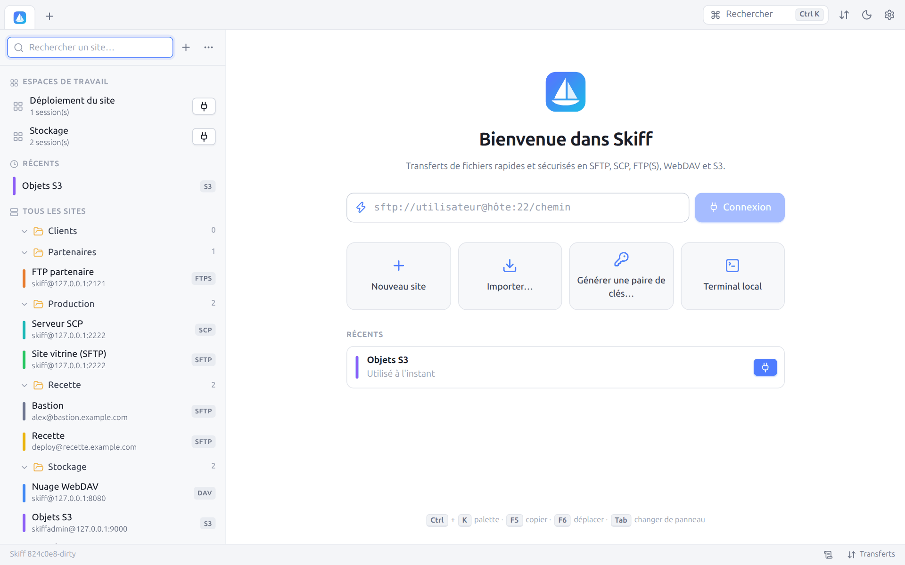

La barre latérale contient, de haut en bas :

- le champ **Rechercher un site…**, qui filtre sur le nom, l'hôte, l'utilisateur, le dossier et les notes ;
- le bouton **+** (nouveau site) et le menu **⋯** ;
- les **Espaces de travail** ([§ 3.3](#33-espaces-de-travail)) ;
- les **Récents** : les cinq derniers sites utilisés, avec une pastille verte pour ceux qui sont connectés ;
- **Tous les sites**, rangés en dossiers et sous-dossiers. Chaque site affiche sa couleur, son nom, `utilisateur@hôte:port` et un badge de protocole (`SFTP`, `SCP`, `FTP`, `FTPS`, `DAV`, `S3`). Le nombre à droite d'un dossier est le nombre de sites qu'il contient.
- **Config OpenSSH** : les hôtes déclarés dans votre `~/.ssh/config`, prêts à l'emploi sans rien enregistrer ([§ 3.4](#34-configuration-openssh-ssh_config)).

| Action | Effet |
|---|---|
| Clic | Affiche le site dans le formulaire |
| Double-clic, `Entrée` | Se connecte |
| `↑` / `↓` | Passe au site précédent / suivant |
| `Suppr` | Supprime le site (après confirmation) |
| Glisser un site sur un dossier | Range le site dans ce dossier (sur la zone vide : le remet à la racine) |
| Clic droit | Menu contextuel du site ou du dossier |

### Menu contextuel d'un site

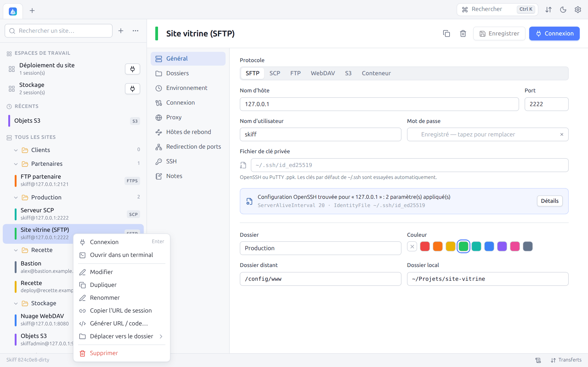

| Commande | Effet |
|---|---|
| **Connexion** (`Entrée`) | Ouvre une session |
| **Ouvrir dans un terminal** | Se connecte et ouvre directement un terminal SSH (SFTP et SCP) |
| **Modifier** | Affiche le formulaire du site |
| **Dupliquer** | Crée une copie du site, nommée « … (copie) », mots de passe compris |
| **Renommer** | Change le nom du site |
| **Copier l'URL de session** | Copie l'URL du site (sans mot de passe) |
| **Générer URL / code…** | Ouvre le [générateur d'URL et de code](#37-url-et-code-de-session) |
| **Déplacer vers le dossier** | Range le site dans un dossier existant ou à la **(racine)** |
| **Supprimer** | Supprime le site |

### Menu contextuel d'un dossier

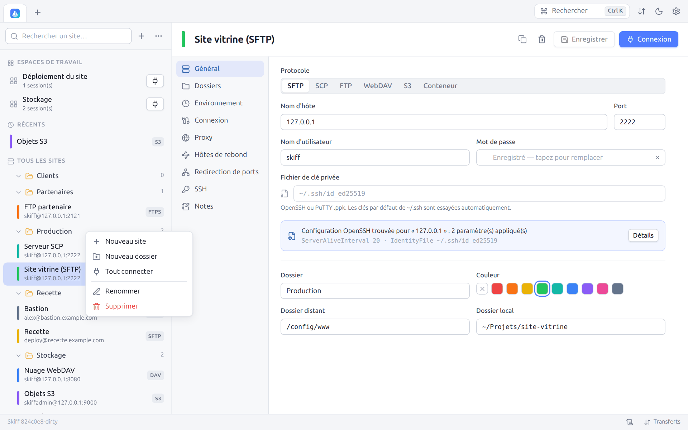

| Commande | Effet |
|---|---|
| **Nouveau site** | Crée un site directement dans ce dossier |
| **Nouveau dossier** | Crée un sous-dossier |
| **Tout connecter** | Ouvre une session pour chaque site du dossier et de ses sous-dossiers |
| **Renommer** | Renomme le dossier (les sites suivent) |
| **Supprimer** | Supprime le dossier. Ses sites remontent dans le dossier parent : aucun site n'est perdu. |

### Menu ⋯

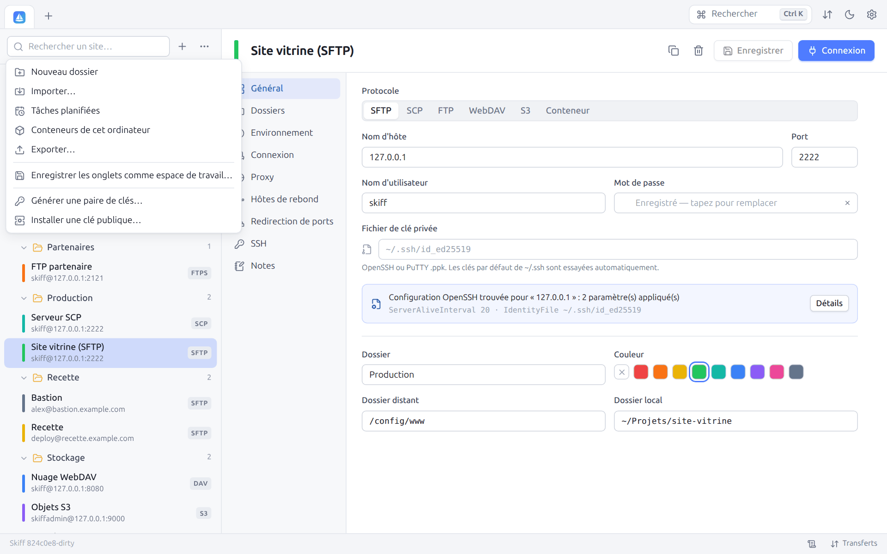

**Nouveau dossier**, **Importer…**, **Exporter…**, **Enregistrer les onglets comme espace de travail…**, **Générer une paire de clés…** et **Installer une clé publique…** (sur un serveur connecté, voir [§ 11.6](11-securite.md#installer-une-clé-existante-sur-un-serveur)).

## 3.2 Créer et modifier un site

**+** (ou **Nouveau site** sur l'écran d'accueil) ouvre un formulaire vide marqué **Site non enregistré** :

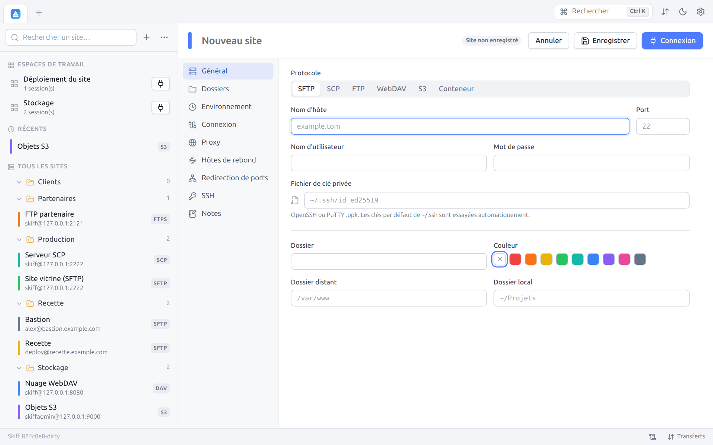

L'en-tête du formulaire contient :

- la **couleur** et le **nom** du site, modifiable directement (vide, le site s'appelle `utilisateur@hôte`) ;
- le badge **Modifié** quand il y a des changements non enregistrés ;
- **Copier l'URL de session** et **Supprimer** (sites existants) ;
- **Enregistrer** (`Ctrl+S`) et **Connexion**. Si le site a été modifié, ce bouton devient **Enregistrer et connecter**. `Entrée` dans un champ lance aussi la connexion.

Les sections du formulaire s'adaptent au protocole choisi :

| Section | SFTP | SCP | FTP/FTPS | WebDAV | S3 |
|---|:-:|:-:|:-:|:-:|:-:|
| Général, Dossiers, Environnement, Connexion, Proxy, Hôtes de rebond, Notes | ✓ | ✓ | ✓ | ✓ | ✓ |
| Redirection de ports, SSH | ✓ | ✓ | | | |
| FTP | | | ✓ | | |
| TLS | | | si chiffré | si HTTPS | si HTTPS |
| S3 | | | | | ✓ |

### Général

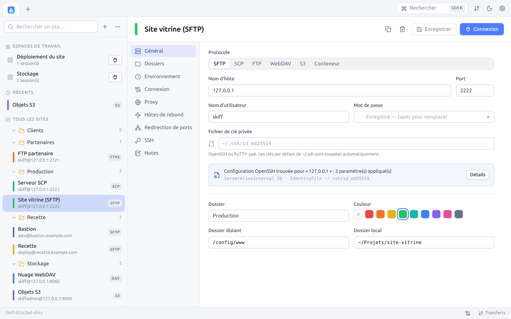

| Champ | Description |
|---|---|
| **Protocole** | SFTP, SCP, FTP, WebDAV, S3 ou **Conteneur** (Docker, Podman, Kubernetes, voir [§ 15.7](15-protocoles.md#157-conteneurs-docker-podman-kubernetes)). Le port par défaut suit le protocole (22, 21, 80/443, 443). |
| **Nom d'hôte** et **Port** | Adresse du serveur (nom DNS, IPv4 ou IPv6) |
| **Nom d'utilisateur** et **Mot de passe** | Un mot de passe enregistré n'est jamais renvoyé à l'interface : le champ affiche « Enregistré — tapez pour remplacer », et la croix l'oublie. |
| **Fichier de clé privée** | Clé OpenSSH ou PuTTY `.ppk` (SSH seulement). Les clés par défaut de `~/.ssh` sont essayées automatiquement. |
| **Dossier** | Dossier de rangement du site dans la liste (`Clients/Acme` pour un sous-dossier) |
| **Couleur** | Couleur du site dans la liste, les onglets et les récents |
| **Dossier distant**, **Dossier local** | Dossiers ouverts à la connexion (raccourci de la section Dossiers) |

Pour **FTP**, la section Général contient en plus le **Chiffrement** (**Pas de chiffrement**, **TLS/SSL explicite**, **TLS/SSL implicite**) et **Connexion anonyme** :

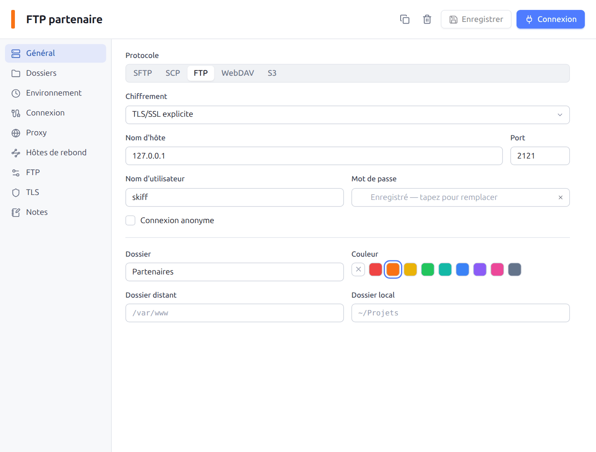

Pour **WebDAV**, **Utiliser HTTPS (TLS)** remplace le choix de chiffrement, et un rappel indique que le dossier distant est le chemin du serveur WebDAV (par exemple `/remote.php/dav/files/moi/` pour Nextcloud) :

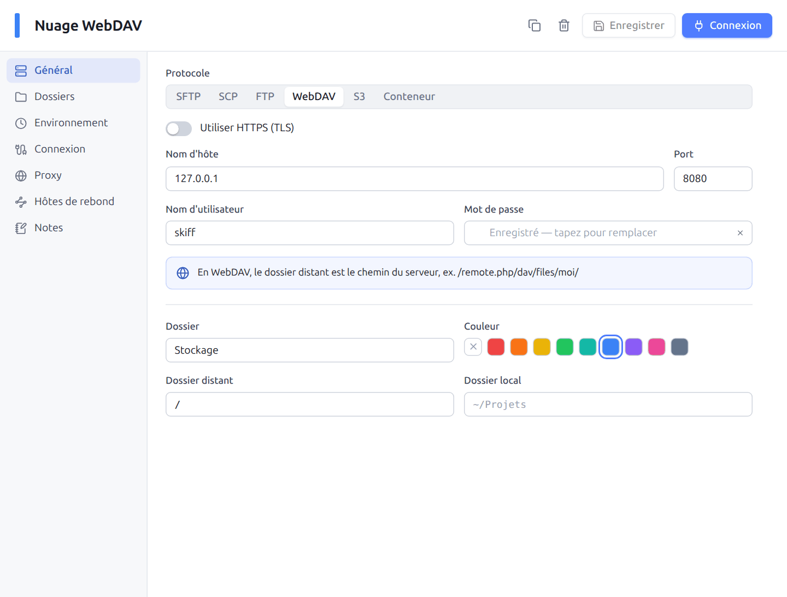

Pour **S3**, les champs deviennent **Endpoint**, **ID de clé d'accès** et **Clé d'accès secrète**. Laissez l'endpoint vide pour AWS :

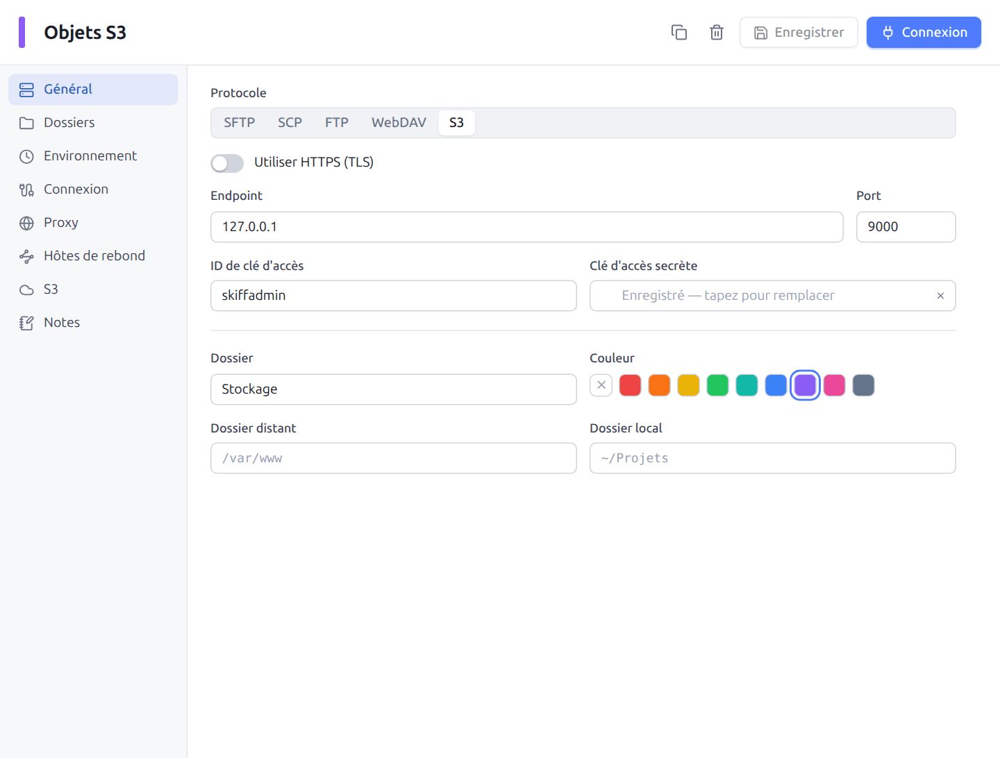

### Dossiers

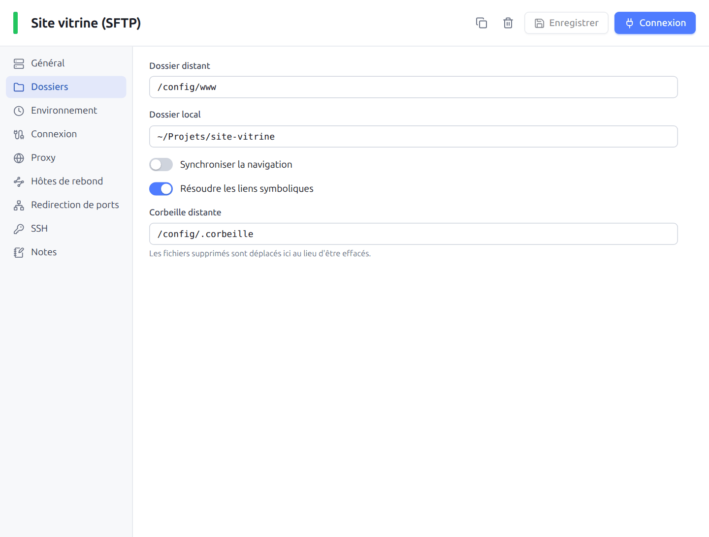

| Champ | Description |
|---|---|
| **Dossier distant** | Dossier ouvert à la connexion. Vide : le dossier personnel de l'utilisateur. |
| **Dossier local** | Dossier ouvert dans le panneau local. `~` désigne votre dossier personnel. |
| **Synchroniser la navigation** | Active la [navigation synchronisée](04-interface.md#411-navigation-synchronisée) dès la connexion |
| **Résoudre les liens symboliques** | Suit les liens pour savoir s'ils pointent vers un fichier ou un dossier (activé par défaut) |
| **Corbeille distante** | Dossier du serveur où les fichiers supprimés sont déplacés au lieu d'être effacés (voir [Supprimer](05-fichiers.md#54-supprimer)) |

### Environnement

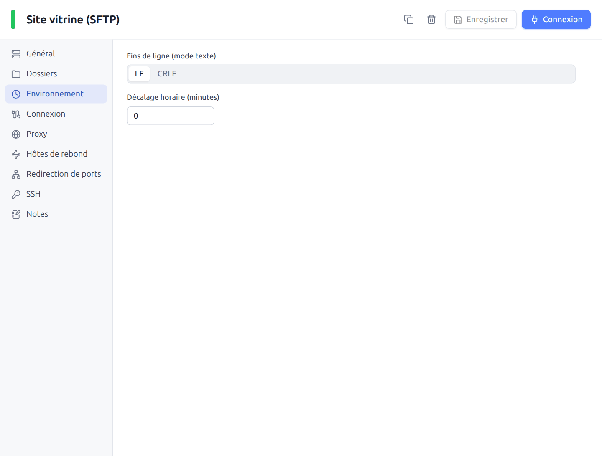

| Champ | Description |
|---|---|
| **Fins de ligne (mode texte)** | `LF` (Unix) ou `CRLF` (Windows) : format des fins de ligne côté serveur pour les transferts en mode texte |
| **Décalage horaire (minutes)** | Corrige l'heure des fichiers d'un serveur mal réglé ou qui donne l'heure locale sans fuseau (FTP) |
| **Encodage des noms de fichiers** (FTP) | UTF-8 (auto), Windows-1252, ISO-8859-1, ISO-8859-15, Windows-1250, Windows-1251, KOI8-R, CP850, CP437 |

### Connexion

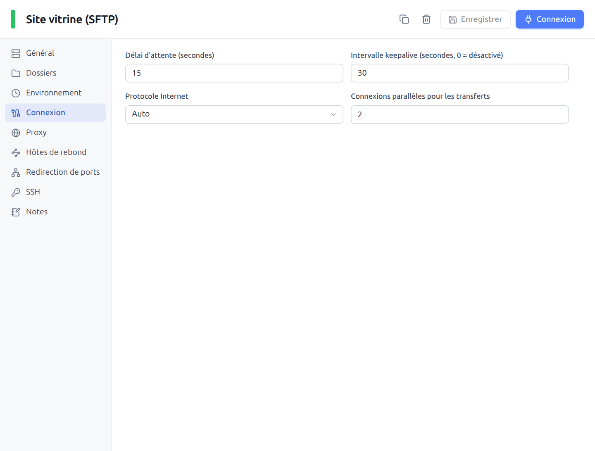

| Champ | Description |
|---|---|
| **Délai d'attente (secondes)** | Temps maximal d'établissement de la connexion (15 s par défaut) |
| **Intervalle keepalive (secondes, 0 = désactivé)** | Envoie un message de maintien pour éviter les coupures par les pare-feu (30 s par défaut) |
| **Protocole Internet** | Auto, IPv4 ou IPv6 |
| **Connexions parallèles pour les transferts** | Nombre de connexions supplémentaires ouvertes pour transférer plusieurs fichiers à la fois |

### Proxy

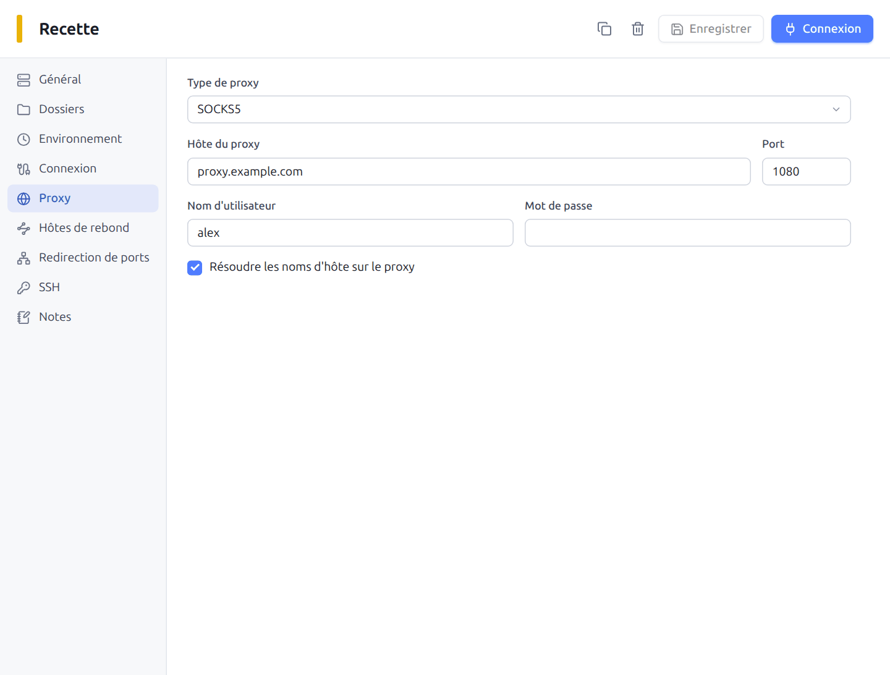

| Champ | Description |
|---|---|
| **Type de proxy** | Aucun, SOCKS4, SOCKS5, HTTP (CONNECT), Telnet, **Commande locale (ProxyCommand)** |
| **Hôte du proxy**, **Port**, **Nom d'utilisateur**, **Mot de passe** | Paramètres du proxy |
| **Résoudre les noms d'hôte sur le proxy** | Le nom du serveur est résolu par le proxy (SOCKS4a/SOCKS5), utile quand le DNS interne n'est pas accessible |
| **Commande** | Pour une commande locale : la commande dont l'entrée et la sortie servent de connexion. Variables : `%host`, `%port`, `%user`, `%pass`, `%proxyhost`, `%proxyport`. Exemple : `ssh -W %host:%port bastion` |

Le proxy s'applique à tous les protocoles. Voir aussi [Proxys](09-terminal-tunnels.md#95-proxys).

### Hôtes de rebond

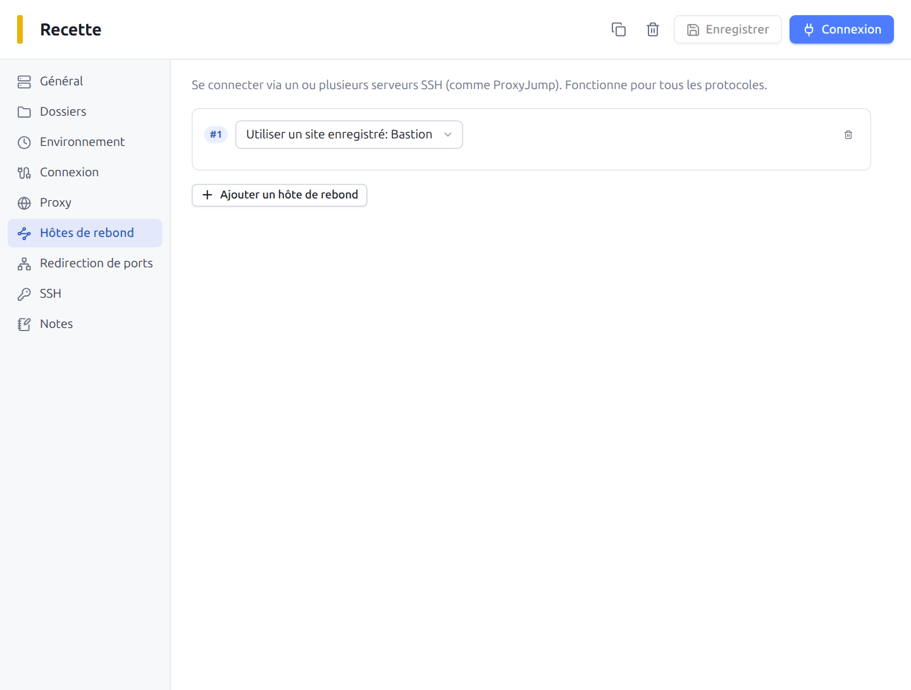

Une chaîne d'hôtes de rebond (comme `ProxyJump` d'OpenSSH) : Skiff se connecte au premier serveur SSH, puis au suivant à travers lui, et ainsi de suite jusqu'au serveur final. Chaque rebond est :

- soit un **site enregistré** (**Utiliser un site enregistré : Bastion**), avec son authentification ;
- soit un **Hôte personnalisé** : hôte, port, utilisateur, mot de passe et fichier de clé.

**Ajouter un hôte de rebond** ajoute une étape à la chaîne. Les rebonds fonctionnent pour **tous les protocoles** : un site FTP, WebDAV ou S3 derrière un bastion SSH est joint par un tunnel. Voir [Hôtes de rebond](09-terminal-tunnels.md#94-hôtes-de-rebond).

### Redirection de ports (SSH)

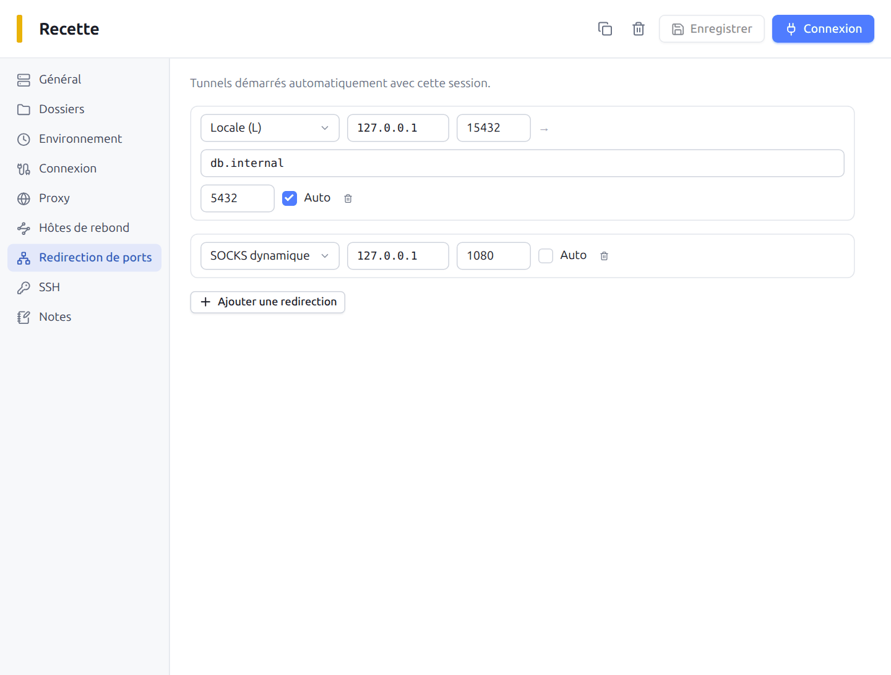

Les tunnels définis ici sont rattachés au site. Chaque ligne indique le type (**Locale (L)**, **Distante (R)**, **SOCKS dynamique (D)**), l'adresse et le port d'écoute, la destination (sauf en SOCKS) et la case **Auto** (**Démarrer automatiquement** à la connexion). **Ajouter une redirection** ajoute une ligne. Voir [Tunnels](09-terminal-tunnels.md#93-tunnels-redirections-de-ports).

### SSH

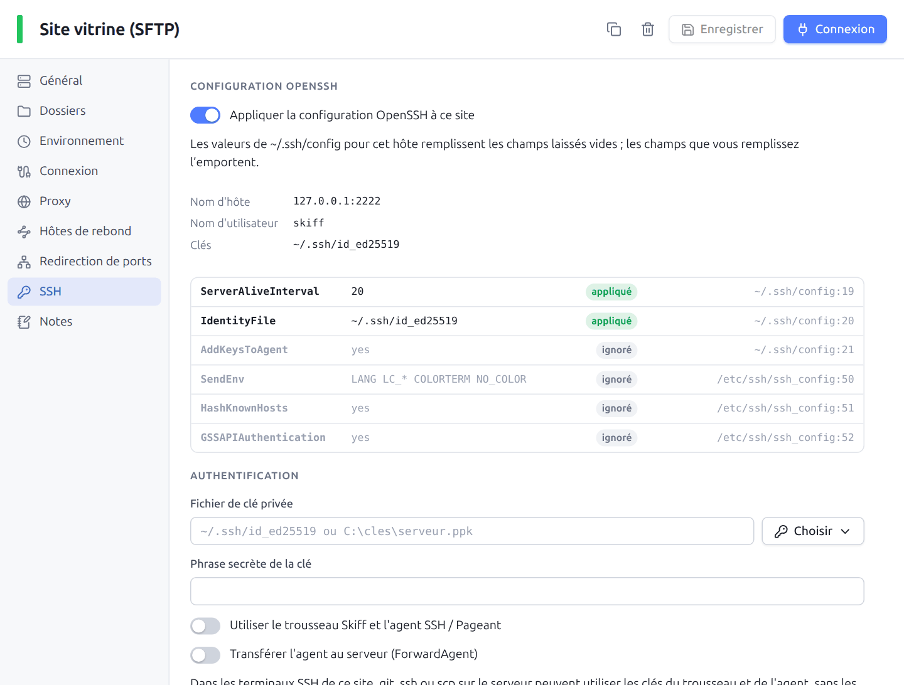

| Champ | Description |
|---|---|
| **Fichier de clé privée** | Clé OpenSSH (`id_ed25519`, `id_rsa`…), PuTTY `.ppk` v2/v3 ; un certificat `-cert.pub` posé à côté est utilisé automatiquement |
| **Phrase secrète de la clé** | Enregistrée chiffrée. Si elle est absente, Skiff la demande. |
| **Utiliser le trousseau Skiff et l'agent SSH / Pageant** | Essaie les clés du [trousseau Skiff](11-securite.md#117-trousseau-skiff-et-transfert-dagent), puis celles de l'agent (`ssh-agent`, agent OpenSSH de Windows, Pageant) |
| **Transférer l'agent au serveur (ForwardAgent)** | Les terminaux SSH du site reçoivent un agent : `git`, `ssh`, `scp` sur le serveur utilisent vos clés sans les copier. Seulement vers des serveurs de confiance. |
| **Authentification clavier-interactive** | Autorise les questions du serveur (OTP, 2FA, changement de mot de passe) |
| **Empreinte attendue de la clé d'hôte** | `SHA256:…` : épingle la clé du serveur. Une autre clé est refusée sans question. |
| **Commande du serveur SFTP** | Lance un autre serveur SFTP, par exemple `sudo /usr/lib/openssh/sftp-server` pour naviguer en root |
| **Shell (SCP)** et **Commande de listage (SCP)** | Shell utilisé pour les commandes SCP et commande de listage forcée (`ls -la`) |
| **Autoriser les anciens algorithmes (vieux serveurs)** | Active les algorithmes obsolètes (`diffie-hellman-group1-sha1`, `ssh-rsa`, `3des-cbc`…) pour les vieux équipements |

En haut de la section, **Appliquer la configuration OpenSSH à ce site** (activé par défaut) laisse `~/.ssh/config` compléter les champs vides du site, et la liste en dessous montre ce qui en est tiré ([§ 3.4](#34-configuration-openssh-ssh_config)).

### FTP

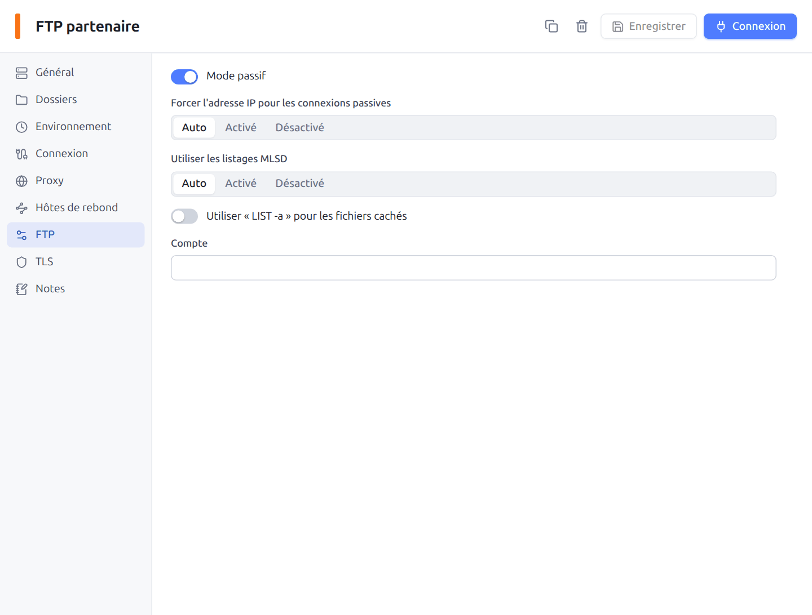

| Champ | Description |
|---|---|
| **Mode passif** | Activé par défaut. Désactivé, Skiff utilise le mode actif (PORT/EPRT). |
| **IP externe pour le mode actif** | Adresse annoncée au serveur en mode actif (vide : automatique) |
| **Forcer l'adresse IP pour les connexions passives** | Auto, Activé, Désactivé : ignore l'adresse renvoyée par le serveur (souvent fausse derrière un NAT) et réutilise celle du serveur |
| **Utiliser les listages MLSD** | Auto, Activé, Désactivé : listages normalisés MLSD/MLST ou LIST classique |
| **Utiliser « LIST -a » pour les fichiers cachés** | Demande aussi les fichiers commençant par un point |
| **Compte** | Commande `ACCT` exigée par certains serveurs |

### TLS

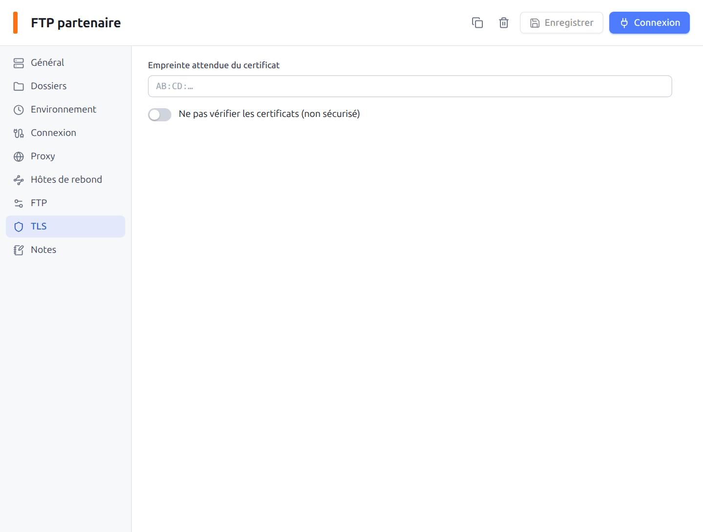

| Champ | Description |
|---|---|
| **Empreinte attendue du certificat** | `AB:CD:…` (SHA-256) : épingle le certificat du serveur |
| **Ne pas vérifier les certificats (non sécurisé)** | Accepte n'importe quel certificat, sans question. À réserver aux tests. |

Sans ces options, un certificat inconnu ou auto-signé déclenche une [demande de confiance](11-securite.md#112-certificats-tls).

### S3

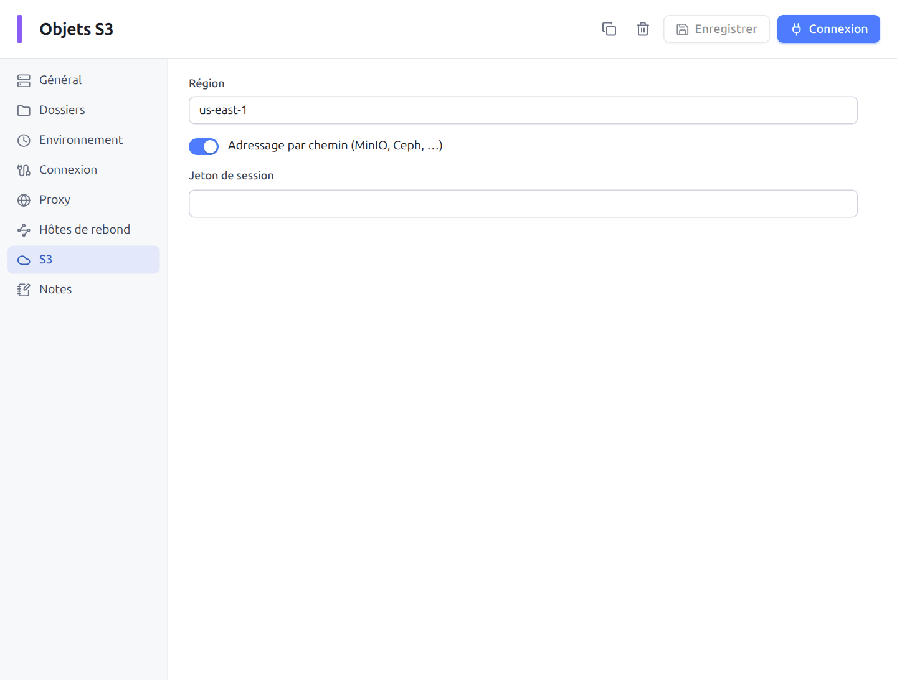

| Champ | Description |
|---|---|
| **Région** | `us-east-1`, `eu-west-3`… Vide : détectée automatiquement |
| **Adressage par chemin (MinIO, Ceph, …)** | `https://hôte/bucket/objet` au lieu de `https://bucket.hôte/objet` |
| **Jeton de session** | Pour des identifiants temporaires (STS) |

### Notes

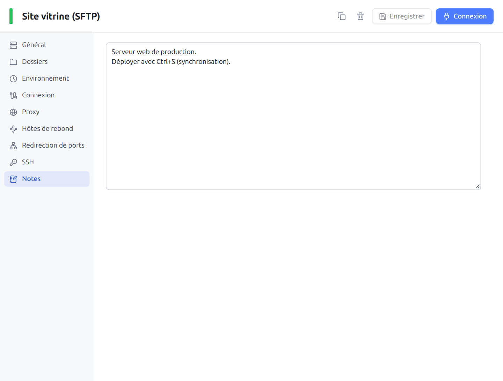

Texte libre : procédure de déploiement, contacts, numéro de contrat… Les notes sont prises en compte par la recherche de sites.

## 3.3 Espaces de travail

Un espace de travail mémorise un ensemble d'onglets de session (site, dossier distant et dossier local de chacun) pour les rouvrir ensemble.

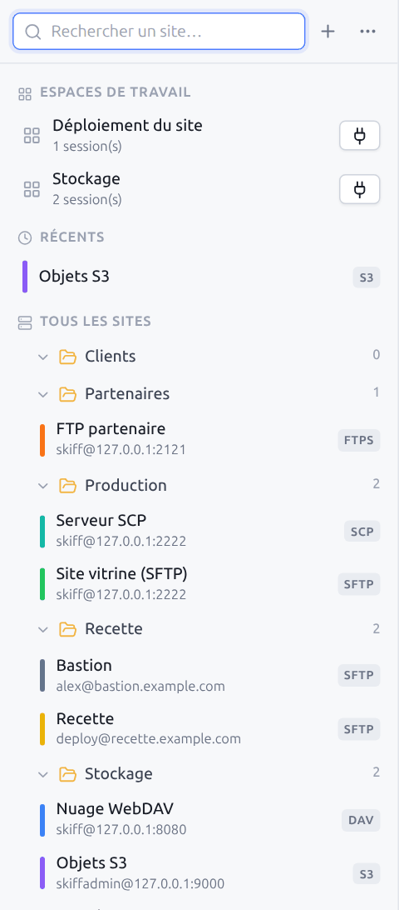

- **Enregistrer** : ouvrez les sessions voulues, puis **⋯ → Enregistrer les onglets comme espace de travail…** (ou la même commande dans la palette `Ctrl+K`) et donnez un nom.
- **Ouvrir** : double-clic sur l'espace, bouton de connexion à sa droite, ou palette `Ctrl+K`.
- **Supprimer** : clic droit → **Supprimer**.

## 3.4 Configuration OpenSSH (ssh_config)

Skiff lit la configuration du client OpenSSH comme la commande `ssh` : un hôte décrit dans `~/.ssh/config` s'ouvre dans Skiff par son nom, avec les mêmes réglages (adresse réelle, port, utilisateur, clés, rebonds, proxy, tunnels…), sans rien importer ni ressaisir.

### Fichiers lus selon le système

| Système | Fichier utilisateur (lu en premier) | Fichier système (lu ensuite) |
|---|---|---|
| **Windows 10 et 11** | `%USERPROFILE%\.ssh\config`, soit `C:\Users\vous\.ssh\config` | `%ProgramData%\ssh\ssh_config`, soit `C:\ProgramData\ssh\ssh_config` |
| **macOS** | `~/.ssh/config` | `/etc/ssh/ssh_config` |
| **Linux, BSD** | `~/.ssh/config` | `/etc/ssh/ssh_config` (et ses `Include`, par exemple `/etc/ssh/ssh_config.d/*.conf`) |

Ce sont les fichiers de la commande `ssh` de chaque système (OpenSSH de Windows, Git pour Windows et WSL côté Windows utilisent aussi `%USERPROFILE%\.ssh`). Le fichier utilisateur peut être remplacé par un autre dans **Préférences → SSH** ([§ 12.7](12-preferences.md#127-ssh)).

Les règles d'OpenSSH s'appliquent :

- pour chaque paramètre, **la première valeur obtenue l'emporte** : le fichier utilisateur passe avant le fichier système, et un bloc précis doit donc précéder un bloc `Host *` ;
- `IdentityFile`, `CertificateFile`, `LocalForward`, `RemoteForward` et `DynamicForward` peuvent être donnés plusieurs fois et s'additionnent ;
- `ProxyJump` et `ProxyCommand` s'excluent : le premier rencontré gagne ;
- blocs `Host` avec les motifs `*`, `?` et les négations `!` ;
- blocs `Match` avec les critères `host`, `originalhost`, `user`, `localuser`, `exec`, `localnetwork`, `tagged`, `all`, `canonical` et `final`, éventuellement niés par `!` ;
- `Include` (jokers acceptés, chemins relatifs à `~/.ssh` pour le fichier utilisateur et au dossier du fichier système sinon), y compris à l'intérieur d'un bloc `Host` ou `Match` ;
- jetons `%h`, `%p`, `%r`, `%n`, `%u`, `%d`, `%C`, `%L`, `%l`, `%k`, `%j`, `%i` et `%%`, variables `${VAR}` et `~` dans les chemins ; guillemets et chemins Windows (`IdentityFile "C:\Users\vous\.ssh\clé perso"`) ;
- comme `ssh` depuis la version 9.6, une commande (`ProxyCommand`, `Match exec`) n'est jamais lancée pour un nom d'hôte ou d'utilisateur contenant des caractères du shell.

Les fichiers sont relus à chaque connexion : modifiez-les, Skiff suit sans redémarrer.

### Les hôtes dans la liste des sites

La section **Config OpenSSH**, sous vos sites, liste les hôtes déclarés dans le fichier utilisateur (les motifs comme `Host *.lan` ne sont pas des hôtes et n'y figurent pas). Cliquez sur un hôte pour voir ce que la connexion utilisera et d'où vient chaque valeur :

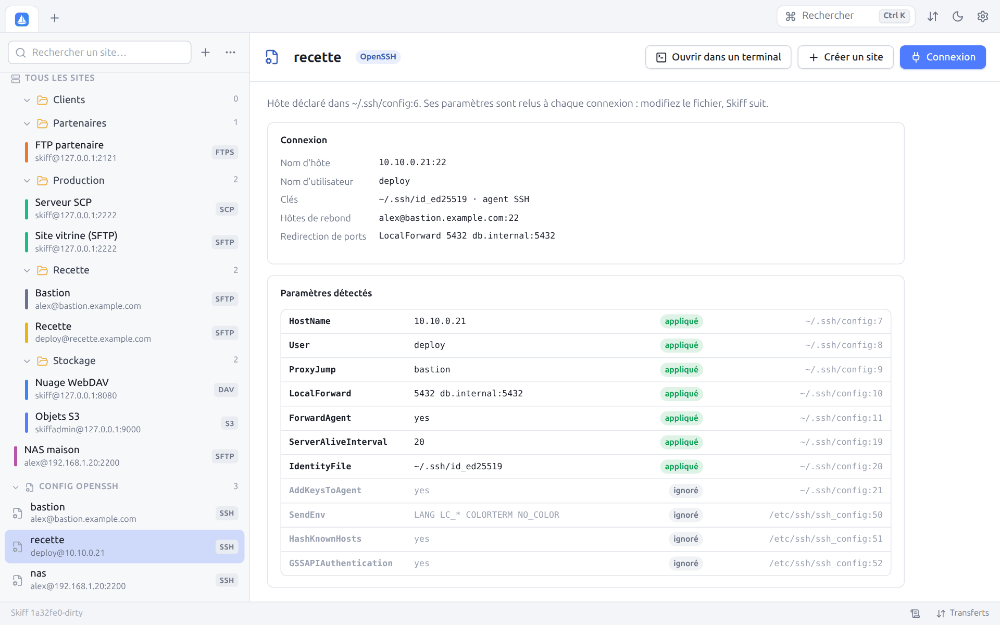

| Zone | Contenu |
|---|---|
| **Connexion** | Hôte et port réels, utilisateur, clés essayées (et l'agent SSH), hôtes de rebond, commande proxy, tunnels ouverts à la connexion |
| Avertissements | Par exemple un `IdentityFile` qui n'existe pas |
| **Paramètres détectés** | Chaque valeur obtenue, avec le fichier et la ligne d'où elle vient, et son statut : **appliqué**, **site** (remplacé par le réglage du site, valeur barrée) ou **ignoré** (fonction que Skiff n'a pas, par exemple `ControlMaster` ou `Compression`) |

Un double-clic, `Entrée` ou **Connexion** ouvre la session ; **Ouvrir dans un terminal** ouvre aussi un terminal SSH. **Créer un site** prépare un site dont l'hôte est l'alias : la configuration continue de s'appliquer et vous n'ajoutez que ce qui est propre à Skiff (couleur, dossiers d'ouverture, mot de passe enregistré…). Le clic droit propose les mêmes actions et **Copier le nom** :

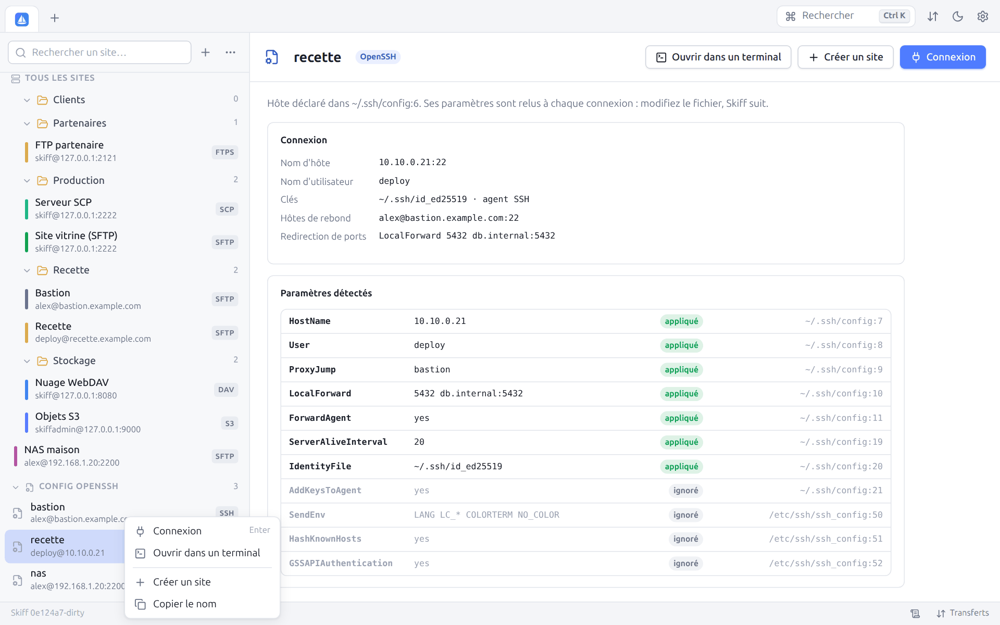

L'alias fonctionne partout où un nom d'hôte est accepté : la connexion rapide (qui propose les alias pendant la saisie), le champ **Nom d'hôte** d'un site, un hôte de rebond, et la ligne de commande (`skiff sftp://recette`, `open recette` dans un script, voir [Scripts](13-scripts-cli.md#sessions)).

### Le site passe en premier

Comme les options de la ligne de commande de `ssh`, **un réglage fait dans Skiff l'emporte toujours** : la configuration OpenSSH ne remplit que ce que le site laisse vide. Pour les réglages qui ont une valeur par défaut dans Skiff (délai de connexion, keepalive), la configuration s'applique tant que le site garde cette valeur par défaut.

| Paramètre `ssh_config` | Effet dans Skiff | Le site l'emporte quand… |
|---|---|---|
| `HostName` | Adresse réelle du serveur | — |
| `Port` | Port | le champ **Port** est rempli |
| `User` | Nom d'utilisateur (à défaut de tout, le nom de l'utilisateur local, comme `ssh`) | le champ **Nom d'utilisateur** est rempli |
| `IdentityFile` | Clés essayées, à la place des clés par défaut de `~/.ssh` ; comme avec `ssh`, le fichier peut être la clé publique (ou une clé privée absente dont le `.pub` existe) quand la clé privée n'est que dans l'agent (clé matérielle, gestionnaire de mots de passe) | le champ **Fichier de clé privée** est rempli |
| `IdentitiesOnly` | N'offre que les clés de l'agent qui correspondent à ces fichiers | — |
| `CertificateFile` | Certificats OpenSSH associés aux clés | — |
| `ForwardAgent` | Transfert d'agent vers les terminaux SSH ([§ 11.7](11-securite.md#117-trousseau-skiff-et-transfert-dagent)) | **Transférer l'agent au serveur** est coché |
| `IdentityAgent` | Socket de l'agent (ou tube nommé sous Windows, par exemple `\\.\pipe\openssh-ssh-agent`) ; `none` désactive l'agent | **Utiliser l'agent SSH** est décoché |
| `PubkeyAuthentication`, `PasswordAuthentication`, `KbdInteractiveAuthentication`, `PreferredAuthentications` | Méthodes d'authentification autorisées et leur ordre | une clé est donnée dans le site / **clavier-interactif** est décoché |
| `ProxyJump` | Chaîne de rebonds ; chaque rebond est lui-même résolu par la configuration (le premier peut avoir son propre `ProxyJump` ou `ProxyCommand`) | le site a des **Hôtes de rebond** ou un **Proxy** |
| `ProxyCommand` | Commande proxy locale (`nc`, `ssh -W`, `cloudflared`…) | idem |
| `HostKeyAlias`, `StrictHostKeyChecking`, `UserKnownHostsFile`, `GlobalKnownHostsFile` | Vérification de la clé du serveur ([§ 11.1](11-securite.md#111-clés-dhôte-ssh)) | une empreinte est épinglée dans le site |
| `ConnectTimeout` | Délai de connexion | le délai n'est plus de 15 s |
| `ServerAliveInterval`, `ServerAliveCountMax` | Keepalive et nombre de réponses manquées avant la coupure | le keepalive n'est plus de 30 s |
| `AddressFamily` | IPv4 (`inet`) ou IPv6 (`inet6`) | **Version IP** n'est pas sur Auto |
| `Ciphers`, `KexAlgorithms`, `MACs`, `HostKeyAlgorithms` | Algorithmes (listes avec `+`, `-` et `^` acceptées ; ceux que Skiff ne connaît pas sont écartés) | **Autoriser les anciens algorithmes** est coché |
| `LocalForward`, `RemoteForward`, `DynamicForward` | Tunnels ouverts à la connexion, visibles dans le panneau **Tunnels** | le site a ses propres **Redirections de ports** |
| `Tag` | Utilisé par `Match tagged` | — |

Les autres mots-clés sont affichés **ignoré**. `ProxyUseFdpass` n'est pas pris en charge : un hôte qui en a besoin (comme ceux de `systemd-ssh-proxy`) renvoie une erreur claire.

### Dans l'éditeur de site

Pour un site SFTP ou SCP, Skiff cherche la configuration de l'hôte pendant la saisie. Les champs vides montrent en grisé la valeur qui sera utilisée (utilisateur, port, clé) et un encadré résume ce qui s'applique :

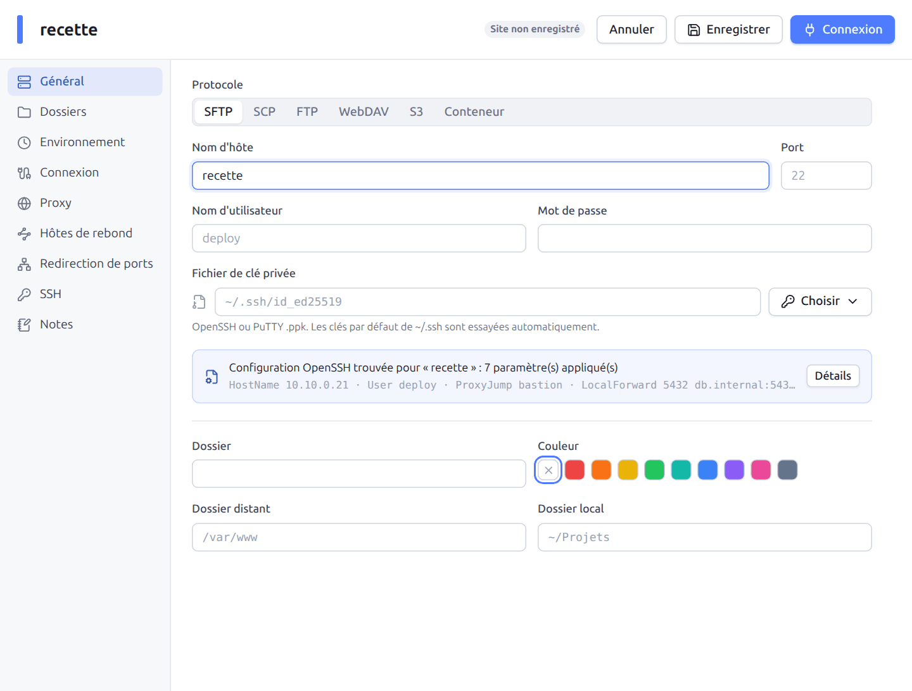

**Détails** ouvre la section **SSH**, où l'interrupteur **Appliquer la configuration OpenSSH à ce site** et la liste complète des paramètres se trouvent. Ici, le nom d'utilisateur saisi dans le site remplace celui du fichier (statut **site**) :

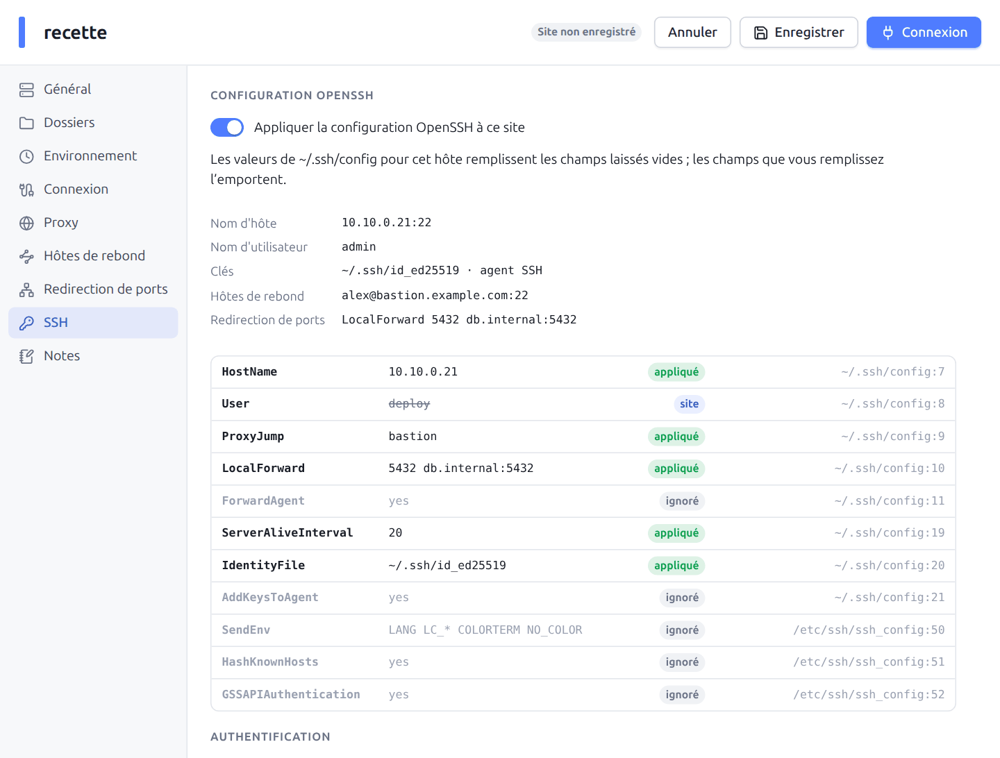

### Désactiver la lecture

- pour un site : décochez **Appliquer la configuration OpenSSH à ce site** (section **SSH**) ;
- pour tout Skiff : décochez **Lire la configuration OpenSSH** dans **Préférences → SSH** ([§ 12.7](12-preferences.md#127-ssh)) ; la section **Config OpenSSH** disparaît alors de la liste des sites.

## 3.5 Importer des sites

**⋯ → Importer…** (ou **Importer…** sur l'écran d'accueil) ouvre l'assistant d'import. Skiff détecte les sources présentes sur l'ordinateur :

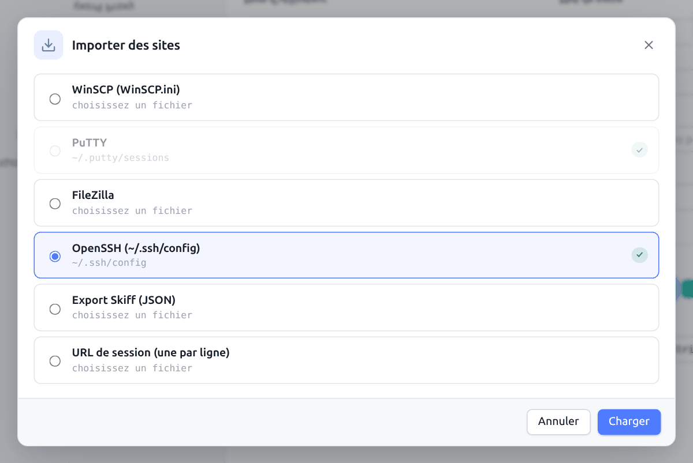

| Source | Ce qui est importé |
|---|---|
| **WinSCP (WinSCP.ini)** | Sessions, dossiers, mots de passe (déchiffrés), proxys, tunnels, clés, options. Fichier détecté automatiquement ou à choisir. |
| **WinSCP (registre)** | Les mêmes informations, lues dans le registre de Windows |
| **PuTTY** | Sessions SSH (registre sous Windows, `~/.putty/sessions` ailleurs) |
| **FileZilla** | `sitemanager.xml`, mots de passe compris |
| **OpenSSH (~/.ssh/config)** | Un site par bloc `Host`, avec les valeurs que `ssh` utiliserait (`Host *`, `Match` et `Include` compris) : `HostName`, `User`, `Port`, `IdentityFile`, `ProxyJump` (devient une chaîne de rebonds), `ProxyCommand`, `ConnectTimeout`, `ServerAliveInterval`, `AddressFamily` et `LocalForward`/`RemoteForward`/`DynamicForward` (deviennent des tunnels). Inutile pour se connecter : Skiff lit déjà ce fichier ([§ 3.4](#34-configuration-openssh-ssh_config)) ; l'import en fait des copies indépendantes du fichier. |
| **Export Skiff (JSON)** | Un fichier exporté par Skiff |
| **URL de session (une par ligne)** | Une liste d'URL `sftp://…`, `ftps://…` |

Pour les sources qui demandent un fichier, glissez-le dans la zone prévue, cliquez pour le choisir, ou collez son contenu. **Charger** affiche l'aperçu :

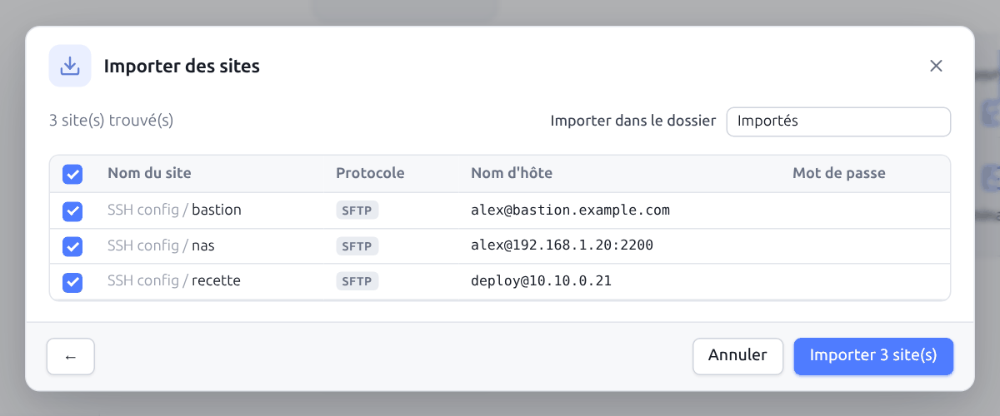

Cochez les sites à importer, choisissez le dossier de destination (**Importer dans le dossier**, « Importés » par défaut) puis **Importer N site(s)**. Un triangle orange signale un site dont le mot de passe n'a pas pu être récupéré. La même opération existe en ligne de commande : `skiff import` (voir [Scripts](13-scripts-cli.md#136-skiff-import)).

## 3.6 Exporter des sites

**⋯ → Exporter…** produit la liste des sites dans quatre formats : **Skiff JSON**, **WinSCP.ini**, **OpenSSH config** et **URLs**.

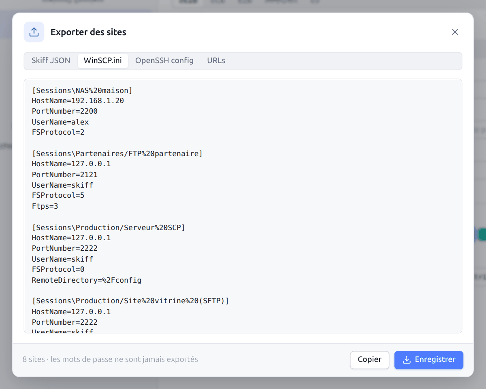

**Copier** place le texte dans le presse-papiers, **Enregistrer** le télécharge (`skiff-sites.json`, `.ini`, `.config` ou `.txt`). Les mots de passe ne sont **jamais** exportés.

## 3.7 URL et code de session

**Générer URL / code…** (menu contextuel d'un site) produit, prêts à copier :

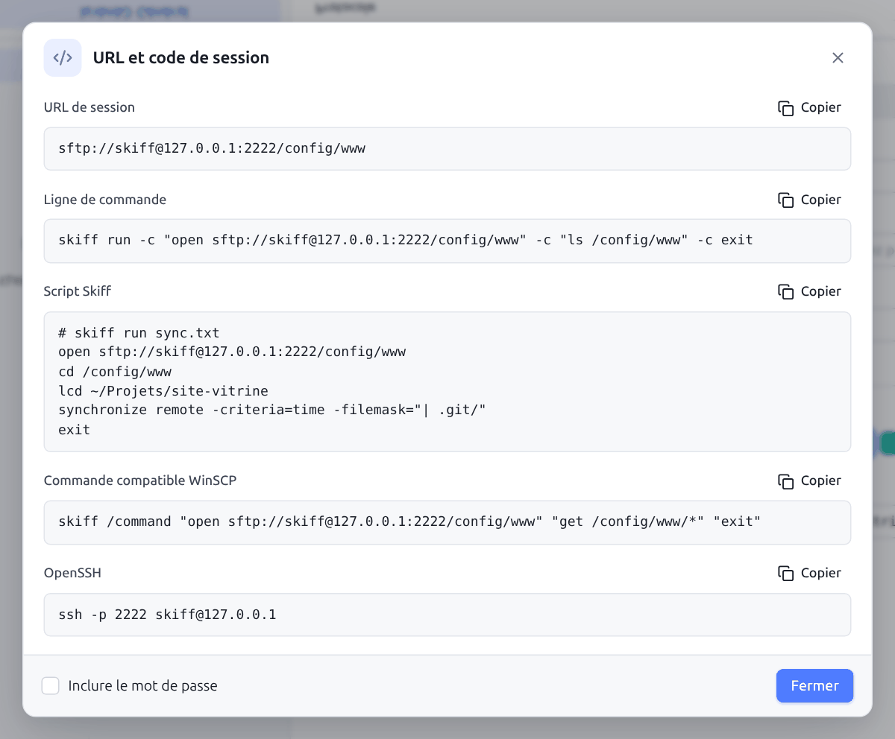

| Bloc | Exemple |
|---|---|
| **URL de session** | `sftp://skiff@127.0.0.1:2222/config/www` |
| **Ligne de commande** | `skiff run -c "open …" -c "ls …" -c exit` |
| **Script Skiff** | Script complet : ouverture, `cd`, `lcd`, `synchronize remote`, `exit` |
| **Commande compatible WinSCP** | `skiff /command "open …" "get …" "exit"` |
| **OpenSSH** | `ssh -p 2222 skiff@127.0.0.1` (sites SSH) |

**Inclure le mot de passe** ajoute le mot de passe enregistré dans l'URL et les commandes. À utiliser avec prudence.

---

[← Premiers pas](02-premiers-pas.md) · [Sommaire](README.md) · [Interface et navigation →](04-interface.md)
