# 4. Interface et navigation

[← Gestionnaire de sites](03-sites.md) · [Sommaire](README.md) · [Opérations sur les fichiers →](05-fichiers.md)

## 4.1 Les onglets

Chaque session, éditeur, comparaison et terminal s'ouvre dans un onglet. Le logo Skiff, à gauche, ramène à l'onglet **Sites**.

| Action | Effet |
|---|---|
| Clic | Active l'onglet |
| Clic du milieu | Ferme l'onglet |
| Glisser-déposer | Réordonne les onglets |
| Double-clic sur la zone vide | Ouvre l'onglet **Sites** |
| `Ctrl+Tab` / `Ctrl+Maj+Tab`, `Ctrl+PgSuiv` / `Ctrl+PgPréc` | Onglet suivant / précédent |
| `Alt+1` … `Alt+9` | Va à l'onglet n |
| `Ctrl+W`, `F10` | Ferme l'onglet actif |
| `Ctrl+N`, `+` | Nouvelle session (onglet **Sites**) |

Le clic droit sur un onglet de session propose **Reconnecter**, **Dupliquer la session** (ouvre une deuxième session sur le même site, dans les mêmes dossiers), **Fermer l'onglet** et **Fermer les autres onglets**. Fermer un onglet qui a des transferts en cours demande confirmation (désactivable dans les préférences).

## 4.2 Barre d'outils de la session

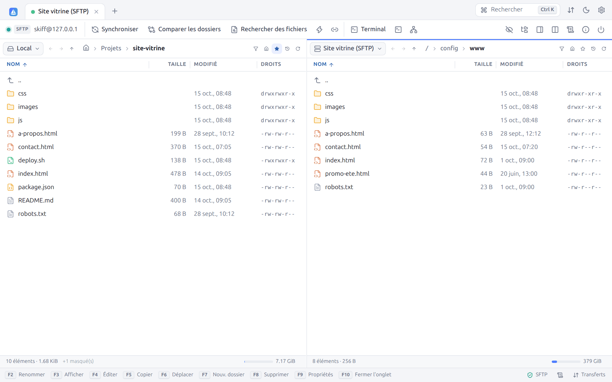

| Bouton | Raccourci | Rôle |
|---|---|---|
| Pastille, `SFTP`, `utilisateur@hôte` | | État, protocole et identité de la connexion |
| **Synchroniser** | `Ctrl+S` | [Synchronisation](07-synchronisation.md) des dossiers des deux panneaux |
| **Comparer les dossiers** | `Ctrl+=` | Compare les deux panneaux ([§ 4.10](#410-comparer-les-dossiers)) |
| **Rechercher des fichiers** | `Ctrl+Maj+F` | [Recherche](10-recherche-journal.md#101-rechercher-des-fichiers) récursive |
| Éclair : **Garder le dossier distant à jour** | `Ctrl+U` | [Surveillance](07-synchronisation.md#73-garder-le-dossier-distant-à-jour) du dossier local |
| Maillons : **Navigation synchronisée** | `Ctrl+B` | [§ 4.11](#411-navigation-synchronisée) |
| **Terminal** : **Ouvrir un terminal** | `Ctrl+T` | [Terminal SSH](09-terminal-tunnels.md#91-terminal-ssh) dans le dossier courant |
| **Exécuter une commande** | `Ctrl+Maj+X` | [Commande ponctuelle](05-fichiers.md#511-exécuter-une-commande) sur le serveur |
| **Tunnels** | | [Redirection de ports](09-terminal-tunnels.md#93-tunnels-redirections-de-ports) |
| Œil barré : **Afficher les fichiers cachés** | `Ctrl+Alt+H` | Affiche ou masque les fichiers commençant par un point |
| **Arborescence des dossiers** | | [§ 4.7](#47-arborescence-des-dossiers) |
| **Panneau d'aperçu** | `Ctrl+Maj+P` | [§ 4.9](#49-panneau-daperçu) |
| **Disposition** | | Bascule entre Commander et Explorateur ([§ 4.3](#43-commander-ou-explorateur)) |
| **Journal de session** | | [Journal](10-recherche-journal.md#102-journal-de-session) de la connexion |
| **Informations serveur/protocole** | | [Informations](10-recherche-journal.md#103-informations-serveur-et-protocole) sur le serveur |
| **Déconnexion** | | Ferme la connexion et l'onglet |

Les boutons sans objet pour le protocole sont grisés : par exemple **Terminal** pour FTP, WebDAV et S3, qui n'ont pas de shell.

## 4.3 Commander ou Explorateur

**Commander** (par défaut) affiche deux panneaux côte à côte, comme Norton Commander et WinSCP. **Explorateur** n'affiche que le serveur, avec la colonne **Propriétaire** en plus :

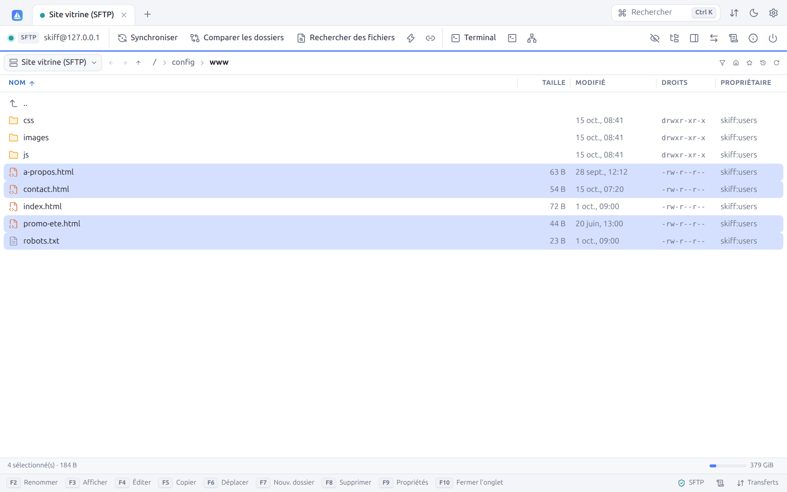

En Explorateur, les téléchargements (`F5`) vont dans le dossier du panneau local masqué. Le bouton **Disposition** bascule la session courante. La disposition par défaut des nouvelles sessions se règle dans **Préférences → Apparence → Interface**.

## 4.4 Les panneaux de fichiers

Chaque panneau peut afficher **n'importe quelle connexion** : le disque local ou l'une des sessions ouvertes. Cliquez sur le sélecteur à gauche du panneau (**Local**, **Site vitrine (SFTP)**…) :

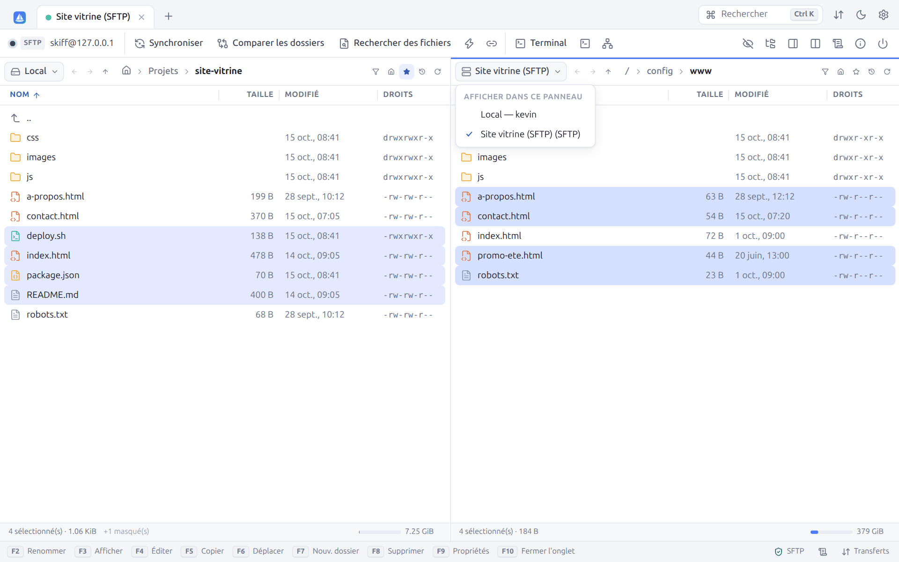

Afficher deux serveurs face à face permet les **transferts directs de serveur à serveur** (voir [Transferts](06-transferts.md#68-de-serveur-à-serveur)).

La barre de navigation du panneau contient, de gauche à droite :

| Élément | Rôle |
|---|---|
| ← → | **Précédent** / **Suivant** dans l'historique du panneau (`Alt+←` / `Alt+→`) |
| ↑ | **Dossier parent** (`Retour arrière`, `Alt+↑`) |
| Fil d'Ariane | Chaque élément est cliquable. En local, l'icône maison remplace votre dossier personnel (`~`). Cliquez dans la zone vide (ou `Ctrl+L`) pour **saisir un chemin**. |
| Entonnoir | **Filtrer** (`Ctrl+F`, [§ 4.8](#48-filtre)) |
| Maison | **Dossier personnel** |
| Étoile | **Favoris** ([§ 4.5](#45-favoris)) |
| Horloge | **Dossiers récents** ([§ 4.6](#46-dossiers-récents)) |
| Flèche circulaire | **Actualiser** (`Ctrl+R`, `Ctrl+F5`) |

La séparation entre les deux panneaux se déplace à la souris. `Ctrl+O` ouvre la boîte **Ouvrir un dossier**. Dans la saisie d'un chemin, `~` désigne votre dossier personnel et les chemins relatifs partent du dossier courant.

### La liste des fichiers

- **Colonnes** : Nom, Taille, Modifié, Droits, Propriétaire (selon le protocole) et Type (masquée par défaut). Cliquez sur un en-tête pour trier, cliquez à nouveau pour inverser. Faites glisser le bord d'un en-tête pour le redimensionner. Le clic droit sur les en-têtes affiche ou masque les colonnes. Dans un panneau étroit, les colonnes secondaires se masquent d'elles-mêmes.
- **Tri** : dossiers d'abord et tri naturel (`fichier2` avant `fichier10`), réglables dans les préférences.
- **Icônes** : chaque type de fichier a son icône et sa couleur (code, web, image, archive, script…). Les liens symboliques sont signalés.
- La ligne `..` remonte au dossier parent.
- **Recherche par saisie** : tapez le début d'un nom pour y aller directement.
- La liste est virtualisée : un dossier de 100 000 fichiers reste fluide.

### Clavier et souris

| Action | Effet |
|---|---|
| `↑` `↓` `PgPréc` `PgSuiv` `Début` `Fin` | Déplace le curseur |
| `Entrée`, double-clic | Ouvre le dossier, ou ouvre le fichier selon le réglage **Double-clic sur un fichier** |
| `Retour arrière` | Dossier parent |
| `Tab` | Passe à l'autre panneau |
| `Échap` | Désélectionne tout, puis efface le filtre |
| `Maj+F10`, touche Menu, clic droit | Menu contextuel |

### Sélection

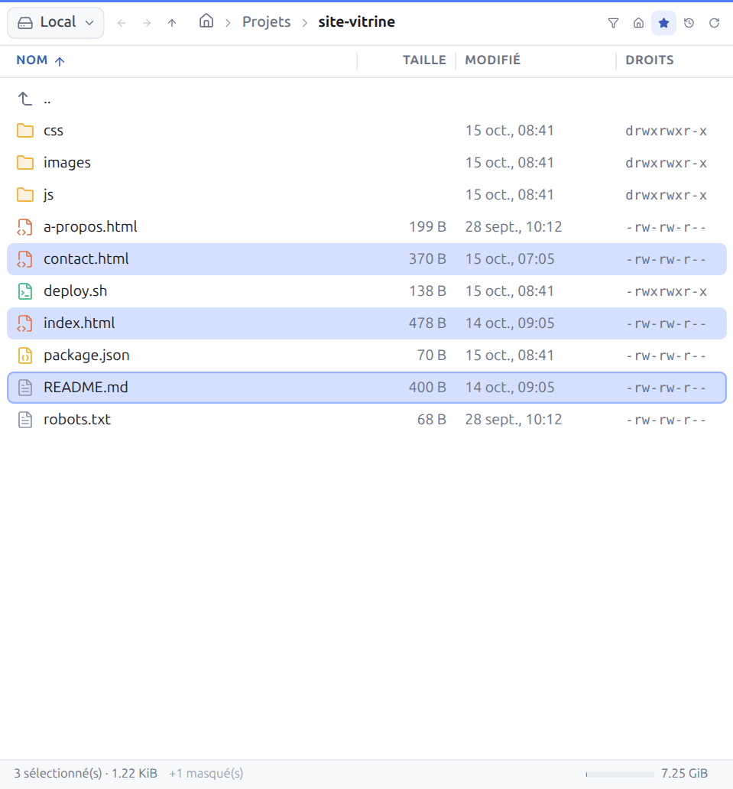

| Action | Effet |
|---|---|
| Clic | Sélectionne un élément |
| `Ctrl+clic` | Ajoute ou retire un élément |
| `Maj+clic`, `Maj+↑/↓` | Sélectionne une plage |
| `Espace`, `Inser` | Sélectionne ou désélectionne l'élément courant (`Inser` passe au suivant) |
| `Ctrl+A` / `Ctrl+Maj+A` | Tout sélectionner / tout désélectionner |
| `Num +` | **Sélectionner des fichiers** par masque (`*.html`, `*.jpg; *.png`, `rapport-202?.*`, `*>1M`) |
| `Num −` | **Désélectionner des fichiers** par masque |
| `Num *` | **Inverser la sélection** |

Le menu contextuel de la zone vide propose aussi **Sélectionner les fichiers de même extension**.

La barre de statut du panneau indique le nombre d'éléments et leur taille, ou le nombre et la taille de la sélection, le nombre d'éléments **masqués** (fichiers cachés) et **filtrés**, puis l'espace libre du disque ou du serveur (quand le protocole le permet), avec une jauge.

## 4.5 Favoris

L'étoile de la barre de navigation ajoute le dossier courant aux favoris (`Ctrl+D`) ou ouvre la liste des favoris :

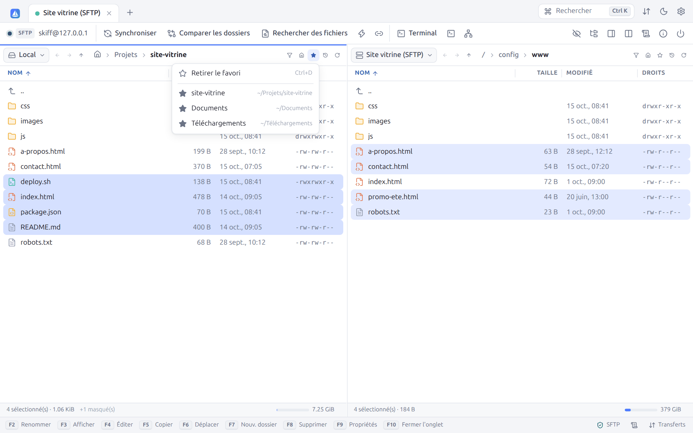

L'étoile pleine indique que le dossier courant est déjà un favori : **Retirer le favori** l'enlève. Les favoris locaux sont communs à toutes les sessions. Les favoris distants sont propres à chaque site (ou, pour une connexion rapide, à chaque couple utilisateur, hôte et port).

## 4.6 Dossiers récents

L'horloge affiche les **Dossiers récents** visités dans le panneau, le dossier courant étant coché :

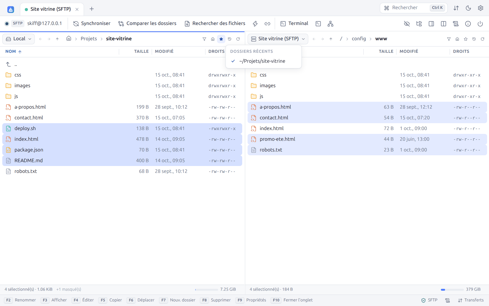

## 4.7 Arborescence des dossiers

Le bouton **Arborescence des dossiers** affiche l'arbre des dossiers à gauche de chaque panneau, comme dans l'Explorateur Windows :

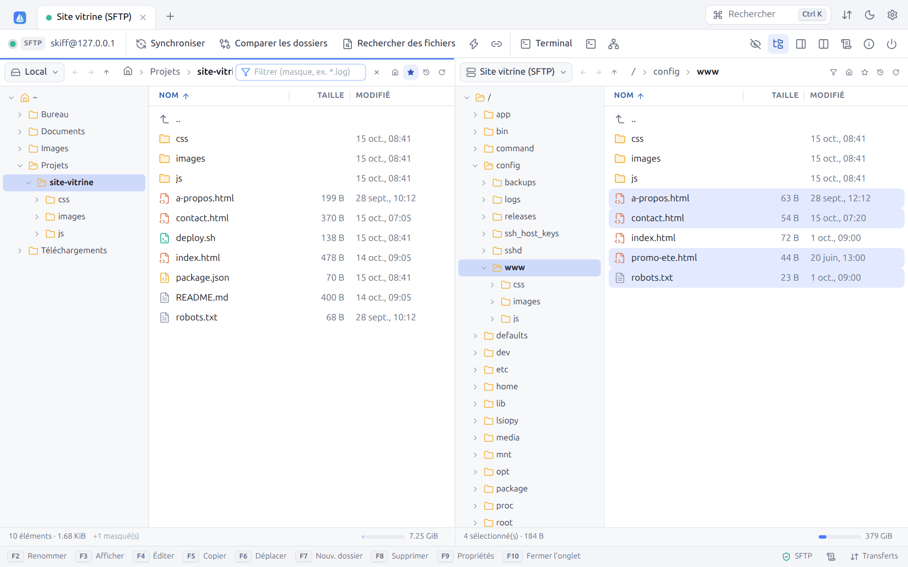

L'arbre se déplie jusqu'au dossier courant. Un clic ouvre un dossier, la flèche le déplie sans l'ouvrir. En local, quand vous êtes dans votre dossier personnel, l'arbre part de `~` ; ailleurs, il part de la racine (`/`, ou **Ce PC** sous Windows).

## 4.8 Filtre

`Ctrl+F` (ou l'entonnoir) affiche un champ de filtre dans le fil d'Ariane. Seuls les fichiers qui correspondent restent visibles. Les dossiers restent toujours affichés pour naviguer.

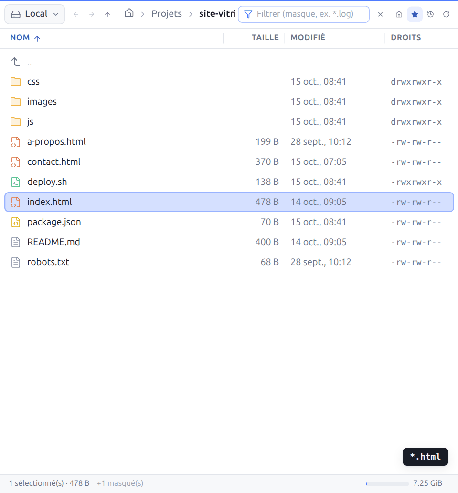

Le texte saisi sans caractère spécial filtre sur une partie du nom (`index` garde `index.html`). Avec des jokers ou des conditions, le filtre suit la syntaxe des masques de WinSCP :

| Exemple | Fichiers affichés |
|---|---|
| `*.html` | Les fichiers HTML |
| `*.html; *.css` | Les fichiers HTML et CSS (`;` ou `,` séparent les masques) |
| `* \| *.bak; *.tmp` | Tout sauf les `.bak` et `.tmp` (à droite de `\|` : les exclusions) |
| `*.jpg>100K` | Les JPEG de plus de 100 Kio (unités `K`, `M`, `G`, `T`) |
| `*>1D` | Les fichiers modifiés depuis moins d'un jour (unités `Y`, `D`, `H`, `N` pour les minutes, `S`) |
| `*<2026-01-01` | Les fichiers modifiés avant le 1er janvier 2026 |
| `*>=today`, `*>=yesterday` | Modifiés aujourd'hui, depuis hier |

La barre de statut indique combien d'éléments sont filtrés. `Échap` ou la croix efface le filtre. La syntaxe complète des masques est au chapitre [Transferts](06-transferts.md#63-masques-de-fichiers).

## 4.9 Panneau d'aperçu

`Ctrl+Maj+P` (ou **Panneau d'aperçu**) ouvre à droite un aperçu du fichier sélectionné, local ou distant :

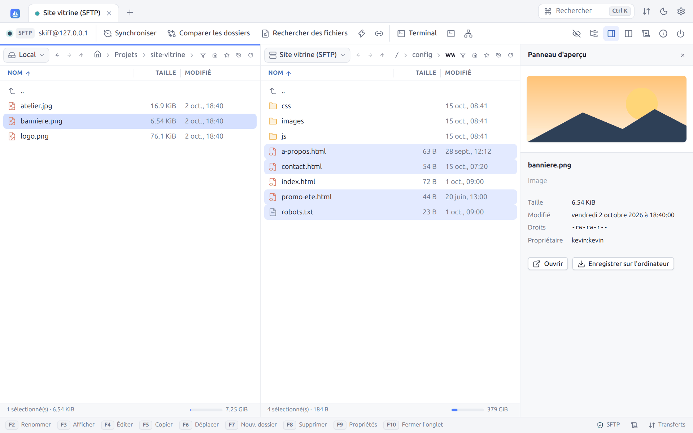

| Type | Aperçu |
|---|---|
| Images (PNG, JPEG, GIF, WebP, SVG, AVIF…) | Image |
| Vidéo, audio | Lecteur intégré |
| PDF | Visionneuse |
| Markdown | Rendu mis en forme |
| Texte et code | Les 20 000 premiers caractères |

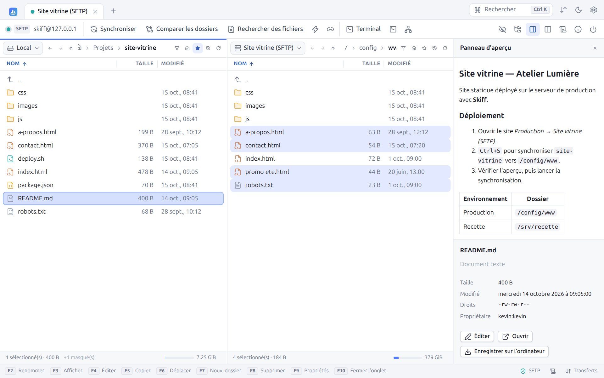

Sous l'aperçu figurent le nom, le type, la taille, la date de modification, les droits et le propriétaire, puis les boutons **Éditer** (texte), **Ouvrir** (application par défaut) et **Enregistrer sur l'ordinateur**. Les fichiers trop volumineux ne sont pas prévisualisés.

## 4.10 Comparer les dossiers

**Comparer les dossiers** (`Ctrl+=`) compare les deux panneaux, nom par nom, et sélectionne les fichiers qui diffèrent :

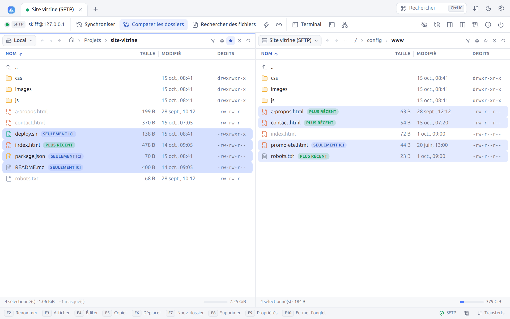

| Badge | Signification |
|---|---|
| **SEULEMENT ICI** | Le fichier n'existe pas dans l'autre panneau |
| **PLUS RÉCENT** | Le fichier est plus récent que celui de l'autre panneau (l'autre apparaît estompé) |
| **DIFFÉRENT** | Même date, mais taille différente |

Les fichiers les plus récents et ceux qui n'existent que d'un côté sont sélectionnés dans chaque panneau. La comparaison tient compte de la précision des dates du protocole (la seconde, ou la minute en FTP) et des fichiers cachés seulement s'ils sont affichés. Il suffit ensuite d'appuyer sur `F5` pour copier la sélection. Un message indique le nombre de différences, ou que les dossiers sont identiques. Un nouveau clic sur **Comparer les dossiers** efface les badges. Pour une comparaison récursive avec aperçu, utilisez la [synchronisation](07-synchronisation.md).

## 4.11 Navigation synchronisée

Avec la **Navigation synchronisée** (`Ctrl+B`, maillons), entrer dans un sous-dossier ou remonter d'un niveau dans un panneau fait de même dans l'autre. C'est pratique quand les arborescences locale et distante sont identiques. Le réglage peut être activé dès la connexion dans le site (**Dossiers → Synchroniser la navigation**).

## 4.12 Panneau du bas

Le panneau du bas regroupe six onglets :

| Onglet | Contenu |
|---|---|
| **Transferts** | La [file de transferts](06-transferts.md#64-la-file-de-transferts) (`F12`) |
| **Journal** | Le [journal de session](10-recherche-journal.md#102-journal-de-session) |
| **Recherche** | Les [résultats de recherche](10-recherche-journal.md#101-rechercher-des-fichiers) |
| **Surveillances** | Les dossiers [gardés à jour](07-synchronisation.md#73-garder-le-dossier-distant-à-jour) |
| **Tunnels** | Les [tunnels](09-terminal-tunnels.md#93-tunnels-redirections-de-ports) actifs |
| **Fichiers édités** | Les fichiers ouverts dans un [éditeur externe](08-edition.md#84-éditeur-externe) |

`Ctrl+Maj+Q` l'ouvre ou le ferme, la flèche à droite le replie, et sa hauteur se règle en faisant glisser son bord supérieur. Un badge indique le nombre d'éléments actifs de chaque onglet.

## 4.13 Barre d'état

En bas de la fenêtre :

- à gauche, la **barre des touches de fonction** (`F2` à `F10`), cliquable, masquable dans les préférences ; sur l'onglet Sites, la version de Skiff ;
- à droite, le protocole et l'état de sécurité de la connexion (bouclier vert : chiffrée), le nombre de surveillances et de tunnels actifs, le **Journal** et **Transferts** avec la vitesse et le temps restant des transferts en cours.

---

[← Gestionnaire de sites](03-sites.md) · [Sommaire](README.md) · [Opérations sur les fichiers →](05-fichiers.md)
