# 5. Opérations sur les fichiers

[← Interface et navigation](04-interface.md) · [Sommaire](README.md) · [Transferts →](06-transferts.md) · 🇬🇧 [English](en/05-files.md)

Toutes les opérations s'appliquent à la sélection du panneau actif, ou à l'élément sous le curseur s'il n'y a pas de sélection. Elles fonctionnent de la même façon en local et sur tous les protocoles, dans la limite de ce que chaque protocole permet (voir [Protocoles](15-protocoles.md)). Les commandes impossibles sont masquées.

## 5.1 Menu contextuel d'un fichier

Clic droit sur un fichier ou un dossier (ou `Maj+F10`, touche Menu) :

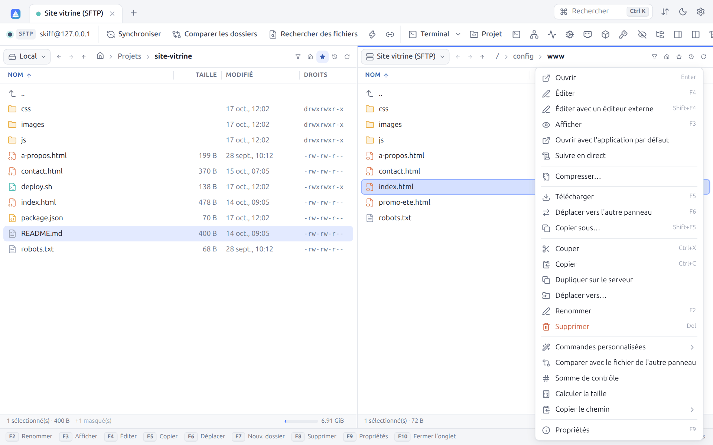

| Commande | Raccourci | Effet |
|---|---|---|
| **Ouvrir** | `Entrée` | Ouvre le dossier, ou le fichier selon le réglage du double-clic |
| **Éditer** | `F4` | Ouvre le fichier dans l'[éditeur intégré](08-edition.md) |
| **Éditer avec un éditeur externe** | `Maj+F4` | Ouvre le fichier dans votre éditeur, avec renvoi automatique ([§ 8.4](08-edition.md#84-éditeur-externe)) |
| **Afficher** | `F3` | Ouvre un fichier texte dans l'éditeur en lecture seule ; pour une image, une vidéo, un son ou un PDF, ouvre le [panneau d'aperçu](04-interface.md#49-panneau-daperçu) |
| **Ouvrir avec l'application par défaut** | | Télécharge si besoin et ouvre avec l'application associée du système |
| **Ouvrir comme projet** | | Un dossier : le [projet](08-edition.md#87-projets--modifier-un-dossier-sans-rien-installer-sur-le-serveur) |
| **Qu'est-ce qui prend de la place ?** | | Un dossier : ses éléments par taille ([§ 5.13](#513-quest-ce-qui-prend-de-la-place-)) |
| **Suivre en direct** | | Ouvre la fin du fichier et chaque ligne ajoutée ([§ 9.8](09-terminal-tunnels.md#98-suivre-un-journal-en-direct)) |
| **Extraire…** | | Archive zip, tar, tar.gz, tar.bz2 ou tar.xz : l'ouvre sur place ([§ 5.12](#512-compresser-et-extraire)) |
| **Compresser…** | | Met la sélection dans une archive zip, tar.gz ou tar ([§ 5.12](#512-compresser-et-extraire)) |
| **Télécharger** / **Envoyer** / **Copier vers l'autre panneau** | `F5` | Copie vers le dossier de l'autre panneau ([Transferts](06-transferts.md)) |
| **Déplacer vers l'autre panneau** | `F6` | Déplace vers le dossier de l'autre panneau |
| **Copier sous…** | `Maj+F5` | Copie avec la boîte des options de transfert |
| **Enregistrer sur l'ordinateur** | | En [mode web](14-mode-web.md) : télécharge le fichier dans le navigateur |
| **Couper**, **Copier**, **Coller** | `Ctrl+X`, `Ctrl+C`, `Ctrl+V` | [Presse-papiers de fichiers](#58-presse-papiers-de-fichiers) |
| **Dupliquer sur le serveur** | | Copie côté serveur, sans transiter par l'ordinateur : `cp` en SFTP et SCP, `COPY` en WebDAV, copie d'objet en S3 |
| **Déplacer vers…** | | Déplace dans un autre dossier du même serveur (boîte **Déplacer vers le dossier**) |
| **Renommer** | `F2`, `Maj+F6` | [§ 5.3](#53-renommer) |
| **Supprimer** | `Suppr`, `F8` | [§ 5.4](#54-supprimer) |
| **Commandes personnalisées** | | [§ 5.10](#510-commandes-personnalisées) |
| **Comparer avec le fichier de l'autre panneau** | | Ouvre le [diff visuel](08-edition.md#85-diff-visuel) |
| **Somme de contrôle** | | [§ 5.7](#57-sommes-de-contrôle) |
| **Calculer la taille** | | Taille totale des dossiers sélectionnés, en octets, fichiers et dossiers |
| **Copier le chemin** | `Ctrl+Maj+C` | Sous-menu : **Copier le chemin**, **Copier le nom**, **Copier l'URL** (`sftp://utilisateur@hôte/chemin`) |
| **Afficher dans le gestionnaire de fichiers** | | Fichier local : l'ouvre dans l'Explorateur, le Finder ou Fichiers |
| **Propriétés** | `F9` | [§ 5.6](#56-propriétés-et-droits) |

## 5.2 Menu contextuel de la zone vide

Clic droit dans la zone vide d'un panneau :

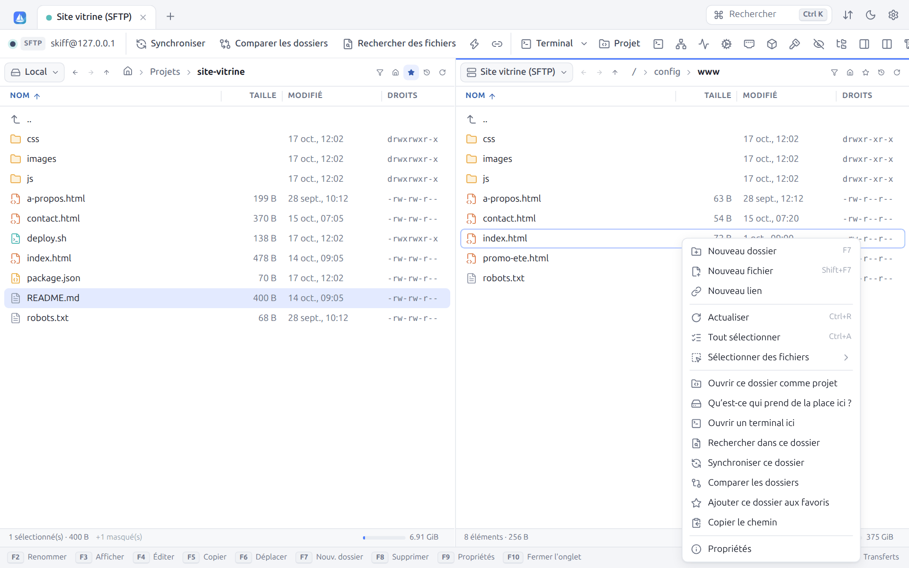

| Commande | Raccourci | Effet |
|---|---|---|
| **Nouveau dossier** | `F7` | [§ 5.5](#55-créer-des-dossiers-des-fichiers-et-des-liens) |
| **Nouveau fichier** | `Maj+F7` | Crée un fichier vide et l'ouvre dans l'éditeur |
| **Nouveau lien** | | Crée un lien symbolique ou physique |
| **Coller** | `Ctrl+V` | Colle les fichiers copiés ou coupés |
| **Actualiser** | `Ctrl+R` | Relit le dossier |
| **Tout sélectionner** | `Ctrl+A` | |
| **Sélectionner des fichiers** | | Sous-menu : sélectionner / désélectionner par masque (`Num +` / `Num −`), inverser (`Num *`), même extension |
| **Ouvrir ce dossier comme projet** | `Ctrl+Maj+E` | [Projet](08-edition.md#87-projets--modifier-un-dossier-sans-rien-installer-sur-le-serveur) |
| **Qu'est-ce qui prend de la place ici ?** | | [§ 5.13](#513-quest-ce-qui-prend-de-la-place-) |
| **Ouvrir un terminal ici** | | [Terminal](09-terminal-tunnels.md) dans ce dossier |
| **Rechercher dans ce dossier** | | [Recherche de fichiers](10-recherche-journal.md#101-rechercher-des-fichiers) |
| **Synchroniser ce dossier** | | [Synchronisation](07-synchronisation.md) |
| **Comparer les dossiers** | | [Comparaison](04-interface.md#410-comparer-les-dossiers) |
| **Ajouter ce dossier aux favoris** | | [Favoris](04-interface.md#45-favoris) |
| **Copier le chemin** | | Copie le chemin du dossier courant |
| **Propriétés** | | Propriétés du dossier courant |

## 5.3 Renommer

`F2` passe le nom en édition directement dans la liste. Le nom est présélectionné sans l'extension :

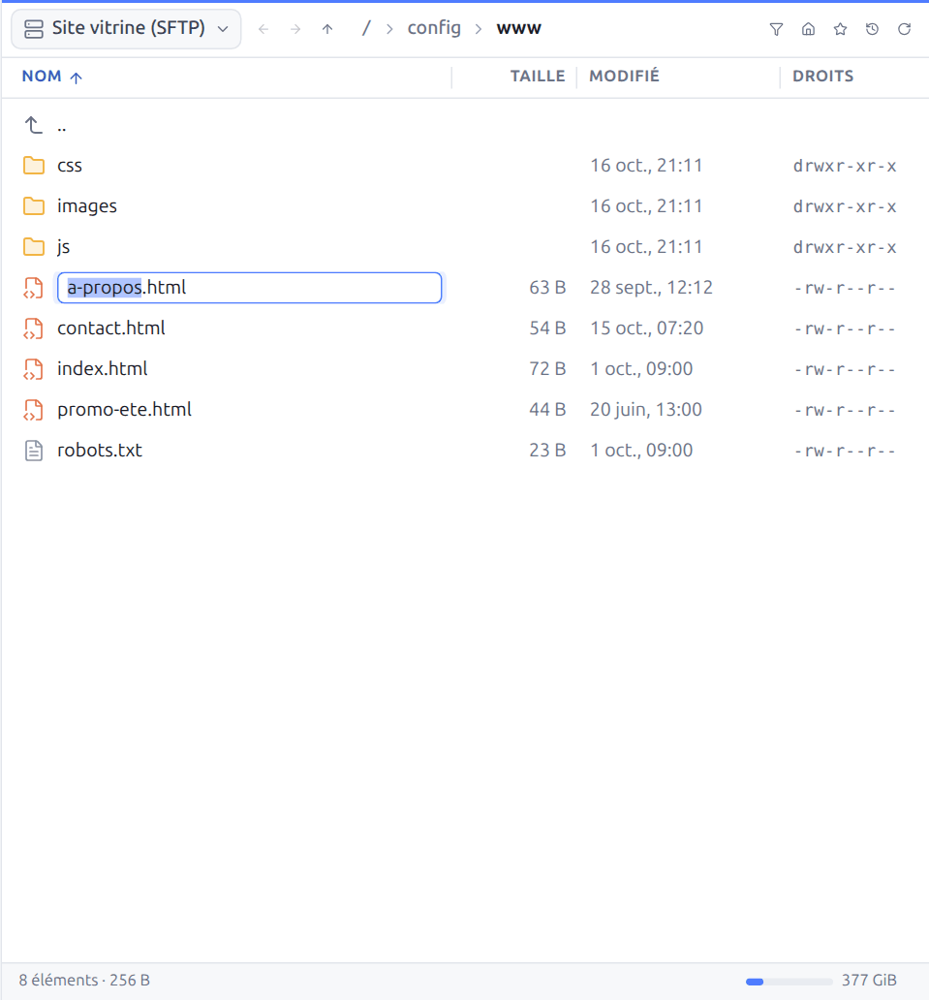

`Entrée` valide, `Échap` annule. Sur un serveur SFTP récent, Skiff utilise `posix-rename` pour remplacer un fichier existant de façon atomique.

## 5.4 Supprimer

`Suppr` ou `F8` supprime la sélection après confirmation :

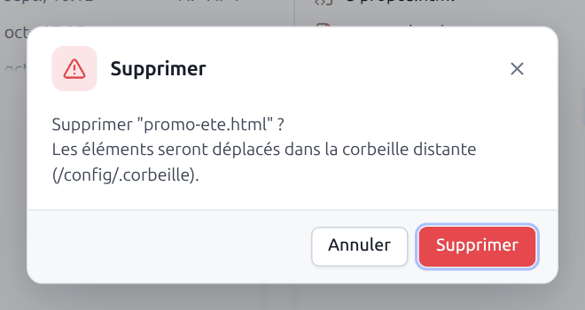

| Où | Ce qui se passe |
|---|---|
| Local, fenêtre de bureau | Les éléments vont dans la **corbeille du système** (Corbeille de Windows, Corbeille de macOS, `~/.local/share/Trash` sous Linux) |
| Serveur avec **corbeille distante** configurée ([site → Dossiers](03-sites.md#dossiers)) | Les éléments sont déplacés dans ce dossier du serveur, comme le montre la capture |
| Serveur sans corbeille, mode web | Suppression définitive. La boîte précise « Cette action est irréversible. » |

`Maj+Suppr` supprime **définitivement**, sans passer par une corbeille, et demande toujours confirmation. La confirmation des suppressions ordinaires peut être désactivée (**Préférences → Confirmations**). Les dossiers sont supprimés récursivement.

## 5.5 Créer des dossiers, des fichiers et des liens

`F7` crée un dossier :

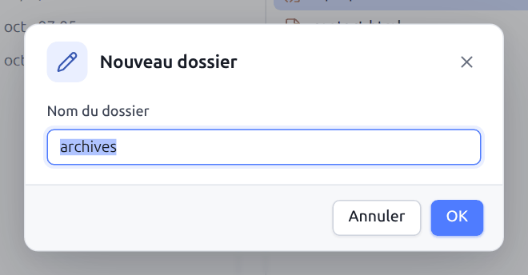

`Maj+F7` crée un fichier vide (nom proposé : `untitled.txt`) et l'ouvre dans l'éditeur.

**Nouveau lien** crée un lien vers l'élément sélectionné :

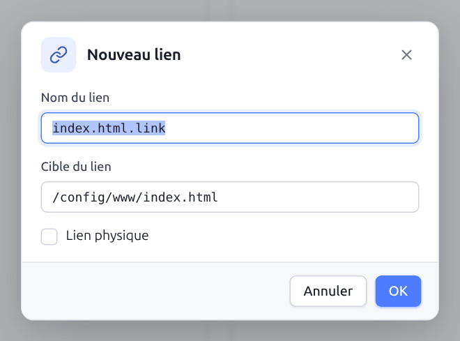

| Champ | Description |
|---|---|
| **Nom du lien** | Nom du lien à créer dans le dossier courant |
| **Cible du lien** | Chemin pointé par le lien (absolu ou relatif) |
| **Lien physique** | Crée un lien physique (*hard link*) au lieu d'un lien symbolique. En SFTP, nécessite l'extension `hardlink@openssh.com`. |

Les liens sont disponibles en local, en SFTP et en SCP.

## 5.6 Propriétés et droits

`F9` ouvre les propriétés de la sélection :

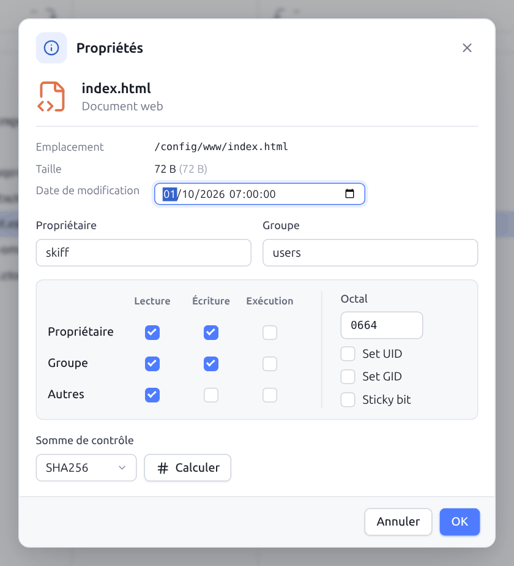

| Zone | Description |
|---|---|
| En-tête | Icône, nom et type de fichier (« Document web »), ou nombre d'éléments pour une sélection multiple |
| **Emplacement** | Dossier contenant l'élément. Pour un lien : **Cible du lien**. |
| **Taille** | Taille en unités lisibles et en octets |
| **Date de modification** | Modifiable directement quand le protocole le permet (SFTP, SCP, FTP avec MFMT, local) |
| **Propriétaire**, **Groupe** | Modifiables en SFTP, SCP et local (Unix). Skiff propose les utilisateurs et groupes connus du serveur. |
| Grille des droits | **Lecture**, **Écriture**, **Exécution** pour le **Propriétaire**, le **Groupe** et les **Autres** |
| **Octal** | Les mêmes droits en octal (`0644`), modifiables directement |
| **Set UID**, **Set GID**, **Sticky bit** | Droits spéciaux |
| **Somme de contrôle** | Algorithme (MD5, SHA-1, SHA-256, SHA-512) et bouton **Calculer** |

Pour un dossier, la taille se calcule avec **Calculer** (taille totale, nombre de fichiers et de dossiers), et deux options apparaissent :

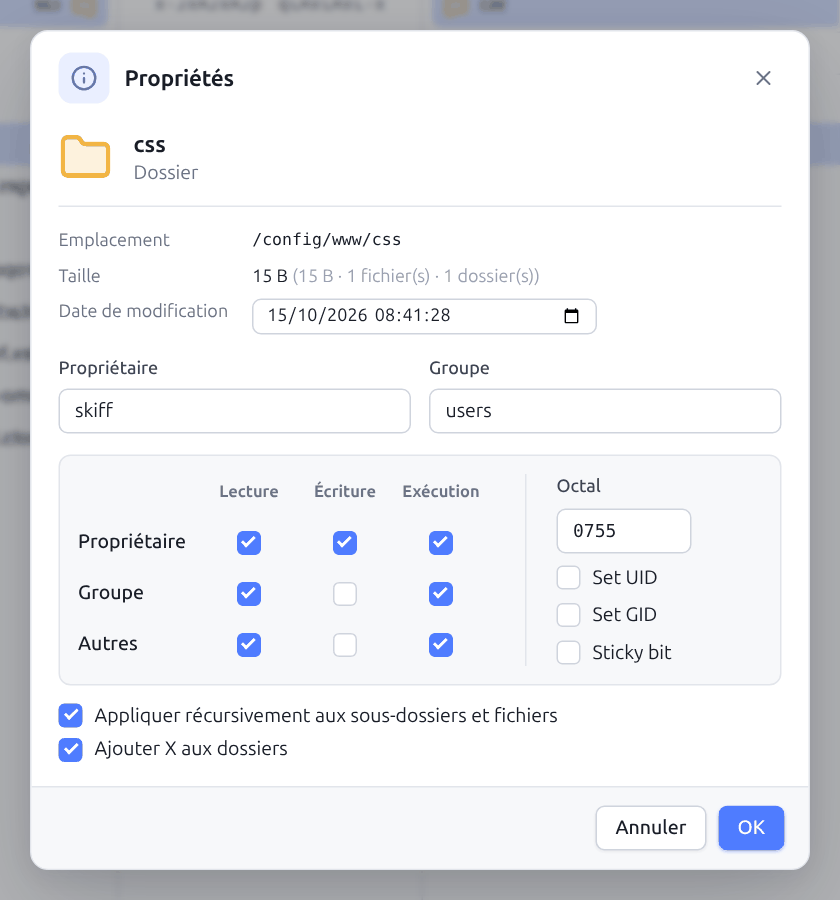

- **Appliquer récursivement aux sous-dossiers et fichiers** : applique droits, propriétaire et groupe à tout le contenu ;
- **Ajouter X aux dossiers** : lors d'une application récursive, ajoute le droit d'exécution aux dossiers partout où le droit de lecture est donné (pour que `0644` donne `0755` sur les dossiers).

Le calcul de la somme de contrôle se fait sur le serveur, sans télécharger le fichier : commandes `md5sum`, `sha1sum`, `sha256sum`, `sha512sum` (ou `shasum` sur BSD et macOS) en SFTP et SCP, commandes `HASH`, `XSHA256`, `XSHA1`, `XMD5` en FTP quand le serveur les connaît, ETag (MD5) en S3 :

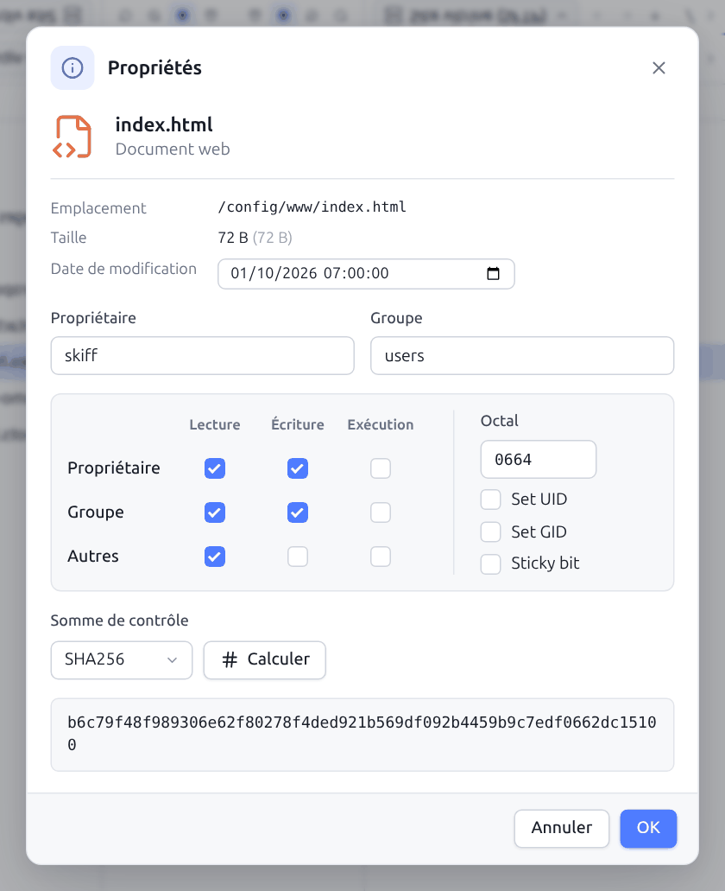

## 5.7 Sommes de contrôle

**Somme de contrôle** (menu contextuel) ouvre une boîte dédiée :

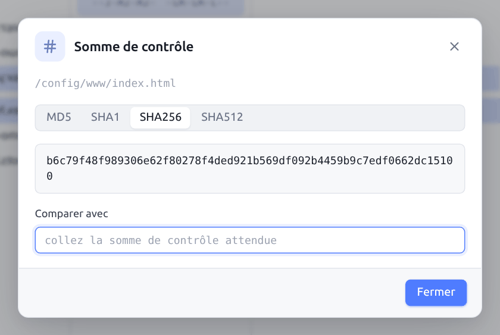

Choisissez l'algorithme (**MD5**, **SHA1**, **SHA256**, **SHA512** ; MD5 seulement en S3). Un clic sur la somme la copie. Collez une somme attendue dans **Comparer avec** : le champ devient vert avec « ✓ identique » ou rouge avec « ✗ différente ».

## 5.8 Presse-papiers de fichiers

`Ctrl+C` (ou `Ctrl+X`) puis `Ctrl+V` copie (ou déplace) des fichiers d'un panneau à l'autre, d'un dossier à l'autre ou d'une session à l'autre, comme dans un gestionnaire de fichiers. Coller dans une autre connexion lance un transfert. Couper puis coller sur le même serveur est un simple déplacement.

## 5.9 Glisser-déposer

| Geste | Effet |
|---|---|
| Glisser d'un panneau à l'autre | Copie (déplacement si les deux panneaux sont sur la même connexion) |
| Glisser sur un dossier de la liste | Copie ou déplace **dans** ce dossier |
| Glisser sur `..` | Copie ou déplace dans le dossier parent |
| `Ctrl` (ou `Alt`) pendant le dépôt | Force la copie |
| `Maj` pendant le dépôt | Force le déplacement |
| Glisser des fichiers ou dossiers depuis l'Explorateur, le Finder ou le bureau | Les envoie dans le dossier visé (dossiers compris) |
| Glisser des fichiers **locaux** vers le bureau ou un autre programme | Les y dépose comme des fichiers (copie par le gestionnaire de fichiers, pièce jointe d'un mail…), sur tous les systèmes |
| Glisser un fichier **distant** vers le bureau | Le télécharge avec les moteurs Chromium (fenêtre Windows, Chrome et Edge en mode web). Sous Linux et macOS, la fenêtre ne peut pas déposer un fichier distant dans un autre programme : un message l'explique la première fois ; faites-le glisser sur le panneau local, ou copiez-le (`F5`) vers un dossier de l'ordinateur, puis glissez-le depuis celui-ci |

Pendant le survol, un bandeau indique l'action (« Déposer pour envoyer vers… », « Déposer pour copier ici », « Déposer pour déplacer ici »). L'option **Confirmer les transferts par glisser-déposer** (Préférences → Confirmations) affiche la boîte des options avant chaque dépôt.

## 5.10 Commandes personnalisées

Les commandes personnalisées s'exécutent sur la sélection, sur le serveur (SFTP, SCP) ou en local. Elles se trouvent dans le sous-menu **Commandes personnalisées** du menu contextuel :

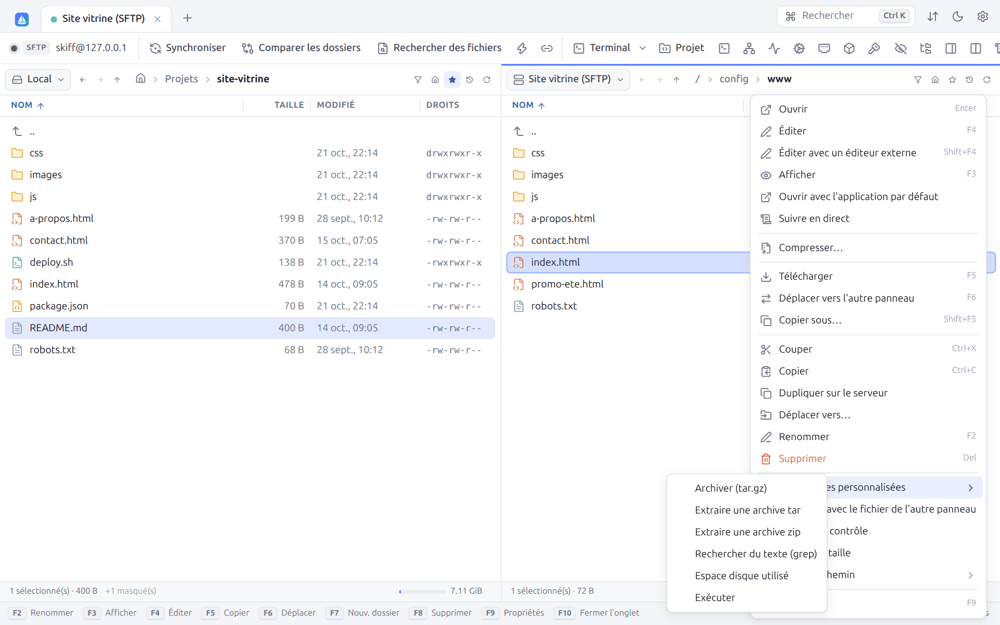

Skiff en fournit six, modifiables : **Archiver (tar.gz)**, **Extraire une archive tar**, **Extraire une archive zip**, **Rechercher du texte (grep)**, **Espace disque utilisé** et **Exécuter**. Elles se gèrent dans **Préférences → Commandes personnalisées** ([§ 12.11](12-preferences.md#1211-commandes-personnalisées)).

Les motifs de WinSCP sont remplacés avant l'exécution :

| Motif | Remplacé par |
|---|---|
| `!` | Nom du fichier courant |
| `!&` | Noms de tous les fichiers sélectionnés, entre guillemets si besoin |
| `!/` | Chemin du dossier courant |
| `!@` | Nom d'hôte du serveur |
| `!U` | Nom d'utilisateur |
| `!?Question?défaut!` | Valeur demandée à l'utilisateur au lancement (par exemple `!?Nom de l'archive :?archive.tar.gz!`) |

Options de chaque commande : **Une fois par fichier** (sinon une seule fois pour toute la sélection), **Dossiers** (utilisable sur des dossiers), **Commande locale** (exécutée sur l'ordinateur) et **Afficher la sortie**. La sortie s'affiche aussi automatiquement si la commande échoue.

## 5.11 Exécuter une commande

`Ctrl+Maj+X` (ou **Exécuter une commande** dans la barre d'outils) lance une commande ponctuelle dans le dossier courant du serveur (ou en local) :

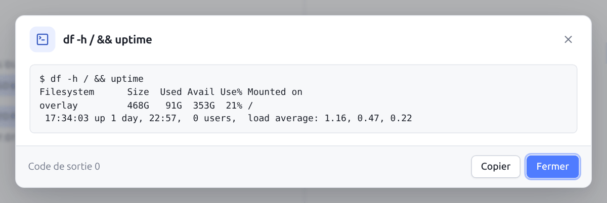

La boîte affiche la sortie standard et la sortie d'erreur, puis le **Code de sortie**. En FTP, la commande est envoyée telle quelle au serveur (par exemple `SITE CHMOD 640 fichier.txt`) et la boîte affiche sa réponse. **Copier** copie la sortie. Le panneau est actualisé après la commande. Pour une session interactive, utilisez le [terminal](09-terminal-tunnels.md).

## 5.12 Compresser et extraire

Les archives se font et s'ouvrent **là où sont les fichiers**, sans rien télécharger : sur un serveur SFTP ou SCP avec un shell (et dans un conteneur), par ses propres commandes `tar`, `zip` et `unzip` ; sur cet ordinateur, par Skiff. Pratique pour sauvegarder un site avant une mise à jour, ou déployer une archive envoyée d'un coup.

**Compresser…** (clic droit sur un ou plusieurs fichiers et dossiers) met la sélection dans une archive, dans le même dossier :

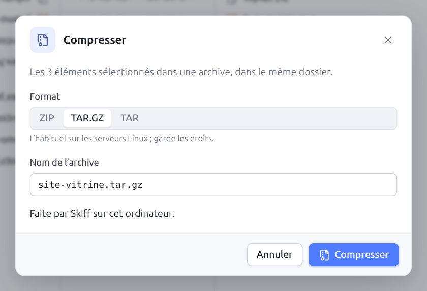

| Format | Pour |
|---|---|
| **ZIP** | S'ouvre partout, Windows compris. Sur un serveur sans `zip`, Skiff utilise Python 3 ; sans l'un ni l'autre, il propose TAR.GZ. |
| **TAR.GZ** | L'habituel sur les serveurs Linux ; garde les droits des fichiers |
| **TAR** | Sans compression : rapide, garde les droits |

Le nom proposé est celui de l'élément (ou du dossier, pour plusieurs éléments) ; changer de format change son extension. Une archive existante n'est jamais remplacée.

**Extraire…** (clic droit sur une archive `.zip`, `.tar`, `.tar.gz`, `.tgz`, `.tar.bz2` ou `.tar.xz`) l'ouvre :

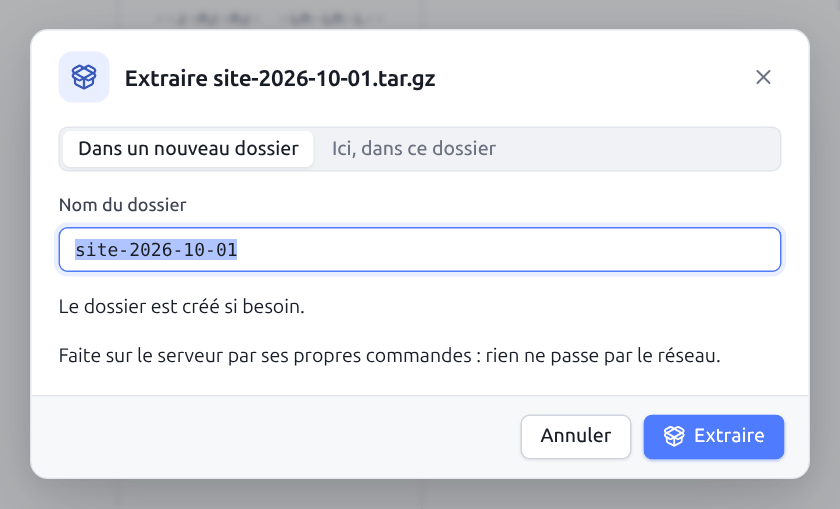

- **Dans un nouveau dossier** (par défaut), du nom de l'archive : rien n'est mélangé aux fichiers déjà là ;
- **Ici, dans ce dossier** : les fichiers de même nom sont remplacés.

Rien n'est écrit hors du dossier de destination : une archive dont un chemin en sortirait (`../`, chemin absolu) est refusée, ou ce chemin est ramené dans le dossier par le `tar` du serveur. Sans shell (compte SFTP seul, FTP, WebDAV, S3), les commandes **Compresser…** et **Extraire…** n'apparaissent pas.

## 5.13 Qu'est-ce qui prend de la place ?

Quand le disque d'un serveur se remplit, **Qu'est-ce qui prend de la place ici ?** (clic droit dans la zone vide, sur un dossier, ou la palette ; l'icône de loupe d'un disque du [moniteur](09-terminal-tunnels.md#96-moniteur-du-serveur)) ouvre un onglet qui classe les éléments du dossier par taille :

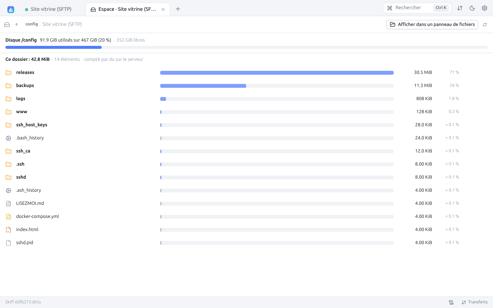

- En haut, le **disque** du dossier : place utilisée, taille, place libre, et la jauge (orange au-delà de 75 %, rouge au-delà de 90 %).
- Puis la taille du dossier et, pour chaque élément, sa taille, sa part du dossier et une barre à l'échelle du plus gros. Les fichiers cachés comptent aussi (un `.cache` peut être énorme).
- Un clic sur un dossier l'ouvre ; le chemin en haut et la flèche **Dossier parent** remontent. Les dossiers déjà vus ne sont pas recomptés ; **Recompter** le fait.
- Au survol d'une ligne : **Copier le chemin** et **Supprimer** (après confirmation, avec la place libérée). **Afficher dans un panneau de fichiers** ouvre le dossier dans une session.

Sur une connexion SFTP ou SCP avec un shell, `du` compte la place sur le serveur, en une commande, sans sortir du système de fichiers (`du -x`) : rapide même pour des milliers de fichiers. Sinon (FTP, WebDAV, S3, compte SFTP seul, ou cet ordinateur), Skiff additionne la taille des fichiers en les parcourant ; au-delà de 300 000 éléments ou de 2 minutes, le calcul s'arrête et l'onglet le signale. Les dossiers que le compte ne peut pas lire sont comptés à part (« dossiers illisibles ») : connectez-vous en root pour tout mesurer.

---

[← Interface et navigation](04-interface.md) · [Sommaire](README.md) · [Transferts →](06-transferts.md) · 🇬🇧 [English](en/05-files.md)
