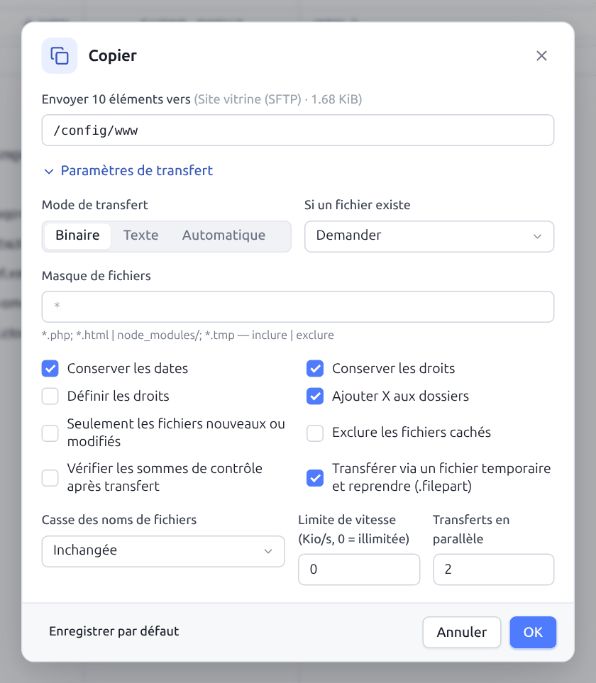
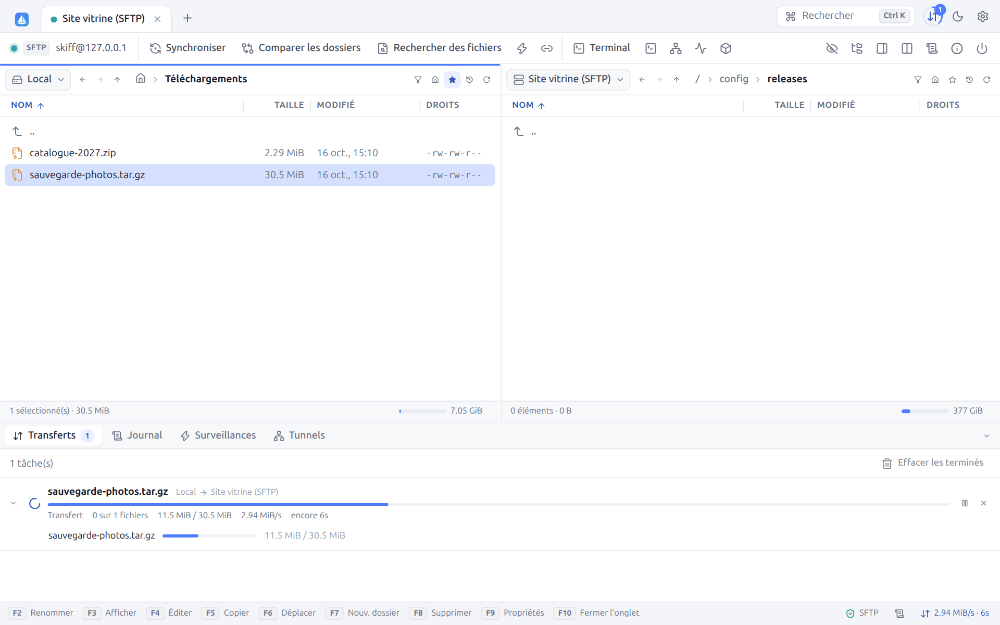
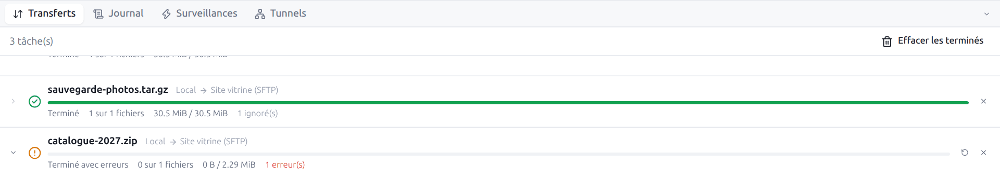
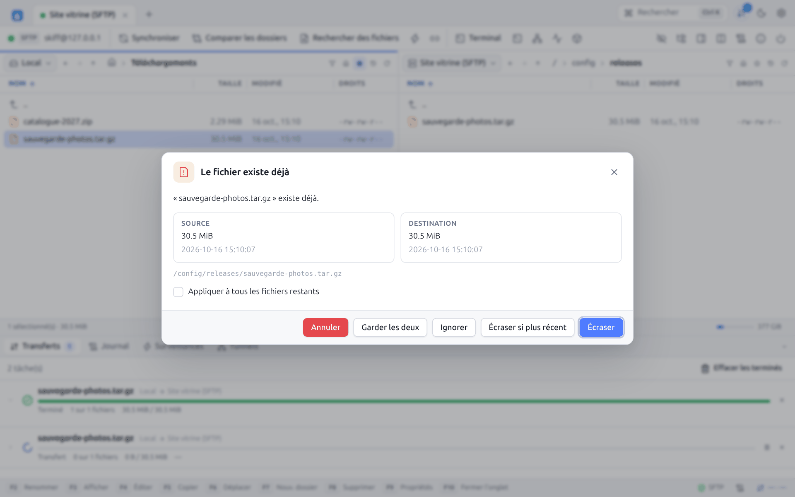
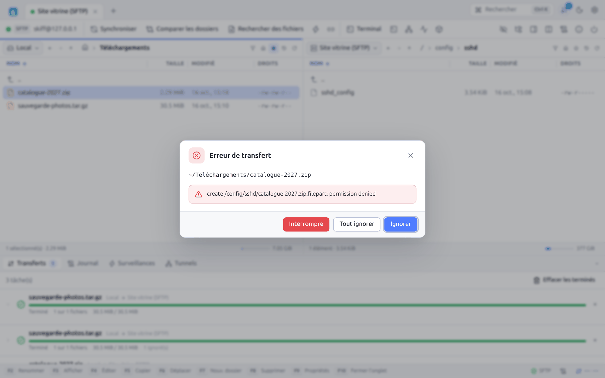
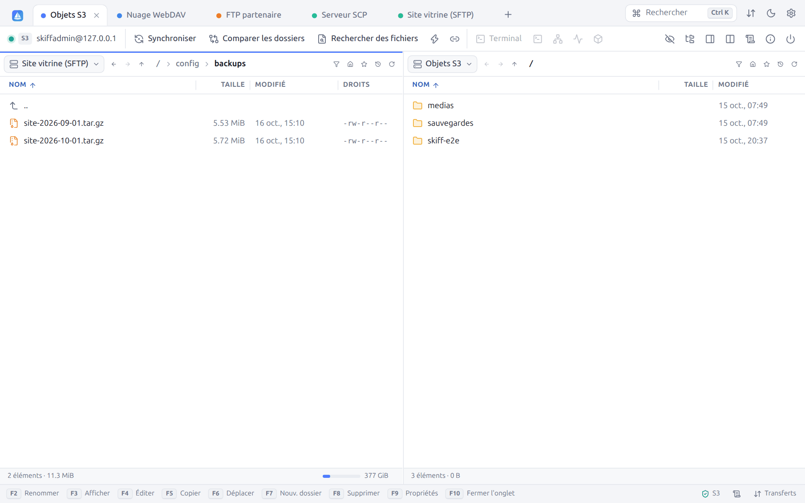

# 6. Transferts

[← Opérations sur les fichiers](05-fichiers.md) · [Sommaire](README.md) · [Synchronisation →](07-synchronisation.md)

## 6.1 Copier et déplacer

| Méthode | Effet |
|---|---|
| `F5` | Copie la sélection vers le dossier de l'autre panneau |
| `F6` | Déplace la sélection (copie puis supprime la source) |
| `Maj+F5` | **Copier sous…** : copie avec la boîte d'options |
| Glisser-déposer | Voir [Glisser-déposer](05-fichiers.md#59-glisser-déposer) |
| `Ctrl+C` / `Ctrl+X` puis `Ctrl+V` | Voir [Presse-papiers](05-fichiers.md#58-presse-papiers-de-fichiers) |
| Menu contextuel | **Télécharger**, **Envoyer**, **Copier vers l'autre panneau**, **Déplacer vers l'autre panneau** |

Selon l'option **Afficher les options avant de copier** (Préférences → Confirmations), `F5` lance tout de suite le transfert ou affiche d'abord la boîte de transfert. `Maj+F5` l'affiche toujours.

Entre deux panneaux affichant la même connexion, `F6` est un simple renommage côté serveur, instantané, et `F5` une copie côté serveur (**Dupliquer sur le serveur**), sans transit par l'ordinateur.

En disposition **Explorateur**, il n'y a qu'un panneau visible : `F5` télécharge alors dans le dossier du panneau local masqué, celui de la session (le dossier local du site par défaut).

## 6.2 La boîte de transfert

En haut : l'action (« Envoyer 10 éléments vers », « Télécharger "rapport.pdf" vers »…), la destination et la taille totale, puis le **dossier de destination**, modifiable. Pour un seul élément, un champ **Nom** permet de le renommer à l'arrivée. **Paramètres de transfert** déplie les options :

| Option | Description |
|---|---|
| **Mode de transfert** | **Binaire** (octet pour octet), **Texte** (convertit les fins de ligne entre LF et CRLF selon le système de destination et le réglage du site), **Automatique** (texte pour les fichiers du **Masque des fichiers texte**, binaire pour les autres) |
| **Masque des fichiers texte** | En mode automatique. Par défaut : `*.*html; *.htm; *.txt; *.php; *.js; *.css; *.sh; *.xml; *.md; *.json; *.yml; *.csv; *.sql; *.py; *.conf`… |
| **Si un fichier existe** | **Demander**, **Écraser**, **Écraser si plus récent**, **Écraser si la taille diffère**, **Reprendre / compléter**, **Ignorer**, **Garder les deux** |
| **Masque de fichiers** | Fichiers et dossiers à inclure ou exclure ([§ 6.3](#63-masques-de-fichiers)) |
| **Conserver les dates** | Donne à la copie la date de modification de l'original |
| **Conserver les droits** | Donne à la copie les droits de l'original |
| **Définir les droits** | Impose des droits (en octal, `644` par défaut) au lieu de les conserver |
| **Ajouter X aux dossiers** | Avec des droits imposés, ajoute l'exécution aux dossiers |
| **Seulement les fichiers nouveaux ou modifiés** | Ignore les fichiers déjà présents et à jour à destination |
| **Exclure les fichiers cachés** | Ignore les fichiers et dossiers commençant par un point |
| **Vérifier les sommes de contrôle après transfert** | Recalcule la somme de contrôle de part et d'autre et signale toute différence |
| **Transférer via un fichier temporaire et reprendre (.filepart)** | Écrit d'abord `nom.filepart`, puis le renomme. Un transfert interrompu reprend là où il s'était arrêté. Appliqué aux fichiers de plus de 100 Kio. |
| **Casse des noms de fichiers** | **Inchangée**, **minuscules**, **MAJUSCULES**, **Première majuscule** |
| **Limite de vitesse (Kio/s, 0 = illimitée)** | Bride le débit de ce transfert |
| **Transferts en parallèle** | Nombre de fichiers transférés simultanément pour ce transfert (1 à 16) |

**Enregistrer par défaut** fait de ces réglages les options par défaut (elles se retrouvent dans **Préférences → Transferts**). **OK** ajoute le transfert à la file.

Quand la destination est Windows, les caractères interdits dans les noms (`\ / : * ? " < > |`) sont remplacés automatiquement.

## 6.3 Masques de fichiers

Les masques suivent la syntaxe de WinSCP. Ils servent aux transferts, à la synchronisation, à la surveillance, à la recherche, au filtre des panneaux et à la sélection par masque.

| Élément | Syntaxe | Exemple |
|---|---|---|
| Joker | `*` (n'importe quelle suite), `?` (un caractère) | `rapport-202?.pdf` |
| Liste | `;` ou `,` | `*.html; *.css; *.js` |
| Exclusion | à droite de `\|` | `* \| *.bak; *.tmp` |
| Dossier | se termine par `/` | `* \| .git/; node_modules/` |
| Chemin | contient un `/` | `src/*.go`, `/var/www/*/cache/` |
| Taille | `>`, `<`, `>=`, `<=`, `=` suivi d'une taille, unités `K`, `M`, `G`, `T` | `*.jpg>100K`, `*<1G` |
| Date absolue | opérateur suivi de `AAAA-MM-JJ` (et éventuellement `HH:MM[:SS]`) | `*>=2026-01-01` |
| Date relative | opérateur suivi d'une durée, unités `Y` (années), `D` (jours), `H` (heures), `N` (minutes), `S` (secondes) ; `>` = plus récent que | `*.log>1D` (modifiés depuis moins d'un jour), `*<1Y` (plus d'un an) |
| Arrondi | `S` final : début de l'unité | `*>1DS` (depuis hier minuit) |
| Mots-clés | `today`, `yesterday` | `*>=today` |
| Guillemets | pour les noms contenant `;` ou `\|` | `"a;b.txt"` |

La correspondance ne tient pas compte de la casse. Un masque vide sélectionne tout.

## 6.4 La file de transferts

Chaque transfert devient une tâche de la file, visible dans le panneau **Transferts** (`F12`, ou l'icône ⇅ en haut à droite). Elle s'ouvre toute seule quand un transfert démarre (réglable).

Pour chaque tâche : icône d'état, nom, sens (« Local → Site vitrine (SFTP) »), barre de progression, statut, nombre de fichiers (« 0 sur 1 fichiers »), octets transférés, vitesse, temps restant, fichiers ignorés et en erreur. La flèche à gauche déplie la liste des fichiers en cours.

| Statut | Signification |
|---|---|
| **En attente** | Attend une place libre (voir **Nombre maximal de transferts simultanés**) |
| **Analyse…** | Parcourt les dossiers à transférer |
| **Transfert** | En cours |
| **En pause** | Suspendu |
| **Terminé** | Tout s'est bien passé |
| **Terminé avec erreurs** | Certains fichiers ont échoué ou ont été ignorés |
| **Échec** / **Annulé** | Interrompu |

Boutons de chaque tâche : **Pause** / **Reprendre**, **Réessayer les fichiers en échec**, **Annuler le transfert** (tâche active) ou **Retirer** (tâche terminée). Le clic droit propose en plus **Monter** et **Descendre** pour changer l'ordre de la file. **Effacer les terminés** vide la liste des tâches terminées.

La barre d'état en bas à droite affiche la vitesse globale et le temps restant. Le badge de l'icône ⇅ compte les transferts actifs. Une notification signale la fin de tous les transferts.

Les erreurs réseau sont réessayées automatiquement (2 fois par défaut, réglable), avec reconnexion si besoin. Avec un fichier `.filepart`, la reprise repart de l'octet atteint.

## 6.5 Fichier existant

Quand la politique est **Demander** et qu'un fichier existe déjà, Skiff affiche les deux versions côte à côte, la plus récente étant signalée :

| Bouton | Effet |
|---|---|
| **Écraser** | Remplace le fichier |
| **Écraser si plus récent** | Remplace seulement si la source est plus récente |
| **Ignorer** | Garde le fichier existant |
| **Reprendre** | Complète le fichier existant (proposé s'il est plus petit que la source) |
| **Garder les deux** | Enregistre la copie sous `nom (1).ext` |
| **Annuler** | Arrête le transfert |

**Appliquer à tous les fichiers restants** applique le même choix au reste du transfert. Pour ne plus jamais être interrogé, choisissez une autre politique dans **Préférences → Transferts** ou décochez **Demander avant d'écraser des fichiers** (Préférences → Confirmations).

## 6.6 Erreurs de transfert

Quand un fichier ne peut pas être transféré (droits, disque plein, nom invalide…), Skiff affiche le fichier en cause et l'erreur :

| Bouton | Effet |
|---|---|
| **Ignorer** | Passe au fichier suivant |
| **Tout ignorer** | Ignore toutes les erreurs suivantes de ce transfert |
| **Interrompre** | Arrête le transfert |

Les fichiers ignorés en erreur restent listés dans la tâche : **Réessayer les fichiers en échec** les relance une fois le problème corrigé. Avec **Ignorer les fichiers en erreur sans demander** (Préférences → File d'attente), la question n'est jamais posée.

## 6.7 Reprise et fichiers partiels

- Avec l'option `.filepart` (par défaut pour les fichiers de plus de 100 Kio), un fichier n'apparaît sous son vrai nom qu'une fois complet. Un site web ne sert donc jamais un fichier à moitié envoyé.
- Si le transfert est interrompu (coupure, annulation, fermeture), le `.filepart` est conservé. Le relancer reprend à la fin du fichier partiel.
- La politique **Reprendre / compléter** reprend aussi les fichiers existants plus petits que la source.

## 6.8 Gros fichiers en parties parallèles (SFTP)

Un gros fichier est copié en **plusieurs parties à la fois**, chacune sur son propre canal SFTP de la même connexion (sans nouvelle authentification). Chaque canal SSH a sa propre fenêtre de contrôle de flux : vers un serveur lointain (forte latence), un seul canal plafonne le débit, quatre canaux le multiplient presque par quatre. Sur un réseau local, le gain est faible.

- Activé par défaut pour les fichiers d'au moins **100 Mio**, en **4 parties** (de 2 à 8, et au moins 1 Mio par partie) : **Préférences → File d'attente → Gros fichiers SFTP** ([§ 12.4](12-preferences.md#124-file-dattente)).
- S'applique aux téléchargements depuis un serveur SFTP, aux envois vers un serveur SFTP et aux copies entre deux serveurs SFTP. Pas en mode texte, ni quand un fichier est repris ou complété.
- Dans le détail d'une tâche de la file, un fichier copié ainsi porte le badge **4 parties**, et le [journal de session](10-recherche-journal.md#102-journal-de-session) indique `4 parts copied in parallel`.
- Les parties s'écrivent dans le `.filepart`, renommé une fois toutes terminées. Un fichier copié en parties ne se reprend jamais : en cas d'interruption, le fichier partiel est supprimé et le prochain essai repart du début.
- La limite de vitesse et la pause s'appliquent à l'ensemble des parties.

## 6.9 De serveur à serveur

Affichez deux connexions face à face ([§ 4.4](04-interface.md#44-les-panneaux-de-fichiers)) : `F5` copie directement d'un serveur à l'autre, par exemple d'un serveur SFTP vers un stockage S3.

Les données transitent par Skiff en flux continu, sans fichier temporaire sur l'ordinateur. Toutes les options de transfert s'appliquent. Entre deux dossiers d'un même serveur, **Dupliquer sur le serveur** évite même ce transit.

---

[← Opérations sur les fichiers](05-fichiers.md) · [Sommaire](README.md) · [Synchronisation →](07-synchronisation.md)
