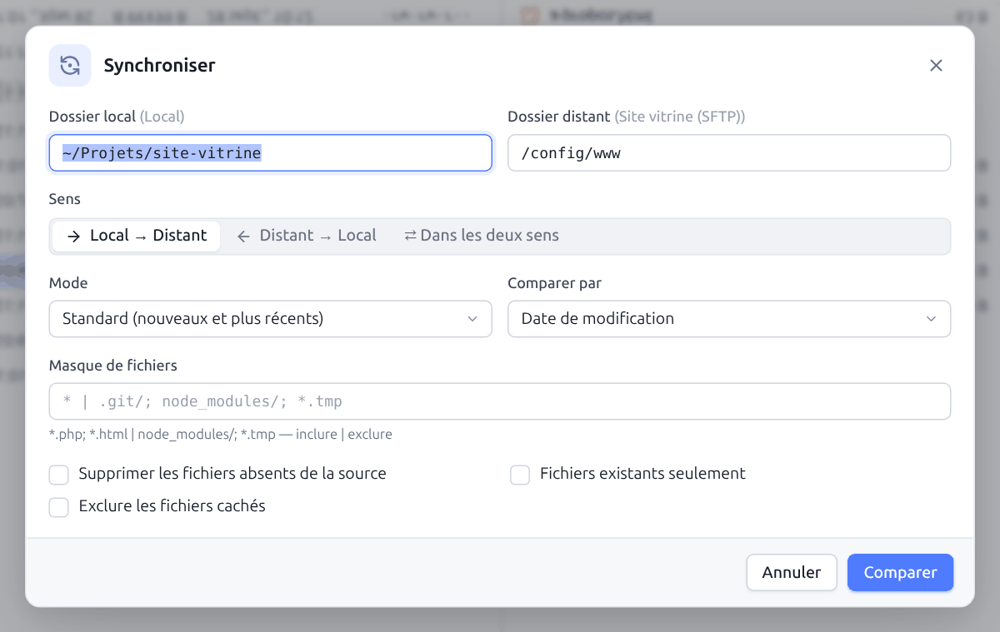
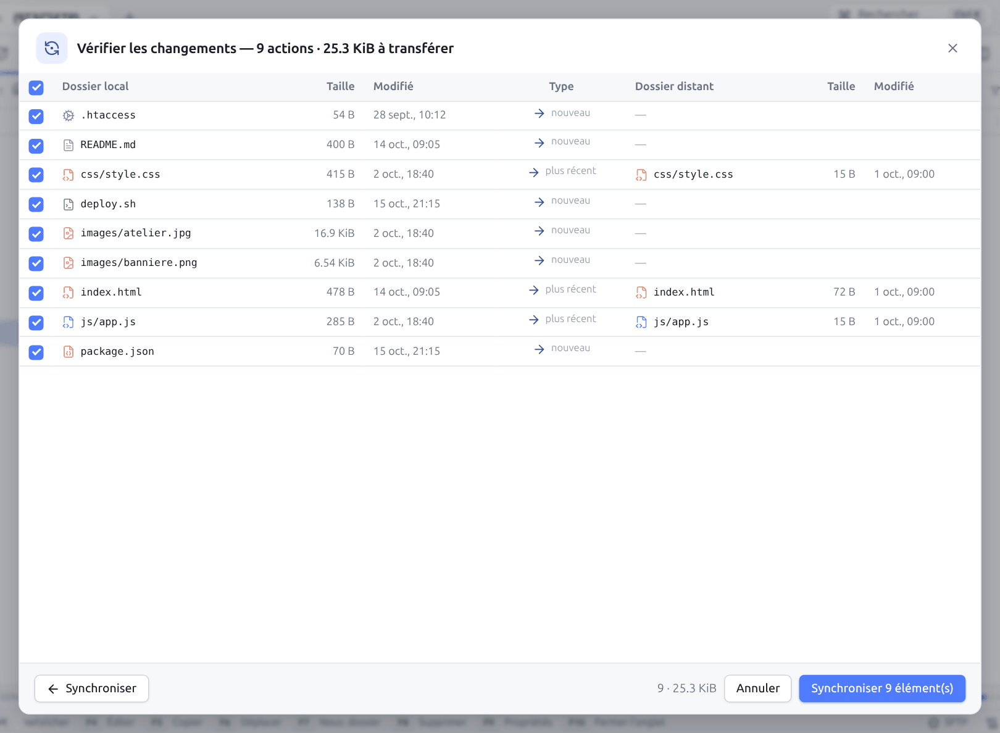
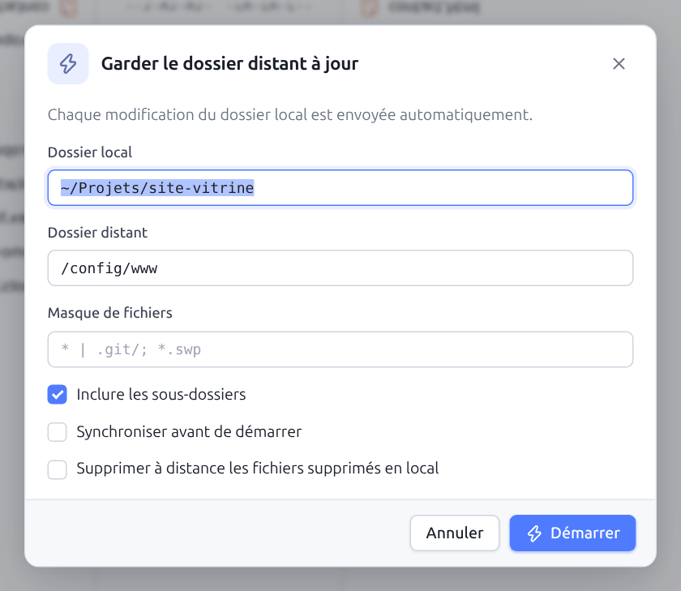
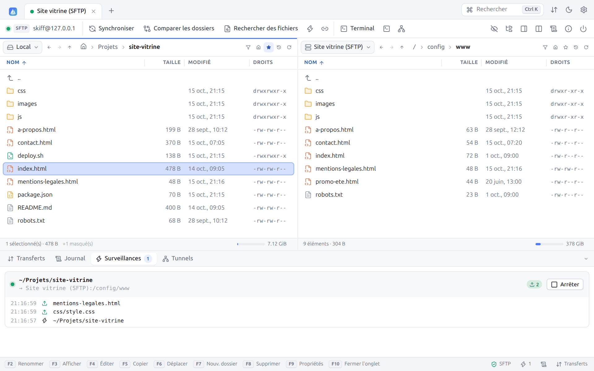

# 7. Synchronisation

[← Transferts](06-transferts.md) · [Sommaire](README.md) · [Édition, diff et aperçu →](08-edition.md)

## 7.1 Synchroniser deux dossiers

**Synchroniser** (`Ctrl+S`, barre d'outils ou menu contextuel **Synchroniser ce dossier**) compare récursivement un dossier local et un dossier distant, puis ne transfère que ce qui a changé. Les dossiers proposés sont ceux des deux panneaux.

| Option | Description |
|---|---|
| **Dossier local**, **Dossier distant** | Dossiers à comparer, modifiables. La connexion de chacun est rappelée entre parenthèses. |
| **Sens** | **Local → Distant** (envoi), **Distant → Local** (téléchargement) ou **Dans les deux sens** |
| **Mode** | **Standard (nouveaux et plus récents)** : transfère les fichiers absents ou plus récents à la source. **Miroir (nouveaux et différents)** : rend la destination identique à la source, même si elle est plus récente. **Dates seulement** : ne transfère rien, met à jour les dates de la destination |
| **Comparer par** | **Date de modification**, **Taille**, **Date ou taille**, **Somme de contrôle** (lit les fichiers des deux côtés), **Existence seulement** |
| **Masque de fichiers** | Fichiers et dossiers pris en compte ([syntaxe](06-transferts.md#63-masques-de-fichiers)), par exemple `* \| .git/; node_modules/; *.tmp` |
| **Supprimer les fichiers absents de la source** | Supprime à destination ce qui n'existe plus à la source. Indisponible dans les deux sens. |
| **Fichiers existants seulement** | Met à jour les fichiers présents des deux côtés, sans en créer de nouveaux |
| **Exclure les fichiers cachés** | Ignore les fichiers et dossiers commençant par un point |

**Comparer** lance l'analyse. Si le dossier de destination n'existe pas encore, il est considéré comme vide et sera créé : c'est le cas d'une première synchronisation vers un nouveau dossier. Dans les deux sens, deux fichiers différents ayant la même date sont signalés comme conflit au lieu d'être transférés.

## 7.2 Vérifier les changements

Skiff affiche ensuite la liste des actions prévues, avant de toucher à quoi que ce soit :

Chaque ligne indique le fichier local (taille, date), l'action, puis le fichier distant (taille, date). Le titre résume le nombre d'actions et le volume à transférer.

| Icône | Action | Raison possible |
|---|---|---|
| → | **Envoyer** | nouveau, plus récent, différent |
| ← | **Télécharger** | nouveau, plus récent, différent |
| Dossier + | **Créer le dossier distant** / **Créer le dossier local** | nouveau |
| Corbeille | **Supprimer à distance** / **Supprimer en local** | absent de la source |
| Horloge | **Mettre à jour la date distante** / **locale** | date |

Survolez l'icône pour voir l'action et la raison. Décochez les lignes à ignorer (la case d'en-tête coche ou décoche tout). Le bas de la fenêtre affiche le nombre d'actions retenues et le volume correspondant. **Synchroniser N élément(s)** exécute les actions retenues : les transferts rejoignent la [file](06-transferts.md#64-la-file-de-transferts), les suppressions et les mises à jour de dates sont faites immédiatement. **← Synchroniser** revient aux réglages.

Quand tout est déjà à jour, la fenêtre l'indique : « Les dossiers sont synchronisés ».

La synchronisation fonctionne entre n'importe quelles connexions : local et serveur, mais aussi deux serveurs (affichez-les dans les deux panneaux). Les options de transfert par défaut (mode texte, droits, `.filepart`…) s'appliquent.

## 7.3 Garder le dossier distant à jour

**Garder le dossier distant à jour** (`Ctrl+U`, éclair de la barre d'outils) surveille un dossier local et envoie chaque modification sur le serveur dès qu'elle se produit. C'est idéal pour développer en local un site hébergé à distance.

| Option | Description |
|---|---|
| **Dossier local** | Dossier surveillé |
| **Dossier distant** | Dossier de destination |
| **Masque de fichiers** | Fichiers pris en compte, par exemple `* \| .git/; *.swp` |
| **Inclure les sous-dossiers** | Surveille toute l'arborescence |
| **Synchroniser avant de démarrer** | Fait d'abord une synchronisation standard (local → distant) |
| **Supprimer à distance les fichiers supprimés en local** | Répercute les suppressions |

**Démarrer** lance la surveillance. Elle continue en arrière-plan, quel que soit l'onglet affiché, et apparaît dans l'onglet **Surveillances** du panneau du bas :

Chaque surveillance affiche le dossier local, la destination, les compteurs d'envois et de suppressions, le journal horodaté des événements (création, modification, suppression, erreurs) et un bouton **Arrêter**. Les modifications rapprochées sont regroupées (600 ms) pour ne pas envoyer dix fois un fichier en cours d'enregistrement. L'éclair de la barre d'état indique le nombre de surveillances actives.

En script, la commande `keepuptodate` fait la même chose (voir [Scripts](13-scripts-cli.md)).

---

[← Transferts](06-transferts.md) · [Sommaire](README.md) · [Édition, diff et aperçu →](08-edition.md)
