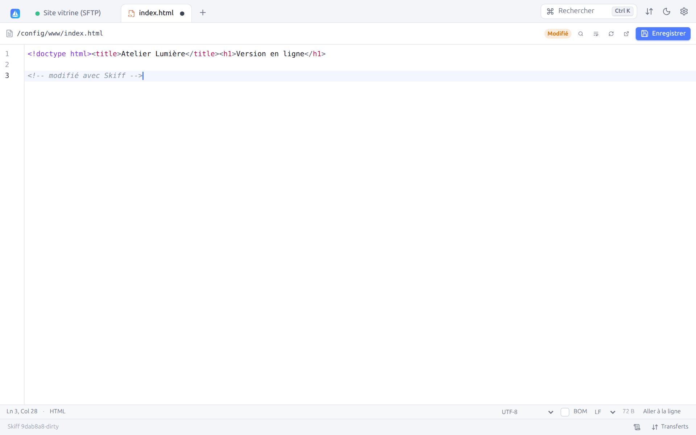
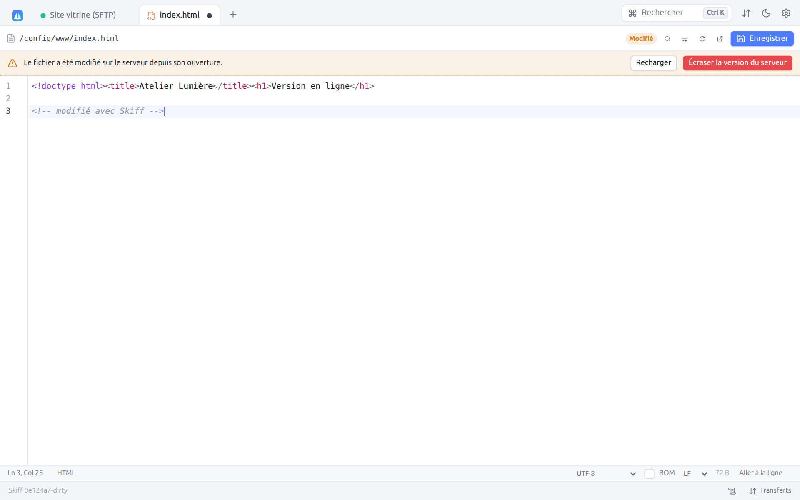
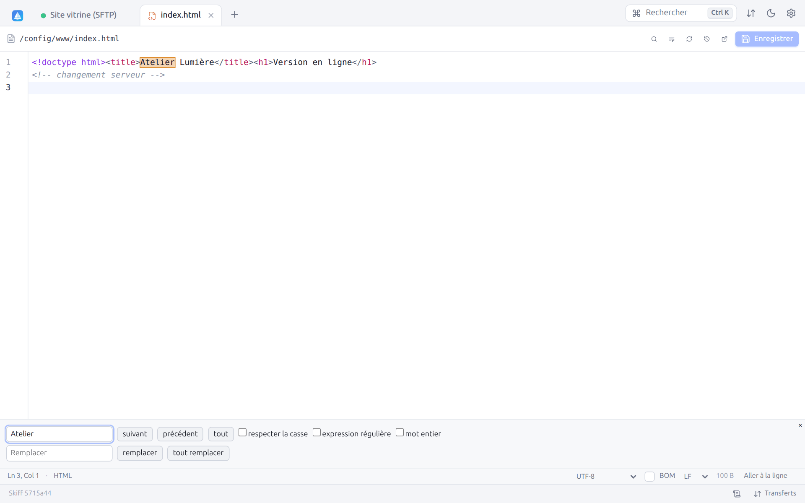
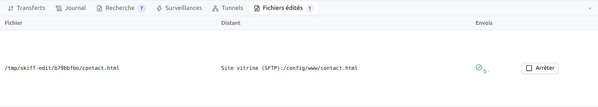
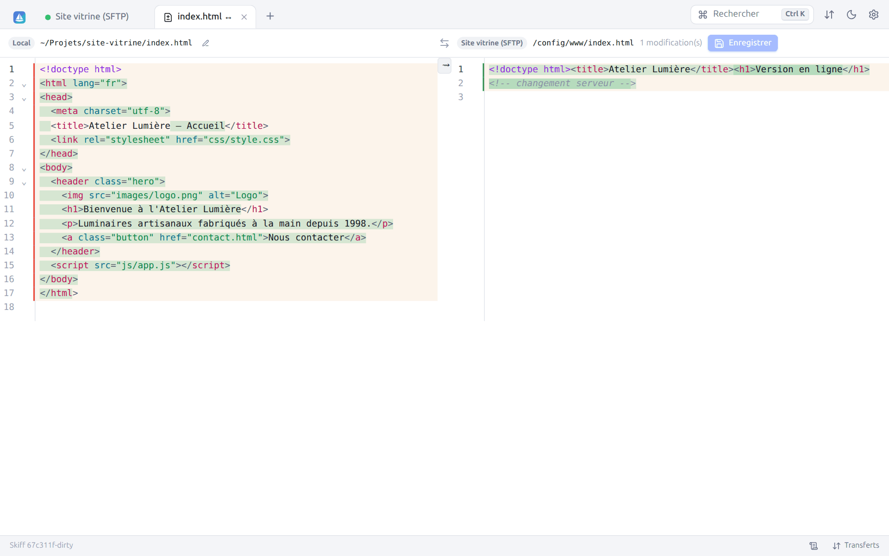
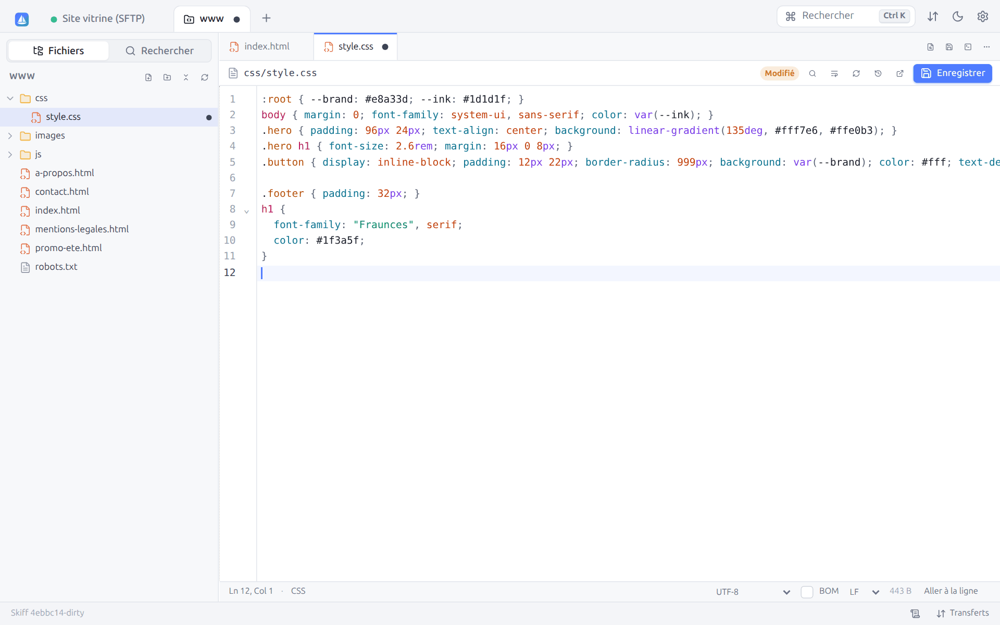
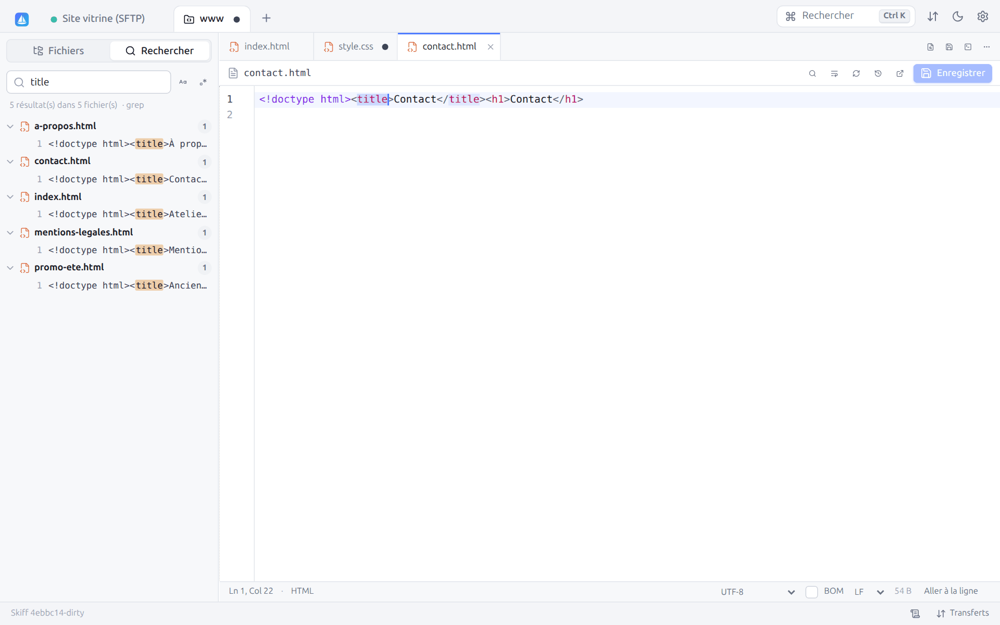
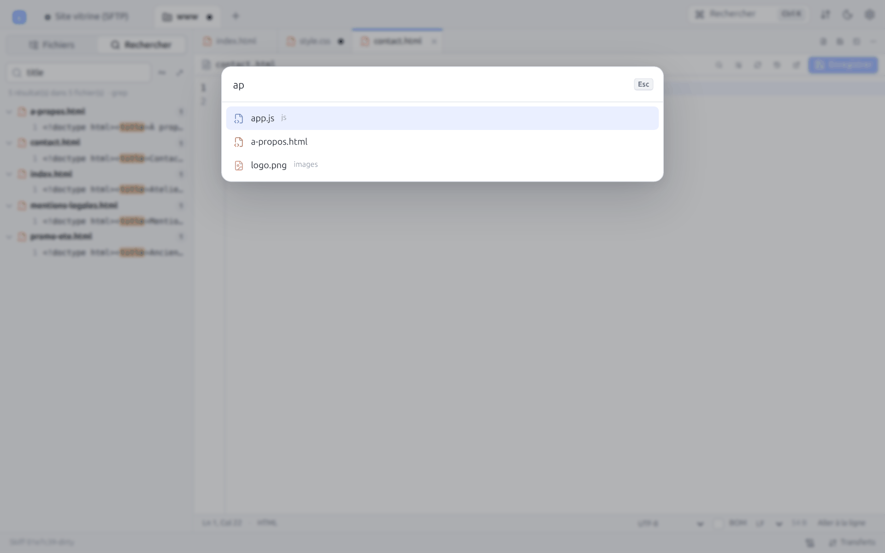
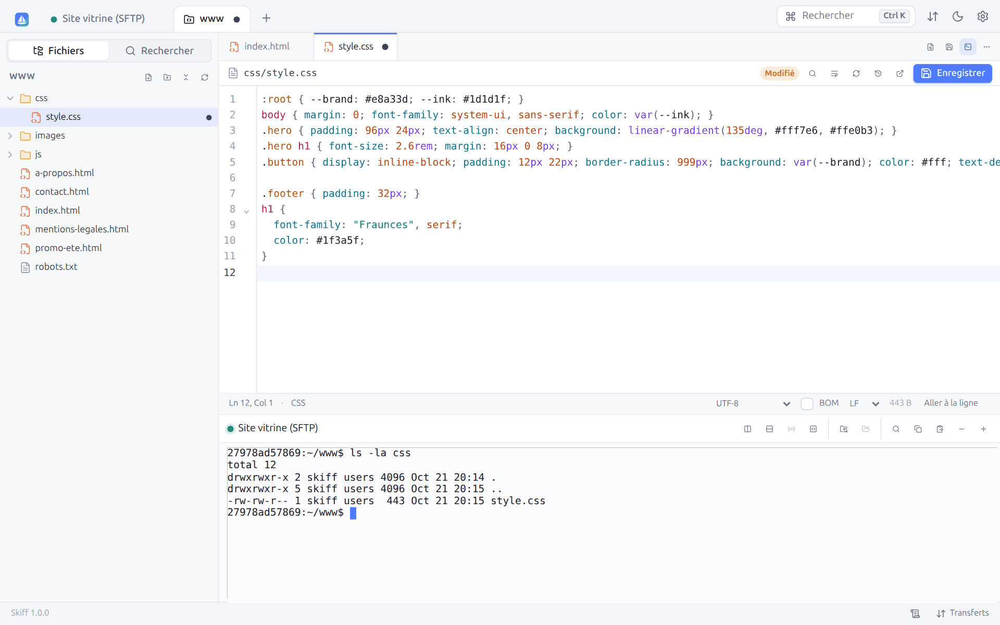
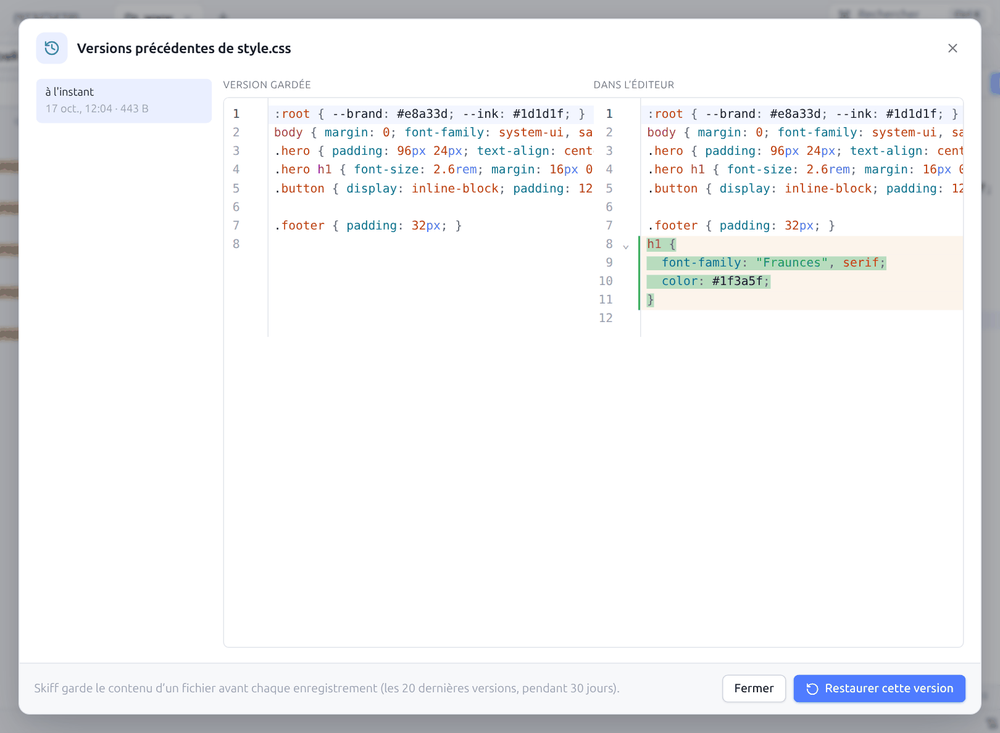

# 8. Édition, diff et aperçu

[← Synchronisation](07-synchronisation.md) · [Sommaire](README.md) · [Terminal, tunnels, proxys et rebonds →](09-terminal-tunnels.md) · 🇬🇧 [English](en/08-editing.md)

## 8.1 L'éditeur intégré

`F4` (ou **Éditer**, ou un double-clic si le réglage le prévoit) ouvre un fichier, local ou distant, dans un onglet d'éditeur. L'éditeur repose sur CodeMirror 6.

| Élément | Rôle |
|---|---|
| Onglet | Icône du type de fichier et nom. Un point signale des modifications non enregistrées. |
| Barre du haut | Chemin du fichier, badge **Modifié**, puis **Rechercher / remplacer** (`Ctrl+F`), **Retour à la ligne**, **Recharger**, **Éditer avec un éditeur externe** et **Enregistrer** (`Ctrl+S`) |
| Zone d'édition | Numéros de ligne, repli de code, coloration syntaxique (plus de 100 langages, détectés d'après le nom : HTML, CSS, JavaScript, TypeScript, PHP, Python, Go, Rust, Java, C/C++, SQL, YAML, JSON, Markdown, Dockerfile, Nginx, Shell…), correspondance des parenthèses, fermeture automatique, sélections multiples, sélection rectangulaire (`Alt` + glisser), autocomplétion (`Ctrl+Espace`) |
| Barre d'état | Position (**Ln 3, Col 28**), langage, **Encodage**, case **BOM**, **Fins de ligne**, taille du fichier, **Aller à la ligne** |

Raccourcis de l'éditeur :

| Touche | Effet |
|---|---|
| `Ctrl+S` | Enregistrer (le fichier est renvoyé sur le serveur) |
| `Ctrl+F` | Rechercher et remplacer |
| `F3` ou `Ctrl+G`, `Maj+F3` ou `Ctrl+Maj+G` | Occurrence suivante / précédente |
| `Ctrl+Maj+L` | Sélectionner toutes les occurrences de la sélection |
| `Ctrl+Alt+G` | Aller à la ligne |
| `Ctrl+Z`, `Ctrl+Y` (`Ctrl+Maj+Z`) | Annuler, rétablir |
| `Ctrl+D` | Sélectionner l'occurrence suivante |
| `Tab`, `Maj+Tab` | Indenter, désindenter |
| `Ctrl+/` | Commenter la ligne |
| `Alt+↑`, `Alt+↓` | Déplacer la ligne |
| `Ctrl+Maj+[`, `Ctrl+Maj+]` | Replier, déplier |

### Encodage et fins de ligne

Skiff détecte l'encodage (UTF-8, UTF-16 avec BOM, sinon Windows-1252) et les fins de ligne du fichier, et les conserve à l'enregistrement. Pour les changer :

- **Encodage** : UTF-8, Windows-1252, ISO-8859-1, ISO-8859-15, Windows-1250, Windows-1251, KOI8-R, CP850, UTF-16LE, UTF-16BE. Sans modification en cours, changer d'encodage relit le fichier ; sinon, le fichier sera converti à l'enregistrement.
- **BOM** : ajoute ou retire la marque d'ordre des octets.
- **Fins de ligne** : LF, CRLF ou CR.

Un fichier qui semble binaire affiche un avertissement (« Le modifier risque de le corrompre »). Les fichiers plus gros que la limite (20 Mo par défaut, **Préférences → Éditeur**) ne sont pas ouverts dans l'éditeur.

`F3` (**Afficher**) ouvre le même éditeur en **lecture seule**.

Fermer un onglet modifié propose **Enregistrer**, **Ne pas enregistrer** ou **Annuler**.

## 8.2 Conflits à l'enregistrement

Skiff mémorise la date et la taille du fichier à l'ouverture (et après chaque enregistrement). Si quelqu'un d'autre l'a modifié sur le serveur entre-temps, l'enregistrement est bloqué et un bandeau l'indique :

- **Recharger** abandonne vos modifications et relit la version du serveur ;
- **Écraser la version du serveur** enregistre quand même votre version.

Pour comparer les deux versions avant de choisir, copiez votre texte, rechargez, puis utilisez le [diff](#85-diff-visuel).

## 8.3 Rechercher et remplacer

`Ctrl+F` ouvre le panneau de recherche en bas de l'éditeur. Les occurrences sont surlignées dans le texte :

Boutons : **suivant**, **précédent**, **tout** (sélectionne toutes les occurrences pour les modifier ensemble), **remplacer**, **tout remplacer**. Options : **respecter la casse**, **expression régulière** (avec `$1`, `$2` dans le remplacement), **mot entier**. `Échap` ferme le panneau.

## 8.4 Éditeur externe

**Éditer avec un éditeur externe** (`Maj+F4`) ouvre le fichier dans l'application de votre choix : Visual Studio Code, Notepad++, Sublime Text, vim… Pour un fichier distant, Skiff le télécharge dans un dossier temporaire, lance l'éditeur, puis **renvoie le fichier sur le serveur à chaque enregistrement**, comme WinSCP.

L'éditeur utilisé est, dans l'ordre :

1. celui d'une **association** correspondant au fichier (Préférences → Éditeur → Associations, par exemple `*.psd` → `gimp !.!`) ;
2. la **Commande de l'éditeur externe** des préférences (`code --wait !.!`, où `!.!` est remplacé par le chemin du fichier) ;
3. l'application associée par le système.

Les fichiers suivis apparaissent dans l'onglet **Fichiers édités** du panneau du bas (`Ctrl+Maj+Q`) :

Pour chaque fichier : la copie locale temporaire, le fichier distant, le nombre d'**Envois** (avec une coche verte après le dernier envoi réussi) et **Arrêter**, qui cesse la surveillance. Une erreur d'envoi est signalée par une notification.

Pour faire de l'éditeur externe le choix par défaut de `F4` et du double-clic : **Préférences → Éditeur → Éditeur par défaut → Application externe**. L'édition externe n'existe pas en mode web.

## 8.5 Diff visuel

**Comparer avec le fichier de l'autre panneau** (menu contextuel d'un fichier) ouvre un onglet de comparaison entre deux fichiers : local et distant, ou sur deux serveurs.

- En-tête : la connexion et le chemin de chaque fichier, un bouton pour ouvrir chacun dans l'éditeur, le nombre de **modifications** et **Enregistrer** (fichier de droite).
- Les lignes supprimées sont surlignées en rouge à gauche, les lignes ajoutées en vert à droite, avec le détail des mots modifiés.
- Les longues portions identiques sont repliées (cliquez pour les déplier).
- Les flèches entre les deux côtés recopient un bloc de gauche vers la droite (fusion par blocs).
- Le côté droit est modifiable : corrigez-le puis **Enregistrer**. Comme dans l'éditeur, un conflit est détecté si le fichier a changé entre-temps.

## 8.6 Aperçu

Le [panneau d'aperçu](04-interface.md#49-panneau-daperçu) (`Ctrl+Maj+P`) affiche les images, vidéos, sons, PDF, fichiers Markdown et textes, en local comme sur un serveur, sans ouvrir d'onglet.

## 8.7 Projets : modifier un dossier sans rien installer sur le serveur

Pour travailler sur plusieurs fichiers d'un même dossier (un site, la configuration d'un serveur, des scripts), ouvrez-le comme **projet**. Vous obtenez une vue proche d'un éditeur de code : l'arborescence à gauche, les fichiers en onglets, une recherche dans tous les fichiers et un terminal.

Contrairement à VS Code (Remote SSH), qui installe son propre serveur sur la machine distante, **rien n'est installé ni lancé en permanence sur le serveur**. Skiff lit et enregistre les fichiers par la connexion déjà ouverte. Ça marche donc sur un petit VPS, un compte SFTP seul, un NAS, un conteneur, et aussi en FTP, WebDAV ou S3.

**Ouvrir un projet** :

- **Projet** dans la barre d'outils de la session (`Ctrl+Maj+E`) : le dossier du panneau actif ;
- clic droit sur un dossier → **Ouvrir comme projet**, ou sur le fond du panneau → **Ouvrir ce dossier comme projet** ;
- la palette (`Ctrl+K` → « Ouvrir ce dossier comme projet »).

Le projet s'ouvre dans un onglet qui porte le nom du dossier ; un point y signale des fichiers non enregistrés. Il utilise la connexion de la session : fermer l'onglet de session ne la coupe pas tant que le projet est ouvert. Avec **Rouvrir les sessions de la dernière fois** ([§ 12.2](12-preferences.md#122-panneaux)) ou un [espace de travail](03-sites.md#33-espaces-de-travail), les projets reviennent avec leurs fichiers ouverts.

### Arborescence

Les dossiers se chargent à l'ouverture (clic sur le dossier) ; les fichiers cachés suivent le réglage des panneaux. Un clic ouvre un fichier dans un onglet. L'arborescence se met à jour quand un fichier est créé, renommé ou supprimé, par Skiff ou dans une autre session.

Le clic droit propose **Nouveau fichier**, **Nouveau dossier**, **Rechercher dans ce dossier**, **Renommer**, **Supprimer**, **Copier le chemin** et **Copier le chemin dans le projet** (relatif). Les boutons en haut créent un fichier ou un dossier à la racine, **Tout replier** et **Actualiser**.

### Fichiers en onglets

Chaque fichier s'ouvre avec l'[éditeur intégré](#81-léditeur-intégré) : coloration, encodage, fins de ligne, rechercher et remplacer, [conflits à l'enregistrement](#82-conflits-à-lenregistrement). Un point remplace la croix d'un onglet modifié. `Ctrl+S` enregistre le fichier affiché, **Tout enregistrer** (`Ctrl+Alt+S`) tous les fichiers modifiés, `Ctrl+W` ferme le fichier affiché (pas le projet). Fermer un fichier ou le projet avec des modifications demande s'il faut les enregistrer.

Les droits du fichier sont conservés : un script exécutable le reste après l'enregistrement.

### Rechercher dans le projet

**Rechercher** (`Ctrl+Maj+F`) cherche un texte dans tous les fichiers du projet, ou d'un dossier (**Rechercher dans ce dossier** dans l'arborescence ; la croix revient au projet entier). **Respecter la casse** et **Expression régulière** se règlent à droite du champ. Les résultats sont groupés par fichier, avec la ligne et le texte trouvé surligné ; un clic ouvre le fichier sur l'occurrence.

Sur une connexion SFTP ou SCP avec un shell (et dans un conteneur), la recherche est faite par `find` et `grep` **sur le serveur**, en une commande : rapide même sur un gros dossier, et rien n'est installé. Sinon (compte SFTP seul, FTP, WebDAV, S3, dossier local), Skiff lit les fichiers un par un. La ligne de résumé indique la méthode (« grep » ou « fichiers lus »).

Les fichiers binaires et ceux de plus de 2 Mo sont ignorés, ainsi que les dossiers `.git`, `node_modules`, `vendor`, `__pycache__`, `.venv`, `venv`, `.cache`, `.next`, `.nuxt` et `.terraform` (liste modifiable dans **Préférences → Éditeur**, [§ 12.5](12-preferences.md#125-éditeur)). Les 1 000 premiers résultats sont affichés.

### Aller au fichier

`Ctrl+P` (ou le bouton **Aller au fichier**, un fichier sous une loupe) ouvre un fichier par son nom : tapez quelques lettres, dans l'ordre (`ngc` trouve `nginx.conf`, `cs/st` trouve `css/style.css`). Les fichiers dont le nom commence par ce que vous tapez viennent en premier ; sans rien taper, les fichiers ouverts sont proposés d'abord. Les mêmes dossiers que pour la recherche sont ignorés ; au-delà de 20 000 fichiers, seuls les premiers sont proposés.

### Terminal

L'icône de terminal (`` Ctrl+` ``) ouvre un [terminal](09-terminal-tunnels.md#91-terminal-ssh) en bas du projet, dans son dossier, sur la même connexion (et sur cet ordinateur pour un projet local). Le même raccourci le masque et le réaffiche ; il continue de tourner pendant ce temps. Il ferme avec le projet. La séparation se déplace à la souris.

Le menu **⋯** propose aussi **Afficher le dossier dans un panneau de fichiers**, **Copier le chemin du projet** et **Fermer tous les fichiers**.

## 8.8 Versions précédentes

À chaque enregistrement depuis l'éditeur (fichier seul ou projet), Skiff garde **sur cet ordinateur** une copie du contenu d'avant : les 20 dernières versions de chaque fichier, pendant 30 jours. Rien n'est écrit sur le serveur. Un enregistrement qui ne change rien ne crée pas de copie.

L'icône d'horloge de la barre de l'éditeur (**Versions précédentes**) liste ces copies, la plus récente en haut, et compare celle choisie avec le contenu de l'éditeur. **Restaurer cette version** met ce contenu dans l'éditeur : relisez-le, puis enregistrez (la version remplacée est gardée à son tour).

Les copies sont dans le dossier de configuration (`history/`), une par fichier et par serveur. Le réglage **Garder les versions précédentes des fichiers enregistrés** (**Préférences → Éditeur**) les arrête. Les fichiers de plus de 10 Mo ne sont pas copiés.

---

[← Synchronisation](07-synchronisation.md) · [Sommaire](README.md) · [Terminal, tunnels, proxys et rebonds →](09-terminal-tunnels.md) · 🇬🇧 [English](en/08-editing.md)
