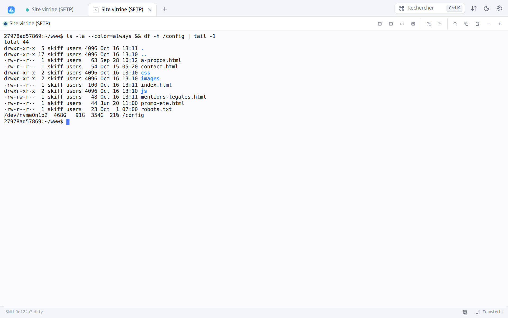
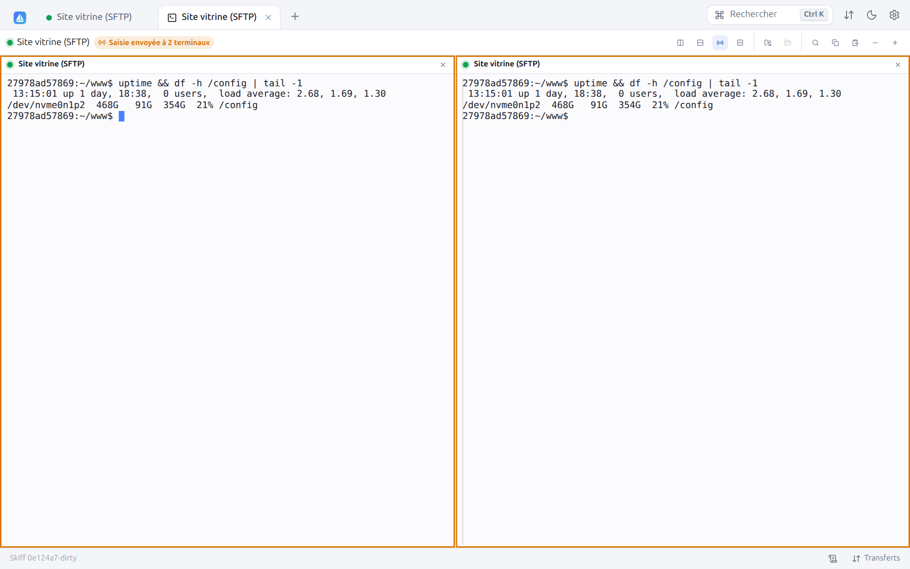
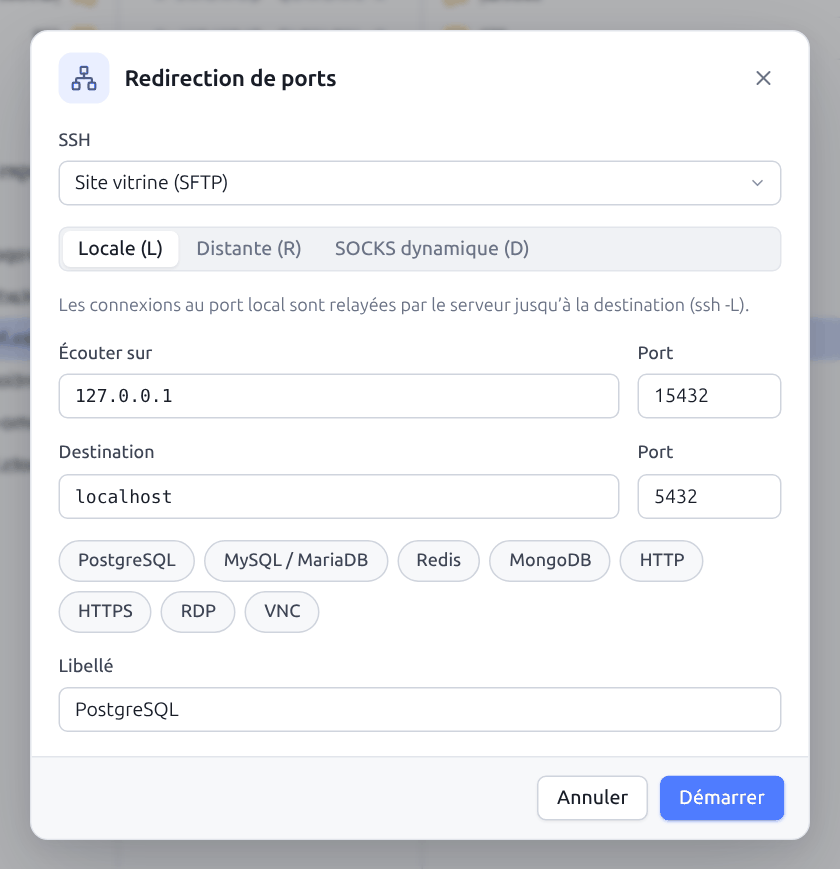
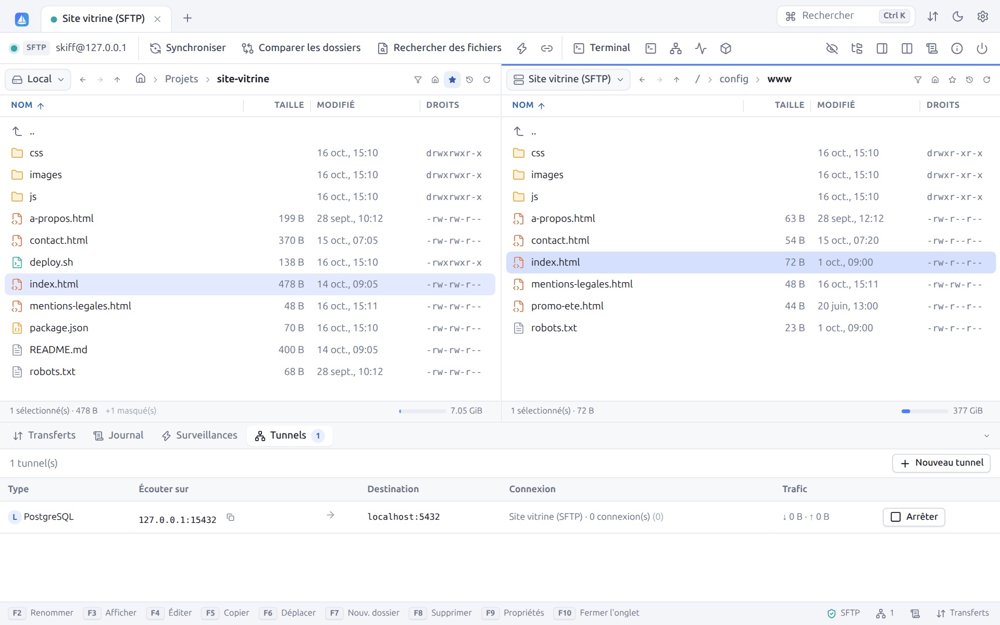
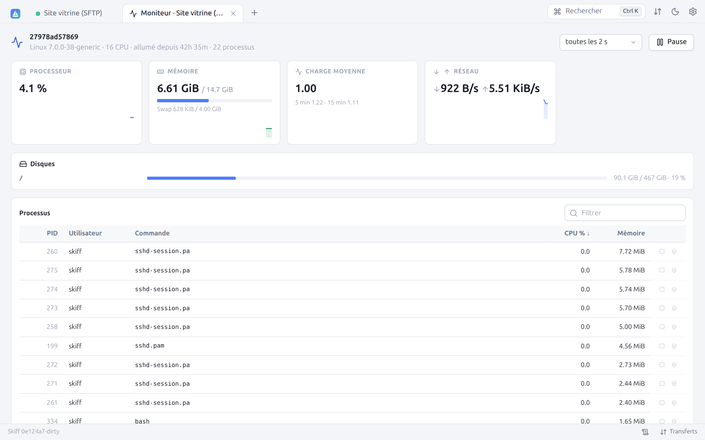

# 9. Terminal, tunnels, proxys et rebonds

[← Édition, diff et aperçu](08-edition.md) · [Sommaire](README.md) · [Recherche, journal et palette →](10-recherche-journal.md)

## 9.1 Terminal SSH

Pour les sessions SFTP et SCP, **Terminal** (`Ctrl+T`) ouvre un terminal SSH complet dans un onglet, directement dans le dossier courant du panneau. Il utilise la connexion déjà ouverte : pas de nouvelle authentification.

- Émulation xterm complète (xterm.js) : couleurs, 256 couleurs et vraies couleurs, souris, applications plein écran (`vim`, `htop`, `mc`, `tmux`…), redimensionnement automatique.
- Barre d'outils : **Rechercher** dans le défilement (`Ctrl+Maj+F`), **Copier** la sélection (`Ctrl+Maj+C`), **Coller** (`Ctrl+Maj+V`), **Réduire la police** et **Agrandir la police** (de 9 à 28 px, pour ce terminal).
- Option **Copier à la sélection** (Préférences → Terminal) : sélectionner du texte le copie.
- Le terminal continue de tourner quand vous changez d'onglet. Quand l'interface se recharge (par exemple en mode web), les 256 derniers Kio affichés sont restitués.
- Quand le shell se termine, le terminal affiche « La session est terminée » et un bouton **Rouvrir**.
- Avec le **transfert d'agent** activé dans le site, `git`, `ssh` et `scp` lancés dans le terminal utilisent vos clés (trousseau Skiff et agent), sans les copier sur le serveur (voir [§ 11.7](11-securite.md#117-trousseau-skiff-et-transfert-dagent)).

Le shell est le shell de connexion de l'utilisateur (`$SHELL -l`). La police, sa taille, le nombre de lignes conservées, le curseur et la variable `TERM` se règlent dans **Préférences → Terminal**. Un terminal s'ouvre aussi depuis la liste des sites (**Ouvrir dans un terminal**), qui se connecte et ouvre le terminal en une seule étape.

### Plusieurs terminaux dans un onglet

**Diviser à droite** et **Diviser en bas** (barre du terminal) ajoutent un terminal à l'onglet, sur le même serveur (dans le même dossier) ou sur une autre connexion ouverte, voire l'ordinateur local. Deux terminaux se partagent l'onglet côte à côte ou l'un au-dessus de l'autre, trois ou quatre en grille. Chacun a son en-tête (connexion, dossier courant, **Fermer ce terminal**) ; celui qui a le clavier est entouré de la couleur d'accent.

### Diffuser la saisie

**Diffuser la saisie** (icône d'antenne, dès deux terminaux) envoie chaque frappe à **tous les terminaux de l'onglet** : la même commande s'exécute sur plusieurs serveurs à la fois (mise à jour, redémarrage d'un service, vérification). Les terminaux sont alors entourés d'orange et la barre indique « Saisie envoyée à N terminaux ». Un nouveau clic arrête la diffusion. Le collage et les commandes enregistrées sont diffusés de la même façon.

### Commandes enregistrées

Le bouton **Commandes enregistrées** propose des commandes prêtes à taper : **Espace disque** (`df -h`), **Mémoire** (`free -h`), **Plus gros fichiers ici**, **Derniers journaux système**, et les vôtres. Une commande marquée **Exécuter** est validée aussitôt ; sinon elle est seulement tapée, pour la compléter. **Gérer les commandes enregistrées…** ouvre **Préférences → Terminal** ([§ 12.6](12-preferences.md#126-terminal)).

### Suivre le dossier courant

Le terminal connaît le dossier courant du shell quand celui-ci l'annonce (séquence standard OSC 7) : il s'affiche dans la barre et dans l'en-tête de chaque terminal.

- **Afficher le dossier courant dans le panneau de fichiers** ouvre ce dossier dans le panneau de la même connexion (ou un nouvel onglet de session).
- **Le panneau de fichiers suit le dossier courant** : chaque `cd` dans le terminal change le dossier du panneau. À l'activation, Skiff installe dans les shells bash et zsh qui n'annoncent pas encore leur dossier une petite fonction pour le faire (le terminal est effacé une fois) ; fish et les configurations qui envoient déjà OSC 7 n'en ont pas besoin. L'installation dure jusqu'à la fin du shell et ne modifie aucun fichier du serveur.

## 9.2 Terminal local

**Terminal local**, sur l'écran d'accueil ou dans la palette (`Ctrl+K` → « Terminal (Local) »), ouvre un terminal sur l'ordinateur ; **Ouvrir un terminal ici** dans le panneau local l'ouvre dans le dossier affiché.

| Système | Shell |
|---|---|
| Linux, macOS, FreeBSD | `$SHELL` (pseudo-terminal) |
| Windows | PowerShell 7 (`pwsh.exe`) s'il est installé, sinon Windows PowerShell, via ConPTY |

En [mode web](14-mode-web.md), le terminal local est désactivé, sauf avec l'option `--allow-local-terminal`.

## 9.3 Tunnels (redirections de ports)

Les tunnels font passer des connexions réseau à travers une session SSH. **Tunnels** (barre d'outils) ouvre la boîte **Redirection de ports** :

| Type | Équivalent OpenSSH | Usage |
|---|---|---|
| **Locale (L)** | `ssh -L` | Un port de votre ordinateur mène à une destination vue depuis le serveur. Exemple : `127.0.0.1:15432` → `localhost:5432` pour atteindre la base PostgreSQL du serveur avec votre client habituel. |
| **Distante (R)** | `ssh -R` | Un port du serveur mène à une destination vue depuis votre ordinateur. Exemple : montrer au serveur un service de développement local. |
| **SOCKS dynamique (D)** | `ssh -D` | Un proxy SOCKS4/5 local : toute application réglée sur ce proxy sort par le serveur. |

| Champ | Description |
|---|---|
| **SSH** | Session SSH (SFTP ou SCP) à utiliser |
| **Écouter sur**, **Port** | Adresse et port d'écoute (`127.0.0.1` pour un accès réservé à l'ordinateur) |
| **Destination**, **Port** | Hôte et port à joindre (sauf en SOCKS) |
| Raccourcis | **PostgreSQL**, **MySQL / MariaDB**, **Redis**, **MongoDB**, **HTTP**, **HTTPS**, **RDP**, **VNC** : remplissent le port de destination, un port local libre et le libellé |
| **Libellé** | Nom affiché dans la liste des tunnels |

**Démarrer** ouvre le tunnel. Les tunnels actifs sont listés dans l'onglet **Tunnels** du panneau du bas :

Pour chaque tunnel : le type et le libellé, l'adresse d'écoute (avec un bouton pour la copier), la destination, la session utilisée avec le nombre de connexions en cours et au total, le trafic reçu et envoyé, et **Arrêter**. **Nouveau tunnel** ouvre la boîte de création. Les tunnels s'arrêtent quand leur session se ferme.

Pour qu'un tunnel s'ouvre à chaque connexion, définissez-le dans le site (**Redirection de ports**, case **Auto**, voir [Sites](03-sites.md#redirection-de-ports-ssh)). Les `LocalForward`, `RemoteForward` et `DynamicForward` de la [configuration OpenSSH](03-sites.md#34-configuration-openssh-ssh_config) d'un hôte s'ouvrent aussi à la connexion, tant que le site n'a pas ses propres redirections (et deviennent des tunnels du site à l'import).

## 9.4 Hôtes de rebond

Un hôte de rebond (*bastion*, *jump host*) est un serveur SSH par lequel il faut passer pour atteindre les serveurs d'un réseau privé. Dans le site, section **Hôtes de rebond**, ajoutez un ou plusieurs rebonds :

Skiff se connecte au premier rebond, ouvre à travers lui une connexion vers le suivant, et ainsi de suite jusqu'au serveur final, exactement comme `ssh -J bastion1,bastion2 serveur`. Chaque rebond s'authentifie avec ses propres identifiants : utilisez un **site enregistré** (recommandé, il garde son mot de passe, sa clé, sa clé d'hôte) ou un **hôte personnalisé**.

Particularités :

- les clés d'hôte de chaque rebond sont vérifiées comme pour une connexion directe ;
- les rebonds servent à **tous les protocoles** : un FTP, un WebDAV ou un S3 accessible seulement depuis le réseau interne est joint à travers le tunnel SSH ;
- le nombre de rebonds est indiqué dans les [informations serveur](10-recherche-journal.md#103-informations-serveur-et-protocole) ;
- un rebond peut être un alias de `~/.ssh/config` : son adresse, son port, son utilisateur et ses clés viennent alors du fichier ;
- sans rebond ni proxy dans le site, le `ProxyJump` (ou `ProxyCommand`) de la [configuration OpenSSH](03-sites.md#34-configuration-openssh-ssh_config) de l'hôte s'applique tel quel ; à l'import, il devient une chaîne de rebonds.

## 9.5 Proxys

Dans le site, section **Proxy** :

| Type | Description |
|---|---|
| **SOCKS4** | SOCKS4, ou SOCKS4a si **Résoudre les noms d'hôte sur le proxy** est coché |
| **SOCKS5** | Avec authentification facultative, résolution des noms locale ou par le proxy |
| **HTTP** | Méthode `CONNECT`, authentification Basic facultative |
| **Telnet** | Envoie une commande de connexion au proxy (proxys d'entreprise anciens) |
| **Commande locale (ProxyCommand)** | Lance une commande dont l'entrée et la sortie servent de connexion, avec les variables `%host`, `%port`, `%user`, `%pass`, `%proxyhost`, `%proxyport`. Exemples : `ssh -W %host:%port passerelle`, `nc -X 5 -x proxy:1080 %host %port`, `cloudflared access ssh --hostname %host` |

Le proxy s'applique à la première connexion réseau : directement au serveur, ou au premier hôte de rebond s'il y en a.

## 9.6 Moniteur du serveur

Pour une session SFTP ou SCP vers un serveur Linux, le bouton **Moniteur du serveur** (icône d'activité dans la barre d'outils de la session, ou la palette) ouvre un onglet qui montre l'état du serveur en direct. Rien n'est installé sur le serveur : Skiff lit `/proc` par la connexion déjà ouverte, une commande par mesure.

| Zone | Contenu |
|---|---|
| En-tête | Nom du serveur, noyau, nombre de processeurs, durée depuis le démarrage, nombre de processus |
| **Processeur** | Occupation de tous les processeurs depuis la mesure précédente, et sa courbe sur les 60 dernières mesures |
| **Mémoire** | Mémoire utilisée (hors cache) sur le total, la swap, et la courbe |
| **Charge moyenne** | Sur 1, 5 et 15 minutes |
| **Réseau** | Débit reçu ↓ et envoyé ↑ de toutes les interfaces (sauf `lo`) |
| **Disques** | Chaque système de fichiers monté (sans les systèmes virtuels ni les doublons de montage), avec son taux d'occupation : la barre passe à l'orange au-delà de 75 %, au rouge au-delà de 90 % |
| **Processus** | Les 40 processus les plus actifs : PID, utilisateur, commande, % CPU (part d'un processeur, comme `top`) et mémoire résidente. Un clic sur un en-tête trie la colonne ; le champ **Filtrer** cherche dans le nom, l'utilisateur et le PID. |

Les boutons d'une ligne de processus envoient **TERM** (**Arrêter**, le processus peut se terminer proprement) ou **KILL** (**Forcer l'arrêt**), après confirmation. Ils agissent avec les droits de l'utilisateur de la session.

La fréquence se règle de 1 à 10 secondes ; **Pause** fige l'affichage. Les mesures s'arrêtent quand l'onglet n'est pas affiché et reprennent après une reconnexion. Un serveur sans `/proc` (macOS, BSD) affiche « the monitor needs a Linux server ».

---

[← Édition, diff et aperçu](08-edition.md) · [Sommaire](README.md) · [Recherche, journal et palette →](10-recherche-journal.md)
