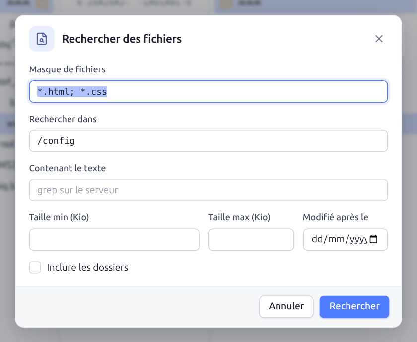
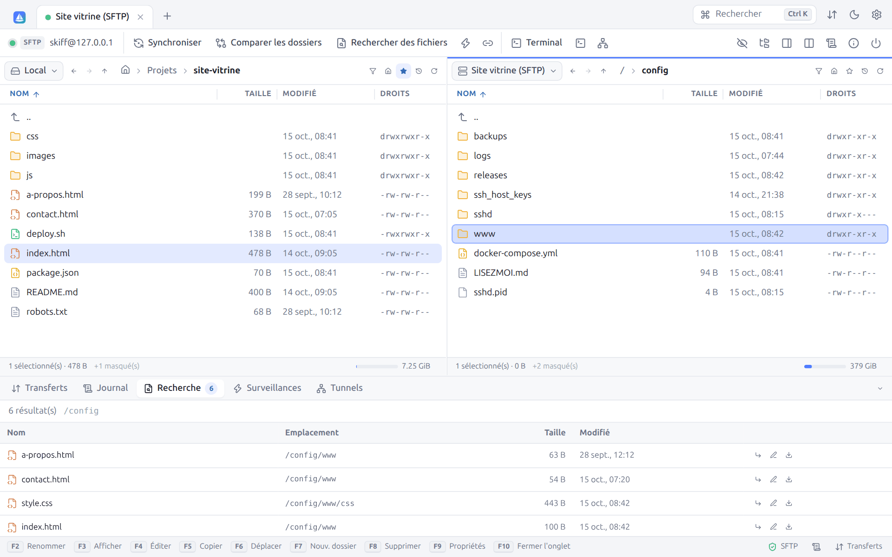
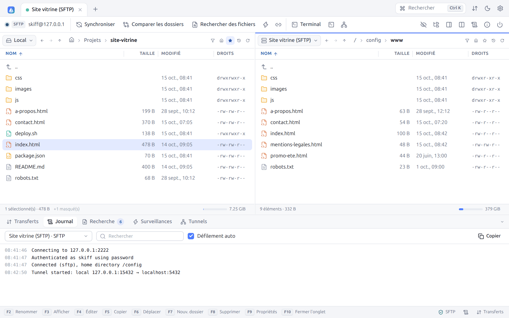
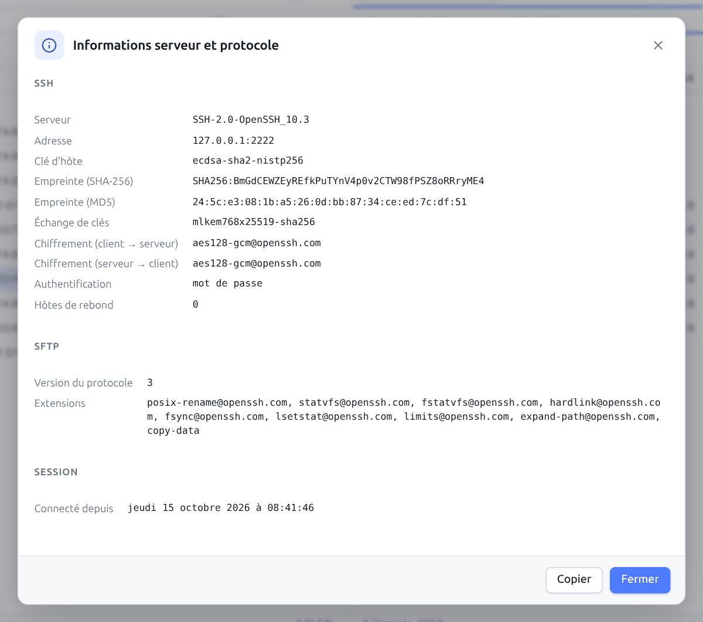
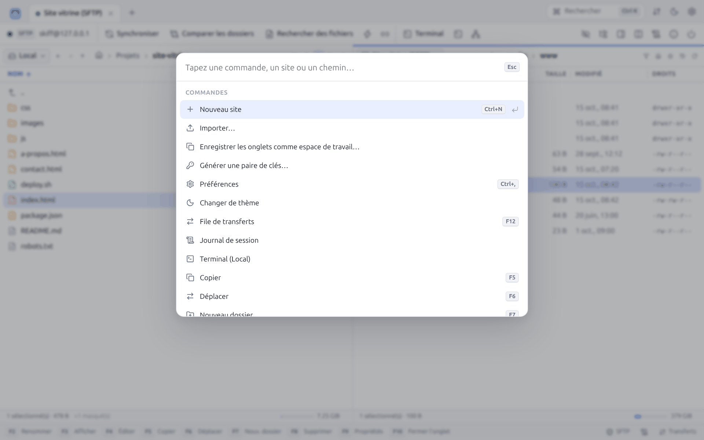
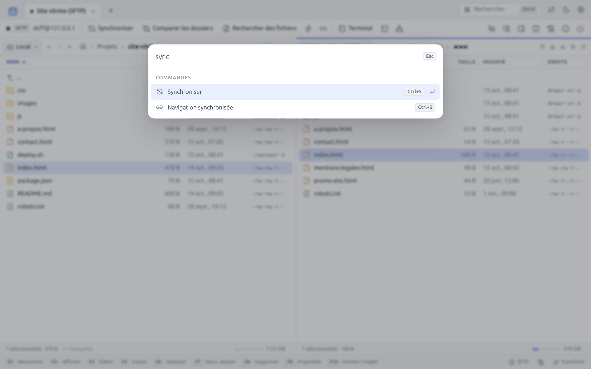

# 10. Recherche, journal et palette

[← Terminal, tunnels, proxys et rebonds](09-terminal-tunnels.md) · [Sommaire](README.md) · [Sécurité →](11-securite.md)

## 10.1 Rechercher des fichiers

**Rechercher des fichiers** (`Ctrl+Maj+F`, barre d'outils, ou **Rechercher dans ce dossier** du menu contextuel) parcourt un dossier et tous ses sous-dossiers, en local ou sur le serveur.

| Champ | Description |
|---|---|
| **Masque de fichiers** | Noms recherchés, avec la [syntaxe des masques](06-transferts.md#63-masques-de-fichiers) : `*.html; *.css`, `rapport*`, `* \| node_modules/` |
| **Rechercher dans** | Dossier de départ (par défaut, le dossier courant du panneau) |
| **Contenant le texte** | Ne garde que les fichiers contenant ce texte. Sur un serveur SSH, la recherche se fait côté serveur avec `grep` (sensible à la casse), sans rien télécharger. Ailleurs, Skiff lit les fichiers de moins de 50 Mo (insensible à la casse). |
| **Taille min (Kio)**, **Taille max (Kio)** | Bornes de taille |
| **Modifié après le** | Date minimale de modification |
| **Inclure les dossiers** | Liste aussi les dossiers dont le nom correspond |

**Rechercher** lance la recherche. Les résultats arrivent au fil de l'eau dans l'onglet **Recherche** du panneau du bas, avec le nombre d'éléments analysés et un bouton **Arrêter** :

Pour chaque résultat : nom, emplacement, taille, date, et trois boutons : **Atteindre** (ouvre le dossier dans le panneau et place le curseur sur le fichier), **Éditer** et **Télécharger** (fichiers distants).

## 10.2 Journal de session

**Journal de session** (barre d'outils, barre d'état, ou palette) ouvre l'onglet **Journal** du panneau du bas :

- Le menu déroulant choisit la connexion dont on affiche le journal.
- Le champ **Rechercher** filtre les lignes.
- **Défilement auto** suit les nouvelles lignes.
- **Copier** copie les lignes affichées.

Chaque ligne est horodatée : connexion, authentification, dossier d'accueil, ouverture de tunnels, erreurs, ainsi que les commandes envoyées au serveur (commandes FTP, requêtes WebDAV), précédées de `>`. Au niveau **debug** (Préférences → Journalisation), le journal contient aussi les réponses du serveur, précédées de `<`. Le niveau s'applique aux connexions ouvertes après le changement.

Pour garder une trace sur disque, activez **Écrire les journaux de session dans des fichiers** : chaque session écrit un fichier `AAAAMMJJ-HHMMSS_nom-du-site.log` dans le dossier `logs` de la configuration. Les scripts ont leur propre option `/log=` (voir [Scripts](13-scripts-cli.md)).

## 10.3 Informations serveur et protocole

**Informations serveur/protocole** (icône ⓘ de la barre d'outils) rassemble tout ce que Skiff sait de la connexion :

| Groupe | Informations |
|---|---|
| **SSH** | Version du serveur, adresse, type de clé d'hôte, empreintes SHA-256 et MD5, échange de clés, chiffrements dans chaque sens, MAC, méthode d'authentification, nombre d'hôtes de rebond |
| **SFTP** | Version du protocole, extensions prises en charge par le serveur (`posix-rename`, `statvfs`, `hardlink`, `fsync`, `limits`, `copy-data`…), commande du serveur SFTP |
| **SCP** | Méthode de listage, shell |
| **FTP** | Serveur, système (`SYST`), message d'accueil, mode passif ou actif, méthode de listage (MLSD ou LIST), fonctionnalités (`FEAT`) |
| **TLS** | Version, suite de chiffrement, sujet, émetteur, date d'expiration et empreinte du certificat |
| **WebDAV** | URL, logiciel du serveur, conformité DAV, authentification |
| **S3** | Endpoint, région, TLS, adressage |
| **Session** | Date et heure de connexion |

**Copier** copie le tout sous forme de texte, pratique pour un ticket de support.

## 10.4 Palette de commandes

`Ctrl+K` (ou **Rechercher** en haut à droite) ouvre la palette : un seul champ pour tout trouver et tout lancer au clavier.

Sans rien taper, la palette liste les commandes. En tapant, elle filtre de façon approximative (les lettres tapées doivent apparaître dans l'ordre) parmi :

| Groupe | Contenu |
|---|---|
| **Connexion rapide** | Une URL `sftp://`, `scp://`, `ssh://`, `ftp://`, `ftps://`, `ftpes://`, `dav://`, `davs://` ou `s3://` propose de s'y connecter |
| **Ouvrir un dossier** | Un chemin commençant par `/`, `~` ou `C:\` propose de l'ouvrir dans le panneau actif |
| **Sites** | Tous les sites, avec protocole, hôte et dossier |
| **Espaces de travail** | Les espaces de travail |
| **Terminal** | Les terminaux ouverts |
| **Commandes** | Nouveau site, Importer…, Enregistrer les onglets comme espace de travail…, Générer une paire de clés…, Préférences, Changer de thème, File de transferts, Journal de session, Terminal (Local) ; dans une session : Copier, Déplacer, Nouveau dossier, Nouveau fichier, Supprimer, Synchroniser, Comparer les dossiers, Rechercher des fichiers, Garder le dossier distant à jour, Navigation synchronisée, Ouvrir un terminal, Nouveau tunnel, Afficher les fichiers cachés |
| **Fichiers du dossier courant** | Les fichiers et dossiers du panneau actif : `Entrée` les ouvre |

`↑` / `↓` déplacent la sélection, `Entrée` exécute, `Échap` ferme. Le raccourci de chaque commande est affiché à droite.

---

[← Terminal, tunnels, proxys et rebonds](09-terminal-tunnels.md) · [Sommaire](README.md) · [Sécurité →](11-securite.md)
