# 11. Sécurité

[← Recherche, journal et palette](10-recherche-journal.md) · [Sommaire](README.md) · [Préférences →](12-preferences.md)

## 11.1 Clés d'hôte SSH

Chaque serveur SSH possède une clé d'hôte qui prouve son identité. Skiff la vérifie à chaque connexion, pour le serveur comme pour chaque hôte de rebond.

- Les clés acceptées sont enregistrées dans le fichier `known_hosts` de Skiff (dossier de configuration, format OpenSSH).
- Les fichiers `known_hosts` d'OpenSSH sont aussi consultés, en lecture seule : un serveur déjà connu d'OpenSSH ne déclenche aucune question. Ce sont `~/.ssh/known_hosts` et `~/.ssh/known_hosts2`, puis `/etc/ssh/ssh_known_hosts` (macOS, Linux) ou `%ProgramData%\ssh\ssh_known_hosts` (Windows).
- La [configuration OpenSSH](03-sites.md#34-configuration-openssh-ssh_config) d'un hôte est respectée : `UserKnownHostsFile` et `GlobalKnownHostsFile` remplacent ces fichiers, `HostKeyAlias` donne le nom cherché et enregistré, et `StrictHostKeyChecking` change la question posée pour un serveur inconnu : `yes` refuse la connexion, `accept-new` (et `no`) enregistre la clé sans rien demander, `ask` (par défaut) pose la question. Une clé **modifiée** n'est jamais acceptée en silence.

**Serveur inconnu** : à la première connexion, Skiff affiche l'hôte, le type de clé et les empreintes SHA-256 et MD5, et propose **Accepter** (enregistre la clé), **Se connecter une fois** (la clé est acceptée jusqu'à la fermeture de Skiff, sans être enregistrée) ou **Annuler** :

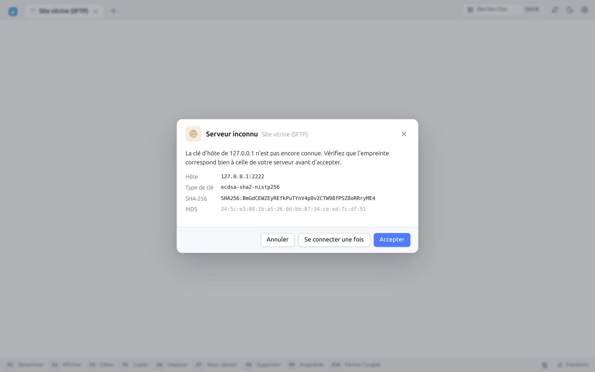

**Clé d'hôte modifiée** : si un serveur présente une clé différente de celle enregistrée, Skiff affiche une alerte rouge, avec l'ancienne et la nouvelle empreinte. C'est le signe d'une réinstallation du serveur… ou d'une interception. Les choix sont **Mettre à jour la clé**, **Se connecter une fois** et **Annuler**. Dans le doute, annulez et vérifiez auprès de l'administrateur.

**Épinglage** : dans le site (**SSH → Empreinte attendue de la clé d'hôte**), une empreinte `SHA256:…` fixe la clé attendue. Toute autre clé est alors refusée sans question. En script, l'option `-hostkey=` de `open` fait de même.

La liste des clés enregistrées se trouve dans **Préférences → Sécurité → Clés d'hôtes connues**. La corbeille d'une ligne supprime la clé (la question sera reposée à la prochaine connexion).

## 11.2 Certificats TLS

Pour FTPS, WebDAV en HTTPS et S3 en HTTPS, Skiff vérifie le certificat du serveur avec les autorités de certification du système. Un certificat auto-signé, expiré ou émis pour un autre nom déclenche une question :

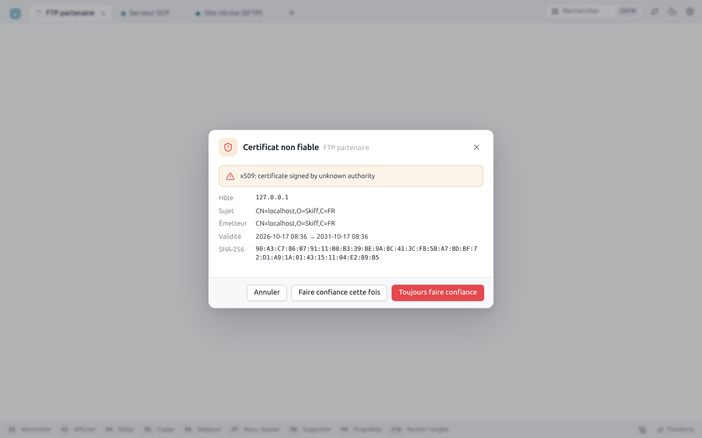

La boîte rappelle la raison du refus (« certificate signed by unknown authority »), puis l'**Hôte**, le **Sujet**, l'**Émetteur**, les **Noms** couverts, la période de **Validité** et l'empreinte SHA-256.

| Bouton | Effet |
|---|---|
| **Toujours faire confiance** | Enregistre le certificat (`trusted_certs.json`) : les connexions suivantes l'acceptent sans question |
| **Faire confiance cette fois** | Accepte le certificat pour cette connexion seulement |
| **Annuler** | Abandonne la connexion |

Dans le site, section **TLS**, l'**Empreinte attendue du certificat** épingle un certificat précis, et **Ne pas vérifier les certificats (non sécurisé)** désactive toute vérification (à réserver aux tests).

## 11.3 Mots de passe enregistrés

Les mots de passe, phrases secrètes, mots de passe de proxy et jetons enregistrés sont chiffrés avec **XChaCha20-Poly1305** avant d'être écrits dans `sites.json`.

- **Sans mot de passe maître**, la clé de chiffrement est un fichier aléatoire, `secret.key`, lisible par vous seul (droits 600). `sites.json` peut être sauvegardé ou synchronisé : sans `secret.key`, les mots de passe restent illisibles.
- **Avec un mot de passe maître**, la clé est dérivée de ce mot de passe par **Argon2id** (3 passes, 64 Mio, 2 fils) et n'est jamais écrite sur le disque.

Dans tous les cas, l'interface ne reçoit jamais les mots de passe enregistrés : elle sait seulement qu'un mot de passe existe (« Enregistré — tapez pour remplacer »). Les exports de sites ne contiennent jamais de mot de passe.

## 11.4 Mot de passe maître

**Préférences → Sécurité → Définir un mot de passe maître** :

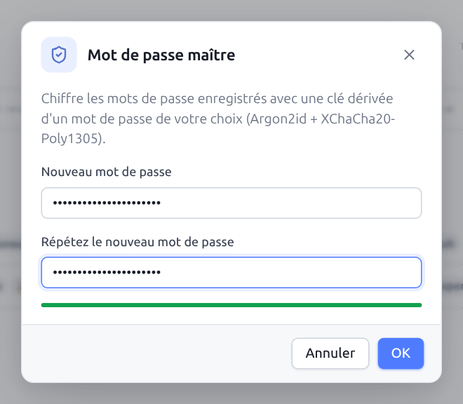

Saisissez deux fois le mot de passe (8 caractères au minimum). Une jauge indique sa robustesse. Une fois défini, la section Sécurité affiche **Activé** et propose **Changer le mot de passe maître**, **Supprimer le mot de passe maître** et **Verrouiller les mots de passe maintenant** :

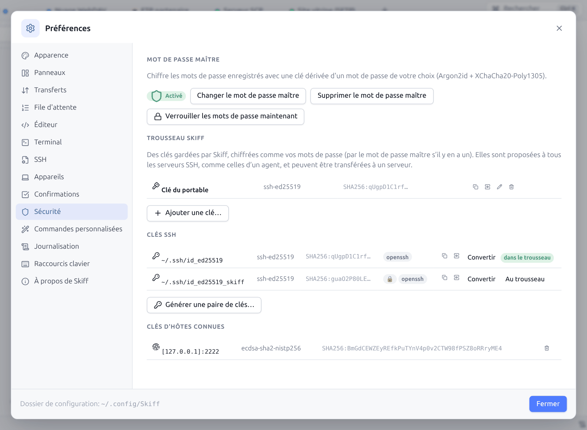

Au démarrage suivant (ou après **Verrouiller les mots de passe maintenant**, aussi disponible dans la palette `Ctrl+K`), les mots de passe enregistrés sont **verrouillés**. Un bandeau le signale en haut de la liste des sites :

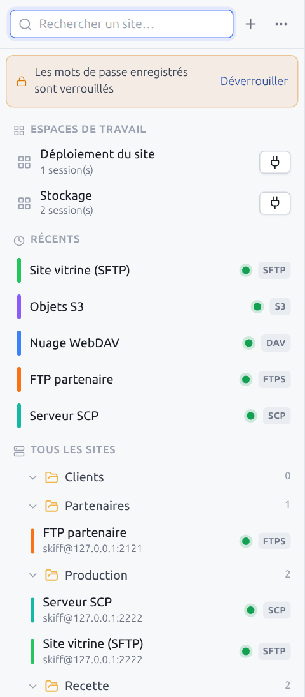

Cliquez sur **Déverrouiller** (ou connectez-vous à un site qui a besoin d'un mot de passe) pour saisir le mot de passe maître :

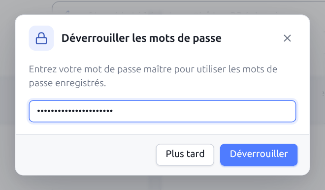

**Plus tard** ferme la boîte sans déverrouiller (et n'ouvre pas la connexion demandée, le cas échéant). Les sites sans mot de passe enregistré, qui utilisent une clé ou l'agent SSH, restent utilisables tant que les mots de passe sont verrouillés. Changer le mot de passe maître rechiffre tous les secrets. Le supprimer revient au chiffrement par `secret.key`.

Un mot de passe maître oublié ne peut pas être récupéré : il faut alors ressaisir les mots de passe des sites.

## 11.5 Générateur de clés SSH

**Générer une paire de clés…** (**Nouvelle clé SSH** sur l'écran d'accueil, menu ⋯ des sites, palette, Préférences → Sécurité, bouton **Choisir** du fichier de clé d'un site) crée une nouvelle clé, comme `ssh-keygen` ou PuTTYgen :

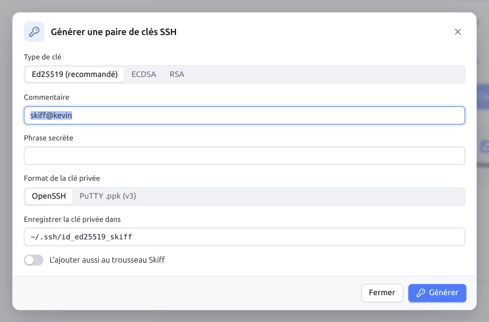

| Champ | Description |
|---|---|
| **Type de clé** | **Ed25519 (recommandé)**, **ECDSA** (256, 384 ou 521 bits), **RSA** (2048, 3072, 4096 ou 8192 bits) |
| **Commentaire** | Texte ajouté à la clé publique (`utilisateur@machine` par défaut) |
| **Phrase secrète** | Chiffre la clé privée (recommandé). Une jauge indique sa robustesse. |
| **Format de la clé privée** | **OpenSSH** ou **PuTTY .ppk (v3)** |
| **Enregistrer la clé privée dans** | Chemin du fichier (`~/.ssh/id_ed25519_skiff` par défaut). La clé publique est écrite à côté avec l'extension `.pub`. Un fichier existant n'est jamais écrasé. |

**Générer** affiche le résultat :

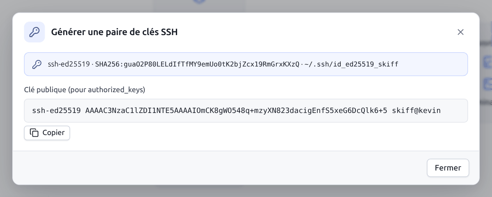

Le type, l'empreinte et l'emplacement de la clé, puis la **Clé publique (pour authorized_keys)** à copier. Si une session SFTP ou SCP est ouverte, **Installer sur le serveur courant** ajoute la clé publique au fichier `~/.ssh/authorized_keys` du serveur (en créant `~/.ssh` avec les bons droits si besoin), comme `ssh-copy-id`.

En ligne de commande : `skiff keygen` (voir [Scripts](13-scripts-cli.md#137-skiff-keygen)).

## 11.6 Clés existantes et conversion

**Préférences → Sécurité → Clés SSH** liste les clés privées de `~/.ssh` avec leur type, leur empreinte, leur format (`openssh` ou `ppk`) et un cadenas si elles sont protégées par une phrase secrète. **Convertir** transforme une clé OpenSSH en clé PuTTY `.ppk`, ou l'inverse :

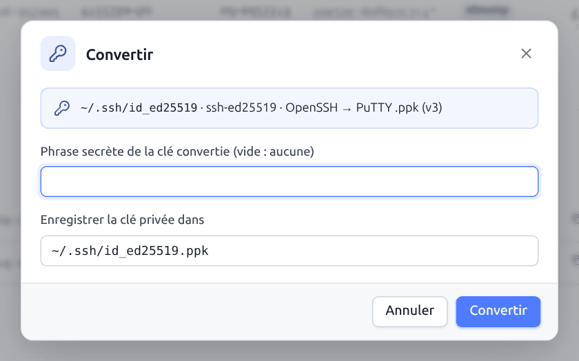

Indiquez la phrase secrète actuelle (si la clé est chiffrée), la phrase secrète de la clé convertie (vide : aucune) et le fichier de destination. La clé d'origine n'est pas modifiée. En ligne de commande : `skiff keygen -convert`.

Skiff lit directement les deux formats pour se connecter : la conversion ne sert qu'à échanger des clés avec d'autres logiciels (PuTTY, WinSCP, OpenSSH).

### Installer une clé existante sur un serveur

Pour passer d'un mot de passe à une clé sur un serveur (un VPS, par exemple) : connectez-vous une fois en SFTP ou SCP avec le mot de passe, puis ouvrez **Installer une clé publique**. La boîte ajoute la clé publique à `~/.ssh/authorized_keys` du compte connecté, comme `ssh-copy-id` :

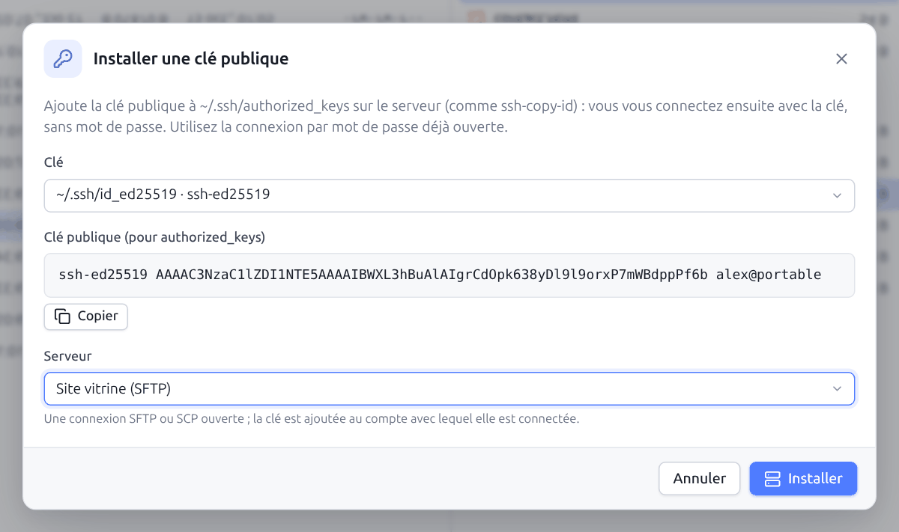

| Champ | Description |
|---|---|
| **Clé** | Une clé du **trousseau Skiff** ([§ 11.7](#117-trousseau-skiff-et-transfert-dagent)), une clé de `~/.ssh`, ou **Une autre clé publique (à coller)…** (la clé d'un collègue, d'un autre ordinateur). La clé publique choisie s'affiche dessous, avec **Copier**. |
| **Serveur** | Une connexion SFTP ou SCP ouverte ; la clé est ajoutée au compte avec lequel elle est connectée. Depuis une session, c'est le serveur de cette session. |

**Installer** crée `~/.ssh` (droits `700`) et `authorized_keys` (droits `600`) si besoin, et n'ajoute pas une clé déjà présente. Seules des opérations sur les fichiers sont utilisées : cela marche aussi pour un compte limité à SFTP.

La clé publique d'une clé de `~/.ssh` vient de son fichier `.pub`, ou de la clé elle-même : une clé OpenSSH récente ou PuTTY `.ppk` contient sa partie publique en clair, même protégée par une phrase secrète, qui n'est donc pas demandée. Seules les anciennes clés PEM chiffrées sans `.pub` ne sont pas proposées (la boîte l'indique).

La boîte s'ouvre depuis :

- **Préférences → Sécurité** : **Installer sur un serveur…** sur chaque clé du trousseau et de `~/.ssh`, à côté de **Copier la clé publique** ;
- la palette (`Ctrl+K` → « Installer une clé publique ») ;
- le menu **⋯** de la liste des sites ;
- **Informations serveur/protocole** d'une session SFTP ou SCP ([§ 10.3](10-recherche-journal.md#103-informations-serveur-et-protocole)) ;
- le résultat du générateur de clés propose aussi **Installer sur le serveur courant** ([§ 11.5](#115-générateur-de-clés-ssh)).

Vérifiez ensuite qu'une nouvelle connexion passe par la clé (le [journal](10-recherche-journal.md) indique `publickey`) avant de désactiver les mots de passe sur le serveur (`PasswordAuthentication no` dans `/etc/ssh/sshd_config`).

## 11.7 Trousseau Skiff et transfert d'agent

Le **trousseau Skiff** garde vos clés privées dans Skiff lui-même, chiffrées comme les mots de passe enregistrés : par le mot de passe maître s'il y en a un ([§ 11.4](#114-mot-de-passe-maître)), sinon par la clé locale de l'ordinateur. Pas besoin d'agent SSH sur l'ordinateur, ni de laisser une clé non chiffrée sur le disque.

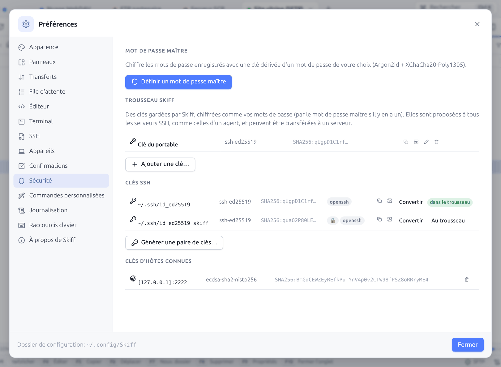

Pour y mettre une clé, dans **Préférences → Sécurité** :

- **Au trousseau**, sur une clé de la liste **Clés SSH** (`~/.ssh`) : la phrase secrète est demandée si la clé en a une ;
- **Ajouter une clé…** : collez une clé OpenSSH, PEM ou PuTTY `.ppk`, avec son nom et sa phrase secrète ;
- dans le [générateur de clés](#115-générateur-de-clés-ssh), la case **L'ajouter aussi au trousseau Skiff**.

Une clé protégée par une phrase secrète est déchiffrée une seule fois, à l'ajout, puis gardée chiffrée par Skiff : la phrase secrète n'est plus jamais demandée. Chaque clé du trousseau se **renomme**, se **retire** (le fichier d'origine, s'il existe, n'est pas touché) et sa clé publique se **copie** (pour la coller dans un `authorized_keys`, ou l'installer avec le générateur). Le fichier `keychain.json` du dossier de configuration ne contient que des clés chiffrées.

Les clés du trousseau sont **proposées à tous les serveurs SSH**, avant celles de l'agent du système, dès que **Utiliser le trousseau Skiff et l'agent SSH / Pageant** est coché dans le site (c'est le cas par défaut), hôtes de rebond compris. Le journal de session indique `Using 1 key(s) from the Skiff keychain`. Tant que le mot de passe maître est verrouillé, le trousseau n'est pas utilisé.

**Transfert d'agent** : avec **Transférer l'agent au serveur (ForwardAgent)** (section **SSH** du site), ou `ForwardAgent yes` dans [`~/.ssh/config`](03-sites.md#34-configuration-openssh-ssh_config), les terminaux SSH de ce site reçoivent un agent : `git pull`, `ssh` vers un autre serveur ou `scp` y utilisent les clés du trousseau puis celles de l'agent du système, sans qu'elles quittent votre ordinateur (`ssh-add -l` les liste). Le serveur peut demander des signatures, jamais ajouter ni retirer de clés. N'activez le transfert que vers des serveurs de confiance : pendant la connexion, leur administrateur peut utiliser vos clés.

## 11.8 Sécurité de l'application

- **Fenêtre de bureau** : l'interface communique avec le moteur de Skiff par un serveur HTTP qui n'écoute que sur `127.0.0.1`, protégé par un jeton aléatoire à chaque lancement, un contrôle de l'en-tête `Host` (contre le *DNS rebinding*) et un en-tête anti-CSRF obligatoire.
- Les fichiers HTML et SVG prévisualisés ne sont jamais exécutés dans le contexte de l'application.
- **Mode web** : voir [Mode web distant](14-mode-web.md#143-sécurité).

---

[← Recherche, journal et palette](10-recherche-journal.md) · [Sommaire](README.md) · [Préférences →](12-preferences.md)
