# 12. Préférences

[← Sécurité](11-securite.md) · [Sommaire](README.md) · [Scripts et ligne de commande →](13-scripts-cli.md)

**Préférences** (`Ctrl+,`, roue dentée en haut à droite, ou palette) ouvre une fenêtre en treize sections. Chaque modification s'applique **immédiatement** et est enregistrée dans `settings.json` : il n'y a pas de bouton « Appliquer ». Le bas de la fenêtre rappelle le **Dossier de configuration**.

## 12.1 Apparence

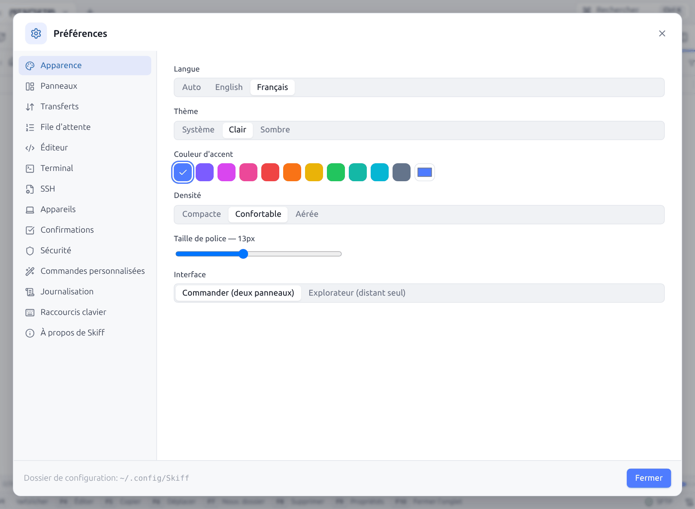

| Réglage | Valeurs |
|---|---|
| **Langue** | **Auto** (langue du système), **English**, **Français** |
| **Thème** | **Système** (suit le réglage clair ou sombre du système), **Clair**, **Sombre** |
| **Couleur d'accent** | Onze couleurs prédéfinies, ou n'importe quelle couleur avec le sélecteur à droite |
| **Densité** | **Compacte**, **Confortable**, **Aérée** : hauteur des lignes et espacements |
| **Taille de police** | De 11 à 16 px, par demi-pixel |
| **Interface** | **Commander (deux panneaux)** ou **Explorateur (distant seul)** pour les nouvelles sessions |

Le bouton lune / soleil de la barre d'onglets bascule directement entre clair et sombre. Voici l'interface en thème sombre :

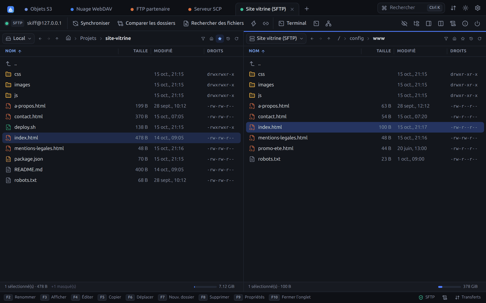

La même, en densité compacte avec un accent turquoise :

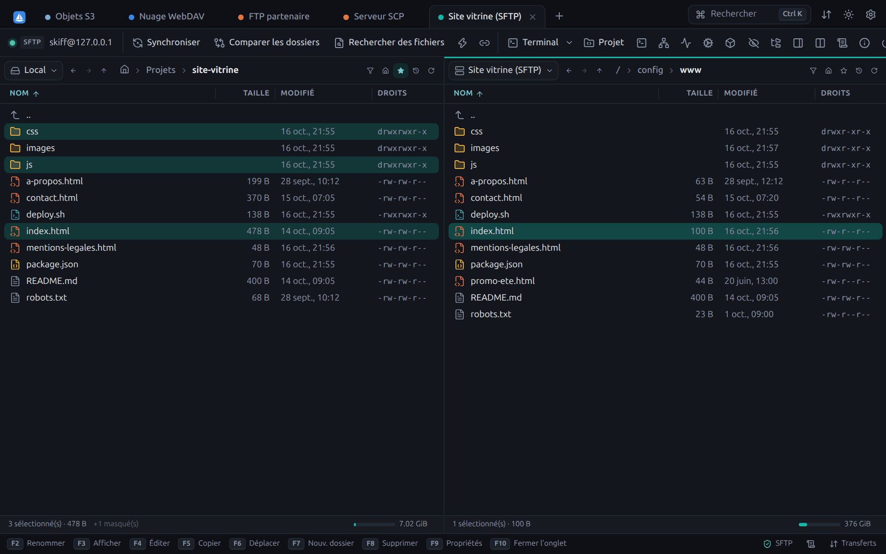

La palette de commandes en thème sombre :

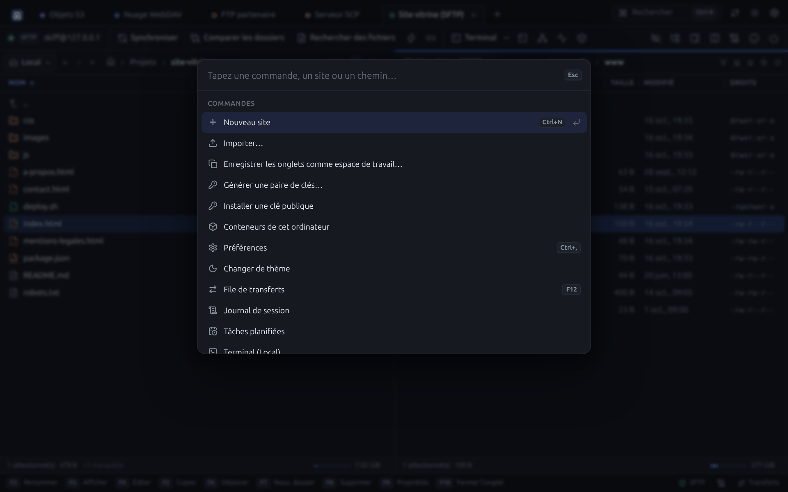

Et l'interface en anglais :

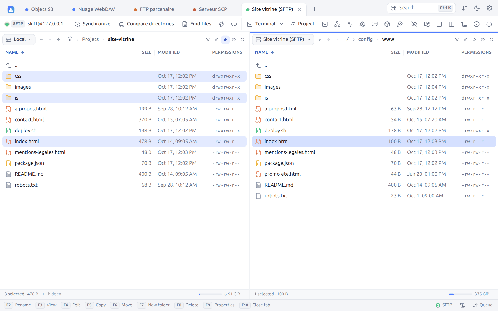

## 12.2 Panneaux

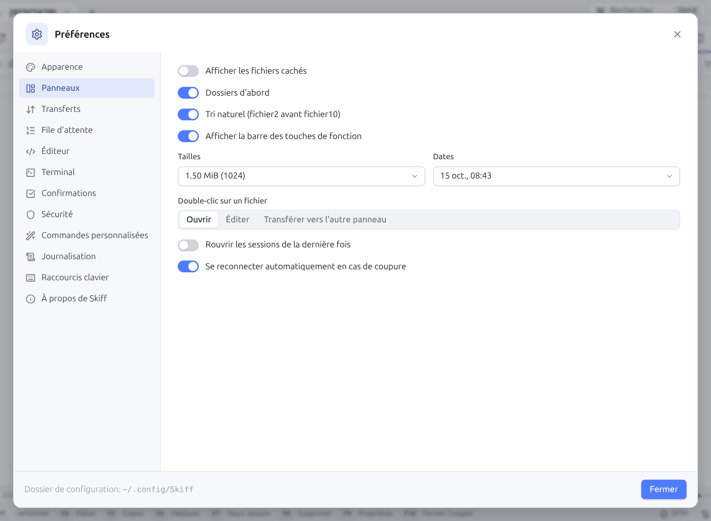

| Réglage | Description |
|---|---|
| **Afficher les fichiers cachés** | Affiche les fichiers commençant par un point (aussi `Ctrl+Alt+H`) |
| **Dossiers d'abord** | Trie les dossiers avant les fichiers |
| **Tri naturel (fichier2 avant fichier10)** | Compare les nombres dans les noms par leur valeur |
| **Afficher la barre des touches de fonction** | Barre `F2`…`F10` en bas de la fenêtre |
| **Tailles** | `1.50 MiB (1024)` (unités binaires), `1.57 MB (1000)` (unités décimales) ou nombre exact d'octets |
| **Dates** | Courte (`15 oct., 08:12`), relative (`il y a 5 minutes`) ou ISO (`2026-10-15 08:12:44`) |
| **Double-clic sur un fichier** (et `Entrée`) | **Ouvrir** : les fichiers texte de moins de 5 Mo s'ouvrent dans l'éditeur, les autres avec l'application par défaut du système (dans l'aperçu en mode web). **Éditer** : toujours l'éditeur. **Transférer vers l'autre panneau** : comme `F5` |
| **Rouvrir les sessions de la dernière fois** | Restaure les onglets au démarrage |
| **Se reconnecter automatiquement en cas de coupure** | Relance la connexion perdue (voir [Dépannage](17-depannage.md#172-connexion-perdue)) |

## 12.3 Transferts

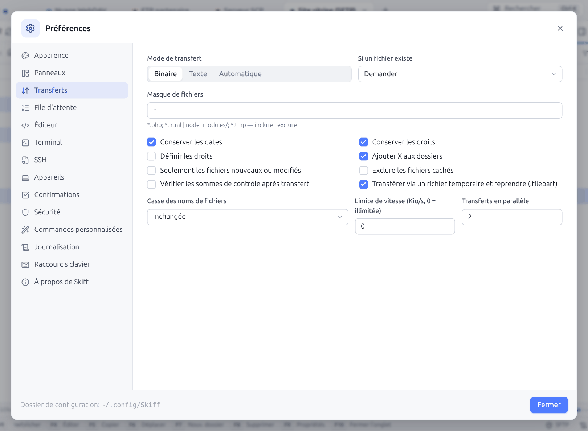

Les options de transfert par défaut, identiques à celles de la [boîte de transfert](06-transferts.md#62-la-boîte-de-transfert) : mode de transfert, politique d'écrasement, masque de fichiers, dates, droits, fichiers nouveaux ou modifiés, fichiers cachés, vérification, `.filepart`, casse des noms, limite de vitesse et transferts en parallèle.

## 12.4 File d'attente

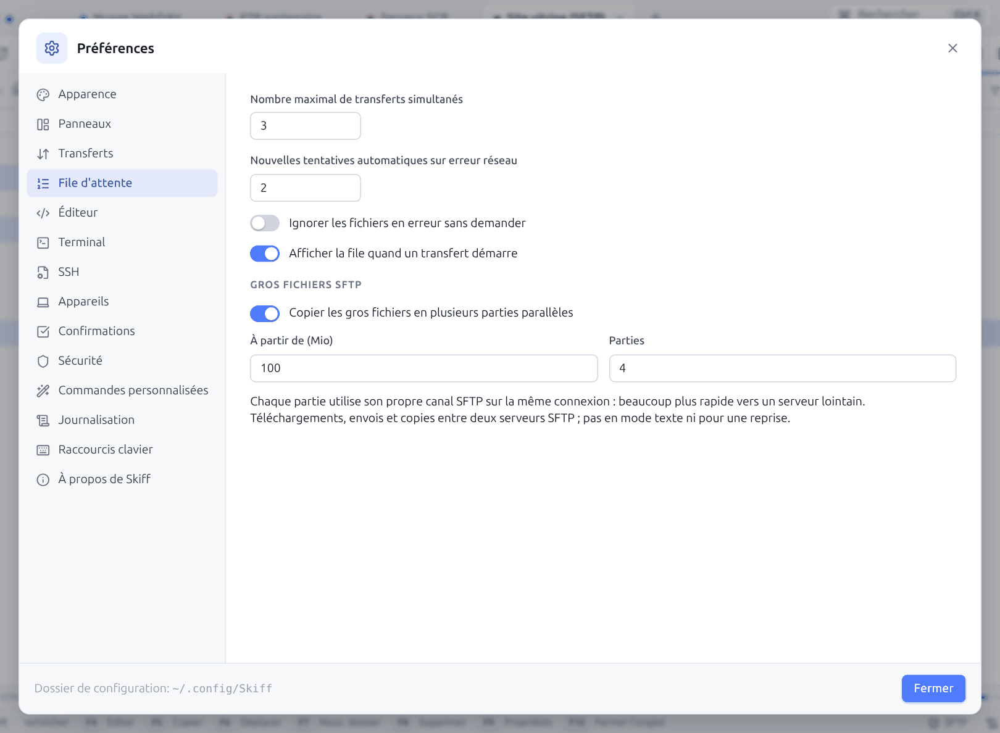

| Réglage | Par défaut | Description |
|---|---|---|
| **Nombre maximal de transferts simultanés** | 3 | Tâches de la file exécutées en même temps ; les autres attendent |
| **Nouvelles tentatives automatiques sur erreur réseau** | 2 | Nombre de reprises automatiques d'un fichier après une coupure |
| **Ignorer les fichiers en erreur sans demander** | non | Passe les fichiers en erreur sans afficher la [boîte d'erreur](06-transferts.md#66-erreurs-de-transfert) |
| **Afficher la file quand un transfert démarre** | oui | Ouvre le panneau **Transferts** automatiquement |

## 12.5 Éditeur

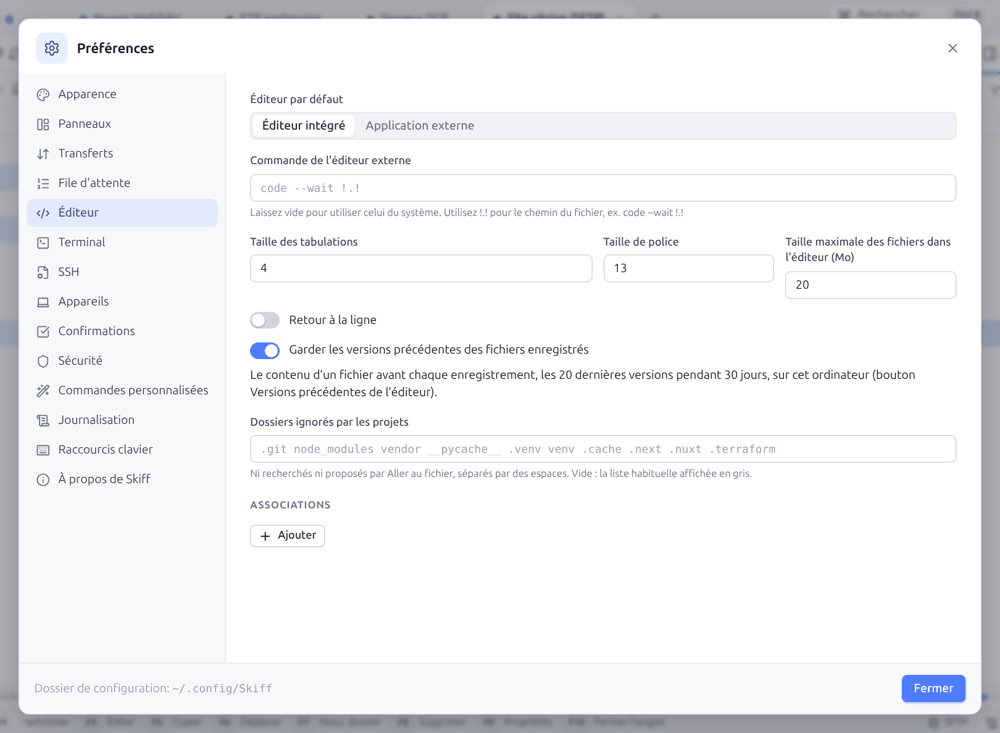

| Réglage | Description |
|---|---|
| **Éditeur par défaut** | **Éditeur intégré** ou **Application externe** pour `F4` et le double-clic (l'application externe n'existe pas en mode web) |
| **Commande de l'éditeur externe** | Vide : l'application du système. Sinon la commande, avec `!.!` pour le chemin du fichier : `code --wait !.!`, `notepad++.exe !.!`, `subl -w !.!` |
| **Taille des tabulations** | 1 à 8 espaces |
| **Taille de police** | Police de l'éditeur, 9 à 24 px |
| **Taille maximale des fichiers dans l'éditeur (Mo)** | 20 par défaut |
| **Retour à la ligne** | Coupe les lignes longues à la largeur de la fenêtre |
| **Associations** | Couples masque → commande. **Ajouter** crée une ligne : `*.psd` → `gimp !.!`, `*.log` → `internal` (force l'éditeur intégré) |

## 12.6 Terminal

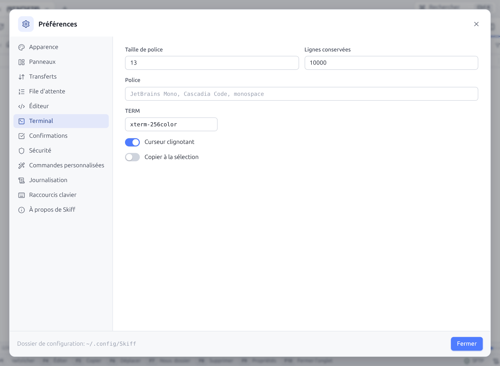

| Réglage | Description |
|---|---|
| **Taille de police** | 9 à 24 px |
| **Lignes conservées** | Taille de l'historique de défilement (10 000 par défaut) |
| **Police** | Liste de polices CSS, par exemple `JetBrains Mono, Cascadia Code, monospace` |
| **TERM** | Type de terminal annoncé au serveur (`xterm-256color`) |
| **Curseur clignotant** | |
| **Copier à la sélection** | Copie le texte dès qu'il est sélectionné |

## 12.7 SSH

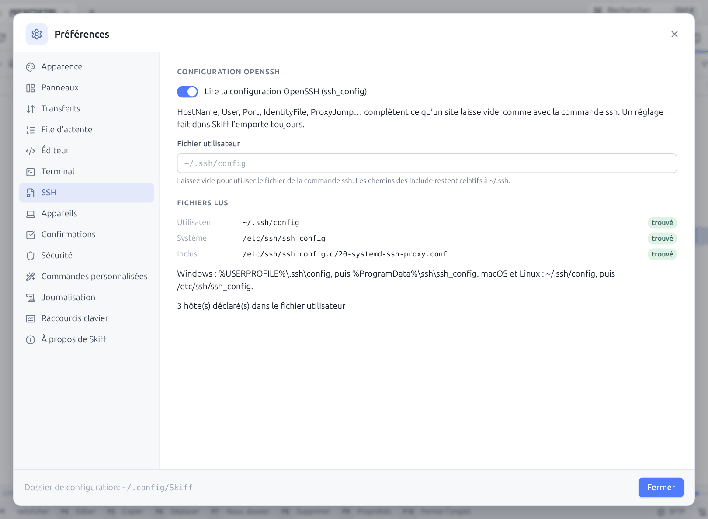

| Réglage | Description |
|---|---|
| **Lire la configuration OpenSSH (ssh_config)** | Activé par défaut : les hôtes de `~/.ssh/config` apparaissent dans la liste des sites et leurs paramètres complètent les sites SSH (voir [Configuration OpenSSH](03-sites.md#34-configuration-openssh-ssh_config)) |
| **Fichier utilisateur** | Vide : le fichier de la commande `ssh` de votre système. Indiquez un autre fichier pour le remplacer (les `Include` relatifs restent cherchés dans `~/.ssh`). |
| **Fichiers lus** | Le fichier utilisateur, le fichier système et ceux qu'ils incluent, avec leur état : **trouvé**, **absent** ou **illisible** |

Emplacements par système : sous Windows `%USERPROFILE%\.ssh\config` puis `%ProgramData%\ssh\ssh_config` ; sous macOS et Linux `~/.ssh/config` puis `/etc/ssh/ssh_config`.

## 12.8 Confirmations

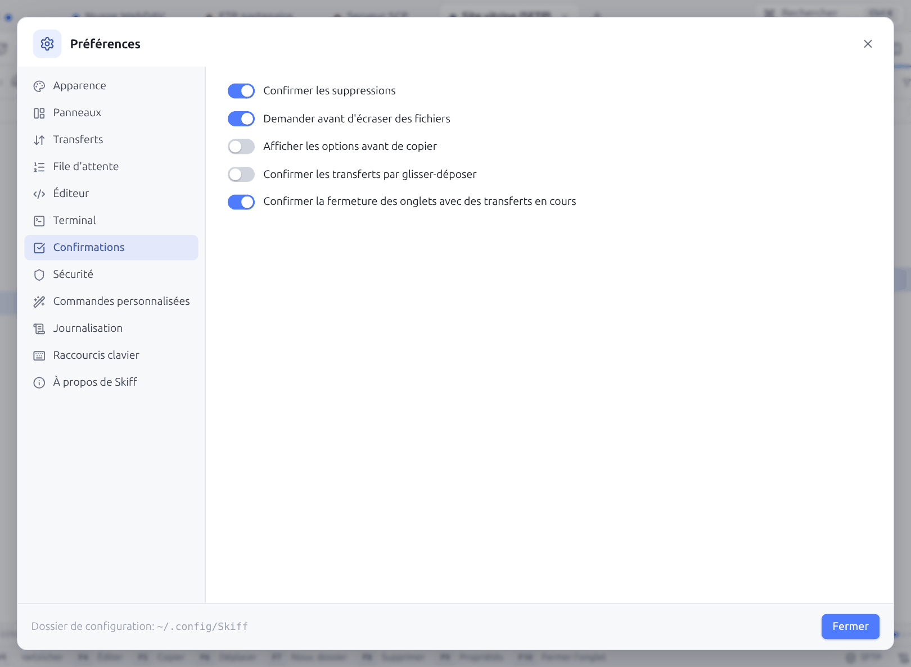

| Réglage | Par défaut |
|---|---|
| **Confirmer les suppressions** | oui |
| **Demander avant d'écraser des fichiers** | oui |
| **Afficher les options avant de copier** (boîte de transfert à chaque `F5`) | non |
| **Confirmer les transferts par glisser-déposer** | non |
| **Confirmer la fermeture des onglets avec des transferts en cours** | oui |

## 12.9 Sécurité

- **Mot de passe maître** : définir, changer, supprimer, verrouiller (voir [§ 11.4](11-securite.md#114-mot-de-passe-maître)).
- **Clés SSH** : les clés privées de `~/.ssh`, avec **Convertir** (voir [§ 11.6](11-securite.md#116-clés-existantes-et-conversion)), et **Générer une paire de clés…**.
- **Clés d'hôtes connues** : hôte, type de clé, empreinte, et la corbeille pour oublier une clé.

## 12.10 Commandes personnalisées

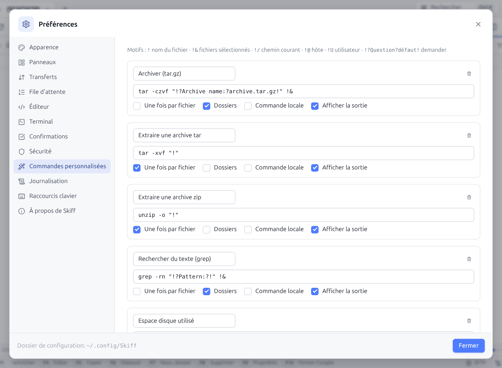

Chaque commande a un nom, une ligne de commande avec les motifs de WinSCP (rappelés en haut : `!` nom du fichier, `!&` fichiers sélectionnés, `!/` chemin courant, `!@` hôte, `!U` utilisateur, `!?Question?défaut!` demander), et quatre options : **Une fois par fichier**, **Dossiers**, **Commande locale**, **Afficher la sortie**. La corbeille supprime la commande et **Ajouter une commande** en crée une. Voir [§ 5.10](05-fichiers.md#510-commandes-personnalisées).

## 12.11 Journalisation

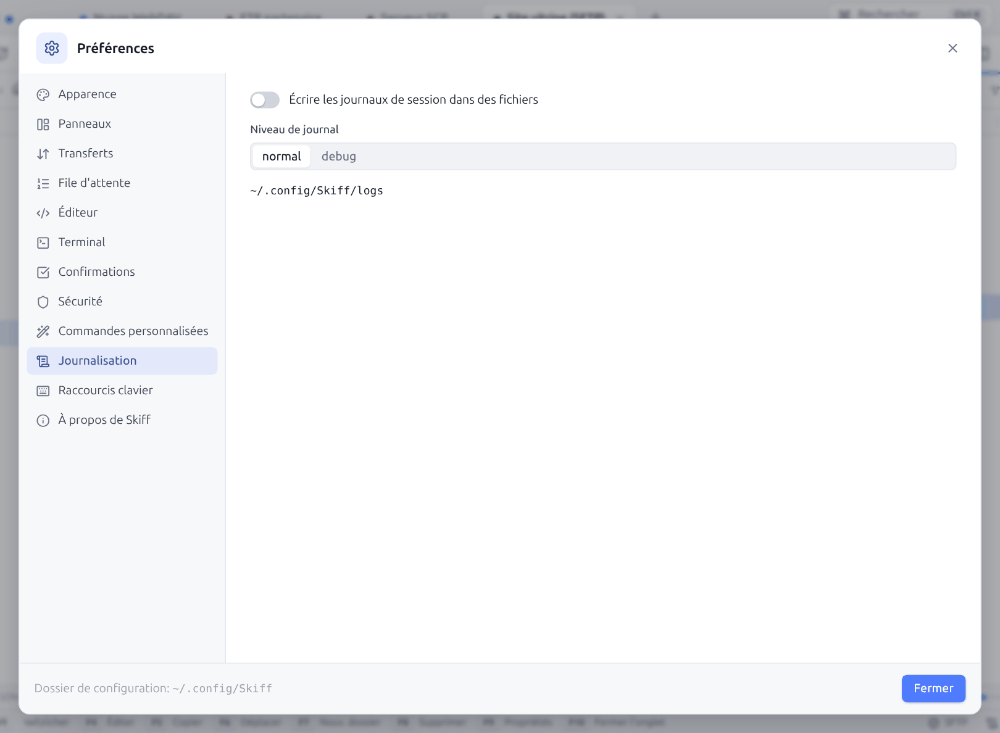

| Réglage | Description |
|---|---|
| **Écrire les journaux de session dans des fichiers** | Un fichier par session dans le dossier `logs` indiqué en dessous |
| **Niveau de journal** | **normal** (commandes et évènements) ou **debug** (avec les réponses du serveur) |

## 12.12 Raccourcis clavier

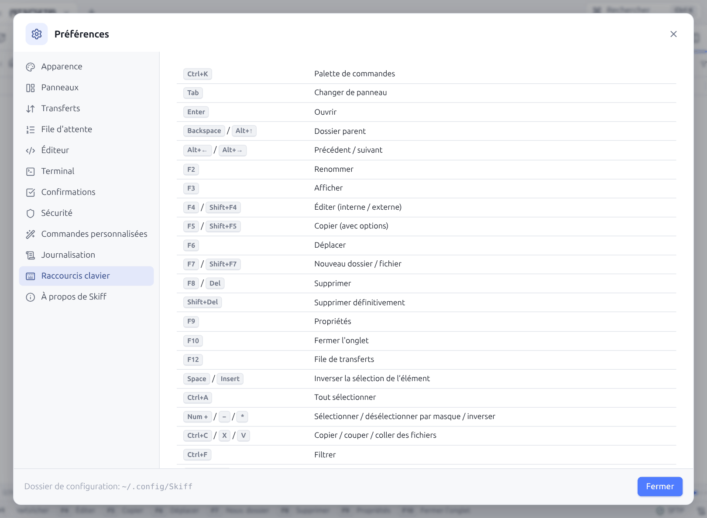

La liste de tous les raccourcis. Elle est reprise au chapitre [Raccourcis clavier](16-raccourcis.md).

## 12.13 À propos de Skiff

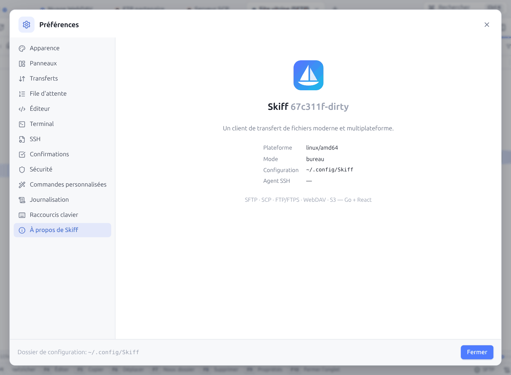

La version, la **Plateforme** (système et architecture), le **Mode** (bureau ou web), le dossier de **Configuration** et la présence d'un **Agent SSH**.

---

[← Sécurité](11-securite.md) · [Sommaire](README.md) · [Scripts et ligne de commande →](13-scripts-cli.md)
