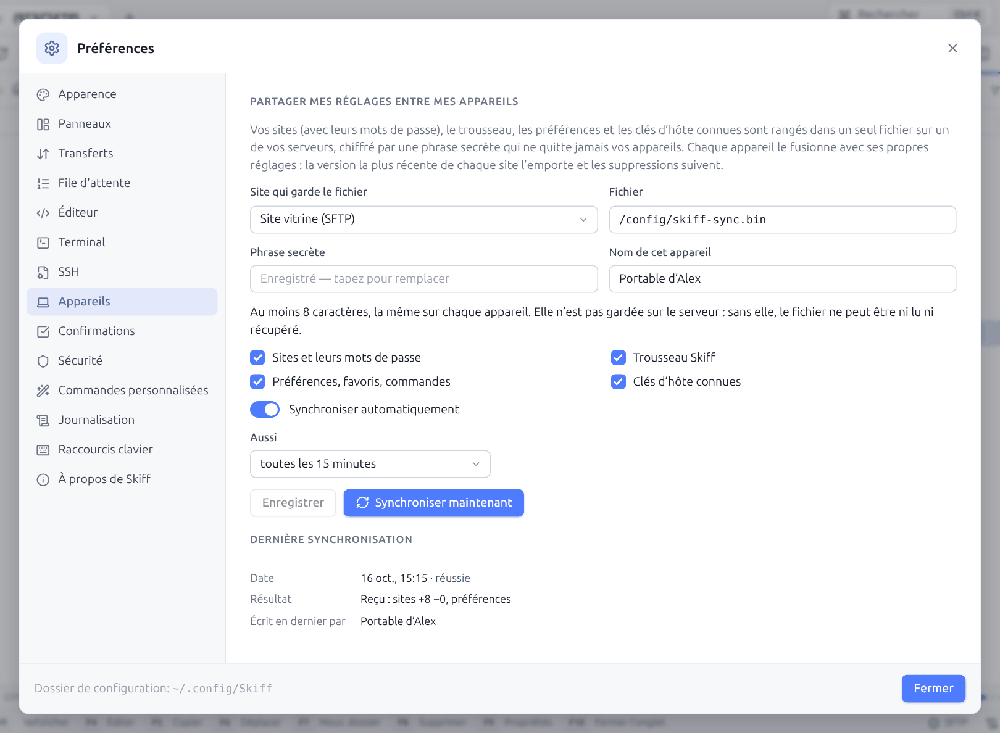
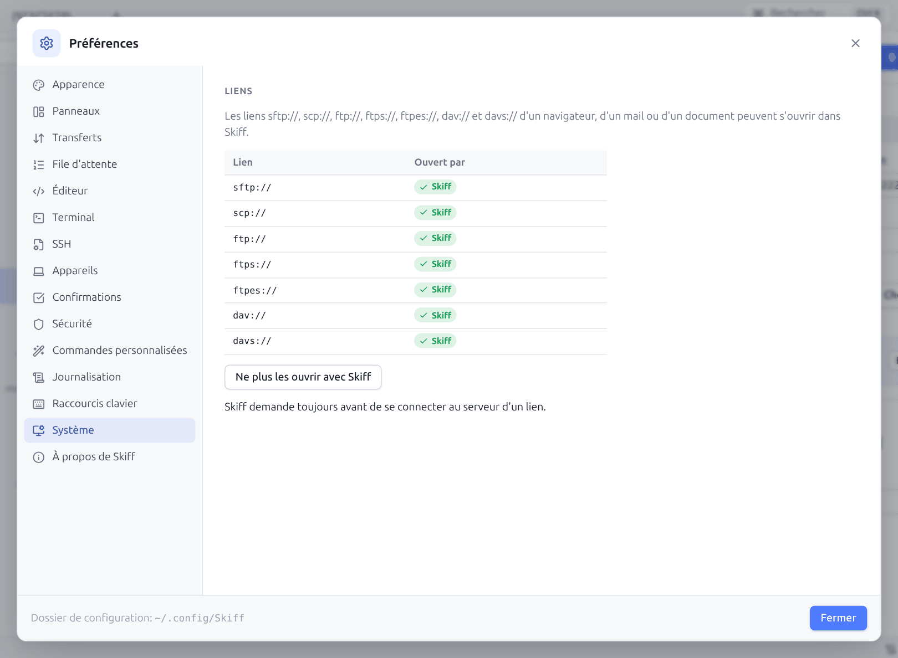
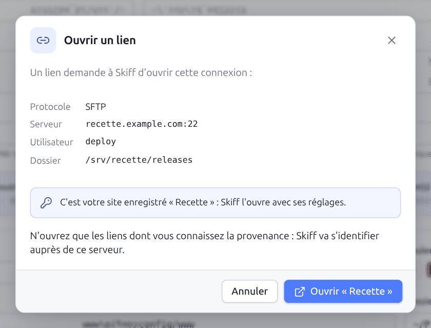

# 12. Préférences

[← Sécurité](11-securite.md) · [Sommaire](README.md) · [Scripts et ligne de commande →](13-scripts-cli.md) · 🇬🇧 [English](en/12-preferences.md)

**Préférences** (`Ctrl+,`, roue dentée en haut à droite, ou palette) ouvre une fenêtre en quatorze sections. Chaque modification s'applique **immédiatement** et est enregistrée dans `settings.json` : il n'y a pas de bouton « Appliquer ». Le bas de la fenêtre rappelle le **Dossier de configuration**.

## 12.1 Apparence

| Réglage | Valeurs |
|---|---|
| **Langue** | **Auto** (langue du système), **English**, **Français** |
| **Thème** | **Système** (suit le réglage clair ou sombre du système), **Clair**, **Sombre** |
| **Couleur d'accent** | Onze couleurs prédéfinies, ou n'importe quelle couleur avec le sélecteur à droite |
| **Densité** | **Compacte**, **Confortable**, **Aérée** : hauteur des lignes et espacements |
| **Taille de police** | De 11 à 16 px, par demi-pixel |
| **Interface** | **Commander (deux panneaux)** ou **Explorateur (distant seul)** pour les nouvelles sessions |

Le bouton lune / soleil de la barre d'onglets bascule directement entre clair et sombre. Voici l'interface en thème sombre :

La même, en densité compacte avec un accent turquoise :

La palette de commandes en thème sombre :

Et l'interface en anglais :

## 12.2 Panneaux

| Réglage | Description |
|---|---|
| **Afficher les fichiers cachés** | Affiche les fichiers commençant par un point (aussi `Ctrl+Alt+H`) |
| **Dossiers d'abord** | Trie les dossiers avant les fichiers |
| **Tri naturel (fichier2 avant fichier10)** | Compare les nombres dans les noms par leur valeur |
| **Afficher la barre des touches de fonction** | Barre `F2`…`F10` en bas de la fenêtre |
| **Tailles** | `1.50 MiB (1024)` (unités binaires), `1.57 MB (1000)` (unités décimales) ou nombre exact d'octets |
| **Dates** | Courte (`15 oct., 08:12`), relative (`il y a 5 minutes`) ou ISO (`2026-10-15 08:12:44`) |
| **Double-clic sur un fichier** (et `Entrée`) | **Ouvrir** : les fichiers texte de moins de 5 Mo s'ouvrent dans l'éditeur, les autres avec l'application par défaut du système (dans l'aperçu en mode web). **Éditer** : toujours l'éditeur. **Transférer vers l'autre panneau** : comme `F5` |
| **Rouvrir les sessions de la dernière fois** | Restaure les onglets au démarrage |
| **Se reconnecter automatiquement en cas de coupure** | Relance la connexion perdue (voir [Dépannage](17-depannage.md#172-connexion-perdue)) |

## 12.3 Transferts

Les options de transfert par défaut, identiques à celles de la [boîte de transfert](06-transferts.md#62-la-boîte-de-transfert) : mode de transfert, politique d'écrasement, masque de fichiers, dates, droits, fichiers nouveaux ou modifiés, fichiers cachés, vérification, `.filepart`, casse des noms, limite de vitesse et transferts en parallèle.

## 12.4 File d'attente

| Réglage | Par défaut | Description |
|---|---|---|
| **Nombre maximal de transferts simultanés** | 3 | Tâches de la file exécutées en même temps ; les autres attendent |
| **Nouvelles tentatives automatiques sur erreur réseau** | 2 | Nombre de reprises automatiques d'un fichier après une coupure |
| **Ignorer les fichiers en erreur sans demander** | non | Passe les fichiers en erreur sans afficher la [boîte d'erreur](06-transferts.md#66-erreurs-de-transfert) |
| **Afficher la file quand un transfert démarre** | oui | Ouvre le panneau **Transferts** automatiquement |
| **Copier les gros fichiers en plusieurs parties parallèles** | oui | Fichiers SFTP copiés en parties simultanées ([§ 6.8](06-transferts.md#68-gros-fichiers-en-parties-parallèles-sftp)) |
| **À partir de (Mio)** | 100 | Taille à partir de laquelle un fichier est découpé |
| **Parties** | 4 | Nombre de parties copiées en même temps (2 à 8) |

## 12.5 Éditeur

| Réglage | Description |
|---|---|
| **Éditeur par défaut** | **Éditeur intégré** ou **Application externe** pour `F4` et le double-clic (l'application externe n'existe pas en mode web) |
| **Commande de l'éditeur externe** | Vide : l'application du système. Sinon la commande, avec `!.!` pour le chemin du fichier : `code --wait !.!`, `notepad++.exe !.!`, `subl -w !.!` |
| **Taille des tabulations** | 1 à 8 espaces |
| **Taille de police** | Police de l'éditeur, 9 à 24 px |
| **Taille maximale des fichiers dans l'éditeur (Mo)** | 20 par défaut |
| **Retour à la ligne** | Coupe les lignes longues à la largeur de la fenêtre |
| **Garder les versions précédentes des fichiers enregistrés** | Activé par défaut : une copie avant chaque enregistrement, sur cet ordinateur ([§ 8.8](08-edition.md#88-versions-précédentes)) |
| **Dossiers ignorés par les projets** | Ni recherchés ni proposés par **Aller au fichier** ([§ 8.7](08-edition.md#87-projets--modifier-un-dossier-sans-rien-installer-sur-le-serveur)), séparés par des espaces. Vide : `.git node_modules vendor __pycache__ .venv venv .cache .next .nuxt .terraform` |
| **Associations** | Couples masque → commande. **Ajouter** crée une ligne : `*.psd` → `gimp !.!`, `*.log` → `internal` (force l'éditeur intégré) |

## 12.6 Terminal

| Réglage | Description |
|---|---|
| **Taille de police** | 9 à 24 px |
| **Lignes conservées** | Taille de l'historique de défilement (10 000 par défaut) |
| **Police** | Liste de polices CSS, par exemple `JetBrains Mono, Cascadia Code, monospace` |
| **TERM** | Type de terminal annoncé au serveur (`xterm-256color`) |
| **Curseur clignotant** | |
| **Copier à la sélection** | Copie le texte dès qu'il est sélectionné |
| **Copier et coller** | **Ctrl+C / Ctrl+V** (par défaut) : `Ctrl+C` copie la sélection, et sans sélection interrompt le programme ; `Ctrl+V` colle. **Ctrl+Maj+C / Ctrl+Maj+V seulement** : `Ctrl+C` et `Ctrl+V` vont toujours au programme. `Ctrl+Maj+C` et `Ctrl+Maj+V` marchent dans les deux cas ([§ 9.1](09-terminal-tunnels.md#copier-coller-et-clic-droit)). |
| **Clic droit** | **Copier ou coller (comme PowerShell)** (par défaut) : copie la sélection, colle s'il n'y en a pas. **Menu** : ouvre un menu (copier, coller, tout sélectionner, effacer, rechercher, diviser). |
| **Shell des terminaux locaux** | **Automatique** (le shell de connexion, PowerShell sous Windows) ou l'un des shells et interpréteurs trouvés sur l'ordinateur ([§ 9.2](09-terminal-tunnels.md#92-terminal-local)). Absent quand le terminal local est désactivé (mode web). |
| **Commandes enregistrées** | Nom, commande et **Exécuter** (appuyer aussi sur Entrée) des commandes du bouton **Commandes enregistrées** du terminal ([§ 9.1](09-terminal-tunnels.md#91-terminal-ssh)). **Ajouter** en crée une, la corbeille la supprime. |

## 12.7 SSH

| Réglage | Description |
|---|---|
| **Lire la configuration OpenSSH (ssh_config)** | Activé par défaut : les hôtes de `~/.ssh/config` apparaissent dans la liste des sites et leurs paramètres complètent les sites SSH (voir [Configuration OpenSSH](03-sites.md#34-configuration-openssh-ssh_config)) |
| **Fichier utilisateur** | Vide : le fichier de la commande `ssh` de votre système. Indiquez un autre fichier pour le remplacer (les `Include` relatifs restent cherchés dans `~/.ssh`). |
| **Fichiers lus** | Le fichier utilisateur, le fichier système et ceux qu'ils incluent, avec leur état : **trouvé**, **absent** ou **illisible** |

Emplacements par système : sous Windows `%USERPROFILE%\.ssh\config` puis `%ProgramData%\ssh\ssh_config` ; sous macOS et Linux `~/.ssh/config` puis `/etc/ssh/ssh_config`.

## 12.8 Appareils

Partage vos réglages entre vos ordinateurs (bureau, portable, machine de secours) par **un seul fichier chiffré**, rangé sur un de vos serveurs : un site SFTP, SCP, FTP, WebDAV ou S3 que vous avez déjà. Le serveur ne voit qu'un contenu chiffré (Argon2id et XChaCha20-Poly1305) ; la phrase secrète ne quitte jamais vos appareils.

| Réglage | Description |
|---|---|
| **Site qui garde le fichier** et **Fichier** | Où est rangé le fichier partagé (`skiff-sync.bin` par défaut, dans le dossier d'ouverture du site ; un chemin commençant par `/` est absolu, en S3 il commence par le bucket) |
| **Phrase secrète** | Au moins 8 caractères, la même sur chaque appareil. Elle est gardée ici, chiffrée comme les mots de passe ; perdue, le fichier ne peut plus être lu (créez-en un nouveau). |
| **Nom de cet appareil** | Affiché sur les autres appareils (« Écrit en dernier par ») |
| Ce qui est partagé | **Sites et leurs mots de passe**, **Trousseau Skiff**, **Préférences, favoris, commandes** (sans ce qui est propre à l'appareil : onglets ouverts, disposition, fichier `ssh_config`), **Clés d'hôte connues** |
| **Synchroniser automatiquement** | Au démarrage, une vingtaine de secondes après chaque changement, et **toutes les N minutes** (ou seulement après un changement) |
| **Synchroniser maintenant** | Lance une synchronisation tout de suite |

**Comment les réglages se fusionnent** : chaque appareil télécharge le fichier, le fusionne avec ses réglages, puis le réécrit s'il a changé.

- un site ou une clé : la version modifiée en dernier l'emporte, qu'elle vienne du fichier ou de l'appareil ;
- une suppression (site, clé du trousseau, dossier) se propage aux autres appareils, sauf si l'élément a été modifié ailleurs après sa suppression ;
- les préférences : si un seul côté les a changées depuis la dernière synchronisation, ce côté l'emporte ; si les deux les ont changées, l'appareil qui synchronise garde les siennes ;
- les clés d'hôte : celles connues d'un appareil s'ajoutent aux autres.

**Ajouter un appareil** : sur le nouvel ordinateur, créez le site du stockage (le même serveur), connectez-vous une fois pour accepter sa clé d'hôte, puis dans **Préférences → Appareils** choisissez ce site, le même fichier et la même phrase secrète, et **Synchroniser maintenant** : tous les sites, mots de passe, clés et préférences arrivent. Le site du stockage n'apparaît pas en double : il est reconnu comme celui déjà partagé.

La synchronisation s'exécute sans poser de question : une clé d'hôte inconnue ou un mot de passe manquant pour le site du stockage la font échouer, et l'erreur s'affiche sous **Dernière synchronisation**. Avec un mot de passe maître verrouillé, elle attend le déverrouillage.

## 12.9 Confirmations

| Réglage | Par défaut |
|---|---|
| **Confirmer les suppressions** | oui |
| **Demander avant d'écraser des fichiers** | oui |
| **Afficher les options avant de copier** (boîte de transfert à chaque `F5`) | non |
| **Confirmer les transferts par glisser-déposer** | non |
| **Confirmer la fermeture des onglets avec des transferts en cours** | oui |

## 12.10 Sécurité

- **Mot de passe maître** : définir, changer, supprimer, verrouiller (voir [§ 11.4](11-securite.md#114-mot-de-passe-maître)).
- **Trousseau Skiff** : les clés gardées par Skiff, avec **Ajouter une clé…**, **Copier la clé publique**, **Installer sur un serveur…**, **Renommer** et **Supprimer** (voir [§ 11.7](11-securite.md#117-trousseau-skiff-et-transfert-dagent)).
- **Clés SSH** : les clés privées de `~/.ssh`, avec **Copier la clé publique**, **Installer sur un serveur…** ([§ 11.6](11-securite.md#installer-une-clé-existante-sur-un-serveur)), **Convertir** (voir [§ 11.6](11-securite.md#116-clés-existantes-et-conversion)), **Au trousseau**, et **Générer une paire de clés…**.
- **Clés d'hôtes connues** : hôte, type de clé, empreinte, et la corbeille pour oublier une clé.

## 12.11 Commandes personnalisées

Chaque commande a un nom, une ligne de commande avec les motifs de WinSCP (rappelés en haut : `!` nom du fichier, `!&` fichiers sélectionnés, `!/` chemin courant, `!@` hôte, `!U` utilisateur, `!?Question?défaut!` demander), et quatre options : **Une fois par fichier**, **Dossiers**, **Commande locale**, **Afficher la sortie**. La corbeille supprime la commande et **Ajouter une commande** en crée une. Voir [§ 5.10](05-fichiers.md#510-commandes-personnalisées).

## 12.12 Journalisation

| Réglage | Description |
|---|---|
| **Écrire les journaux de session dans des fichiers** | Un fichier par session dans le dossier `logs` indiqué en dessous |
| **Niveau de journal** | **normal** (commandes et évènements) ou **debug** (avec les réponses du serveur) |

## 12.13 Raccourcis clavier

La liste de tous les raccourcis. Elle est reprise au chapitre [Raccourcis clavier](16-raccourcis.md).

## 12.14 Système

**Liens** : les liens `sftp://`, `scp://`, `ftp://`, `ftps://`, `ftpes://`, `dav://` et `davs://` d'un navigateur, d'un mail ou d'un document peuvent s'ouvrir dans Skiff, comme avec WinSCP. Le tableau indique l'application qui ouvre aujourd'hui chacun d'eux ; **Ouvrir ces liens avec Skiff** fait de Skiff celle-ci, **Ne plus les ouvrir avec Skiff** les rend.

Au clic sur un lien, Skiff (déjà ouvert, ou lancé pour l'occasion) affiche la connexion demandée et attend votre accord :

Quand le lien désigne un site enregistré (même protocole, serveur, port et utilisateur), Skiff propose d'ouvrir ce site, avec ses réglages et ses mots de passe, au dossier du lien. Un mot de passe contenu dans le lien est signalé ; une clé d'hôte imposée par le lien est ignorée ([§ 11.8](11-securite.md#118-sécurité-de-lapplication)).

| Système | Où Skiff s'inscrit |
|---|---|
| Linux, FreeBSD | Le fichier `mimeapps.list` de l'utilisateur (`~/.config`), selon la norme freedesktop ; l'entrée du menu de Skiff liste ces liens. Sans le paquet `.deb`, l'entrée du menu de l'utilisateur est créée au besoin. |
| Windows | Le registre de l'utilisateur (sans droits d'administrateur), et **Paramètres → Applications → Applications par défaut**, où Skiff apparaît. Une application choisie dans ces paramètres garde ses liens : **Applications par défaut de Windows…** les ouvre pour y choisir Skiff. L'installateur propose la même chose (case cochée). |
| macOS | `Skiff.app` déclare ces liens ; le bouton fait de Skiff leur application. Pour les rendre, choisissez une autre application depuis celle-ci : macOS garde la dernière choisie. |

En mode web, cette section n'existe pas : les liens sont ceux du serveur.

## 12.15 À propos de Skiff

La version, la **Plateforme** (système et architecture), le **Mode** (bureau ou web), le dossier de **Configuration**, la présence d'un **Agent SSH** et la **Licence**. **Licence de Skiff** affiche la licence Apache 2.0 et la mention `NOTICE` ; **Logiciels inclus** liste les bibliothèques que Skiff contient, avec la licence et le texte de chacune (une recherche filtre la liste). Les mêmes textes s'affichent avec `skiff licenses` ([§ 13.12](13-scripts-cli.md#1312-skiff-licenses)).

---

[← Sécurité](11-securite.md) · [Sommaire](README.md) · [Scripts et ligne de commande →](13-scripts-cli.md) · 🇬🇧 [English](en/12-preferences.md)
