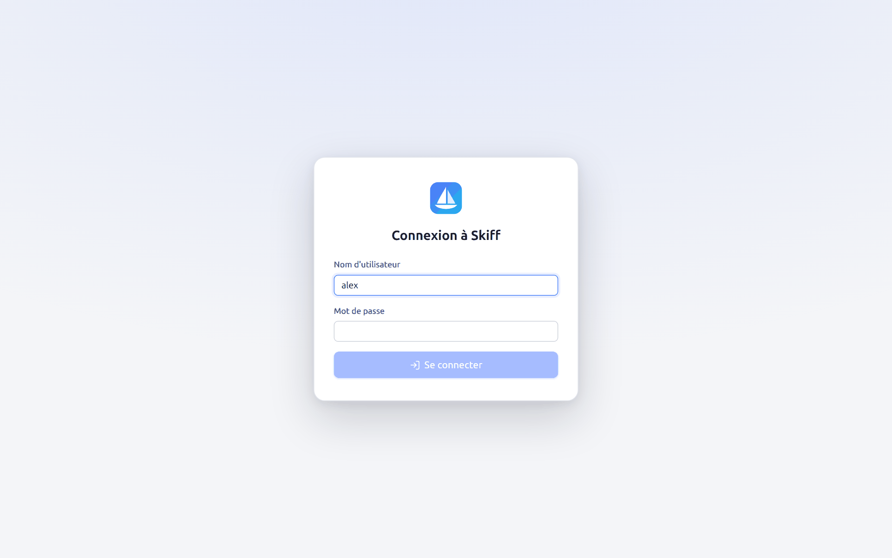
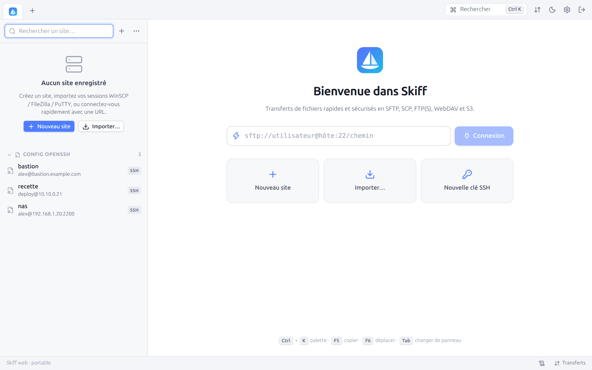

# 14. Mode web distant

[← Scripts et ligne de commande](13-scripts-cli.md) · [Sommaire](README.md) · [Protocoles →](15-protocoles.md)

`skiff serve` lance Skiff sans fenêtre et sert son interface en HTTPS. On l'utilise depuis n'importe quel navigateur : Skiff installé sur un serveur, un NAS ou une machine de rebond devient un client de transfert accessible partout, par exemple pour transférer entre deux serveurs distants sans faire passer les données par son ordinateur portable.

## 14.1 Démarrer

```bash
skiff serve --set-password                              # choisir le mot de passe, puis quitter
skiff serve --listen 0.0.0.0:8443                       # HTTPS avec un certificat auto-signé
skiff serve --listen 0.0.0.0:8443 --root /srv/donnees   # panneau local limité à /srv/donnees
skiff serve --tls-cert cert.pem --tls-key cle.pem       # votre propre certificat
skiff serve --no-tls --listen 127.0.0.1:8080            # derrière un reverse proxy TLS
WEBPW=… skiff serve --password-env WEBPW --user alex    # mot de passe fourni par l'environnement
```

| Option | Par défaut | Description |
|---|---|---|
| `--listen adresse:port` | `127.0.0.1:8443` | Adresse d'écoute. `0.0.0.0:8443` pour un accès depuis le réseau. |
| `--user nom` | l'utilisateur enregistré, ou `admin` | Identifiant de connexion |
| `--set-password` | | Demande le mot de passe (deux fois, 8 caractères au moins), l'enregistre (haché avec Argon2id) et quitte |
| `--password-env VAR` | | Lit le mot de passe dans la variable d'environnement `VAR` (conteneurs, services) |
| `--tls-cert`, `--tls-key` | | Certificat et clé PEM. Sans eux, Skiff crée un certificat auto-signé (`web-cert.pem`) et affiche son empreinte SHA-256 au démarrage. |
| `--no-tls` | | HTTP sans chiffrement, à réserver à une écoute locale derrière un reverse proxy HTTPS. Un avertissement s'affiche si l'adresse est publique. |
| `--root dossier` | | Limite le panneau **Local** à ce dossier |
| `--allow-local-terminal` | | Autorise les terminaux sur la machine qui exécute Skiff (sans effet avec `--root`) |

Au premier lancement, si aucun mot de passe n'est enregistré, Skiff le demande dans le terminal.

## 14.2 Se connecter

Ouvrez `https://serveur:8443/` dans un navigateur. Avec le certificat auto-signé, le navigateur affiche d'abord un avertissement : vérifiez que l'empreinte correspond à celle affichée par `skiff serve`.



Une fois connecté, l'interface est exactement celle de l'application de bureau. Le bouton **Se déconnecter** apparaît à droite de la barre d'onglets, et la barre d'état rappelle le nom de la machine qui exécute Skiff (« Skiff web · nom-du-serveur ») :



La session du navigateur dure sept jours. Les sites, préférences, mots de passe, clés d'hôte et transferts sont ceux du Skiff qui tourne sur le serveur. Fermer l'onglet du navigateur ne coupe ni les connexions, ni les transferts, ni les terminaux : en revenant, on retrouve tout, terminaux compris (avec leur historique récent).

## 14.3 Sécurité

- Mot de passe stocké haché avec **Argon2id**.
- Cookie de session `HttpOnly`, `SameSite=Strict`, `Secure` en HTTPS.
- **Limitation des tentatives** : cinq échecs par minute et par adresse IP, puis refus temporaire.
- **En-tête anti-CSRF** obligatoire sur toutes les requêtes de l'API, vérification de l'`Origin` des WebSockets.
- `--root` confine le panneau local au dossier indiqué, y compris face aux liens symboliques qui en sortiraient.

## 14.4 Différences avec l'application de bureau

| Fonction | En mode web |
|---|---|
| Panneau **Local** | Le disque **du serveur** qui exécute Skiff (limité par `--root`) |
| Envoyer des fichiers de votre ordinateur | Glissez-les depuis votre bureau sur un panneau : ils sont envoyés par le navigateur |
| Récupérer un fichier sur votre ordinateur | **Enregistrer sur l'ordinateur** (menu contextuel, aperçu) : téléchargement par le navigateur |
| **Ouvrir avec l'application par défaut** | Remplacé par un téléchargement, ou l'aperçu pour les images, vidéos et PDF |
| Éditeur externe, **Afficher dans le gestionnaire de fichiers** | Indisponibles |
| Terminal local | Désactivé, sauf avec `--allow-local-terminal`. Jamais disponible avec `--root` : un shell ne peut pas être confiné à un dossier. |
| Commandes locales (commandes personnalisées marquées **Commande locale**) | Désactivées |
| Import depuis un fichier | Collez le contenu du fichier ou envoyez-le par le navigateur (seul `~/.ssh/config` du serveur est lu directement) |
| Conversion de clés | Indisponible |
| Corbeille locale | Les suppressions locales sont définitives |
| Générateur de clés | Les clés sont enregistrées sur le serveur |

## 14.5 Déploiement

### Service systemd

```ini
# /etc/systemd/system/skiff.service
[Unit]
Description=Skiff (interface web)
After=network-online.target

[Service]
User=skiff
Environment=SKIFF_WEB_PASSWORD=change-moi
ExecStart=/usr/local/bin/skiff serve --listen 127.0.0.1:8080 --no-tls --password-env SKIFF_WEB_PASSWORD
Restart=on-failure

[Install]
WantedBy=multi-user.target
```

### Reverse proxy (nginx)

```nginx
location / {
    proxy_pass http://127.0.0.1:8080;
    proxy_http_version 1.1;
    proxy_set_header Upgrade $http_upgrade;     # WebSocket (événements, terminaux)
    proxy_set_header Connection "upgrade";
    proxy_set_header Host $host;
    client_max_body_size 0;                     # envois de fichiers volumineux
    proxy_request_buffering off;
}
```

La variante portable du binaire (sans dépendance) convient aux serveurs, aux NAS et aux conteneurs.

---

[← Scripts et ligne de commande](13-scripts-cli.md) · [Sommaire](README.md) · [Protocoles →](15-protocoles.md)
