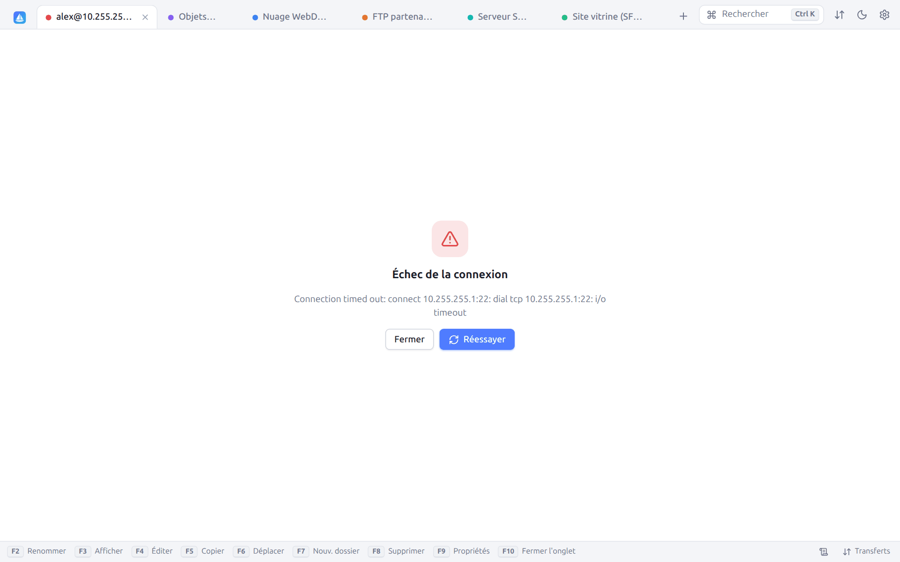
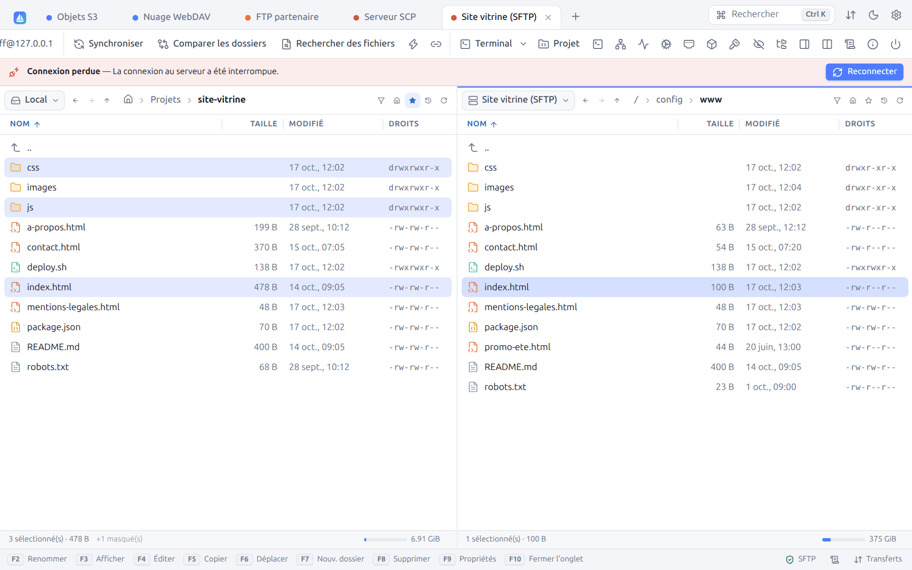

# 17. Dépannage

[← Raccourcis clavier](16-raccourcis.md) · [Sommaire](README.md) · [Correspondance WinSCP → Skiff →](18-winscp.md)

## 17.1 Échec de la connexion

Pendant la connexion, l'onglet affiche l'hôte contacté et un bouton **Interrompre** :

Si la connexion échoue, l'onglet affiche l'erreur, avec **Réessayer** et **Fermer** :

| Message | Cause probable | Que faire |
|---|---|---|
| `i/o timeout`, `Connection timed out` | Hôte injoignable, pare-feu, mauvais port | Vérifiez l'adresse et le port, le VPN, ou passez par un [hôte de rebond](09-terminal-tunnels.md#94-hôtes-de-rebond) ou un [proxy](09-terminal-tunnels.md#95-proxys). Augmentez le **Délai d'attente** du site. |
| `connection refused` | Aucun service sur ce port | Vérifiez le port (22 pour SSH, 21 pour FTP, 990 pour FTPS implicite) |
| `no such host` | Nom DNS inconnu | Vérifiez l'orthographe, ou cochez **Résoudre les noms d'hôte sur le proxy** |
| `unable to authenticate`, `530 Login incorrect` | Identifiants refusés | Vérifiez l'utilisateur, le mot de passe, la clé (format, phrase secrète) ; pour une clé, vérifiez `~/.ssh/authorized_keys` sur le serveur |
| `no common algorithm` | Serveur ancien | Cochez **Autoriser les anciens algorithmes** (section SSH du site) |
| `subsystem request failed` | SFTP désactivé sur le serveur | Skiff bascule tout seul sur SCP ; sinon choisissez le protocole SCP |
| `x509: certificate signed by unknown authority` | Certificat auto-signé | Voir [Certificats TLS](11-securite.md#112-certificats-tls) |
| `the master password is required…` | Mots de passe verrouillés | [Déverrouillez](11-securite.md#114-mot-de-passe-maître) avec le mot de passe maître |
| `… StrictHostKeyChecking is yes` | Clé d'hôte inconnue et `StrictHostKeyChecking yes` dans `~/.ssh/config` | Connectez-vous une fois avec `ssh`, ou changez ce réglage pour cet hôte (voir [Clés d'hôte](11-securite.md#111-clés-dhôte-ssh)) |
| `ProxyUseFdpass is not supported` | L'hôte passe par une commande proxy qui transmet un descripteur (par exemple `systemd-ssh-proxy`) | Hôte réservé à `ssh` ; désactivez la configuration OpenSSH pour ce site s'il s'agit d'un autre serveur |

Le [journal de session](10-recherche-journal.md#102-journal-de-session) détaille chaque étape ; passez le niveau à **debug** pour voir aussi les réponses du serveur.

## 17.2 Connexion perdue

Si la connexion tombe (réseau coupé, serveur redémarré, mise en veille), un bandeau l'indique au-dessus des panneaux, avec la raison et un bouton **Reconnecter** :

- **Reconnecter** rouvre la session, dans les mêmes dossiers.
- Avec **Se reconnecter automatiquement en cas de coupure** (activé par défaut, Préférences → Panneaux), il suffit de continuer : la prochaine opération (navigation, actualisation, transfert) se reconnecte toute seule.
- Les transferts interrompus réessaient automatiquement (2 fois par défaut) et reprennent leurs fichiers `.filepart`.
- Le clic droit sur l'onglet propose aussi **Reconnecter**.

Pour éviter les coupures dues aux pare-feu qui ferment les connexions inactives, réduisez l'**Intervalle keepalive** du site (section Connexion).

## 17.3 Questions fréquentes

**Les noms de fichiers accentués s'affichent mal en FTP.**
Le serveur n'utilise pas UTF-8 : choisissez son encodage dans le site (**Environnement → Encodage des noms de fichiers**, souvent Windows-1252).

**Les dates des fichiers FTP sont décalées d'une ou deux heures.**
Le serveur donne l'heure locale sans fuseau. Réglez **Environnement → Décalage horaire (minutes)** : la valeur est ajoutée aux dates affichées (par exemple `-120` si elles sont en avance de deux heures).

**La synchronisation retransfère des fichiers identiques.**
Le serveur ne conserve pas les dates (S3, certains WebDAV) ou ne les connaît qu'à la minute (FTP sans MLSD). Comparez par **Taille** ou par **Somme de contrôle**.

**Les fins de ligne des scripts envoyés depuis Windows cassent tout sur le serveur.**
Utilisez le mode de transfert **Automatique** ou **Texte** (voir [Transferts](06-transferts.md#62-la-boîte-de-transfert)), ou corrigez le fichier dans l'éditeur (**Fins de ligne → LF**).

**Le panneau FTP reste vide alors que le dossier contient des fichiers.**
Désactivez **Utiliser les listages MLSD** (section FTP du site) et, pour les fichiers cachés, activez **Utiliser « LIST -a »**.

**Les transferts FTP bloquent en mode passif.**
Activez **Forcer l'adresse IP pour les connexions passives**, ou passez en mode actif (décochez **Mode passif**).

**Je veux naviguer en root sur un serveur où je n'ai qu'un compte sudo.**
Dans le site, **SSH → Commande du serveur SFTP** : `sudo /usr/lib/openssh/sftp-server` (sudo doit être possible sans mot de passe pour cette commande ; le chemin varie selon la distribution, par exemple `/usr/libexec/openssh/sftp-server`).

**Un hôte de mon `~/.ssh/config` n'apparaît pas ou se connecte avec de mauvais réglages.**
Ouvrez **Préférences → SSH** : la lecture doit être activée et le fichier utilisateur marqué **trouvé**. Seuls les hôtes sans joker (`Host serveur`, pas `Host *.lan`) sont listés, mais tous s'appliquent. Cliquez sur l'hôte (ou ouvrez la section **SSH** du site) : chaque paramètre y est affiché avec la ligne d'où il vient. N'oubliez pas que la première valeur trouvée l'emporte : placez `Host *` à la fin du fichier, et qu'un réglage fait dans le site remplace celui du fichier (voir [Configuration OpenSSH](03-sites.md#34-configuration-openssh-ssh_config)).

**Où sont mes réglages ?**
Dans le [dossier de configuration](01-installation.md#14-dossier-de-configuration), affiché en bas des préférences.

**Comment repartir de zéro ?**
Quittez Skiff et renommez le dossier de configuration. Pour ne réinitialiser que les clés d'hôte, supprimez `known_hosts` (ou les lignes concernées dans **Préférences → Sécurité**).

**La fenêtre native ne s'ouvre pas sous Linux.**
Installez `libwebkit2gtk-4.1` (paquet `libwebkit2gtk-4.1-0` sur Debian et Ubuntu), ou utilisez la variante portable, qui ouvre une fenêtre de navigateur. L'AppImage choisit seule entre les deux.

**Windows refuse de lancer l'installateur (« Windows a protégé votre ordinateur »).**
L'installateur n'est pas encore signé : cliquez sur **Informations complémentaires**, puis sur **Exécuter quand même**.

**macOS refuse d'ouvrir Skiff.**
L'application n'est pas encore signée par un développeur identifié : ouvrez **Réglages Système → Confidentialité et sécurité** et cliquez sur **Ouvrir quand même** en face de Skiff.

**L'AppImage ne s'ouvre pas (« AppImages require FUSE to run »).**
Installez FUSE (paquet `fuse3`), ou lancez-la avec l'option `--appimage-extract-and-run`.

**Un lien `sftp://` n'ouvre pas Skiff.**
Ouvrez **Préférences → Système** : le tableau indique l'application qui ouvre chaque lien, et **Ouvrir ces liens avec Skiff** les reprend. Sous Windows, une application choisie dans **Paramètres → Applications → Applications par défaut** garde ses liens : choisissez-y Skiff (bouton **Applications par défaut de Windows…**). Un navigateur peut aussi demander une fois s'il faut ouvrir l'application.

**Lancer Skiff une seconde fois ne fait que ramener la fenêtre.**
C'est voulu : une seule fenêtre par dossier de configuration ([§ 1.3](01-installation.md#13-lancer-skiff)). Ouvrez plutôt un nouvel onglet (`Ctrl+N` ou l'onglet **Sites**). Après un plantage, le fichier `instance.json` resté dans la configuration n'empêche pas le lancement suivant.

**Remplacer une clé échoue avec « the new key is installed, but the old one stays ».**
Le serveur n'a pas accepté la nouvelle clé seule, ou sa partie privée n'est pas sur cet ordinateur : l'ancienne clé a été gardée ([§ 11.6](11-securite.md#installer-ou-remplacer-une-clé-sur-plusieurs-serveurs)). Vérifiez que la clé privée est dans le trousseau, l'agent ou `~/.ssh`, et que `sshd_config` ne lit pas un autre fichier (`AuthorizedKeysFile`).

**Deux entrées Skiff dans le menu, ou une entrée qui ne marche plus.**
Lancez `skiff desktop-entry -remove` pour retirer celle que Skiff a ajoutée pour votre utilisateur ; celle du paquet `.deb`, si vous l'avez installé, reste.

## 17.4 Signaler un problème

Joignez :

1. la version (`skiff version`, ou **Préférences → À propos de Skiff**) et le système ;
2. le journal de session au niveau **debug** (**Copier** dans l'onglet Journal), en retirant les informations sensibles ;
3. le contenu de **Informations serveur/protocole** (bouton **Copier**).

---

[← Raccourcis clavier](16-raccourcis.md) · [Sommaire](README.md) · [Correspondance WinSCP → Skiff →](18-winscp.md)
