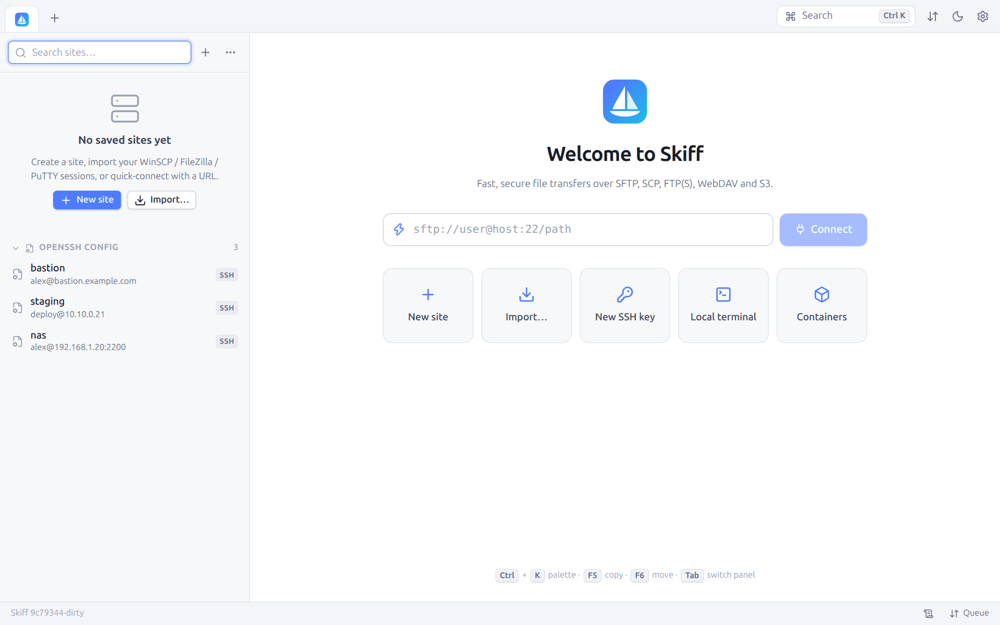

# 1. Installation and first start

[Contents](README.md) · [First steps →](02-first-steps.md) · 🇫🇷 [Français](../01-installation.md)

## 1.1 Installing Skiff

Each system has its installer:

| System | File | Installation |
|---|---|---|
| Windows 10/11 (x64, ARM64) | `skiff-setup-<version>-windows-amd64.exe` (or `-arm64.exe`) | Double-click it. Skiff installs for your account, **without administrator rights**, into `%LOCALAPPDATA%\Programs\Skiff`, with a shortcut in the Start menu (and on the desktop if you tick the box). The **Open sftp://, scp://, ftp://… links with Skiff** box, ticked, makes Skiff open those links ([Preferences → System](12-preferences.md#1214-system)) |
| macOS 11 and later (Intel and Apple Silicon) | `Skiff-<version>-macos.dmg` | Open the disk image and drag **Skiff** onto the **Applications** folder |
| Debian, Ubuntu, Linux Mint… (x64, ARM64) | `skiff_<version>_amd64.deb` (or `_arm64.deb`) | `sudo apt install ./skiff_<version>_amd64.deb`: apt also installs WebKitGTK when needed |
| Other Linux (x64, ARM64) | `Skiff-<version>-x86_64.AppImage` (or `-aarch64`) | Make the file executable (`chmod +x Skiff-*.AppImage`, or **Properties → Allow executing**), then run it. Nothing is installed |

Skiff is free and open source software, under the Apache License 2.0. They all open the **native window**: WebView2 on Windows (preinstalled on Windows 10/11), WKWebView on macOS, WebKitGTK on Linux.

**First start on Windows and macOS.** The installers are not signed by a publisher certificate yet. Windows then shows "Windows protected your PC": click **More info**, then **Run anyway**. macOS says it cannot check the application: open **System Settings → Privacy & Security** and click **Open Anyway** next to Skiff. Both warnings show only once.

**The AppImage** holds two versions of Skiff. It starts the native window when the system has WebKitGTK 4.1, else the variant that opens a browser window. It needs FUSE to open (present on almost every distribution); without it, start it with the `--appimage-extract-and-run` option. It adds its entry to the application menu at its first start (see [Starting Skiff](#13-starting-skiff)).

### Binaries alone

Skiff also fits in a single executable, without installation: the interface, the transfer engine, the protocol clients, the terminal and the web server are all inside.

| Platform | Binary | Window |
|---|---|---|
| Windows 10/11 (x64, ARM64) | `skiff-windows-amd64.exe`, `skiff-windows-arm64.exe` | Native **WebView2** window |
| Linux (x64, ARM64) | `skiff-linux-amd64-desktop` | Native **WebKitGTK** window (`libwebkit2gtk-4.1` package to run it) |
| Linux, FreeBSD, macOS, all | `skiff-<os>-<arch>` (portable variant) | A Chrome, Edge or Brave app window when one of them is installed, else the default browser |

The portable variant depends on no library: it also serves for the [remote web mode](14-web-mode.md) on a server or a NAS.

## 1.2 Building from the sources

Requirements: Go 1.27.2 or later (an older 1.27 fetches 1.27.2 by itself), Node 22 or later and pnpm (only to build the interface).

```bash
./build.sh            # builds the interface, then bin/skiff (the same: make)
./build.sh portable   # bin/skiff without the native window (no dependency)
./build.sh release    # every binary of every platform into dist/
./build.sh packages   # the installers this machine can make, into dist/
```

On Linux, for the native window, install the WebKitGTK headers first. `build.sh` detects them by itself:

```bash
sudo apt install -y libgtk-3-dev libwebkit2gtk-4.1-dev pkg-config
```

Without these headers, the build still succeeds and makes the variant that opens a browser window.

`./build.sh packages` makes, on Linux, the `.deb` package, the AppImage and the Windows installers; on macOS, the `.dmg` disk image. Each can also be made alone:

| Command | Result | Needs |
|---|---|---|
| `./build.sh deb` | `dist/skiff_<version>_<arch>.deb` | Linux, the WebKitGTK headers, `dpkg-deb` |
| `./build.sh appimage` | `dist/Skiff-<version>-<arch>.AppImage` | Linux, the WebKitGTK headers, `mksquashfs` (`squashfs-tools` package); the AppImage runtime is downloaded once from `github.com/AppImage/type2-runtime`, checked by its SHA-256 sum and kept in `build/cache` (or given by the `APPIMAGE_RUNTIME` variable) |
| `./build.sh setup-windows` | `dist/skiff-setup-<version>-windows-amd64.exe` and `-arm64.exe` | NSIS (`apt install nsis`, `brew install makensis` or `choco install nsis`), from any system |
| `./build.sh dmg` | `dist/Skiff-<version>-macos.dmg` (universal application) | macOS, with the Xcode command line tools |

Several commands can follow each other: `./build.sh deb appimage` builds only once. The version comes from `git describe`: a `v1.2.0` tag gives `1.2.0`, and without a tag, `0.1.0~git.<commit>`.

The GitHub Actions CI (`.github/workflows/build.yml`) builds the binaries and the installers of the three systems and publishes a release at each `v*` tag.

## 1.3 Starting Skiff

```bash
skiff                                  # opens the window
skiff sftp://alex@server.example.com   # opens the window and connects
```

At the first start, no site is saved. The welcome screen offers to create a site, to import your WinSCP, FileZilla, PuTTY or OpenSSH sessions, or to connect at once with a URL.



The installers put Skiff in the Start menu (Windows), the Applications folder and the Launchpad (macOS) or the application menu (`.deb` package, for every user).

**On Linux, without the package** (AppImage or binary alone), at the first start of the window, Skiff adds its entry to the application menu and its icon, for your user: `~/.local/share/applications/skiff.desktop` and `~/.local/share/icons/hicolor/512x512/apps/skiff.png`. Without them, GNOME and KDE (on Wayland above all) show a generic icon in the dock and the window switcher. The entry follows the binary, or the AppImage file, when it moves; a `skiff.desktop` entry written by hand is never changed. Nothing is added in [portable mode](#15-portable-mode). When the `.deb` package is installed, its entry is the one that counts: Skiff adds none, and removes the one it had added, which would hide it.

**One window.** Starting Skiff again while it is open (the shortcut, `skiff sftp://…`, a clicked link) does not make a second window: the open window comes to the front and opens the connection asked for. Two windows on the same configuration could write the same files and run the scheduled tasks twice. A copy in [portable mode](#15-portable-mode) has its own configuration, hence its own window.

What follows is described in the chapter [First steps](02-first-steps.md). The other commands (`serve`, `run`, `shell`, `keygen`, `import`, `task`, `desktop-entry`, `url-handler`, `licenses`, `version`) are described in the chapter [Scripts and command line](13-scripts-cli.md), and `skiff <command> -h` gives their options.

## 1.4 Configuration folder

Skiff keeps its settings in a single folder:

| System | Default location |
|---|---|
| Linux, FreeBSD | `~/.config/Skiff` (or `$XDG_CONFIG_HOME/Skiff`) |
| Windows | `%APPDATA%\Skiff` |
| macOS | `~/Library/Application Support/Skiff` |

The exact path is shown at the bottom of the **Preferences** window and in **Preferences → About Skiff**.

| File | Content |
|---|---|
| `sites.json` | Sites, folders and workspaces. The passwords are encrypted in it. |
| `settings.json` | Preferences, bookmarks, folder history, custom commands |
| `secret.key` | Key that encrypts the passwords when there is no master password (mode 600) |
| `master.json` | Derivation parameters of the master password (salt, Argon2id cost), without the password |
| `known_hosts` | Accepted SSH host keys (OpenSSH format) |
| `instance.json` | While the window is open: its local address and the key that lets a second start give it a URL (mode 600) |
| `format.json` | Version of the format of the configuration (see [Updating](#17-updating-and-uninstalling)) |
| `backups/` | Copies of the files of the configuration made before a migration of its format (the last five) |
| `trusted_certs.json` | TLS certificates you trusted |
| `keychain.json` | Skiff keychain: private keys encrypted as the passwords are |
| `tasks.json`, `task-runs.json` | Scheduled tasks and their history |
| `devices.json`, `sync-tombstones.json` | Settings of the sync between devices (encrypted passphrase) and deletions to pass on |
| `logs/` | Session logs, when the option is on |
| `web-cert.pem`, `web-key.pem` | Self-signed certificate of the web mode |

`sites.json` can be copied between machines without exposing the passwords: without `secret.key` (or without the master password), they stay unreadable. To share sites, passwords and preferences between your computers, use **Preferences → Devices** instead.

## 1.5 Portable mode

As the `WinSCP.ini` file of WinSCP, Skiff can keep its whole configuration next to the executable, on a USB stick for one. Create, in the folder of the binary:

- either a `skiff-data` folder;
- or an empty `skiff.portable` file (the `skiff-data` folder is then created at the first start).

With the AppImage, this folder or file goes next to the `.AppImage` file.

The bottom of the preferences window then says "(portable mode)".

## 1.6 Environment variables

| Variable | Effect |
|---|---|
| `SKIFF_HOME` | Forces the configuration folder (wins over everything else) |
| `SSH_AUTH_SOCK` | Socket of the SSH agent to use (Linux, macOS) |
| `LANG`, `LC_ALL` | Language of the system, used by the interface when the **Language** preference is **Auto** |
| `SKIFF_BROWSER` | Browser that opens the web pages of the ports of a server (`firefox`, `chromium`…); by default, the system's |

With the `/ini=<folder>` option, the `winscp.com` syntax can also choose the configuration folder.

## 1.7 Updating and uninstalling

The configuration (sites, passwords, preferences) is kept by updates and, unless you ask otherwise, by uninstalling.

Every 1.x release of Skiff reads the configuration of the earlier 1.x releases. Should a release change the format of the configuration one day, it first copies its files into `backups/<date>-format-<n>`, then converts them. A configuration from before 1.0 is backed up so at the first start. The other way round, an older Skiff refuses to open a configuration of a newer format ("written by a newer version of Skiff") rather than erase what it does not know: install the recent release, or start the older one with another folder (`SKIFF_HOME`).

| Installed with | Updating | Uninstalling |
|---|---|---|
| The Windows installer | Run the new installer, even with Skiff open: the new version starts at the next start | **Settings → Apps → Installed apps → Skiff → Uninstall**. The `sftp://`… links go back to the other applications; the uninstaller asks whether to delete `%APPDATA%\Skiff` too (no by default) |
| The macOS disk image | Drag the new version onto **Applications** and replace the old one | Move **Skiff** to the Trash, then, if you wish, the `~/Library/Application Support/Skiff` folder |
| The `.deb` package | `sudo apt install ./skiff_<new version>_amd64.deb` | `sudo apt remove skiff` |
| The AppImage | Replace the file (keep the same name so that the menu entry stays valid, or start it again: the entry follows) | `./Skiff-*.AppImage desktop-entry -remove` (removes the menu entry and the icon), then delete the file |
| A binary alone | Replace the binary | On Linux, `skiff desktop-entry -remove`, then delete the binary |

To erase the configuration as well, delete the [configuration folder](#14-configuration-folder).

---

[Contents](README.md) · [First steps →](02-first-steps.md) · 🇫🇷 [Français](../01-installation.md)
