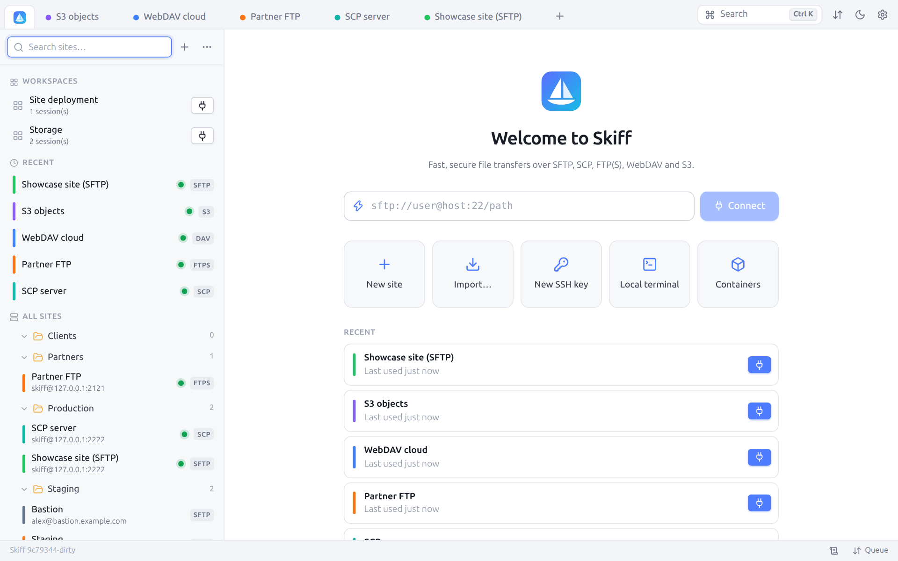
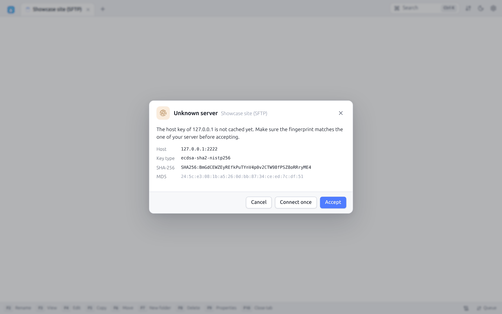
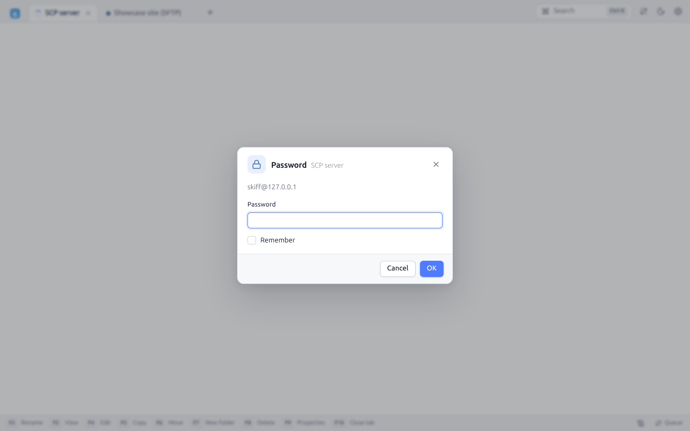
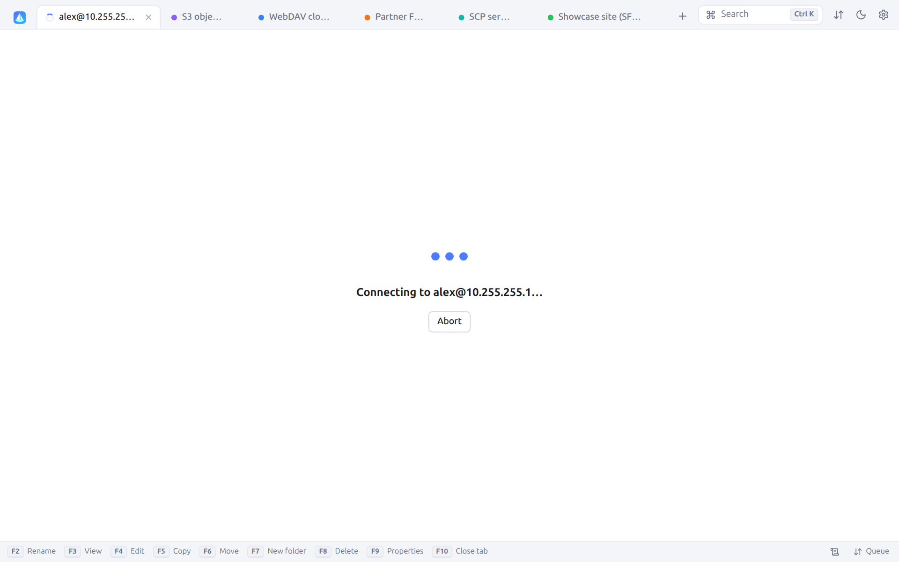
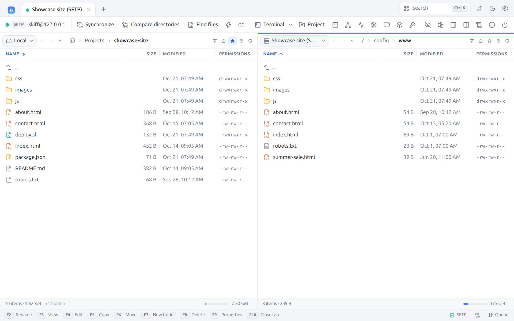

# 2. First steps

[← Installation](01-installation.md) · [Contents](README.md) · [Site manager →](03-sites.md) · 🇫🇷 [Français](../02-premiers-pas.md)

## 2.1 The welcome screen

The **Sites** tab, always in first position, serves as the welcome screen. Once a few sites are saved, it looks like this:



| Area | Role |
|---|---|
| Sidebar | Site search, workspaces, **recent** sites and the tree of **all sites** (see [Site manager](03-sites.md)) |
| Quick connect field | Type a URL (`sftp://user@host:22/path`), then `Enter` or **Connect** |
| **New site** | Opens an empty site form |
| **Import…** | Imports the sessions of WinSCP, PuTTY, FileZilla, OpenSSH or a file (see [Import](03-sites.md#35-importing-sites)) |
| **New SSH key** | Opens the [SSH key generator](11-security.md#115-ssh-key-generator) |
| **Local terminal** | Opens a terminal on the computer (see [Terminal](09-terminal-tunnels.md#92-local-terminal)) |
| **Containers** | Lists the Docker, Podman and Kubernetes containers of the computer, to open their files or a terminal (see [Containers](15-protocols.md#157-docker-podman-and-kubernetes-containers)) |
| **Recent** | The last five sites used, with a connect button |
| Footer | A reminder of the essential shortcuts: `Ctrl+K` palette, `F5` copy, `F6` move, `Tab` switch panel |

The tab bar at the top holds, on the right:

- **Search** (`Ctrl+K`): the [command palette](10-search-log.md#104-command-palette);
- **Transfer queue** (⇅ icon): opens or closes the transfer panel, with a badge giving the number of active transfers;
- **Toggle theme** (moon / sun): switches between the light and the dark theme;
- **Preferences** (gear, `Ctrl+,`).

At the bottom, the status bar shows the version of Skiff, a link to the log and the **Queue** panel.

## 2.2 Quick connection with a URL

For a one-off connection, without saving a site, type a URL in the quick connect field (or in the `Ctrl+K` palette):

```text
sftp://alex@server.example.com
sftp://alex@server.example.com:2222/var/www
scp://root@10.0.0.5
ftpes://depot@ftp.example.com/          (FTP + explicit TLS)
ftps://depot@ftp.example.com/           (FTP + implicit TLS)
davs://alex@cloud.example.com/remote.php/dav/files/alex/
s3://AKIAEXAMPLE@s3.eu-west-3.amazonaws.com/my-bucket/
```

The path, if any, becomes the remote folder opened first. The URLs accepted are detailed in the chapter [Protocols](15-protocols.md#158-session-urls). A quick connection can then be saved as a site.

## 2.3 First connection to an SSH server

At the first connection to an SSH server, Skiff does not know its **host key** yet. It shows its fingerprint and asks you to check it:



| Button | Effect |
|---|---|
| **Accept** | Connects and saves the key in the `known_hosts` of Skiff. The next connections ask nothing more. |
| **Connect once** | Connects without saving the key on disk. The key stays accepted until Skiff closes (reconnections included); the question comes back at the next start. |
| **Cancel** | Gives up the connection |

Compare the SHA-256 fingerprint with the one given by the administrator of the server (`ssh-keygen -lf /etc/ssh/ssh_host_ed25519_key.pub`). Should the key change later, Skiff shows a red alert (see [Security](11-security.md#111-ssh-host-keys)).

When no password is saved and no key fits, Skiff asks for one:



Tick **Remember** to save the password (encrypted) in the site. For a keyboard-interactive authentication (OTP code, change of an expired password), the dialog shows the questions of the server one by one.

While connecting, the tab shows an animation and an **Abort** button:



> **From the password to a key**: once connected with the password, `Ctrl+K` → "Install a public key" puts one of your keys (or a new one, see **New SSH key**) into the `~/.ssh/authorized_keys` of the server. The next connections no longer need the password. See [§ 11.6](11-security.md#installing-an-existing-key-on-a-server).

## 2.4 A tour of the interface

Once connected, the session tab shows the **Commander** interface: the local folder on the left, the server on the right.



From top to bottom:

1. **Tab bar**: the Skiff logo opens the **Sites** tab, then come one tab per session, editor, diff or terminal. The dot of a connected session takes the color of the site (green by default); it turns orange while connecting and red when the connection is lost or has failed. `+` (`Ctrl+N`) opens a new session from the **Sites** tab.
2. **Session toolbar**: state and protocol (`SFTP`), the `user@host` identity, then **Synchronize**, **Compare directories**, **Find files**, **Keep remote directory up to date** (lightning), **Synchronized browsing** (links), **Terminal**, **Run command**, **Tunnels**. On the right: hidden files, tree, preview, layout, log, server information and **Disconnect**. Each button is detailed in the chapter [Interface](04-interface.md#42-the-session-toolbar).
3. **Two file panels**: each has its connection selector (**Local**, **Showcase site (SFTP)**…), its navigation buttons, its breadcrumb and its tools (filter, home folder, bookmark, history, refresh). The active panel is underlined in blue.
4. **Status bar of each panel**: number of items, total size, hidden files, selection, free space on the disk or the server.
5. **Function key bar**: `F2` Rename, `F3` View, `F4` Edit, `F5` Copy, `F6` Move, `F7` New folder, `F8` Delete, `F9` Properties, `F10` Close tab. Each key can be clicked. On the right: protocol and security of the connection, log, **Queue** (with the current speed).

`Tab` goes from one panel to the other. Files are transferred with `F5`, by drag and drop or from the context menu (see [Transfers](06-transfers.md)).

## 2.5 Picking up where you left off

- **Reopen sessions from last time** (Preferences → Panels) reopens at start the tabs open when Skiff last closed, with their folders. A quick connection asks for its password again, as it is not saved.
- **Reconnect automatically when the connection is lost** (on by default) connects again when the network comes back.
- The [workspaces](03-sites.md#33-workspaces) save a set of tabs, to reopen it in one click.

---

[← Installation](01-installation.md) · [Contents](README.md) · [Site manager →](03-sites.md) · 🇫🇷 [Français](../02-premiers-pas.md)
