# 3. Site manager

[← First steps](02-first-steps.md) · [Contents](README.md) · [Interface and navigation →](04-interface.md) · 🇫🇷 [Français](../03-sites.md)

A **site** holds everything needed to connect to a server: protocol, host, credentials, folders opened first, proxy, jump hosts, tunnels and the options of the protocol. It is the equivalent of the site manager of WinSCP.

## 3.1 The site list

The **Sites** tab shows the list on the left and the form of the selected site on the right.

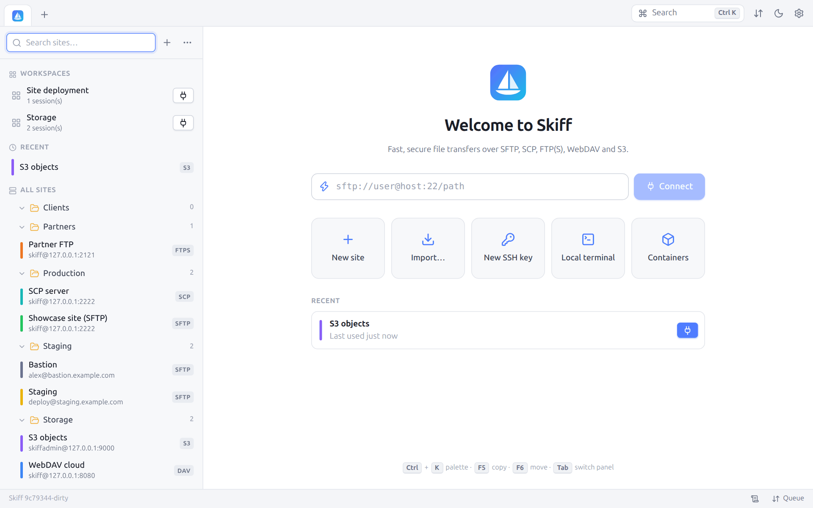

The sidebar holds, from top to bottom:

- the **Search sites…** field, which filters on the name, the host, the user, the folder and the notes;
- the **+** button (new site) and the **⋯** menu;
- the **Workspaces** ([§ 3.3](#33-workspaces));
- the **Recent** sites: the last five sites used, with a green dot for the connected ones;
- **All sites**, sorted into folders and subfolders. Each site shows its color, its name, `user@host:port` and a protocol badge (`SFTP`, `SCP`, `FTP`, `FTPS`, `DAV`, `S3`). The number on the right of a folder is the number of sites it holds.
- **OpenSSH config**: the hosts declared in your `~/.ssh/config`, ready to use without saving anything ([§ 3.4](#34-openssh-configuration-ssh_config)).

| Action | Effect |
|---|---|
| Click | Shows the site in the form |
| Double-click, `Enter` | Connects |
| `↑` / `↓` | Goes to the previous / next site |
| `Ctrl+click`, `Shift+click`, `Shift+↑` / `Shift+↓`, `Ctrl+A` | Selects several sites (see below) |
| `Delete` | Deletes the site, or the selected sites (after a confirmation) |
| Drag a site onto a folder | Puts the site in that folder (onto the empty area: back to the root); dragging a selected site moves the whole selection |
| Right-click | Context menu of the site, of the selection or of the folder |

### Selecting several sites

To sort, connect or delete many sites at once:

- `Ctrl+click` (`Cmd+click` on macOS) adds a site to the selection, or takes it out;
- `Shift+click` selects all the sites between the last one clicked and this one, in the order shown; `Shift+↑` / `Shift+↓` extends the selection from the keyboard;
- `Ctrl+A` (in the list) selects all the sites shown: combined with the search, all the sites whose name holds "prod", for one;
- `Esc` or a single click on a site clears the selection.

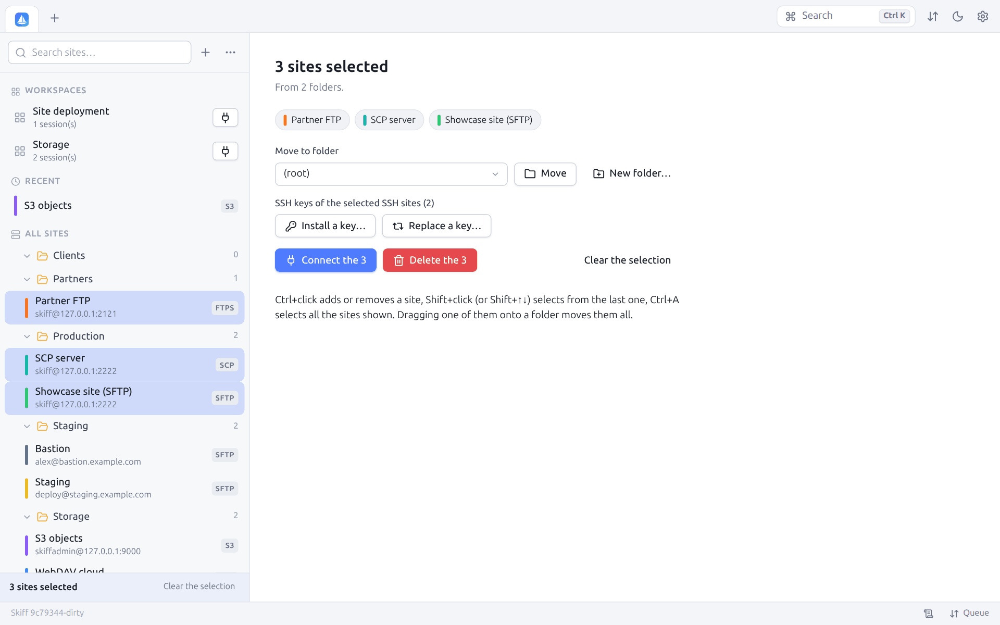

On the right, the list of the chosen sites and their actions: **Move to folder** (an existing folder, the root, or **New folder…**, created and filled at once), **Connect the N** (one session per site), **Delete the N** (a single confirmation) and **Clear the selection**. A right-click on a selected site offers the same actions, `Enter` connects them all, `Delete` deletes them, and dragging one of them onto a folder moves them all into it. The bottom of the list recalls the number of sites selected.

For the SSH sites of the selection, **Install a key** and **Replace a key** put or change a key on all their servers at once ([§ 11.6](11-security.md#installing-or-replacing-a-key-on-several-servers)).

### Context menu of a site

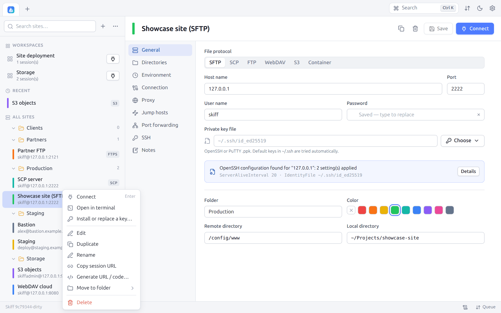

| Command | Effect |
|---|---|
| **Connect** (`Enter`) | Opens a session |
| **Open in terminal** | Connects and opens an SSH terminal straight away (SFTP and SCP) |
| **Install or replace a key** | Installs a public key on the server, or replaces an old key after checking the new one (SFTP and SCP, [§ 11.6](11-security.md#installing-or-replacing-a-key-on-several-servers)) |
| **Edit** | Shows the form of the site |
| **Duplicate** | Makes a copy of the site, named "… (copy)", passwords included |
| **Rename** | Changes the name of the site |
| **Copy session URL** | Copies the URL of the site (without the password) |
| **Generate URL / code…** | Opens the [URL and code generator](#37-session-url-and-code) |
| **Move to folder** | Puts the site in an existing folder or at the **(root)** |
| **Delete** | Deletes the site |

### Context menu of a folder

| Command | Effect |
|---|---|
| **New site** | Creates a site straight in this folder |
| **New folder** | Creates a subfolder |
| **Connect all** | Opens a session for each site of the folder and of its subfolders |
| **Rename** | Renames the folder (the sites follow) |
| **Delete** | Deletes the folder. Its sites move up into the parent folder: no site is lost. |

### The ⋯ menu

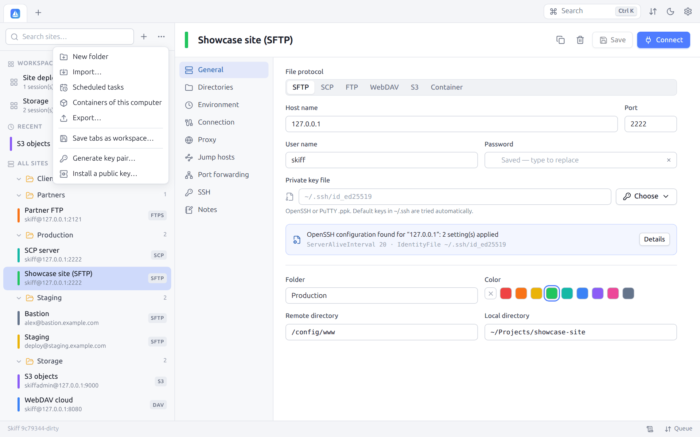

**New folder**, **Import…**, **Export…**, **Save tabs as workspace…**, **Generate key pair…** and **Install a public key** (on a connected server, see [§ 11.6](11-security.md#installing-an-existing-key-on-a-server)).

## 3.2 Creating and editing a site

**+** (or **New site** on the welcome screen) opens an empty form marked **Unsaved site**:

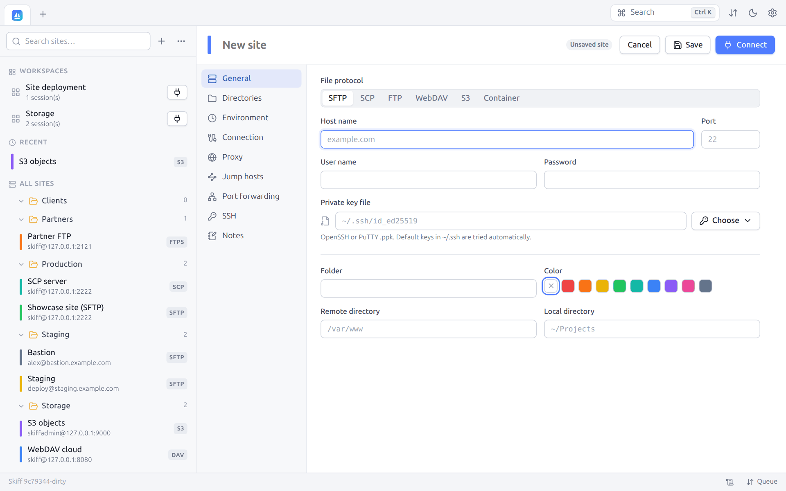

The head of the form holds:

- the **color** and the **name** of the site, which can be edited in place (empty, the site is called `user@host`);
- the **Modified** badge when there are unsaved changes;
- **Copy session URL** and **Delete** (existing sites);
- **Save** (`Ctrl+S`) and **Connect**. When the site has been changed, this button becomes **Save & connect**. `Enter` in a field connects too.

The sections of the form follow the protocol chosen:

| Section | SFTP | SCP | FTP/FTPS | WebDAV | S3 |
|---|:-:|:-:|:-:|:-:|:-:|
| General, Directories, Environment, Connection, Proxy, Jump hosts, Notes | ✓ | ✓ | ✓ | ✓ | ✓ |
| Port forwarding, SSH | ✓ | ✓ | | | |
| FTP | | | ✓ | | |
| TLS | | | if encrypted | if HTTPS | if HTTPS |
| S3 | | | | | ✓ |

### General

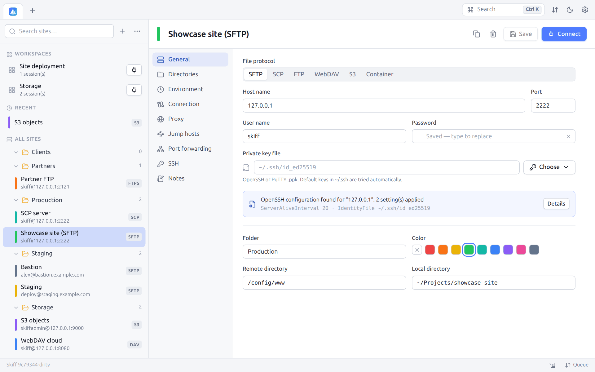

| Field | Description |
|---|---|
| **Protocol** | SFTP, SCP, FTP, WebDAV, S3 or **Container** (Docker, Podman, Kubernetes, see [§ 15.7](15-protocols.md#157-docker-podman-and-kubernetes-containers)). The default port follows the protocol (22, 21, 80/443, 443). |
| **Host name** and **Port** | Address of the server (DNS name, IPv4 or IPv6) |
| **User name** and **Password** | A saved password is never sent back to the interface: the field shows "Saved — type to replace", and the cross forgets it. |
| **Private key file** | OpenSSH or PuTTY `.ppk` key (SSH only), typed or picked with **Choose** (see below). Empty, the default keys of `~/.ssh` (`id_ed25519`, `id_ecdsa`, `id_rsa`) are tried automatically. |
| **Folder** | Folder of the site in the list (`Clients/Acme` for a subfolder) |
| **Color** | Color of the site in the list, the tabs and the recent sites |
| **Remote directory**, **Local directory** | Folders opened when connecting (a shortcut to the Directories section) |

**Choose**, on the right of the **Private key file** field, lists the keys of `~/.ssh` with their type (a padlock marks those protected by a passphrase); the key of the site is ticked. The menu also offers **Generate key pair…**, whose new key is chosen at once, and **None: try the usual keys**, which empties the field. The keys of the [Skiff keychain](11-security.md#117-skiff-keychain-and-agent-forwarding) need not be chosen: they are tried with every server. The same button is in the **SSH** section and for each jump host.

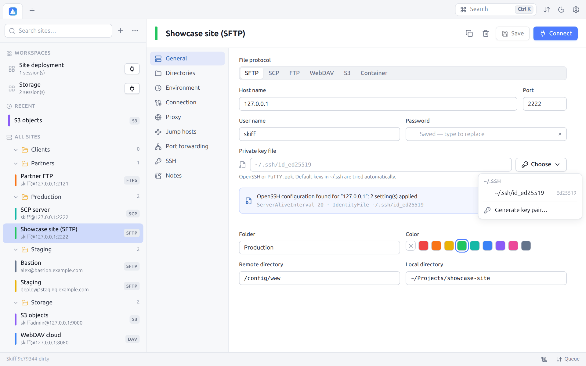

For **FTP**, the General section also holds the **Encryption** (**No encryption**, **TLS/SSL explicit**, **TLS/SSL implicit**) and **Anonymous login**:

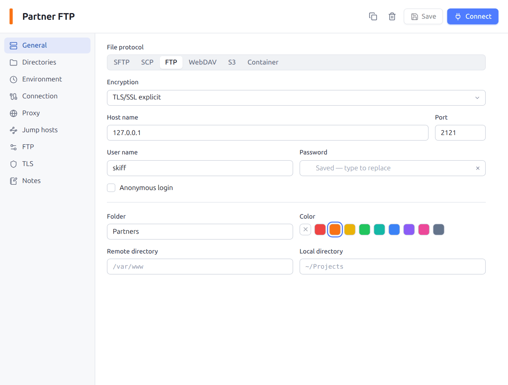

For **WebDAV**, **Use HTTPS (TLS)** replaces the choice of encryption, and a note says that the remote folder is the path of the WebDAV server (`/remote.php/dav/files/me/` for Nextcloud, for one):

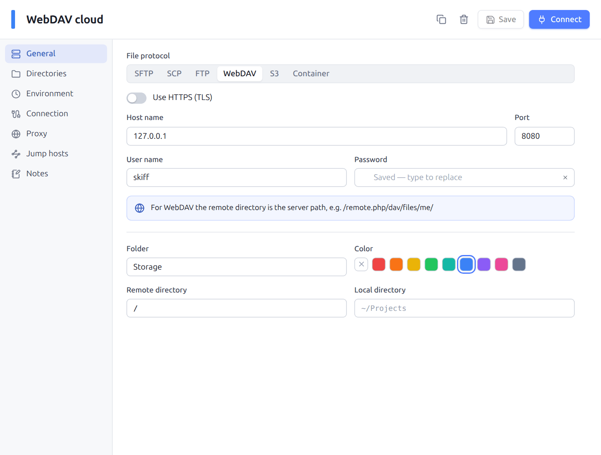

For **S3**, the fields become **Endpoint**, **Access key ID** and **Secret access key**. Leave the endpoint empty for AWS:

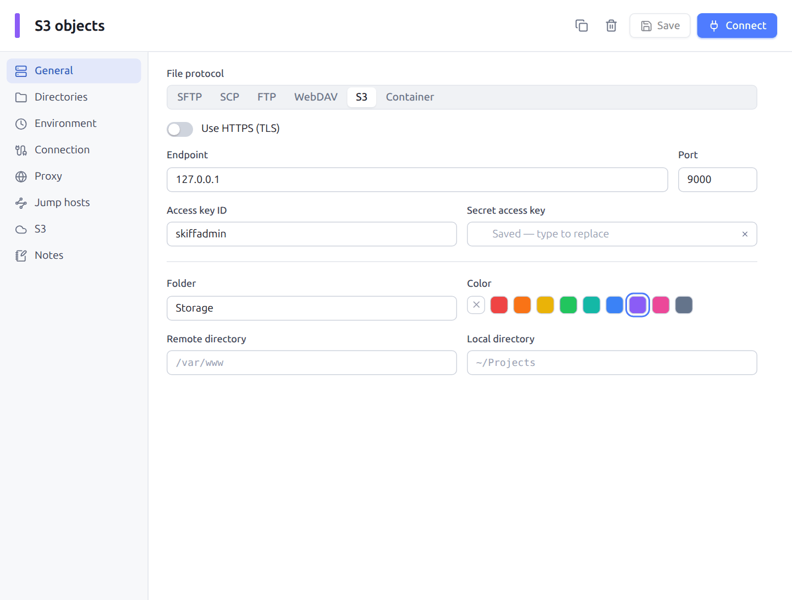

### Directories

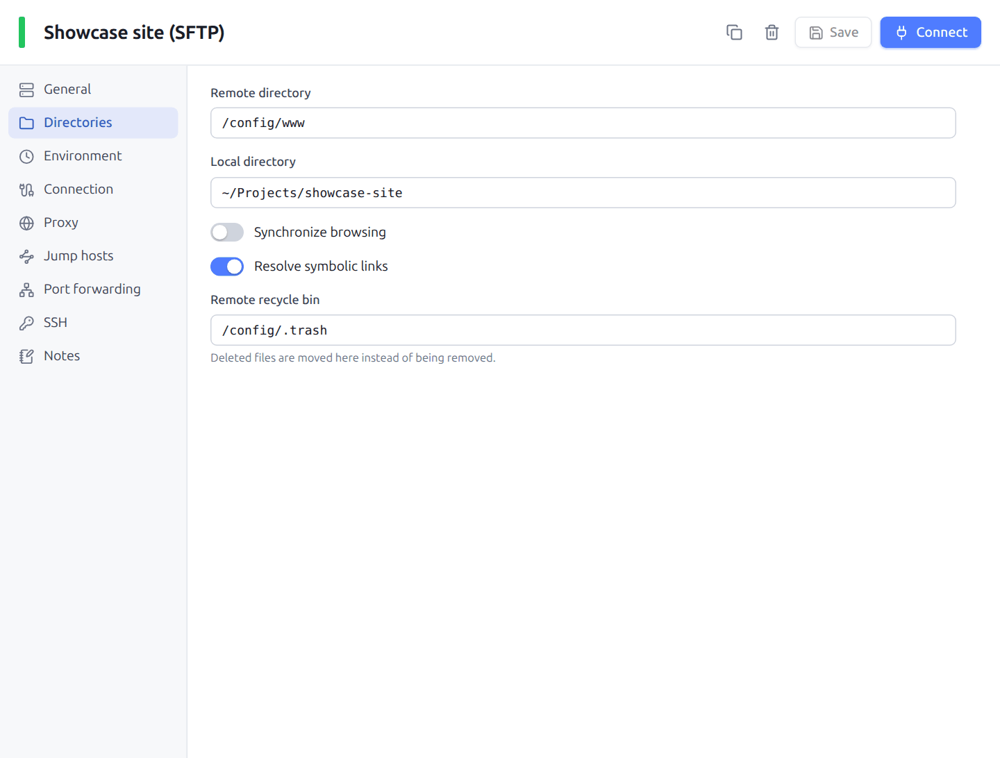

| Field | Description |
|---|---|
| **Remote directory** | Folder opened when connecting. Empty: the home folder of the user. |
| **Local directory** | Folder opened in the local panel. `~` stands for your home folder. |
| **Synchronize browsing** | Turns on [synchronized browsing](04-interface.md#411-synchronized-browsing) as soon as the session connects |
| **Resolve symbolic links** | Follows the links to know whether they point to a file or a folder (on by default) |
| **Remote recycle bin** | Folder of the server where deleted files are moved instead of being erased (see [Deleting](05-files.md#54-deleting)) |

### Environment

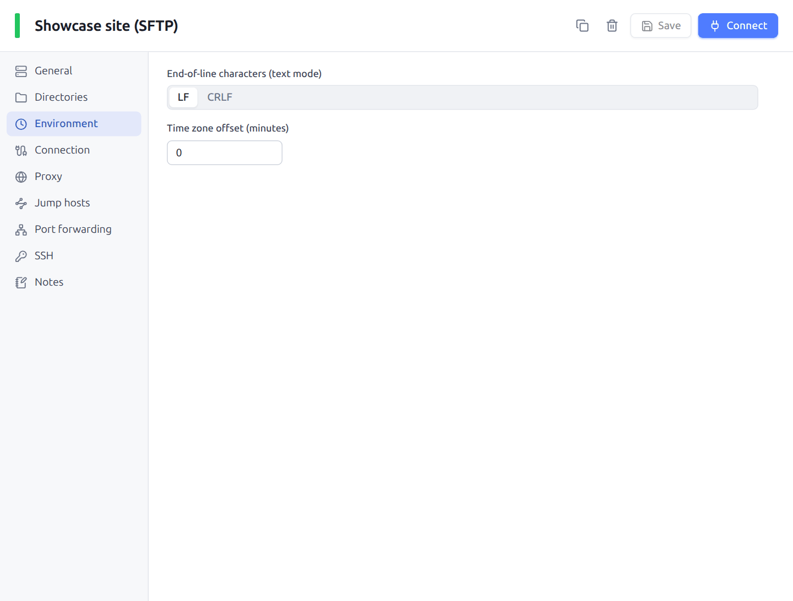

| Field | Description |
|---|---|
| **End-of-line characters (text mode)** | `LF` (Unix) or `CRLF` (Windows): format of the line ends on the server for the transfers in text mode |
| **Time zone offset (minutes)** | Corrects the time of the files of a badly set server, or of one that gives its local time without a time zone (FTP) |
| **File name encoding** (FTP) | UTF-8 (auto), Windows-1252, ISO-8859-1, ISO-8859-15, Windows-1250, Windows-1251, KOI8-R, CP850, CP437 |

### Connection

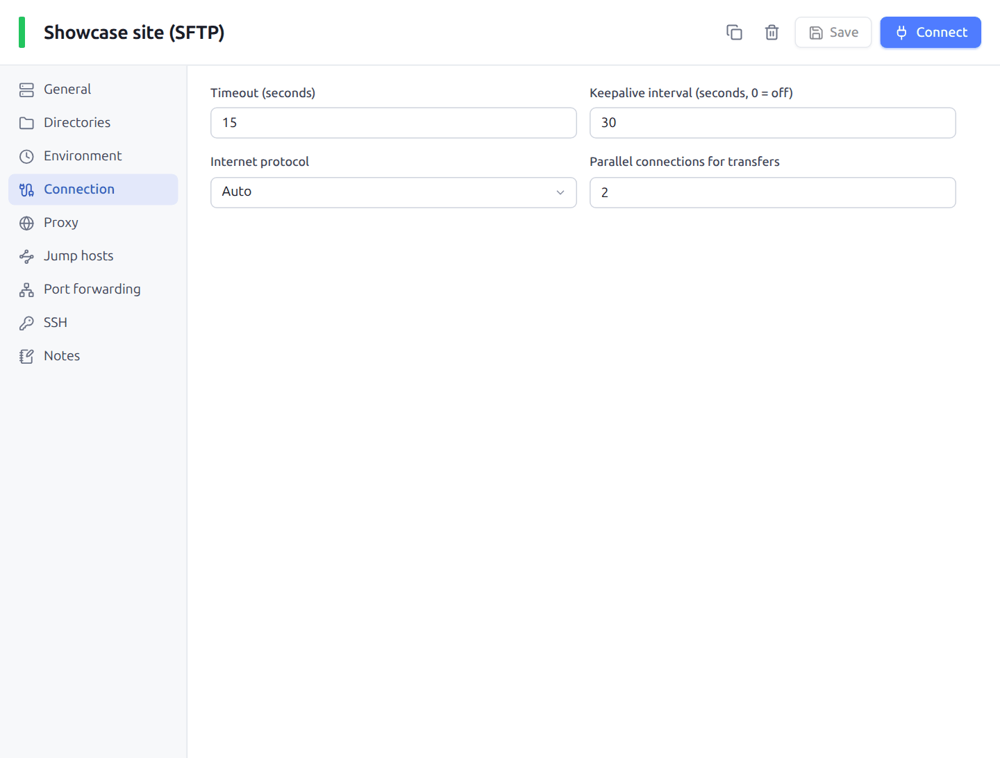

| Field | Description |
|---|---|
| **Timeout (seconds)** | Longest time to set up the connection (15 s by default) |
| **Keepalive interval (seconds, 0 = off)** | Sends a keepalive message so that firewalls do not cut the connection (30 s by default) |
| **Internet protocol** | Auto, IPv4 or IPv6 |
| **Parallel connections for transfers** | Number of extra connections opened to transfer several files at a time |

### Proxy

| Field | Description |
|---|---|
| **Proxy type** | None, SOCKS4, SOCKS5, HTTP (CONNECT), Telnet, **Local command (ProxyCommand)** |
| **Proxy host**, **Port**, **User name**, **Password** | Settings of the proxy |
| **Resolve host names on the proxy** | The name of the server is resolved by the proxy (SOCKS4a/SOCKS5), useful when the internal DNS cannot be reached |
| **Command** | For a local command: the command whose input and output serve as the connection. Variables: `%host`, `%port`, `%user`, `%pass`, `%proxyhost`, `%proxyport`. Example: `ssh -W %host:%port bastion` |

The proxy applies to every protocol. See also [Proxies](09-terminal-tunnels.md#95-proxies).

### Jump hosts

A chain of jump hosts (as the `ProxyJump` of OpenSSH): Skiff connects to the first SSH server, then to the next through it, and so on up to the final server. Each jump is:

- either a **saved site** (**Use a saved site: Bastion**), with its authentication;
- or a **Custom host**: host, port, user, password and key file.

**Add jump host** adds a step to the chain. The jumps work for **every protocol**: an FTP, WebDAV or S3 site behind an SSH bastion is reached through a tunnel. See [Jump hosts](09-terminal-tunnels.md#94-jump-hosts).

### Port forwarding (SSH)

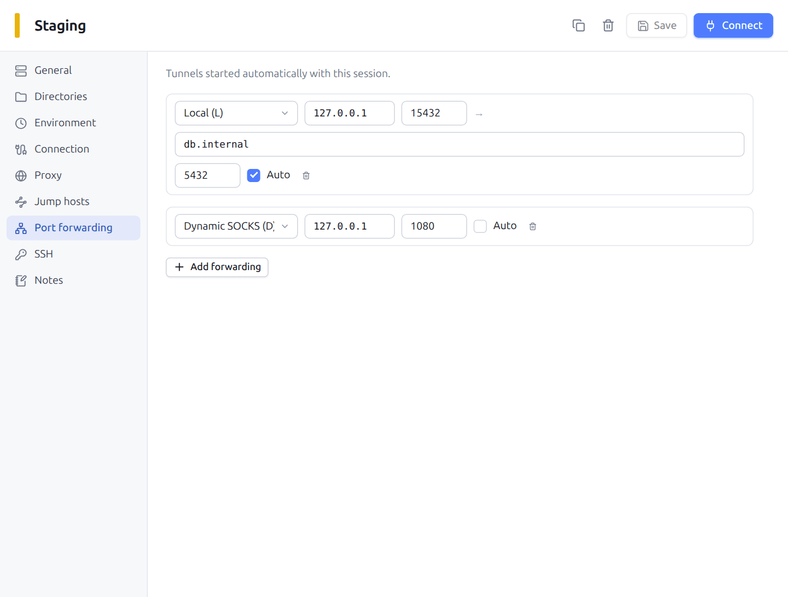

The tunnels defined here belong to the site. Each line gives the type (**Local (L)**, **Remote (R)**, **Dynamic SOCKS (D)**), the listening address and port, the destination (except for SOCKS) and the **Auto** box (**Start automatically** when connecting). **Add forwarding** adds a line. See [Tunnels](09-terminal-tunnels.md#93-tunnels-port-forwarding).

### SSH

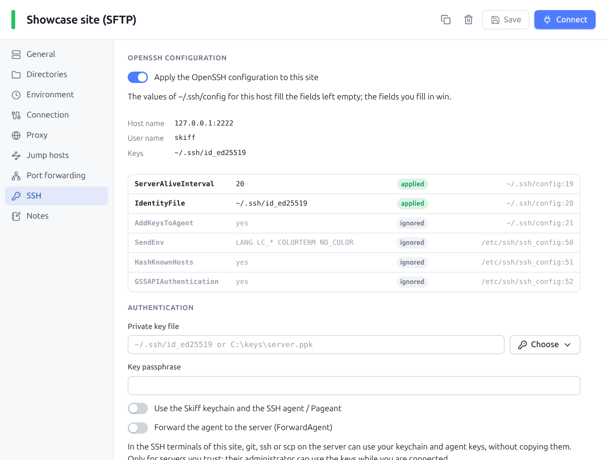

| Field | Description |
|---|---|
| **Private key file** | OpenSSH key (`id_ed25519`, `id_rsa`…), PuTTY `.ppk` v2/v3; a `-cert.pub` certificate lying next to it is used automatically |
| **Key passphrase** | Saved encrypted. When it is missing, Skiff asks for it. |
| **Use the Skiff keychain and the SSH agent / Pageant** | Tries the keys of the [Skiff keychain](11-security.md#117-skiff-keychain-and-agent-forwarding), then those of the agent (`ssh-agent`, the OpenSSH agent of Windows, Pageant) |
| **Forward the agent to the server (ForwardAgent)** | The SSH terminals of the site get an agent: `git`, `ssh`, `scp` on the server use your keys without copying them. Only towards trusted servers. |
| **Keyboard-interactive authentication** | Allows the questions of the server (OTP, 2FA, password change) |
| **Expected host key fingerprint** | `SHA256:…`: pins the key of the server. Any other key is refused without a question. |
| **SFTP server command** | Starts another SFTP server, `sudo /usr/lib/openssh/sftp-server` to browse as root, for one |
| **Shell (SCP)** and **Listing command (SCP)** | Shell used for the SCP commands, and a forced listing command (`ls -la`) |
| **Allow legacy algorithms (old servers)** | Turns on the obsolete algorithms (`diffie-hellman-group1-sha1`, `ssh-rsa`, `3des-cbc`…) for old devices |

At the top of the section, **Apply the OpenSSH configuration to this site** (on by default) lets `~/.ssh/config` fill in the empty fields of the site, and the list under it shows what is taken from it ([§ 3.4](#34-openssh-configuration-ssh_config)).

### FTP

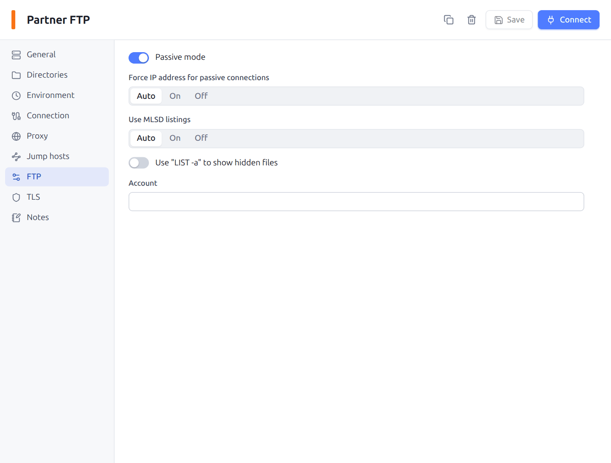

| Field | Description |
|---|---|
| **Passive mode** | On by default. Off, Skiff uses the active mode (PORT/EPRT). |
| **External IP for active mode** | Address given to the server in active mode (empty: automatic) |
| **Force IP address for passive connections** | Auto, On, Off: ignores the address sent back by the server (often wrong behind a NAT) and uses the server's own address again |
| **Use MLSD listings** | Auto, On, Off: standardized MLSD/MLST listings or the classic LIST |
| **Use "LIST -a" to show hidden files** | Asks for the files starting with a dot too |
| **Account** | `ACCT` command required by some servers |

### TLS

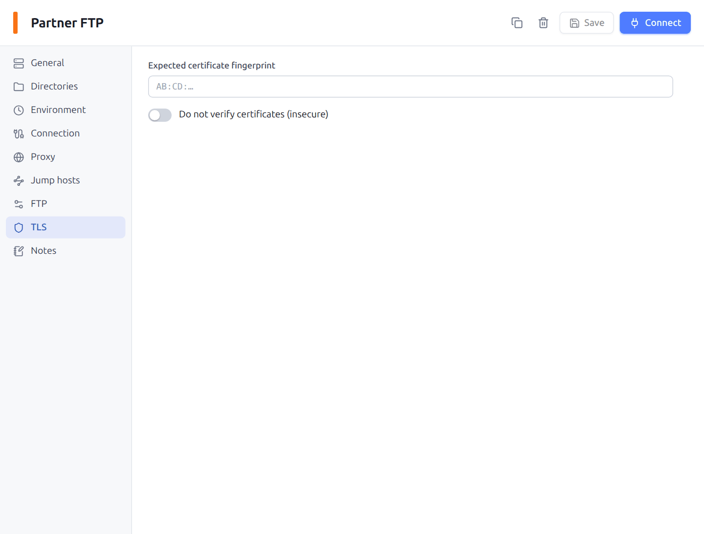

| Field | Description |
|---|---|
| **Expected certificate fingerprint** | `AB:CD:…` (SHA-256): pins the certificate of the server |
| **Do not verify certificates (insecure)** | Accepts any certificate, without a question. For tests only. |

Without these options, an unknown or self-signed certificate brings up a [trust request](11-security.md#112-tls-certificates).

### S3

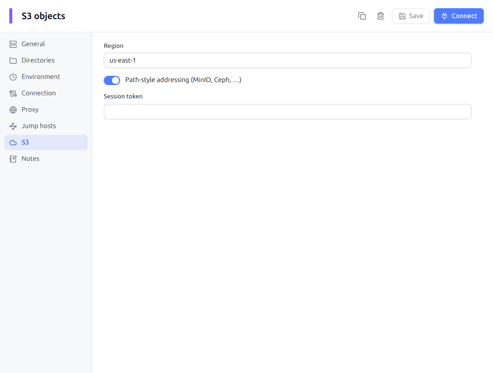

| Field | Description |
|---|---|
| **Region** | `us-east-1`, `eu-west-3`… Empty: detected automatically |
| **Path-style addressing (MinIO, Ceph, …)** | `https://host/bucket/object` instead of `https://bucket.host/object` |
| **Session token** | For temporary credentials (STS) |

### Notes

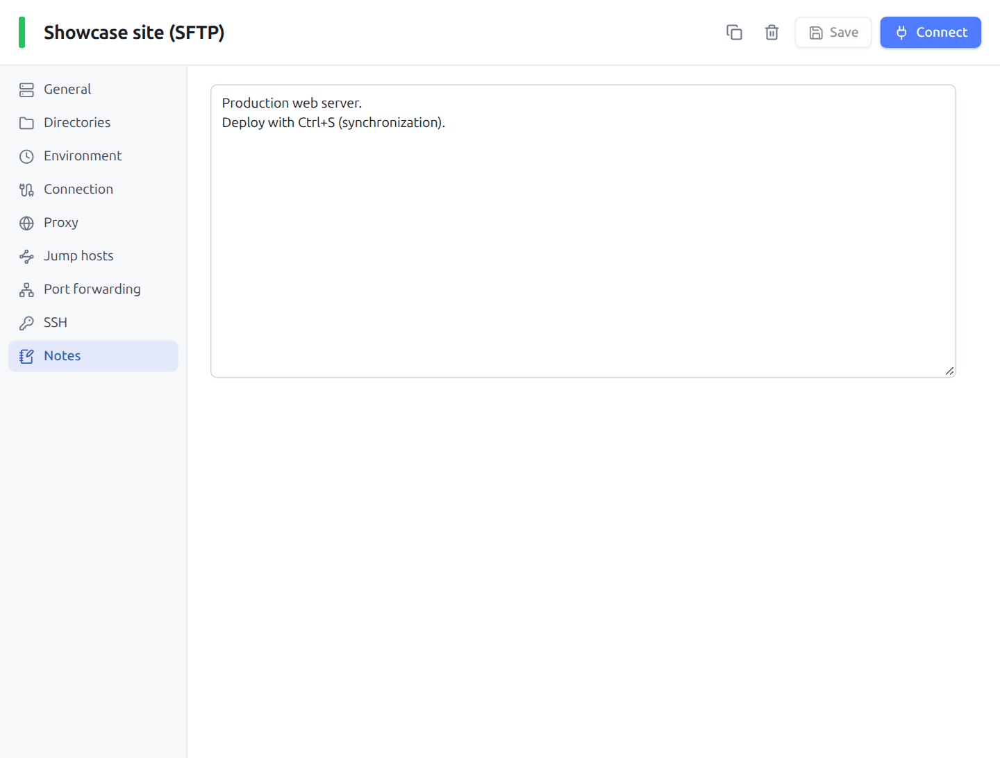

Free text: deployment procedure, contacts, contract number… The site search looks into the notes too.

## 3.3 Workspaces

A workspace remembers a set of session tabs (the site, remote folder and local folder of each) to reopen them together.

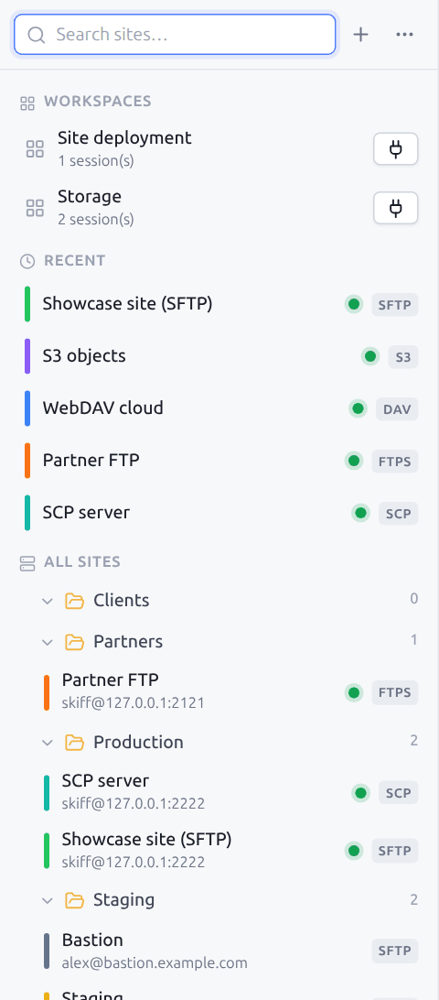

- **Save**: open the sessions you want, then **⋯ → Save tabs as workspace…** (or the same command in the `Ctrl+K` palette) and give it a name.
- **Open**: double-click the workspace, the connect button on its right, or the `Ctrl+K` palette.
- **Delete**: right-click → **Delete**.

## 3.4 OpenSSH configuration (ssh_config)

Skiff reads the configuration of the OpenSSH client as the `ssh` command does: a host described in `~/.ssh/config` opens in Skiff by its name, with the same settings (real address, port, user, keys, jumps, proxy, tunnels…), without importing or typing anything again.

### Files read on each system

| System | User file (read first) | System file (read next) |
|---|---|---|
| **Windows 10 and 11** | `%USERPROFILE%\.ssh\config`, that is `C:\Users\you\.ssh\config` | `%ProgramData%\ssh\ssh_config`, that is `C:\ProgramData\ssh\ssh_config` |
| **macOS** | `~/.ssh/config` | `/etc/ssh/ssh_config` |
| **Linux, BSD** | `~/.ssh/config` | `/etc/ssh/ssh_config` (and its `Include`s, `/etc/ssh/ssh_config.d/*.conf` for one) |

These are the files of the `ssh` command of each system (the OpenSSH of Windows, Git for Windows and WSL on the Windows side use `%USERPROFILE%\.ssh` too). Another file can replace the user file in **Preferences → SSH** ([§ 12.7](12-preferences.md#127-ssh)).

The rules of OpenSSH apply:

- for each setting, **the first value obtained wins**: the user file comes before the system file, so a precise block must come before a `Host *` block;
- `IdentityFile`, `CertificateFile`, `LocalForward`, `RemoteForward` and `DynamicForward` can be given several times and add up;
- `ProxyJump` and `ProxyCommand` exclude each other: the first one met wins;
- `Host` blocks with the `*` and `?` patterns and the `!` negations;
- `Match` blocks with the `host`, `originalhost`, `user`, `localuser`, `exec`, `localnetwork`, `tagged`, `all`, `canonical` and `final` criteria, possibly negated with `!`;
- `Include` (wildcards accepted, paths relative to `~/.ssh` for the user file and to the folder of the system file otherwise), inside a `Host` or `Match` block too;
- the `%h`, `%p`, `%r`, `%n`, `%u`, `%d`, `%C`, `%L`, `%l`, `%k`, `%j`, `%i` and `%%` tokens, the `${VAR}` variables and `~` in the paths; quotes and Windows paths (`IdentityFile "C:\Users\you\.ssh\my key"`);
- as with `ssh` since version 9.6, a command (`ProxyCommand`, `Match exec`) is never run for a host or user name holding shell characters.

The files are read again at each connection: change them, and Skiff follows without a restart.

### The hosts in the site list

The **OpenSSH config** section, under your sites, lists the hosts declared in the user file (patterns such as `Host *.lan` are not hosts and are not listed). Click a host to see what the connection will use and where each value comes from:

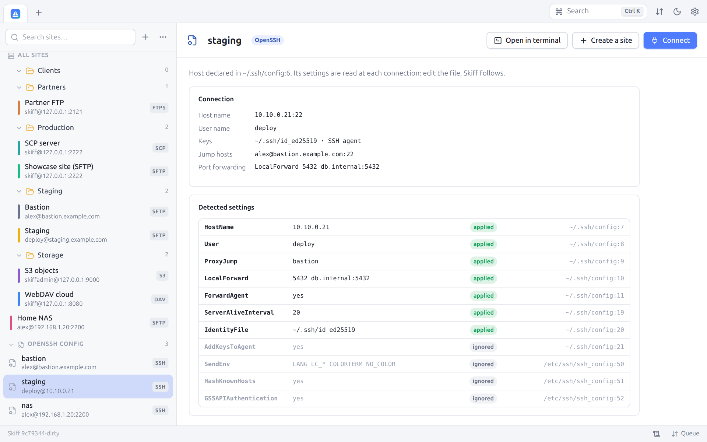

| Area | Content |
|---|---|
| **Connection** | Real host and port, user, keys tried (and the SSH agent), jump hosts, proxy command, tunnels opened when connecting |
| Warnings | An `IdentityFile` that does not exist, for one |
| **Detected settings** | Each value obtained, with the file and the line it comes from, and its status: **applied**, **site** (replaced by the setting of the site, value struck out) or **ignored** (a feature Skiff does not have, `ControlMaster` or `Compression` for instance) |

A double-click, `Enter` or **Connect** opens the session; **Open in terminal** also opens an SSH terminal. **Create a site** prepares a site whose host is the alias: the configuration keeps applying and you only add what belongs to Skiff (color, folders opened first, saved password…). The right-click offers the same actions and **Copy the name**:

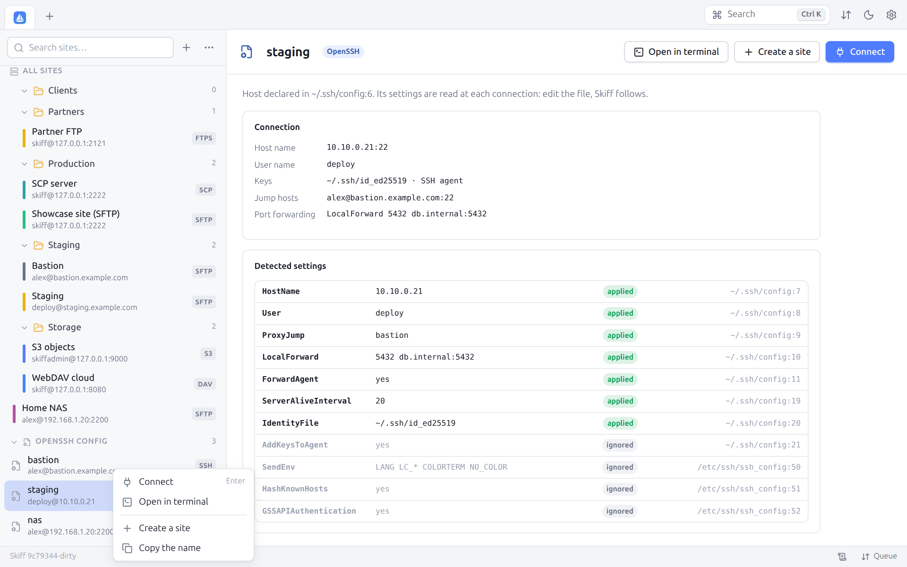

The alias works wherever a host name is accepted: the quick connection (which offers the aliases while you type), the **Host name** field of a site, a jump host, and the command line (`skiff sftp://staging`, `open staging` in a script, see [Scripts](13-scripts-cli.md#sessions)).

### The site comes first

As the command line options of `ssh` do, **a setting made in Skiff always wins**: the OpenSSH configuration only fills in what the site leaves empty. For the settings that have a default value in Skiff (connection timeout, keepalive), the configuration applies as long as the site keeps that default value.

| `ssh_config` setting | Effect in Skiff | The site wins when… |
|---|---|---|
| `HostName` | Real address of the server | — |
| `Port` | Port | the **Port** field is filled in |
| `User` | User name (failing everything, the name of the local user, as with `ssh`) | the **User name** field is filled in |
| `IdentityFile` | Keys tried, instead of the default keys of `~/.ssh`; as with `ssh`, the file can be the public key (or a missing private key whose `.pub` exists) when the private key is only in the agent (hardware key, password manager) | the **Private key file** field is filled in |
| `IdentitiesOnly` | Offers only the keys of the agent that match these files | — |
| `CertificateFile` | OpenSSH certificates of the keys | — |
| `ForwardAgent` | Agent forwarding to the SSH terminals ([§ 11.7](11-security.md#117-skiff-keychain-and-agent-forwarding)) | **Forward the agent to the server** is ticked |
| `IdentityAgent` | Socket of the agent (or named pipe on Windows, `\\.\pipe\openssh-ssh-agent` for one); `none` turns the agent off | **Use the SSH agent** is unticked |
| `PubkeyAuthentication`, `PasswordAuthentication`, `KbdInteractiveAuthentication`, `PreferredAuthentications` | Authentication methods allowed and their order | a key is given in the site / **keyboard-interactive** is unticked |
| `ProxyJump` | Chain of jumps; each jump is resolved by the configuration itself (the first one can have its own `ProxyJump` or `ProxyCommand`) | the site has **Jump hosts** or a **Proxy** |
| `ProxyCommand` | Local proxy command (`nc`, `ssh -W`, `cloudflared`…) | the same |
| `HostKeyAlias`, `StrictHostKeyChecking`, `UserKnownHostsFile`, `GlobalKnownHostsFile` | Check of the server key ([§ 11.1](11-security.md#111-ssh-host-keys)) | a fingerprint is pinned in the site |
| `ConnectTimeout` | Connection timeout | the timeout is no longer 15 s |
| `ServerAliveInterval`, `ServerAliveCountMax` | Keepalive and number of missed answers before the cut | the keepalive is no longer 30 s |
| `AddressFamily` | IPv4 (`inet`) or IPv6 (`inet6`) | **Internet protocol** is not on Auto |
| `Ciphers`, `KexAlgorithms`, `MACs`, `HostKeyAlgorithms` | Algorithms (lists with `+`, `-` and `^` accepted; those Skiff does not know are left out) | **Allow legacy algorithms** is ticked |
| `LocalForward`, `RemoteForward`, `DynamicForward` | Tunnels opened when connecting, shown in the **Tunnels** panel | the site has its own **Port forwarding** |
| `Tag` | Used by `Match tagged` | — |

The other keywords are shown **ignored**. `ProxyUseFdpass` is not supported: a host that needs it (as those of `systemd-ssh-proxy`) gives a clear error.

### In the site editor

For an SFTP or SCP site, Skiff looks up the configuration of the host while you type. The empty fields show in grey the value that will be used (user, port, key), and a box sums up what applies:

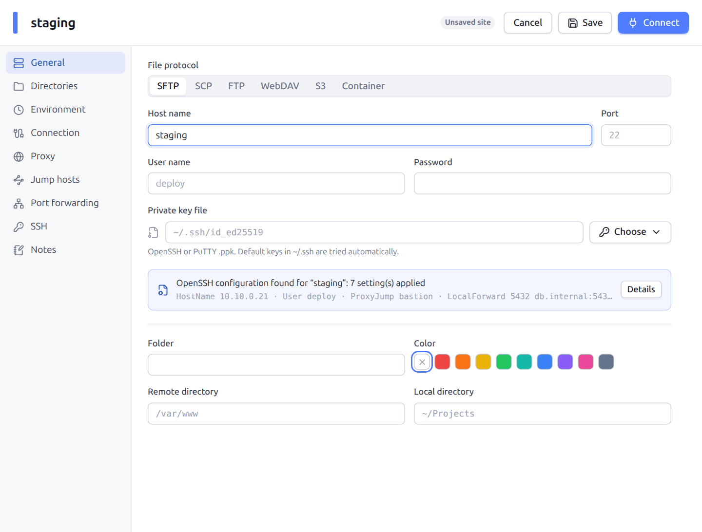

**Details** opens the **SSH** section, which holds the **Apply the OpenSSH configuration to this site** switch and the full list of the settings. Here, the user name typed in the site replaces the one of the file (status **site**):

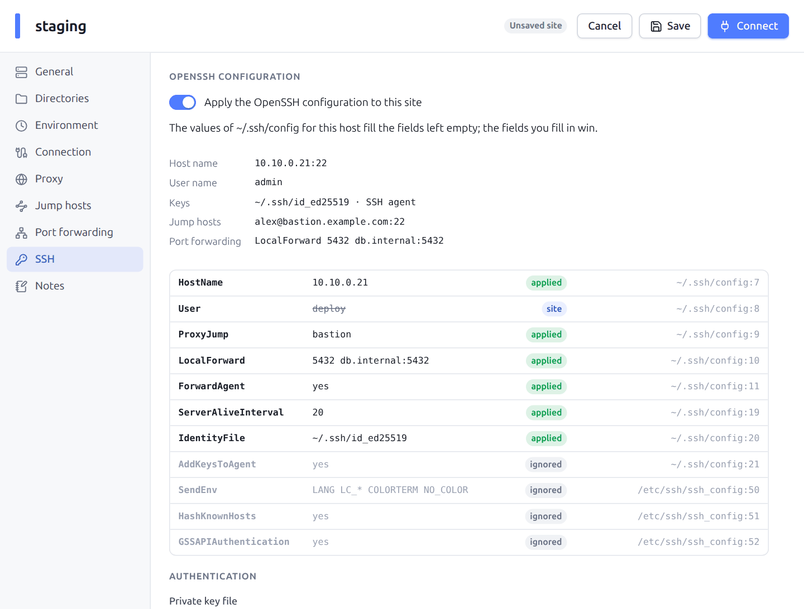

### Turning the reading off

- for a site: untick **Apply the OpenSSH configuration to this site** (**SSH** section);
- for the whole of Skiff: untick **Read the OpenSSH configuration (ssh_config)** in **Preferences → SSH** ([§ 12.7](12-preferences.md#127-ssh)); the **OpenSSH config** section then goes from the site list.

## 3.5 Importing sites

**⋯ → Import…** (or **Import…** on the welcome screen) opens the import wizard. Skiff detects the sources present on the computer:

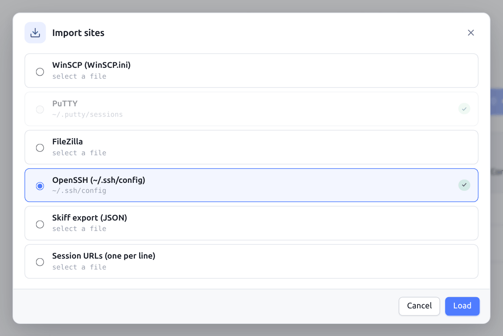

| Source | What is imported |
|---|---|
| **WinSCP (WinSCP.ini)** | Sessions, folders, passwords (decrypted), proxies, tunnels, keys, options. File detected automatically or to be picked. |
| **WinSCP (registry)** | The same information, read from the Windows registry |
| **PuTTY** | SSH sessions (the registry on Windows, `~/.putty/sessions` elsewhere) |
| **FileZilla** | `sitemanager.xml`, passwords included |
| **OpenSSH (~/.ssh/config)** | One site per `Host` block, with the values `ssh` would use (`Host *`, `Match` and `Include` included): `HostName`, `User`, `Port`, `IdentityFile`, `ProxyJump` (becomes a chain of jumps), `ProxyCommand`, `ConnectTimeout`, `ServerAliveInterval`, `AddressFamily` and `LocalForward`/`RemoteForward`/`DynamicForward` (become tunnels). Not needed to connect: Skiff already reads this file ([§ 3.4](#34-openssh-configuration-ssh_config)); the import makes copies of it, independent of the file. |
| **Skiff export (JSON)** | A file exported by Skiff |
| **Session URLs (one per line)** | A list of `sftp://…`, `ftps://…` URLs |

For the sources that need a file, drop it onto the area provided, click to pick it, or paste its content. **Load** shows the preview:

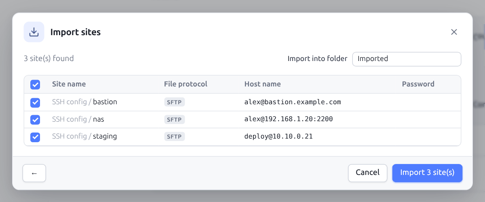

Tick the sites to import, choose the destination folder (**Import into folder**, "Imported" by default), then **Import N site(s)**. An orange triangle marks a site whose password could not be recovered. The same operation exists on the command line: `skiff import` (see [Scripts](13-scripts-cli.md#136-skiff-import)).

## 3.6 Exporting sites

**⋯ → Export…** gives the list of the sites in four formats: **Skiff JSON**, **WinSCP.ini**, **OpenSSH config** and **URLs**.

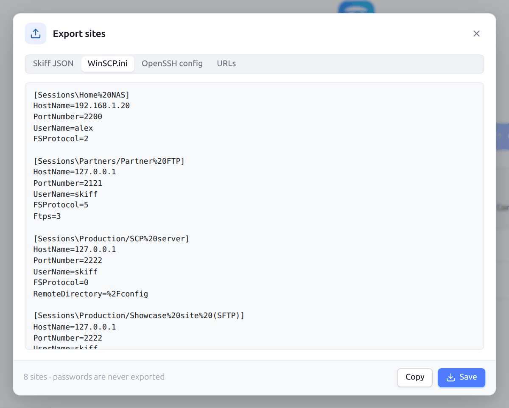

**Copy** puts the text on the clipboard, **Save** downloads it (`skiff-sites.json`, `.ini`, `.config` or `.txt`). Passwords are **never** exported.

## 3.7 Session URL and code

**Generate URL / code…** (context menu of a site) gives, ready to copy:

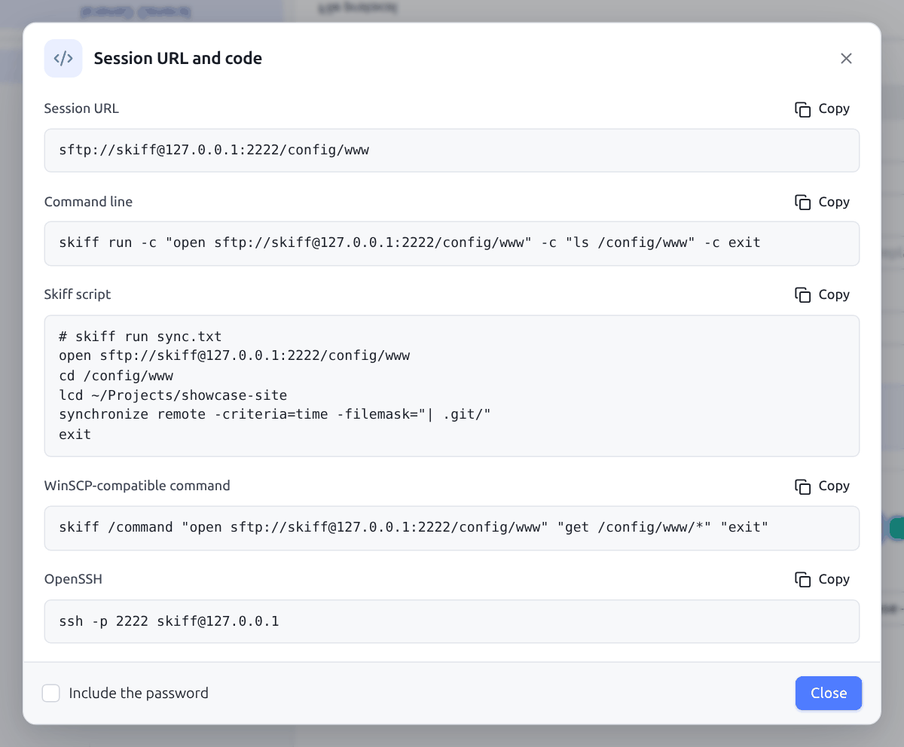

| Block | Example |
|---|---|
| **Session URL** | `sftp://skiff@127.0.0.1:2222/config/www` |
| **Command line** | `skiff run -c "open …" -c "ls …" -c exit` |
| **Skiff script** | A complete script: opening, `cd`, `lcd`, `synchronize remote`, `exit` |
| **WinSCP-compatible command** | `skiff /command "open …" "get …" "exit"` |
| **OpenSSH** | `ssh -p 2222 skiff@127.0.0.1` (SSH sites) |

**Include the password** adds the saved password to the URL and the commands. Use it with care.

---

[← First steps](02-first-steps.md) · [Contents](README.md) · [Interface and navigation →](04-interface.md) · 🇫🇷 [Français](../03-sites.md)
