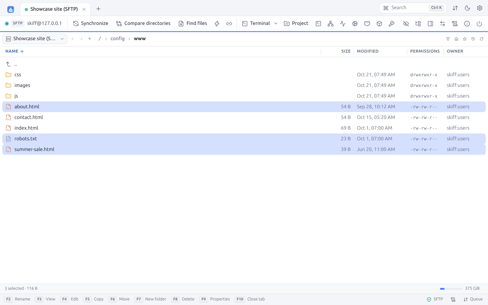
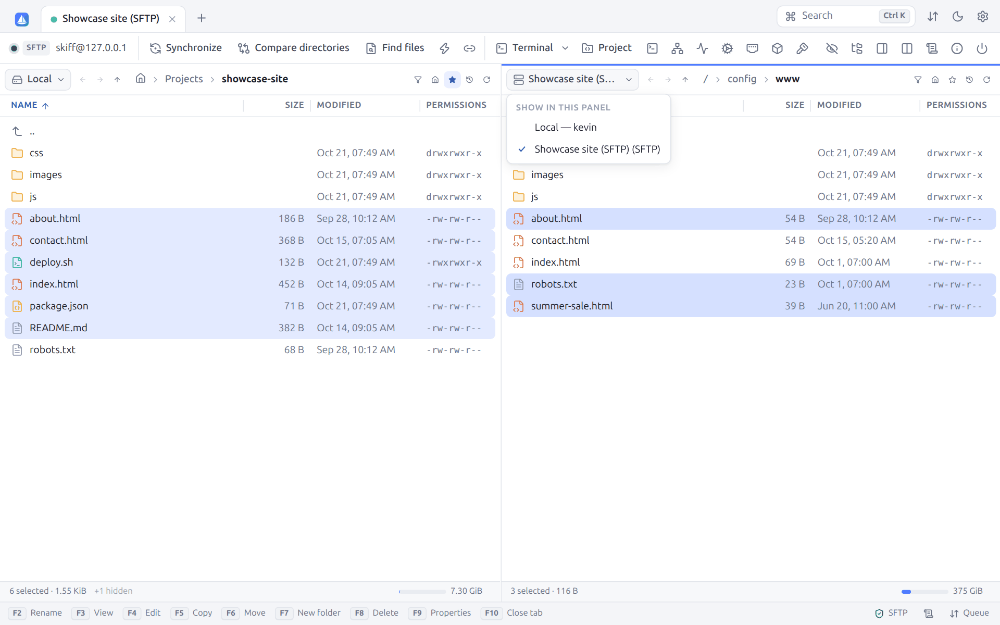
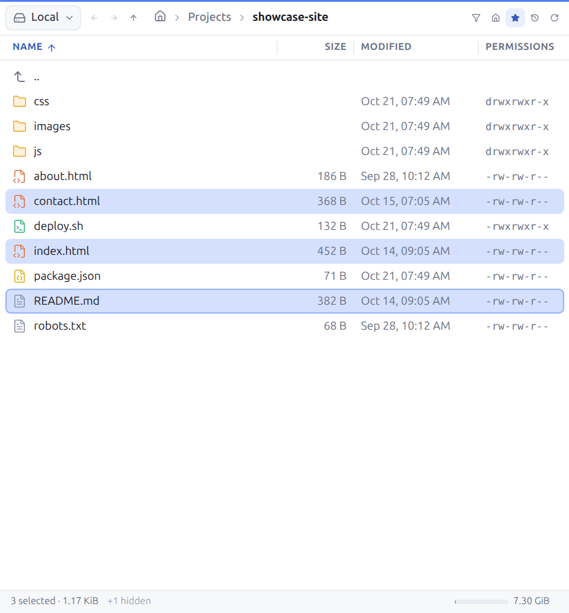
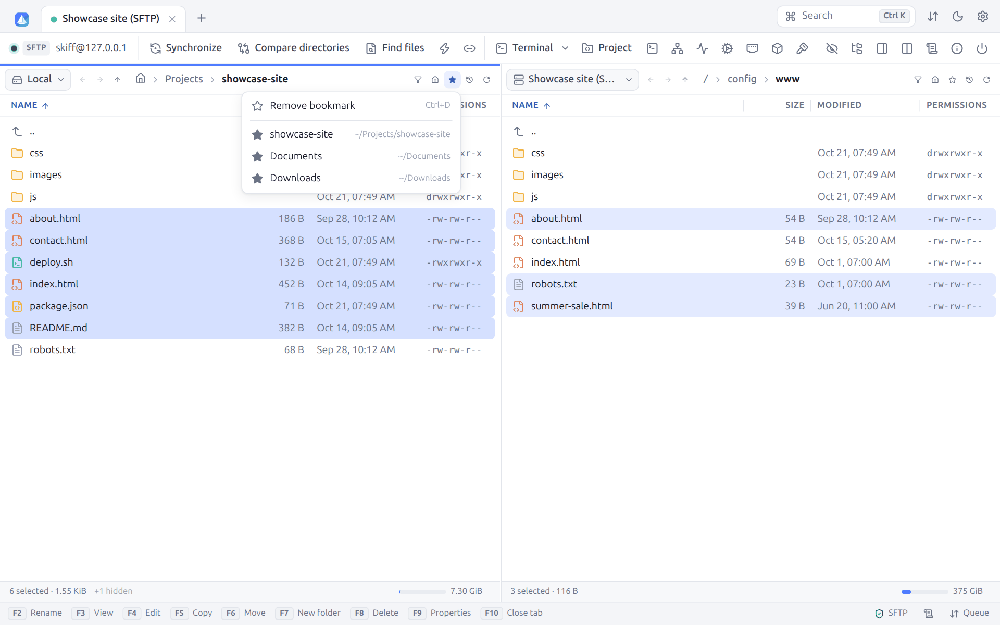
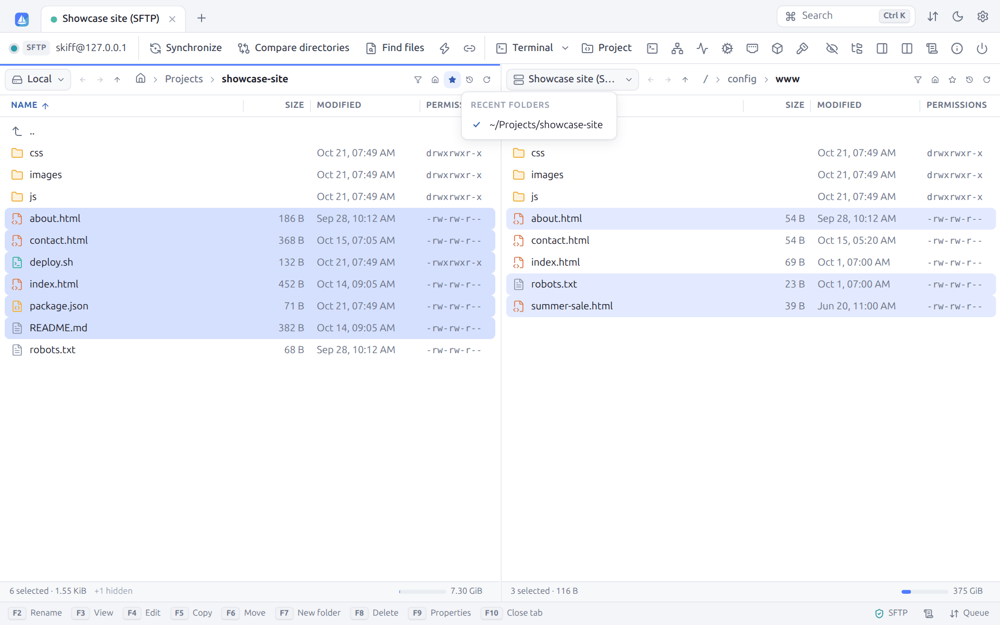
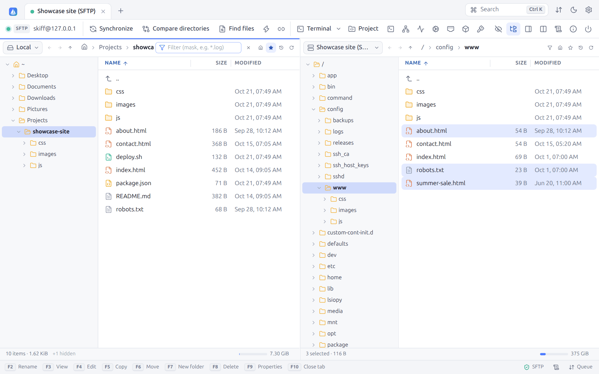
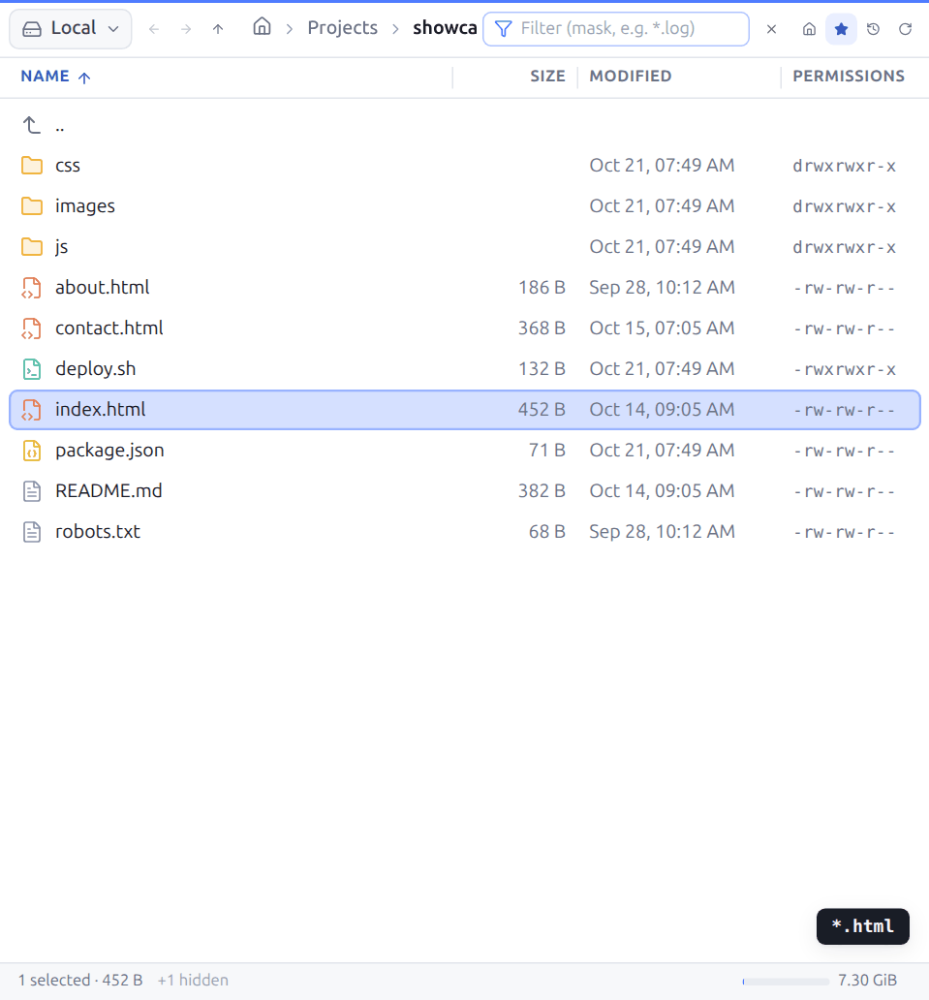
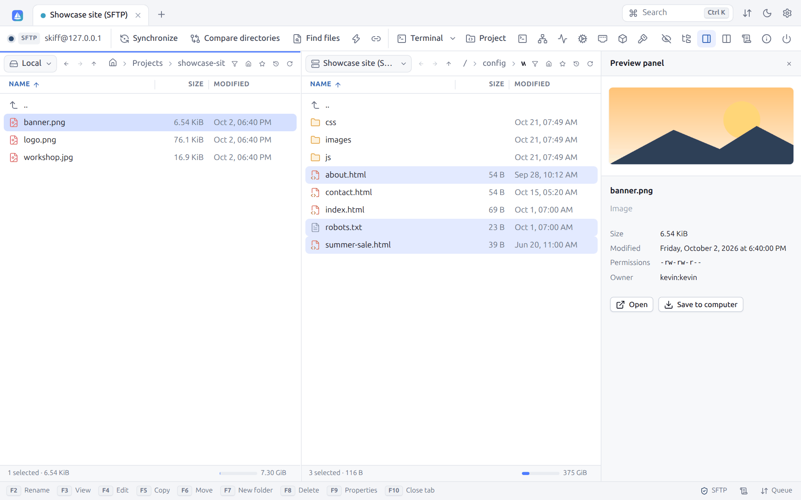
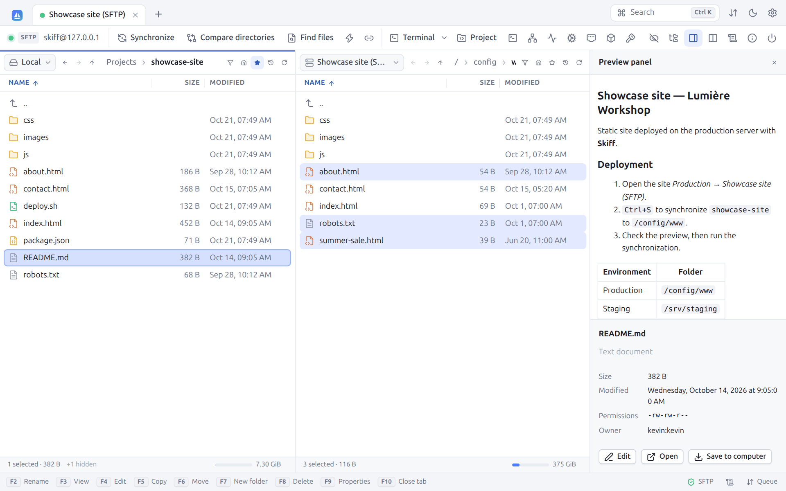
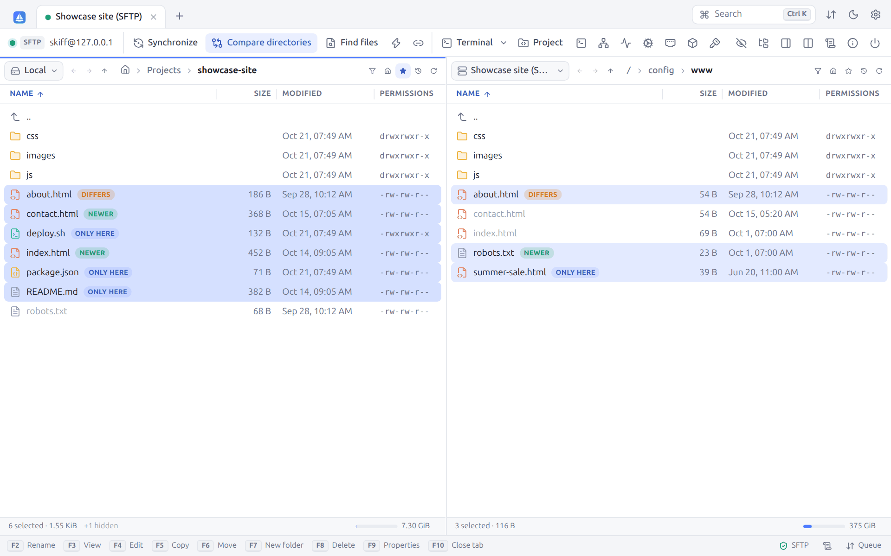

# 4. Interface and navigation

[← Site manager](03-sites.md) · [Contents](README.md) · [File operations →](05-files.md) · 🇫🇷 [Français](../04-interface.md)

## 4.1 Tabs

Each session, editor, comparison and terminal opens in a tab. The Skiff logo, on the left, leads back to the **Sites** tab.

| Action | Effect |
|---|---|
| Click | Activates the tab |
| Middle click | Closes the tab |
| Drag and drop | Reorders the tabs |
| Double-click on the empty area | Opens the **Sites** tab |
| `Ctrl+Tab` / `Ctrl+Shift+Tab`, `Ctrl+PgDn` / `Ctrl+PgUp` | Next / previous tab |
| `Alt+1` … `Alt+9` | Goes to tab n |
| `Ctrl+W`, `F10` | Closes the active tab |
| `Ctrl+N`, `+` | New session (**Sites** tab) |

A right-click on a session tab offers **Reconnect**, **Duplicate session** (opens a second session on the same site, in the same folders), **Close tab** and **Close other tabs**. Closing a tab that has transfers running asks for a confirmation (which can be turned off in the preferences).

## 4.2 The session toolbar

| Button | Shortcut | Role |
|---|---|---|
| Dot, `SFTP`, `user@host` | | State, protocol and identity of the connection |
| **Synchronize** | `Ctrl+S` | [Synchronization](07-synchronization.md) of the folders of both panels |
| **Compare directories** | `Ctrl+=` | Compares both panels ([§ 4.10](#410-comparing-folders)) |
| **Find files** | `Ctrl+Shift+F` | Recursive [search](10-search-log.md#101-finding-files) |
| Lightning: **Keep remote directory up to date** | `Ctrl+U` | [Watching](07-synchronization.md#73-keeping-the-remote-folder-up-to-date) of the local folder |
| Links: **Synchronized browsing** | `Ctrl+B` | [§ 4.11](#411-synchronized-browsing) |
| **Terminal**: **Open terminal** | `Ctrl+T` | [SSH terminal](09-terminal-tunnels.md#91-ssh-terminal) in the current folder |
| **Project** | `Ctrl+Shift+E` | Opens the folder of the active panel as a [project](08-editing.md#87-projects-editing-a-folder-without-installing-anything-on-the-server): tree, files in tabs, search, terminal |
| **Run command** | `Ctrl+Shift+X` | [One-off command](05-files.md#511-running-a-command) on the server |
| **Tunnels** | | [Port forwarding](09-terminal-tunnels.md#93-tunnels-port-forwarding) |
| **Server monitor** | | Processor, memory, disks and processes, live ([§ 9.6](09-terminal-tunnels.md#96-server-monitor)) |
| **Services of the server** | | The systemd services: start, stop, log ([§ 9.7](09-terminal-tunnels.md#97-services-of-the-server)) |
| **Ports of the server** | | The listening ports; a web page opens in the browser through a tunnel ([§ 9.9](09-terminal-tunnels.md#99-ports-of-the-server)) |
| **Containers of this server** | | Docker, Podman, Kubernetes on the server ([§ 15.7](15-protocols.md#157-docker-podman-and-kubernetes-containers)) |
| Crossed-out eye: **Show hidden files** | `Ctrl+Alt+H` | Shows or hides the files starting with a dot |
| **Directory tree** | | [§ 4.7](#47-directory-tree) |
| **Preview panel** | `Ctrl+Shift+P` | [§ 4.9](#49-preview-panel) |
| **Layout** | | Switches between Commander and Explorer ([§ 4.3](#43-commander-or-explorer)) |
| **Session log** | | [Log](10-search-log.md#102-session-log) of the connection |
| **Server/protocol information** | | [Information](10-search-log.md#103-server-and-protocol-information) about the server |
| **Disconnect** | | Closes the connection and the tab |

The buttons that make no sense for the protocol are greyed out: **Terminal** for FTP, WebDAV and S3, which have no shell, for one.

## 4.3 Commander or Explorer

**Commander** (the default) shows two panels side by side, as Norton Commander and WinSCP do. **Explorer** shows only the server, with the **Owner** column on top:

In Explorer, the downloads (`F5`) go into the folder of the hidden local panel. The **Layout** button switches the current session. The default layout of new sessions is set in **Preferences → Appearance → Interface**.

## 4.4 The file panels

Each panel can show **any connection**: the local disk or one of the open sessions. Click the selector on the left of the panel (**Local**, **Showcase site (SFTP)**…):

Showing two servers face to face allows **direct transfers from server to server** (see [Transfers](06-transfers.md#69-from-server-to-server)).

The navigation bar of the panel holds, from left to right:

| Item | Role |
|---|---|
| ← → | **Back** / **Forward** in the history of the panel (`Alt+←` / `Alt+→`) |
| ↑ | **Parent folder** (`Backspace`, `Alt+↑`) |
| Breadcrumb | Each item can be clicked. On the local side, the house icon stands for your home folder (`~`). Click the empty area (or `Ctrl+L`) to **Edit path**. |
| Funnel | **Filter** (`Ctrl+F`, [§ 4.8](#48-filter)) |
| House | **Home directory** |
| Star | **Bookmarks** ([§ 4.5](#45-bookmarks)) |
| Clock | **Recent folders** ([§ 4.6](#46-recent-folders)) |
| Circular arrow | **Refresh** (`Ctrl+R`, `Ctrl+F5`) |

The split between both panels moves with the mouse. `Ctrl+O` opens the **Open directory** dialog.

The local panel updates by itself when the content of the folder shown changes outside Skiff (a file downloaded by the browser, saved by another application…). The remote panels are refreshed after each operation made by Skiff; to see the changes made by others on the server, use **Refresh** (`Ctrl+R`). When typing a path, `~` stands for your home folder and relative paths start from the current folder.

### The file list

- **Columns**: Name, Size, Modified, Permissions, Owner (depending on the protocol) and Type (hidden by default). Click a header to sort, click again to reverse. Drag the edge of a header to resize it. A right-click on the headers shows or hides the columns. In a narrow panel, the secondary columns hide themselves.
- **Sorting**: folders first and natural sorting (`file2` before `file10`), both set in the preferences.
- **Icons**: each file type has its icon and its color (code, web, image, archive, script…). Symbolic links are marked.
- The `..` line goes up to the parent folder.
- **Type-ahead search**: type the start of a name to go straight to it.
- The list is virtualized: a folder of 100,000 files stays smooth.

### Keyboard and mouse

| Action | Effect |
|---|---|
| `↑` `↓` `PgUp` `PgDn` `Home` `End` | Moves the cursor |
| `Enter`, double-click | Opens the folder, or opens the file according to the **Double-click on a file** setting |
| `Backspace` | Parent folder |
| `Tab` | Goes to the other panel |
| `Esc` | Unselects everything, then clears the filter |
| `Shift+F10`, Menu key, right-click | Context menu |

### Selection

| Action | Effect |
|---|---|
| Click | Selects an item |
| `Ctrl+click` | Adds or removes an item |
| `Shift+click`, `Shift+↑/↓` | Selects a range |
| `Space`, `Insert` | Selects or unselects the current item (`Insert` moves to the next one) |
| `Ctrl+A` / `Ctrl+Shift+A` | Select all / unselect all |
| `Num +` | **Select files** by mask (`*.html`, `*.jpg; *.png`, `report-202?.*`, `*>1M`). Folders are selected only when their name matches (`*` selects them all). |
| `Num −` | **Unselect files** by mask |
| `Num *` | **Invert selection** |

The context menu of the empty area also offers **Select files with the same extension**.

The status bar of the panel gives the number of items and their size, or the number and size of the selection, the number of **hidden** items (hidden files) and of **filtered** ones, then the free space of the disk or of the server (when the protocol allows it), with a gauge.

## 4.5 Bookmarks

The star of the navigation bar adds the current folder to the bookmarks (`Ctrl+D`) or opens the list of the bookmarks:

A full star means that the current folder is a bookmark already: **Remove bookmark** takes it out. The local bookmarks are shared by all the sessions. The remote bookmarks belong to each site (or, for a quick connection, to each user, host and port).

## 4.6 Recent folders

The clock shows the **Recent folders** visited in the panel, the current folder being ticked:

## 4.7 Directory tree

The **Directory tree** button shows the tree of the folders on the left of each panel, as in Windows Explorer:

The tree unfolds down to the current folder. A click opens a folder, the arrow unfolds it without opening it. On the local side, when you are in your home folder, the tree starts from `~`; elsewhere, it starts from the root (`/`, or **This PC** on Windows).

## 4.8 Filter

`Ctrl+F` (or the funnel) shows a filter field in the breadcrumb. Only the files that match stay visible. Folders always stay shown, for browsing.

Text typed without a special character filters on a part of the name (`index` keeps `index.html`). With wildcards or conditions, the filter follows the syntax of the masks of WinSCP:

| Example | Files shown |
|---|---|
| `*.html` | The HTML files |
| `*.html; *.css` | The HTML and CSS files (`;` or `,` separate the masks) |
| `* \| *.bak; *.tmp` | Everything but the `.bak` and `.tmp` files (right of `\|`: the exclusions) |
| `*.jpg>100K` | The JPEG files larger than 100 KiB (units `K`, `M`, `G`, `T`) |
| `*>1D` | The files changed less than a day ago (units `Y`, `D`, `H`, `N` for minutes, `S`) |
| `*<2026-01-01` | The files changed before 1 January 2026 |
| `*>=today`, `*>=yesterday` | Changed today, since yesterday |

The status bar tells how many items are filtered. `Esc` or the cross clears the filter. The full syntax of the masks is in the chapter [Transfers](06-transfers.md#63-file-masks).

## 4.9 Preview panel

`Ctrl+Shift+P` (or **Preview panel**) opens on the right a preview of the selected file, local or remote:

| Type | Preview |
|---|---|
| Images (PNG, JPEG, GIF, BMP, WebP, ICO, AVIF) | Image. SVG files are not previewed: they can hold active code, which Skiff never runs. |
| Video (MP4, WebM, MOV, M4V, OGV), audio (MP3, WAV, OGG, FLAC, M4A, AAC, Opus) | Built-in player |
| PDF | Viewer |
| Markdown | Formatted rendering |
| Text and code | The first 20,000 characters |

Under the preview come the name, the type, the size, the modification date, the permissions and the owner, then the **Edit** (text), **Open** (default application) and **Save to computer** buttons. Files too large are not previewed.

## 4.10 Comparing folders

**Compare directories** (`Ctrl+=`) compares both panels, name by name, and selects the files that differ:

| Badge | Meaning |
|---|---|
| **ONLY HERE** | The file does not exist in the other panel |
| **NEWER** | The file is newer than the one of the other panel (the other one is shown faded) |
| **DIFFERS** | Same date, but a different size |

The newest files and those that exist on one side only are selected in each panel. The comparison takes into account the precision of the dates of the protocol (the second, or the minute with FTP), and hidden files only when they are shown. Then just press `F5` to copy the selection. A message gives the number of differences, or says that the folders are identical. Clicking **Compare directories** again clears the badges. For a recursive comparison with a preview, use the [synchronization](07-synchronization.md).

## 4.11 Synchronized browsing

With **Synchronized browsing** (`Ctrl+B`, links), entering a subfolder or going up one level in a panel does the same in the other one. It is handy when the local and remote trees are identical. The setting can be on from the connection in the site (**Directories → Synchronize browsing**).

## 4.12 The bottom panel

The bottom panel gathers six tabs:

| Tab | Content |
|---|---|
| **Queue** | The [transfer queue](06-transfers.md#64-the-transfer-queue) (`F12`) |
| **Log** | The [session log](10-search-log.md#102-session-log) |
| **Find** | The [search results](10-search-log.md#101-finding-files) |
| **Watchers** | The folders [kept up to date](07-synchronization.md#73-keeping-the-remote-folder-up-to-date) |
| **Tunnels** | The active [tunnels](09-terminal-tunnels.md#93-tunnels-port-forwarding) |
| **Edited files** | The files open in an [external editor](08-editing.md#84-external-editor) |

`Ctrl+Shift+Q` opens or closes it, the arrow on the right folds it, and its height is set by dragging its top edge. A badge gives the number of active items of each tab.

## 4.13 Status bar

At the bottom of the window:

- on the left, the **function key bar** (`F2` to `F10`), which can be clicked, and hidden in the preferences; on the Sites tab, the version of Skiff;
- on the right, the protocol and the security state of the connection (green shield: encrypted), the number of active watchers and tunnels, the **Log** and **Queue**, with the speed and the time left of the running transfers.

## 4.14 Accessibility

Skiff can be driven from the keyboard ([Keyboard shortcuts](16-shortcuts.md)) and announces itself to screen readers (NVDA, Narrator, VoiceOver, Orca): each button has a name, those showing only an icon too (the text of their tooltip); the dialogs are named by their title; the tabs, the menus and the file list have their role (selected item, ticked choice); notifications are read when they arrive, and errors at once. The language of the page follows that of the interface, and the focus outline stays visible.

---

[← Site manager](03-sites.md) · [Contents](README.md) · [File operations →](05-files.md) · 🇫🇷 [Français](../04-interface.md)
