# 5. File operations

[← Interface and navigation](04-interface.md) · [Contents](README.md) · [Transfers →](06-transfers.md) · 🇫🇷 [Français](../05-fichiers.md)

Every operation applies to the selection of the active panel, or to the item under the cursor when nothing is selected. They work the same way locally and with every protocol, within what each protocol allows (see [Protocols](15-protocols.md)). The commands that cannot be done are hidden.

## 5.1 Context menu of a file

Right-click a file or a folder (or `Shift+F10`, the Menu key):

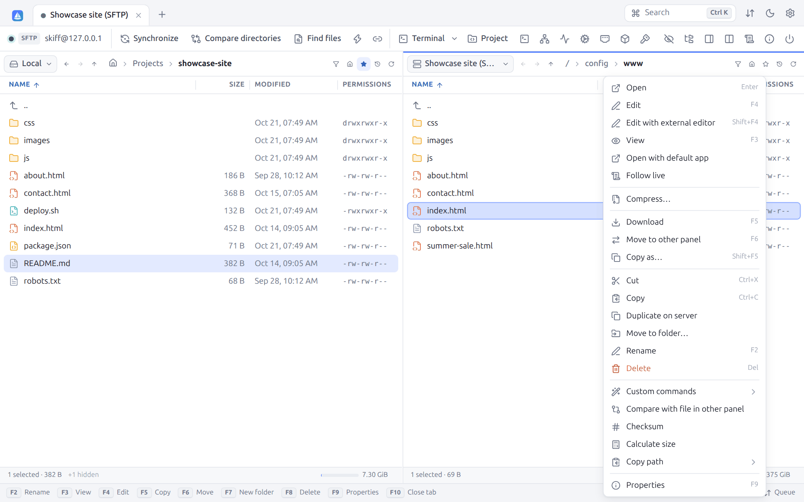

| Command | Shortcut | Effect |
|---|---|---|
| **Open** | `Enter` | Opens the folder, or the file according to the double-click setting |
| **Edit** | `F4` | Opens the file in the [built-in editor](08-editing.md) |
| **Edit with external editor** | `Shift+F4` | Opens the file in your editor, with automatic upload ([§ 8.4](08-editing.md#84-external-editor)) |
| **View** | `F3` | Opens a text file in the editor, read-only; for an image, a video, a sound or a PDF, opens the [preview panel](04-interface.md#49-preview-panel) |
| **Open with default app** | | Downloads when needed and opens with the application the system associates |
| **Open as project** | | A folder: the [project](08-editing.md#87-projects-editing-a-folder-without-installing-anything-on-the-server) |
| **What takes room?** | | A folder: its items by size ([§ 5.13](#513-what-takes-room)) |
| **Follow live** | | Opens the end of the file and each line added ([§ 9.8](09-terminal-tunnels.md#98-following-a-log-live)) |
| **Extract** | | zip, tar, tar.gz, tar.bz2 or tar.xz archive: opens it in place ([§ 5.12](#512-compressing-and-extracting)) |
| **Compress** | | Puts the selection into a zip, tar.gz or tar archive ([§ 5.12](#512-compressing-and-extracting)) |
| **Download** / **Upload** / **Copy to other panel** | `F5` | Copies to the folder of the other panel ([Transfers](06-transfers.md)) |
| **Move to other panel** | `F6` | Moves to the folder of the other panel |
| **Copy as…** | `Shift+F5` | Copies with the transfer options dialog |
| **Save to computer** | | In [web mode](14-web-mode.md): downloads the file in the browser |
| **Cut**, **Copy**, **Paste** | `Ctrl+X`, `Ctrl+C`, `Ctrl+V` | [File clipboard](#58-file-clipboard) |
| **Duplicate on server** | | Copies on the server side, without going through the computer: `cp` with SFTP and SCP, `COPY` with WebDAV, object copy with S3 |
| **Move to folder…** | | Moves into another folder of the same server (**Move to folder** dialog) |
| **Rename** | `F2`, `Shift+F6` | [§ 5.3](#53-renaming) |
| **Delete** | `Delete`, `F8` | [§ 5.4](#54-deleting) |
| **Custom commands** | | [§ 5.10](#510-custom-commands) |
| **Compare with file in other panel** | | Opens the [visual diff](08-editing.md#85-visual-diff) |
| **Checksum** | | [§ 5.7](#57-checksums) |
| **Calculate size** | | Total size of the selected folders, in bytes, files and folders |
| **Copy path** | `Ctrl+Shift+C` | Submenu: **Copy path**, **Copy name**, **Copy URL** (`sftp://user@host/path`) |
| **Show in file manager** | | Local file: shows it in Explorer, the Finder or Files |
| **Properties** | `F9` | [§ 5.6](#56-properties-and-permissions) |

## 5.2 Context menu of the empty area

Right-click the empty area of a panel:

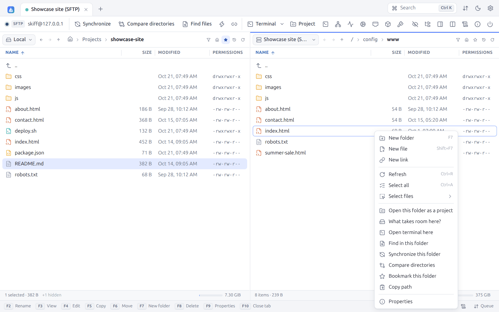

| Command | Shortcut | Effect |
|---|---|---|
| **New folder** | `F7` | [§ 5.5](#55-creating-folders-files-and-links) |
| **New file** | `Shift+F7` | Creates an empty file and opens it in the editor |
| **New link** | | Creates a symbolic or hard link |
| **Paste** | `Ctrl+V` | Pastes the files copied or cut |
| **Refresh** | `Ctrl+R` | Reads the folder again |
| **Select all** | `Ctrl+A` | |
| **Select files** | | Submenu: select / unselect by mask (`Num +` / `Num −`), invert (`Num *`), same extension |
| **Open this folder as a project** | `Ctrl+Shift+E` | [Project](08-editing.md#87-projects-editing-a-folder-without-installing-anything-on-the-server) |
| **What takes room here?** | | [§ 5.13](#513-what-takes-room) |
| **Open terminal here** | | [Terminal](09-terminal-tunnels.md) in this folder |
| **Find in this folder** | | [File search](10-search-log.md#101-finding-files) |
| **Synchronize this folder** | | [Synchronization](07-synchronization.md) |
| **Compare directories** | | [Comparison](04-interface.md#410-comparing-folders) |
| **Bookmark this folder** | | [Bookmarks](04-interface.md#45-bookmarks) |
| **Copy path** | | Copies the path of the current folder |
| **Properties** | | Properties of the current folder |

## 5.3 Renaming

`F2` lets you edit the name right in the list. The name is preselected without its extension:

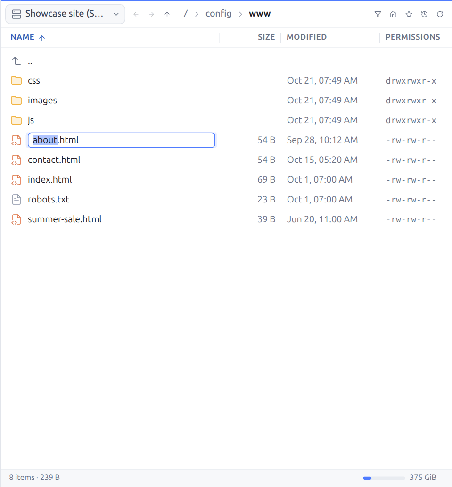

`Enter` confirms, `Esc` cancels. On a recent SFTP server, Skiff uses `posix-rename` to replace an existing file atomically.

## 5.4 Deleting

`Delete` or `F8` deletes the selection after a confirmation:

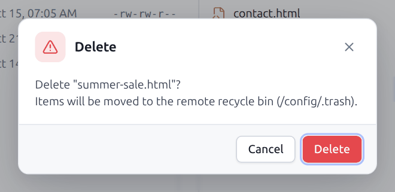

| Where | What happens |
|---|---|
| Local, desktop window | The items go to the **system trash** (the Recycle Bin of Windows, the Trash of macOS, `~/.local/share/Trash` on Linux) |
| Server with a **remote recycle bin** set ([site → Directories](03-sites.md#directories)) | The items are moved into this folder of the server, as the screenshot shows |
| Server without a recycle bin, web mode | Deleted for good. The dialog says "This cannot be undone." |

`Shift+Delete` deletes **for good**, without going through a trash, and always asks for a confirmation. The confirmation of ordinary deletions can be turned off (**Preferences → Confirmations**). Folders are deleted recursively.

## 5.5 Creating folders, files and links

`F7` creates a folder:

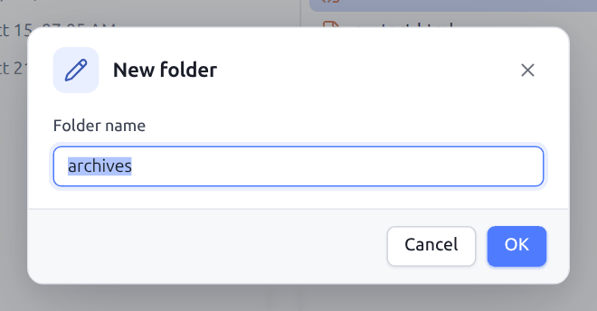

`Shift+F7` creates an empty file (name offered: `untitled.txt`) and opens it in the editor.

**New link** creates a link to the selected item:

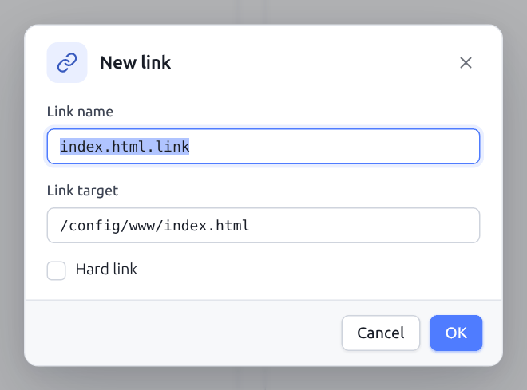

| Field | Description |
|---|---|
| **Link name** | Name of the link to create in the current folder |
| **Link target** | Path the link points to (absolute or relative) |
| **Hard link** | Creates a hard link instead of a symbolic link. With SFTP, needs the `hardlink@openssh.com` extension. |

Links are available locally, with SFTP and with SCP.

## 5.6 Properties and permissions

`F9` opens the properties of the selection:

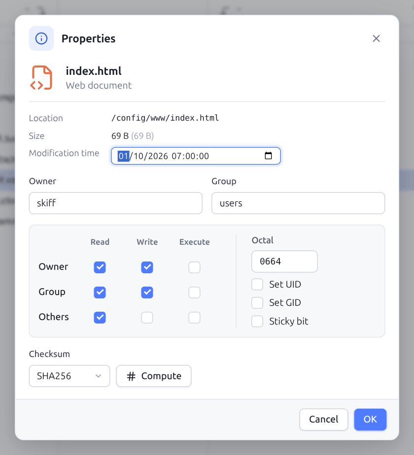

| Area | Description |
|---|---|
| Head | Icon, name and file type ("Web document"), or number of items for a multiple selection |
| **Location** | Folder holding the item. For a link: **Link target**. |
| **Size** | Size in readable units and in bytes |
| **Modification time** | Can be changed right there when the protocol allows it (SFTP, SCP, FTP with MFMT, local) |
| **Owner**, **Group** | Can be changed with SFTP, SCP and locally (Unix). Skiff offers the users and groups known on the server. |
| Permission grid | **Read**, **Write**, **Execute** for the **Owner**, the **Group** and the **Others** |
| **Octal** | The same permissions in octal (`0644`), which can be edited directly |
| **Set UID**, **Set GID**, **Sticky bit** | Special permissions |
| **Checksum** | Algorithm (MD5, SHA-1, SHA-256, SHA-512) and **Compute** button |

For a folder, the size is computed with **Calculate** (total size, number of files and folders), and two options show up:

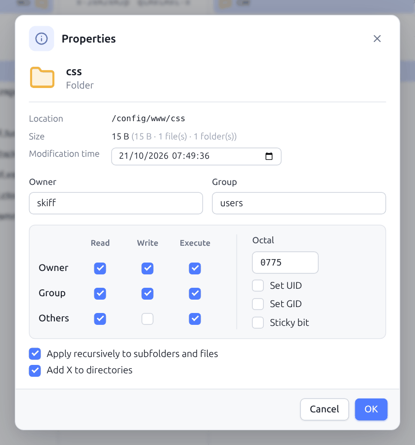

- **Apply recursively to subfolders and files**: applies the permissions, owner and group to the whole content;
- **Add X to directories**: in a recursive application, adds the execute permission to the folders wherever the read permission is given (so that `0644` gives `0755` on the folders).

The checksum is computed (**Compute**) on the server, without downloading the file: the `md5sum`, `sha1sum`, `sha256sum`, `sha512sum` commands (or `shasum` on BSD and macOS) with SFTP and SCP, the `HASH`, `XSHA256`, `XSHA1`, `XMD5` commands with FTP when the server knows them, the ETag (MD5) with S3:

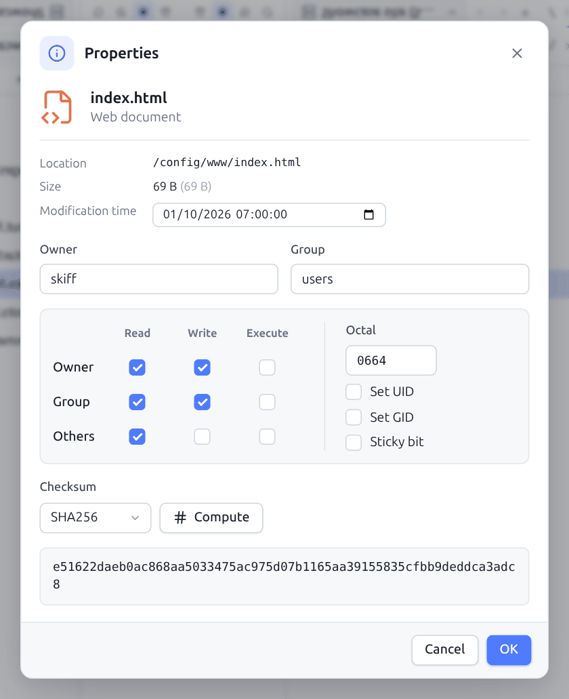

## 5.7 Checksums

**Checksum** (context menu) opens a dialog of its own:

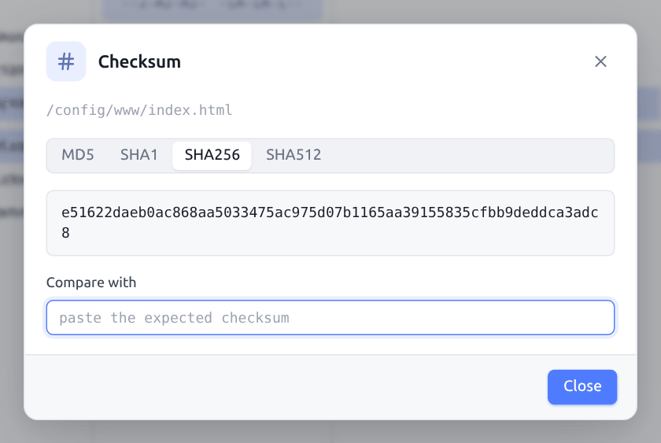

Choose the algorithm (**MD5**, **SHA1**, **SHA256**, **SHA512**; only MD5 with S3). A click on the checksum copies it. Paste an expected checksum into **Compare with**: the field turns green with "✓ match" or red with "✗ different".

## 5.8 File clipboard

`Ctrl+C` (or `Ctrl+X`) then `Ctrl+V` copies (or moves) files from one panel to the other, from one folder to another or from one session to another, as in a file manager. Pasting into another connection starts a transfer. Cutting then pasting on the same server is a simple move.

## 5.9 Drag and drop

| Gesture | Effect |
|---|---|
| Drag from one panel to the other | Copies (moves when both panels are on the same connection) |
| Drag onto a folder of the list | Copies or moves **into** this folder |
| Drag onto `..` | Copies or moves into the parent folder |
| `Ctrl` (or `Alt`) while dropping | Forces a copy |
| `Shift` while dropping | Forces a move |
| Drag files or folders from Explorer, the Finder or the desktop | Uploads them into the target folder (folders included) |
| Drag **local** files to the desktop or another program | Drops them there as files (a copy by the file manager, an e-mail attachment…), on every system |
| Drag a **remote** file to the desktop | Downloads it with the Chromium engines (the Windows window, Chrome and Edge in web mode). On Linux and macOS, the window cannot drop a remote file into another program: a message explains it the first time; drag it onto the local panel, or copy it (`F5`) to a folder of the computer, then drag it from there |

While hovering, a banner tells the action ("Drop to upload to…", "Drop to copy here", "Drop to move here"). The **Confirm drag & drop transfers** option (Preferences → Confirmations) shows the options dialog before each drop.

## 5.10 Custom commands

Custom commands run on the selection, on the server (SFTP, SCP) or locally. They are in the **Custom commands** submenu of the context menu:

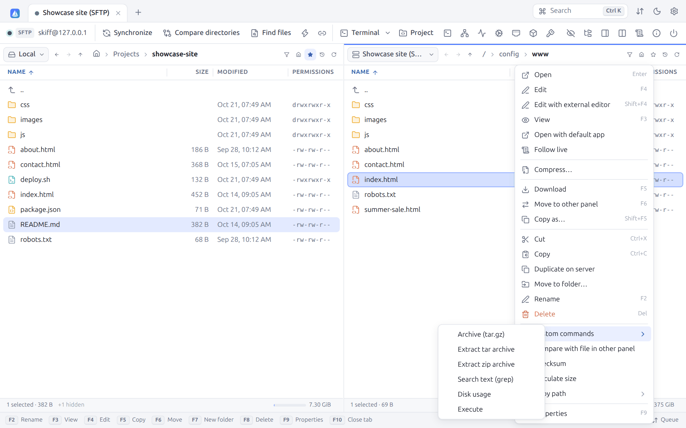

Skiff comes with six, which can be changed: **Archive (tar.gz)**, **Extract tar archive**, **Extract zip archive**, **Search text (grep)**, **Disk usage** and **Execute**. They are managed in **Preferences → Custom commands** ([§ 12.11](12-preferences.md#1211-custom-commands)).

The patterns of WinSCP are replaced before running:

| Pattern | Replaced by |
|---|---|
| `!` | Name of the current file |
| `!&` | Names of all the selected files, quoted when needed |
| `!/` | Path of the current folder |
| `!@` | Host name of the server |
| `!U` | User name |
| `!?Question?default!` | Value asked of the user at start (`!?Archive name:?archive.tar.gz!`, for one) |

Options of each command: **Once per file** (else a single time for the whole selection), **Directories** (can be used on folders), **Local command** (run on the computer) and **Show output**. The output also shows automatically when the command fails.

## 5.11 Running a command

`Ctrl+Shift+X` (or **Run command** in the toolbar) runs a one-off command in the current folder of the server (or locally):

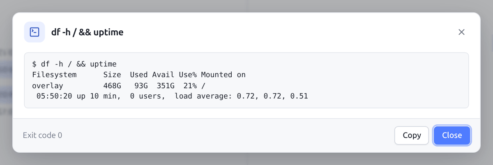

The dialog shows the standard output and the error output, then the **Exit code**. With FTP, the command is sent as it is to the server (`SITE CHMOD 640 file.txt`, for one) and the dialog shows its answer. **Copy** copies the output. The panel is refreshed after the command. For an interactive session, use the [terminal](09-terminal-tunnels.md).

## 5.12 Compressing and extracting

Archives are made and opened **where the files are**, without downloading anything: on an SFTP or SCP server with a shell (and in a container), by its own `tar`, `zip` and `unzip` commands; on this computer, by Skiff. Handy to back up a site before an update, or to deploy an archive uploaded in one go.

**Compress** (right-click one or several files and folders) puts the selection into an archive, in the same folder:

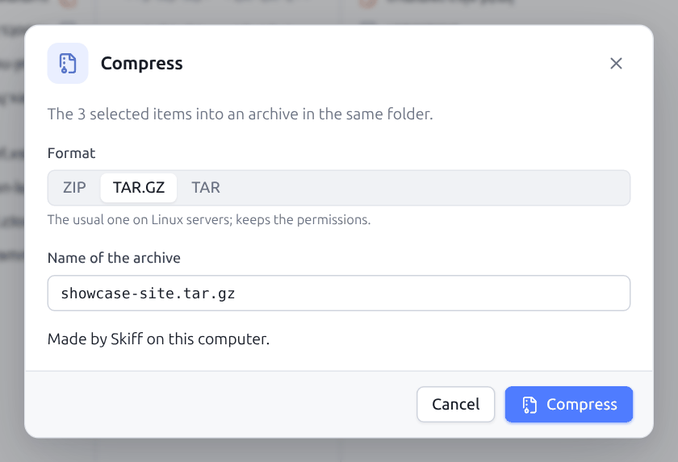

| Format | For |
|---|---|
| **ZIP** | Opens everywhere, Windows included. On a server without `zip`, Skiff uses Python 3; without either, it offers TAR.GZ. |
| **TAR.GZ** | The usual one on Linux servers; keeps the permissions of the files |
| **TAR** | Without compression: fast, keeps the permissions |

The name offered is that of the item (or of the folder, for several items); changing the format changes its extension. An existing archive is never replaced.

**Extract** (right-click a `.zip`, `.tar`, `.tar.gz`, `.tgz`, `.tar.bz2` or `.tar.xz` archive) opens it:

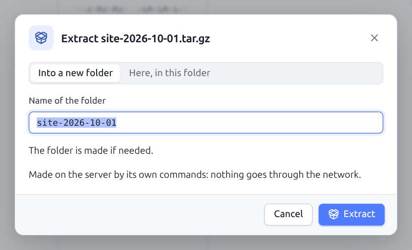

- **Into a new folder** (the default), named after the archive: nothing is mixed with the files already there;
- **Here, in this folder**: the files with the same name are replaced.

Nothing is written outside the destination folder: an archive with a path that would leave it (`../`, an absolute path) is refused, or that path is brought back into the folder by the `tar` of the server. Without a shell (SFTP-only account, FTP, WebDAV, S3), the **Compress** and **Extract** commands do not show.

## 5.13 What takes room?

When the disk of a server fills up, **What takes room here?** (right-click the empty area, a folder, or the palette; the magnifier icon of a disk in the [monitor](09-terminal-tunnels.md#96-server-monitor)) opens a tab that ranks the items of the folder by size:

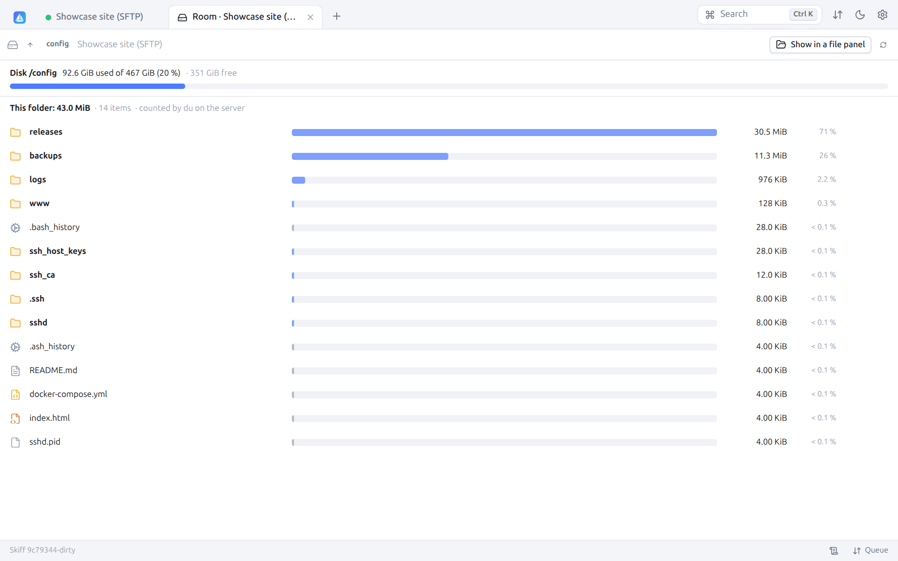

- At the top, the **disk** of the folder: room used, size, free room, and the gauge (orange above 75 %, red above 90 %).
- Then the size of the folder and, for each item, its size, its share of the folder and a bar scaled to the largest one. Hidden files count too (a `.cache` can be huge).
- A click on a folder opens it; the path at the top and the **Parent folder** arrow go back up. The folders already seen are not counted again; **Count again** does it.
- When hovering a line: **Copy path** and **Delete** (after a confirmation, with the room freed). **Show in a file panel** opens the folder in a session.

On an SFTP or SCP connection with a shell, `du` counts the room on the server, in one command, without leaving the file system (`du -x`): fast even for thousands of files. Otherwise (FTP, WebDAV, S3, SFTP-only account, or this computer), Skiff adds up the size of the files while walking through them; beyond 300,000 items or 2 minutes, the count stops and the tab says so. The folders the account cannot read are counted apart ("folders not readable"): connect as root to measure everything.

---

[← Interface and navigation](04-interface.md) · [Contents](README.md) · [Transfers →](06-transfers.md) · 🇫🇷 [Français](../05-fichiers.md)
