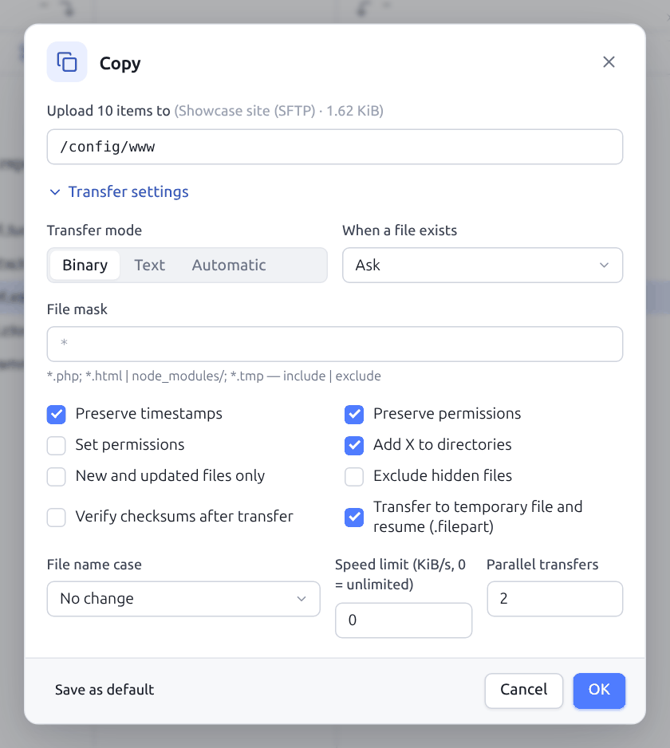
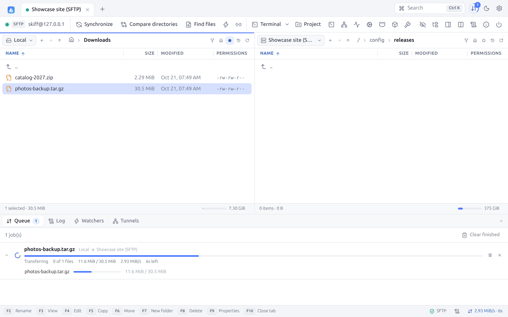
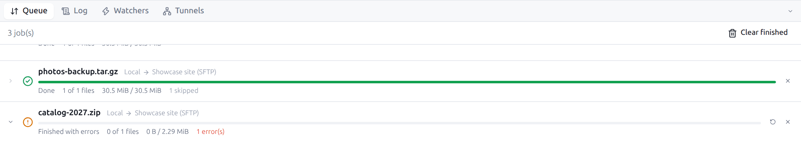
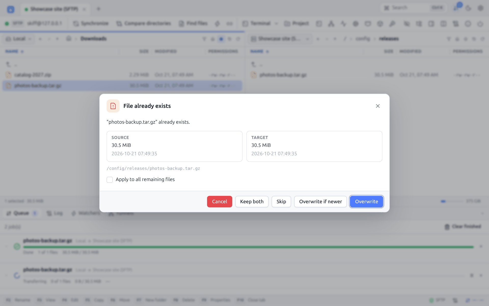
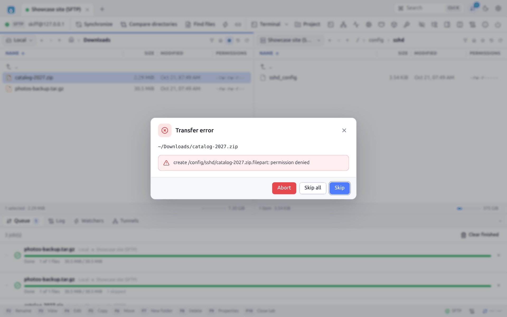
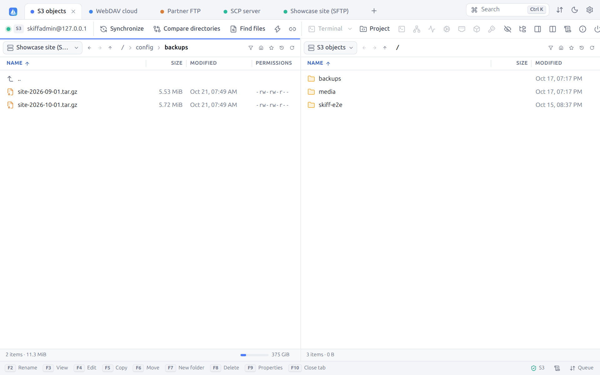

# 6. Transfers

[← File operations](05-files.md) · [Contents](README.md) · [Synchronization →](07-synchronization.md) · 🇫🇷 [Français](../06-transferts.md)

## 6.1 Copying and moving

| Method | Effect |
|---|---|
| `F5` | Copies the selection to the folder of the other panel |
| `F6` | Moves the selection (copies, then deletes the source) |
| `Shift+F5` | **Copy as…**: copies with the options dialog |
| Drag and drop | See [Drag and drop](05-files.md#59-drag-and-drop) |
| `Ctrl+C` / `Ctrl+X` then `Ctrl+V` | See [Clipboard](05-files.md#58-file-clipboard) |
| Context menu | **Download**, **Upload**, **Copy to other panel**, **Move to other panel** |

Depending on the **Show transfer options before copying** option (Preferences → Confirmations), `F5` starts the transfer at once or first shows the transfer dialog. `Shift+F5` always shows it.

Between two panels showing the same connection, `F6` is a simple rename on the server side, instant, and `F5` a copy on the server side (**Duplicate on server**), without going through the computer.

In the **Explorer** layout, only one panel is visible: `F5` then downloads into the folder of the hidden local panel, that of the session (the local folder of the site by default).

## 6.2 The transfer dialog

At the top: the action ("Upload 10 items to", "Download "report.pdf" to"…), the destination and the total size, then the **destination folder**, which can be changed. For a single item, a **Name** field renames it on arrival. **Transfer settings** unfolds the options:

| Option | Description |
|---|---|
| **Transfer mode** | **Binary** (byte for byte), **Text** (converts the line ends between LF and CRLF according to the destination system and the setting of the site), **Automatic** (text for the files of the **Text file mask**, binary for the others) |
| **Text file mask** | In automatic mode. By default: `*.*html; *.htm; *.txt; *.php; *.js; *.css; *.sh; *.xml; *.md; *.json; *.yml; *.csv; *.sql; *.py; *.conf`… |
| **When a file exists** | **Ask**, **Overwrite**, **Overwrite if newer**, **Overwrite if size differs**, **Resume / append**, **Skip**, **Keep both** |
| **File mask** | Files and folders to include or exclude ([§ 6.3](#63-file-masks)) |
| **Preserve timestamps** | Gives the copy the modification date of the original |
| **Preserve permissions** | Gives the copy the permissions of the original |
| **Set permissions** | Forces permissions (in octal, `644` by default) instead of keeping them |
| **Add X to directories** | With forced permissions, adds the execute permission to the folders |
| **New and updated files only** | Skips the files already present and up to date at the destination |
| **Exclude hidden files** | Skips the files and folders starting with a dot |
| **Verify checksums after transfer** | Computes the checksum again on both sides and reports any difference |
| **Transfer to temporary file and resume (.filepart)** | First writes `name.filepart`, then renames it. An interrupted transfer resumes where it stopped. Applied to the files larger than 100 KiB. |
| **File name case** | **No change**, **lower case**, **UPPER CASE**, **First upper** |
| **Speed limit (KiB/s, 0 = unlimited)** | Throttles the speed of this transfer |
| **Parallel transfers** | Number of files transferred at the same time for this transfer (1 to 16) |

**Save as default** makes these settings the default options (they are found in **Preferences → Transfers**). **OK** adds the transfer to the queue.

When the destination is Windows, the characters forbidden in names (`\ / : * ? " < > |`) are replaced automatically.

## 6.3 File masks

The masks follow the syntax of WinSCP. They serve the transfers, the synchronization, the watching, the search, the filter of the panels and the selection by mask.

| Item | Syntax | Example |
|---|---|---|
| Wildcard | `*` (any sequence), `?` (one character) | `report-202?.pdf` |
| List | `;` or `,` | `*.html; *.css; *.js` |
| Exclusion | right of `\|` | `* \| *.bak; *.tmp` |
| Folder | ends with `/` | `* \| .git/; node_modules/` |
| Path | holds a `/` | `src/*.go`, `/var/www/*/cache/` |
| Size | `>`, `<`, `>=`, `<=`, `=` followed by a size, units `K`, `M`, `G`, `T` | `*.jpg>100K`, `*<1G` |
| Absolute date | operator followed by `YYYY-MM-DD` (and possibly `HH:MM[:SS]`) | `*>=2026-01-01` |
| Relative date | operator followed by a duration, units `Y` (years), `D` (days), `H` (hours), `N` (minutes), `S` (seconds); `>` = newer than | `*.log>1D` (changed less than a day ago), `*<1Y` (more than a year) |
| Rounding | final `S`: start of the unit | `*>1DS` (since midnight yesterday) |
| Keywords | `today`, `yesterday` | `*>=today` |
| Quotes | for names holding `;` or `\|` | `"a;b.txt"` |

The matching ignores the case. An empty mask selects everything.

## 6.4 The transfer queue

Each transfer becomes a task of the queue, shown in the **Queue** panel (`F12`, or the ⇅ icon at the top right). It opens by itself when a transfer starts (this can be set).

For each task: state icon, name, direction ("Local → Showcase site (SFTP)"), progress bar, status, number of files ("0 of 1 files"), bytes transferred, speed, time left, files skipped and failed. The arrow on the left unfolds the list of the files in progress.

| Status | Meaning |
|---|---|
| **Queued** | Waits for a free slot (see **Maximum simultaneous transfers**) |
| **Scanning…** | Walks through the folders to transfer |
| **Transferring** | Running |
| **Paused** | Suspended |
| **Done** | Everything went well |
| **Finished with errors** | Some files failed or were skipped |
| **Failed** / **Cancelled** | Interrupted |

Buttons of each task: **Pause** / **Resume**, **Retry failed files**, **Cancel transfer** (active task) or **Remove** (finished task). The right-click also offers **Move up** and **Move down** to change the order of the queue. **Clear finished** empties the list of the finished tasks.

The status bar at the bottom right shows the overall speed and the time left. The badge of the ⇅ icon counts the active transfers. A notification tells when all the transfers are over.

Network errors are retried automatically (twice by default, this can be set), reconnecting when needed. With a `.filepart` file, the resumed transfer starts again from the byte reached.

## 6.5 Existing file

When the policy is **Ask** and a file exists already, Skiff shows both versions side by side, the newer one being marked:

| Button | Effect |
|---|---|
| **Overwrite** | Replaces the file |
| **Overwrite if newer** | Replaces only when the source is newer |
| **Skip** | Keeps the existing file |
| **Resume** | Completes the existing file (offered when it is smaller than the source) |
| **Keep both** | Saves the copy as `name (1).ext` |
| **Cancel** | Stops the transfer |

**Apply to all remaining files** applies the same choice to the rest of the transfer. To never be asked again, choose another policy in **Preferences → Transfers** or untick **Ask before overwriting files** (Preferences → Confirmations).

## 6.6 Transfer errors

When a file cannot be transferred (permissions, full disk, invalid name…), Skiff shows the file at fault and the error:

| Button | Effect |
|---|---|
| **Skip** | Goes on to the next file |
| **Skip all** | Skips all the next errors of this transfer |
| **Abort** | Stops the transfer |

The files skipped after an error stay listed in the task: **Retry failed files** starts them again once the problem is fixed. With **Skip failed files without asking** (Preferences → Queue), the question is never asked.

## 6.7 Resuming and partial files

- With the `.filepart` option (the default for the files larger than 100 KiB), a file shows under its real name only once complete. So a website never serves a half-uploaded file.
- When the transfer is interrupted (network cut, cancel, close), the `.filepart` is kept. Starting it again resumes at the end of the partial file.
- The **Resume / append** policy also resumes the existing files smaller than the source.

## 6.8 Large files in parallel parts (SFTP)

A large file is copied in **several parts at a time**, each on its own SFTP channel of the same connection (without a new authentication). Each SSH channel has its own flow control window: towards a distant server (high latency), a single channel caps the speed, four channels multiply it almost by four. On a local network, the gain is small.

- On by default for the files of at least **100 MiB**, in **4 parts** (from 2 to 8, and at least 1 MiB per part): **Preferences → Queue → Big SFTP files** ([§ 12.4](12-preferences.md#124-queue)).
- Applies to downloads from an SFTP server, uploads to an SFTP server and copies between two SFTP servers. Not in text mode, nor when a file is resumed or appended.
- In the details of a task of the queue, a file copied so bears the **4 parts** badge, and the [session log](10-search-log.md#102-session-log) says `4 parts copied in parallel`.
- The parts are written into the `.filepart`, renamed once they are all done. A file copied in parts is never resumed: when interrupted, the partial file is deleted and the next try starts from the beginning.
- The speed limit and the pause apply to all the parts together.

## 6.9 From server to server

Show two connections face to face ([§ 4.4](04-interface.md#44-the-file-panels)): `F5` copies straight from one server to the other, from an SFTP server to an S3 storage, for one.

The data goes through Skiff as a continuous stream, without a temporary file on the computer. All the transfer options apply. Between two folders of the same server, **Duplicate on server** even avoids this transit.

---

[← File operations](05-files.md) · [Contents](README.md) · [Synchronization →](07-synchronization.md) · 🇫🇷 [Français](../06-transferts.md)
