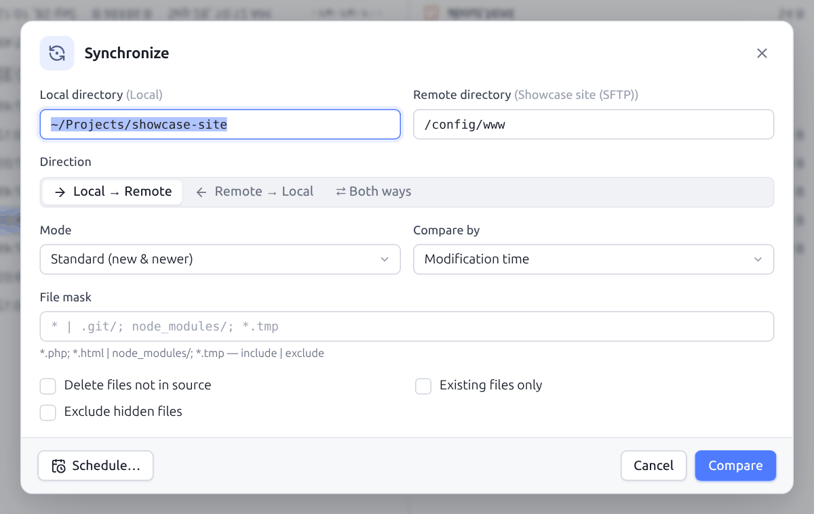
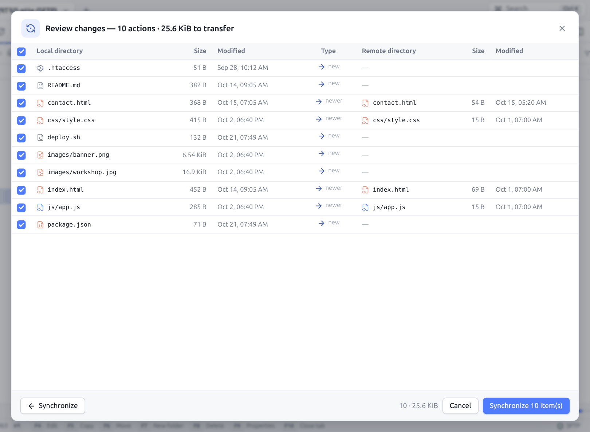
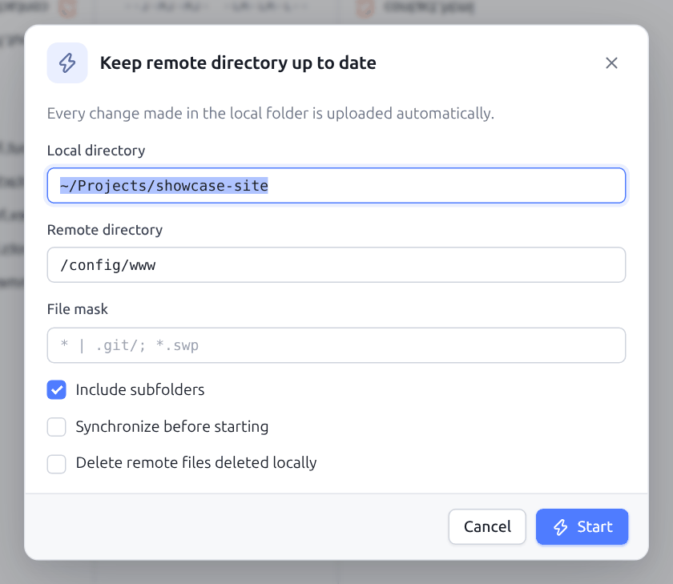
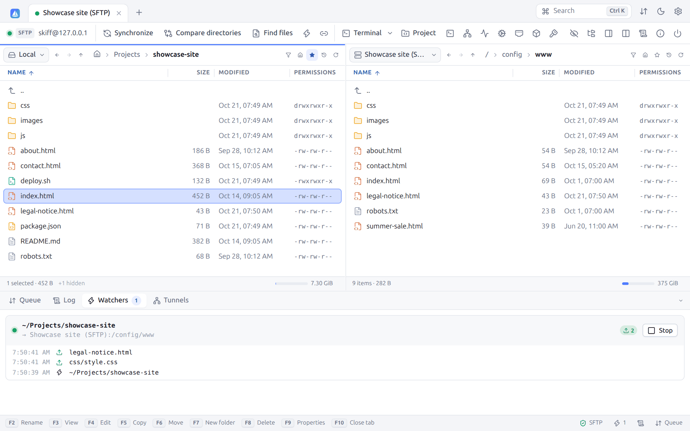
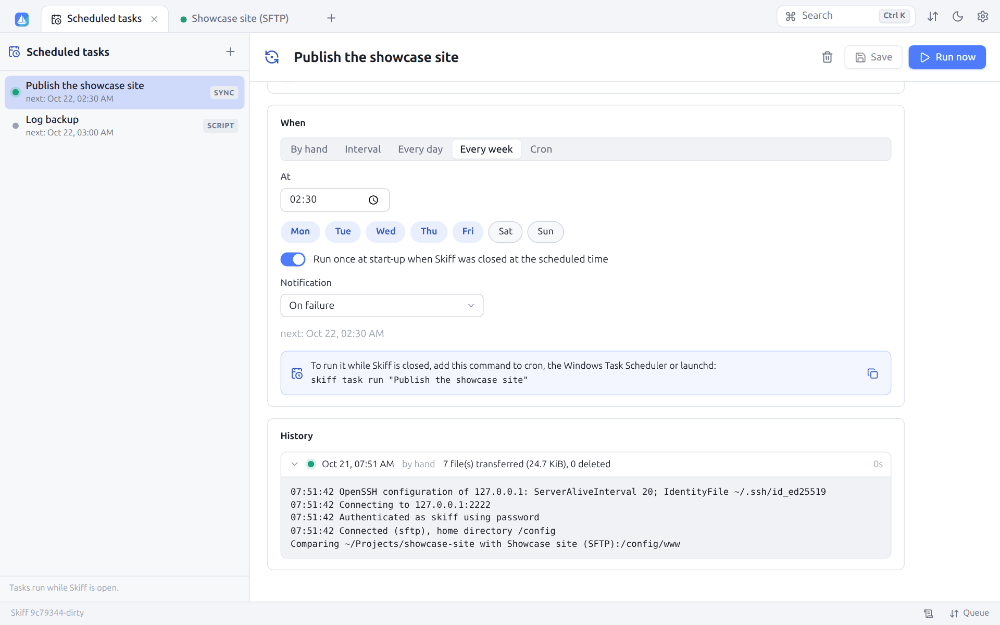

# 7. Synchronization

[← Transfers](06-transfers.md) · [Contents](README.md) · [Editing, diff and preview →](08-editing.md) · 🇫🇷 [Français](../07-synchronisation.md)

## 7.1 Synchronizing two folders

**Synchronize** (`Ctrl+S`, the toolbar or the **Synchronize this folder** context menu) compares a local folder and a remote folder recursively, then transfers only what has changed. The folders offered are those of both panels.



| Option | Description |
|---|---|
| **Local directory**, **Remote directory** | Folders to compare, which can be changed. The connection of each is recalled in parentheses. |
| **Direction** | **Local → Remote** (upload), **Remote → Local** (download) or **Both ways** |
| **Mode** | **Standard (new & newer)**: transfers the files that are missing or newer at the source. **Mirror (new & different)**: makes the destination identical to the source, even when it is newer. **Timestamps only**: transfers nothing, updates the dates of the destination |
| **Compare by** | **Modification time**, **Size**, **Time or size**, **Checksum** (reads the files on both sides), **Existence only** |
| **File mask** | Files and folders taken into account ([syntax](06-transfers.md#63-file-masks)), `* \| .git/; node_modules/; *.tmp` for one |
| **Delete files not in source** | Deletes at the destination what no longer exists at the source. Not available both ways. |
| **Existing files only** | Updates the files present on both sides, without creating new ones |
| **Exclude hidden files** | Skips the files and folders starting with a dot |

**Compare** starts the analysis. When the destination folder does not exist yet, it is taken as empty and will be created: this is the case of a first synchronization to a new folder. Both ways, two different files with the same date are reported as a conflict instead of being transferred.

## 7.2 Checking the changes

Skiff then shows the list of the actions planned, before touching anything:



Each line gives the local file (size, date), the action, then the remote file (size, date). The title sums up the number of actions and the volume to transfer.

| Icon | Action | Possible reason |
|---|---|---|
| → | **Upload** | new, newer, different |
| ← | **Download** | new, newer, different |
| Folder + | **Create remote folder** / **Create local folder** | new |
| Trash | **Delete remote** / **Delete local** | not in the source |
| Clock | **Set remote time** / **Set local time** | date |

Hover the icon to see the action and the reason. Untick the lines to skip (the box of the header ticks or unticks everything). The bottom of the window shows the number of actions kept and the matching volume. **Synchronize N item(s)** runs the actions kept: the transfers join the [queue](06-transfers.md#64-the-transfer-queue), the deletions and the date updates are made at once. **← Synchronize** goes back to the settings.

When everything is up to date already, the window says so: "Directories are in sync".

The synchronization works between any connections: local and server, but also two servers (show them in both panels). The default transfer options (text mode, permissions, `.filepart`…) apply.

## 7.3 Keeping the remote folder up to date

**Keep remote directory up to date** (`Ctrl+U`, the lightning of the toolbar) watches a local folder and uploads each change to the server as soon as it happens. It is ideal to develop locally a site hosted remotely.



| Option | Description |
|---|---|
| **Local directory** | Folder watched |
| **Remote directory** | Destination folder |
| **File mask** | Files taken into account, `* \| .git/; *.swp` for one |
| **Include subfolders** | Watches the whole tree |
| **Synchronize before starting** | First makes a standard synchronization (local → remote) |
| **Delete remote files deleted locally** | Passes the deletions on |

**Start** starts the watching. It goes on in the background, whatever the tab shown, and appears in the **Watchers** tab of the bottom panel:



Each watcher shows the local folder, the destination, the counters of uploads and deletions, the timestamped log of the events (creation, change, deletion, errors) and a **Stop** button. Changes close together are grouped (600 ms), so as not to upload ten times a file being saved. The lightning of the status bar gives the number of active watchers.

In a script, the `keepuptodate` command does the same (see [Scripts](13-scripts-cli.md)).

## 7.4 Scheduled tasks

A synchronization or a script can run **by itself**: each night, every hour, on weekdays at 8 am… Open the **Scheduled tasks** tab from the palette (`Ctrl+K`), the **⋯** menu of the site list, or straight from the synchronization dialog: **Schedule…** saves its settings (site, folders, direction, mode, criteria, mask) as a new task.



**+** creates a **Synchronization** (a saved site, the local folder, the remote folder — empty: that of the site — and the same options as the [synchronization dialog](#71-synchronizing-two-folders)) or a **Script** ([WinSCP-compatible commands](13-scripts-cli.md#133-script-commands), one per line). Then:

| Setting | Effect |
|---|---|
| **Enabled (runs on its schedule)** | Unticked, the task runs only with **Run now** |
| **When** | **By hand**, **Interval** (every N minutes), **Every day** at a time, **Every week** on the days ticked at a time, or a **Cron** expression (`minute hour day month day-of-week`, with `*`, `1-5`, `*/15`, `1,3,5`; 0 and 7 are Sunday) |
| **Run once at start-up when Skiff was closed at the scheduled time** | When Skiff was closed at the planned time, the task runs once at the next start; otherwise the missed run is skipped |
| **Notification** | **On failure** (the default), **After each run** or **Never**: a notification sums up the result |

The list gives for each task the next run and a dot for the last one (green: succeeded, red: failed, orange: stopped). **Run now** starts it at once, **Stop** interrupts it. The **History** keeps the last 200 runs, with their trigger (scheduled, caught up, by hand, command line), their summary (files transferred, deleted, errors) and their full log, unfolded in one click.

A task runs **without asking any question**, in its own connection: an unknown host key, a missing password or passphrase make it fail with a message that says what to do (connect once from Skiff to accept the key, save the password in the site, or use the [keychain](11-security.md#117-skiff-keychain-and-agent-forwarding)). A synchronization never overwrites by asking: it follows its criteria.

**Skiff closed**: the tasks run as long as Skiff is open (the window or `skiff serve`). For them to run while Skiff is closed too, hand the command shown under the schedule to the scheduler of the system; the result is added to the same history ([§ 13.9](13-scripts-cli.md#139-skiff-task)):

```bash
# Linux, macOS (crontab -e): every day at 2 am
0 2 * * * /usr/local/bin/skiff task run -q "Publish the site"
```

```powershell
# Windows: Task Scheduler
schtasks /Create /SC DAILY /ST 02:00 /TN "Skiff - Publish the site" /TR "\"C:\Program Files\Skiff\skiff.exe\" task run -q \"Publish the site\""
```

---

[← Transfers](06-transfers.md) · [Contents](README.md) · [Editing, diff and preview →](08-editing.md) · 🇫🇷 [Français](../07-synchronisation.md)
