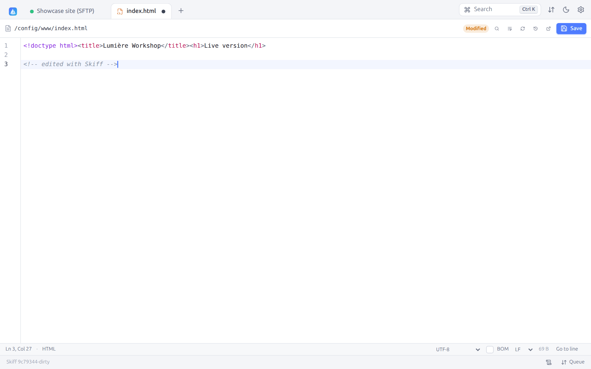
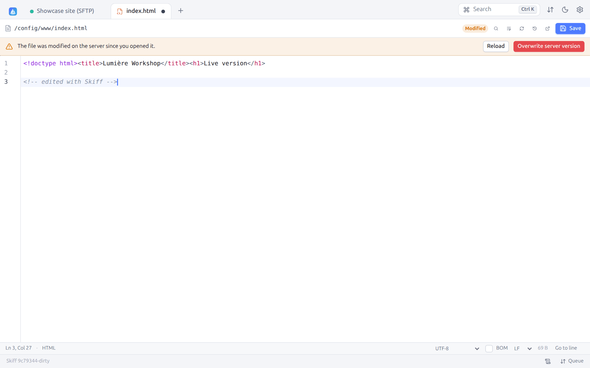
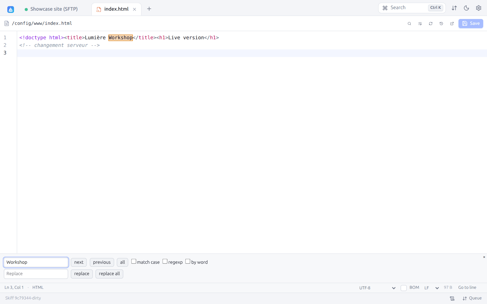
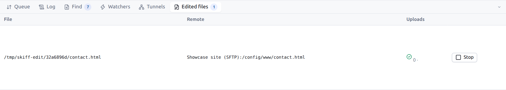
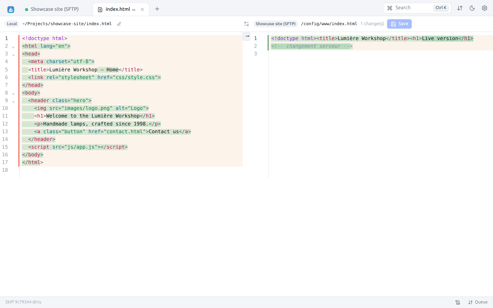
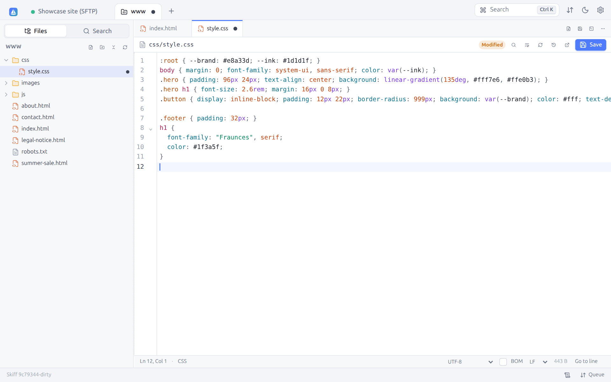
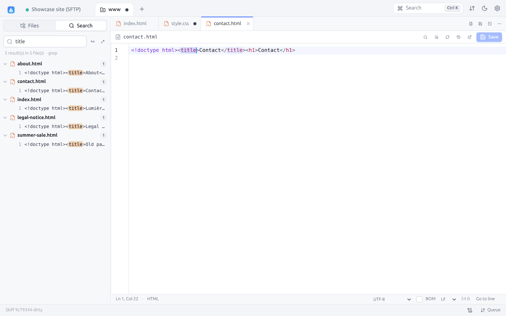
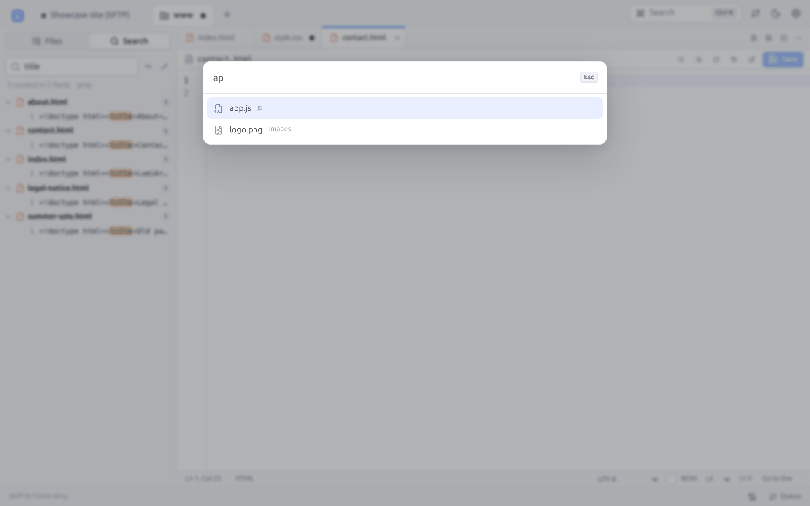
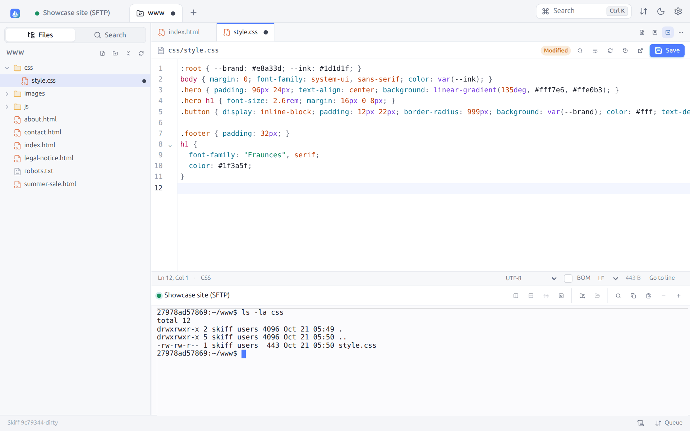
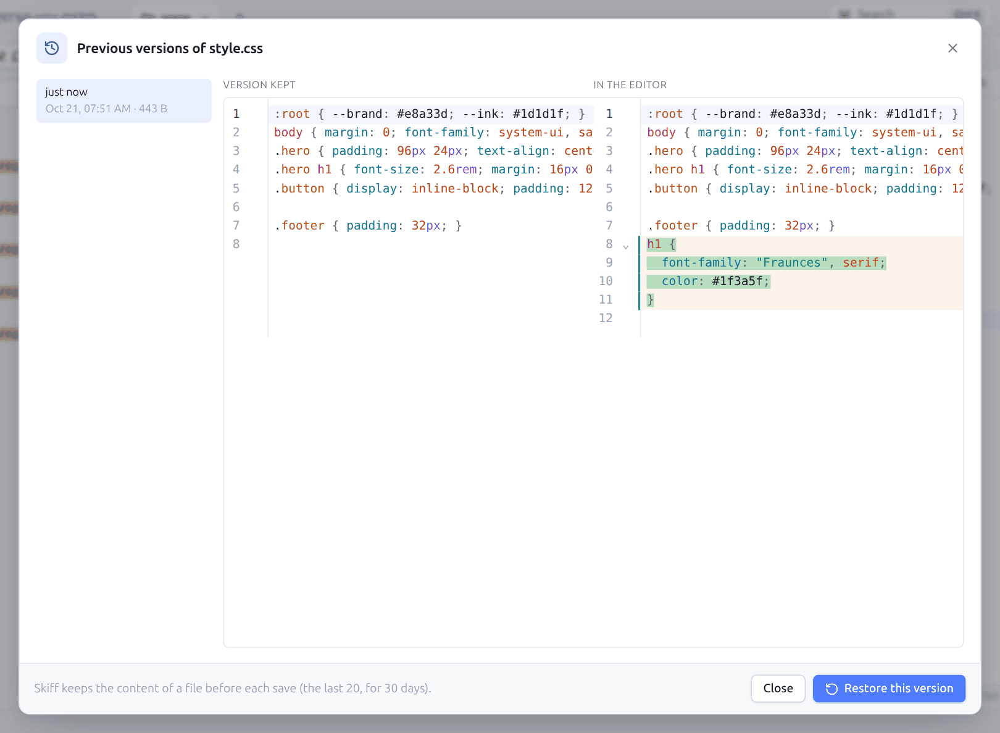

# 8. Editing, diff and preview

[← Synchronization](07-synchronization.md) · [Contents](README.md) · [Terminal, tunnels, proxies and jumps →](09-terminal-tunnels.md) · 🇫🇷 [Français](../08-edition.md)

## 8.1 The built-in editor

`F4` (or **Edit**, or a double-click when the setting says so) opens a file, local or remote, in an editor tab. The editor is built on CodeMirror 6.

| Item | Role |
|---|---|
| Tab | Icon of the file type and name. A dot marks unsaved changes. |
| Top bar | Path of the file, **Modified** badge, then **Find / replace** (`Ctrl+F`), **Word wrap**, **Reload**, **Edit with external editor** and **Save** (`Ctrl+S`) |
| Editing area | Line numbers, code folding, syntax highlighting (more than 100 languages, detected from the name: HTML, CSS, JavaScript, TypeScript, PHP, Python, Go, Rust, Java, C/C++, SQL, YAML, JSON, Markdown, Dockerfile, Nginx, Shell…), bracket matching, automatic closing, multiple selections, rectangular selection (`Alt` + drag), autocompletion (`Ctrl+Space`) |
| Status bar | Position (**Ln 3, Col 28**), language, **Encoding**, **BOM** box, **Line endings**, size of the file, **Go to line** |

Shortcuts of the editor:

| Key | Effect |
|---|---|
| `Ctrl+S` | Save (the file is uploaded to the server again) |
| `Ctrl+F` | Find and replace |
| `F3` or `Ctrl+G`, `Shift+F3` or `Ctrl+Shift+G` | Next / previous match |
| `Ctrl+Shift+L` | Select all the matches of the selection |
| `Ctrl+Alt+G` | Go to line |
| `Ctrl+Z`, `Ctrl+Y` (`Ctrl+Shift+Z`) | Undo, redo |
| `Ctrl+D` | Select the next match |
| `Tab`, `Shift+Tab` | Indent, unindent |
| `Ctrl+/` | Comment the line |
| `Alt+↑`, `Alt+↓` | Move the line |
| `Ctrl+Shift+[`, `Ctrl+Shift+]` | Fold, unfold |

### Encoding and line endings

Skiff detects the encoding (UTF-8, UTF-16 with a BOM, else Windows-1252) and the line endings of the file, and keeps them when saving. To change them:

- **Encoding**: UTF-8, Windows-1252, ISO-8859-1, ISO-8859-15, Windows-1250, Windows-1251, KOI8-R, CP850, UTF-16LE, UTF-16BE. Without unsaved changes, changing the encoding reads the file again; otherwise, the file will be converted when saved.
- **BOM**: adds or removes the byte order mark.
- **Line endings**: LF, CRLF or CR.

A file that looks binary shows a warning ("Editing it may corrupt it"). The files larger than the limit (20 MB by default, **Preferences → Editor**) are not opened in the editor.

`F3` (**View**) opens the same editor **read-only**.

Closing a changed tab offers **Save**, **Don't save** or **Cancel**.

## 8.2 Conflicts when saving

Skiff remembers the date and size of the file when opening it (and after each save). When someone else has changed it on the server in the meantime, the save is blocked and a banner says so:

- **Reload** gives up your changes and reads the version of the server again;
- **Overwrite server version** saves your version anyway.

To compare both versions before choosing, copy your text, reload, then use the [diff](#85-visual-diff).

## 8.3 Find and replace

`Ctrl+F` opens the search panel at the bottom of the editor. The matches are highlighted in the text:

Buttons: **next**, **previous**, **all** (selects all the matches, to change them together), **replace**, **replace all**. Options: **match case**, **regexp** (with `$1`, `$2` in the replacement), **by word**. `Esc` closes the panel.

## 8.4 External editor

**Edit with external editor** (`Shift+F4`) opens the file in the application of your choice: Visual Studio Code, Notepad++, Sublime Text, vim… For a remote file, Skiff downloads it into a temporary folder, starts the editor, then **uploads the file to the server at each save**, as WinSCP does.

The editor used is, in this order:

1. that of an **association** matching the file (Preferences → Editor → Associations, `*.psd` → `gimp !.!` for one);
2. the **External editor command** of the preferences (`code --wait !.!`, where `!.!` is replaced by the path of the file);
3. the application associated by the system.

The files followed show in the **Edited files** tab of the bottom panel (`Ctrl+Shift+Q`):

For each file: the temporary local copy, the remote file, the number of **Uploads** (with a green tick after the last successful upload) and **Stop**, which ends the watching. An upload error is reported by a notification.

To make the external editor the default choice of `F4` and of the double-click: **Preferences → Editor → Default editor → External application**. External editing does not exist in web mode.

## 8.5 Visual diff

**Compare with file in other panel** (context menu of a file) opens a comparison tab between two files: local and remote, or on two servers.

- Head: the connection and the path of each file, a button to open each in the editor, the number of **changes** and **Save** (right-hand file).
- The deleted lines are highlighted in red on the left, the added lines in green on the right, with the details of the words changed.
- Long identical stretches are folded (click to unfold them).
- The arrows between both sides copy a block from left to right (block merging).
- The right-hand side can be edited: fix it, then **Save**. As in the editor, a conflict is detected when the file has changed in the meantime.

## 8.6 Preview

The [preview panel](04-interface.md#49-preview-panel) (`Ctrl+Shift+P`) shows the images, videos, sounds, PDF, Markdown files and texts, locally as on a server, without opening a tab.

## 8.7 Projects: editing a folder without installing anything on the server

To work on several files of the same folder (a site, the configuration of a server, scripts), open it as a **project**. You get a view close to that of a code editor: the tree on the left, the files in tabs, a search through all the files and a terminal.

Unlike VS Code (Remote SSH), which installs its own server on the remote machine, **nothing is installed or left running on the server**. Skiff reads and saves the files through the connection already open. So it works on a small VPS, an SFTP-only account, a NAS, a container, and also with FTP, WebDAV or S3.

**Opening a project**:

- **Project** in the session toolbar (`Ctrl+Shift+E`): the folder of the active panel;
- right-click a folder → **Open as project**, or the background of the panel → **Open this folder as a project**;
- the palette (`Ctrl+K` → "Open this folder as a project").

The project opens in a tab named after the folder; a dot there marks unsaved files. It uses the connection of the session: closing the session tab does not cut it while the project is open. With **Reopen sessions from last time** ([§ 12.2](12-preferences.md#122-panels)) or a [workspace](03-sites.md#33-workspaces), the projects come back with their open files.

### Tree

The folders load when opened (a click on the folder); hidden files follow the setting of the panels. A click opens a file in a tab. The tree updates when a file is created, renamed or deleted, by Skiff or in another session.

The right-click offers **New file**, **New folder**, **Search in this folder**, **Rename**, **Delete**, **Copy path** and **Copy the path in the project** (relative). The buttons at the top create a file or a folder at the root, **Collapse all** and **Refresh**.

### Files in tabs

Each file opens with the [built-in editor](#81-the-built-in-editor): highlighting, encoding, line endings, find and replace, [conflicts when saving](#82-conflicts-when-saving). A dot replaces the cross of a changed tab. `Ctrl+S` saves the file shown, **Save all** (`Ctrl+Alt+S`) all the changed files, `Ctrl+W` closes the file shown (not the project). Closing a file or the project with changes asks whether to save them.

The permissions of the file are kept: an executable script stays so after the save.

### Searching the project

**Search** (`Ctrl+Shift+F`) looks for a text in all the files of the project, or of a folder (**Search in this folder** in the tree; the cross goes back to the whole project). **Match case** and **Regular expression** are set on the right of the field. The results are grouped by file, with the line and the text found highlighted; a click opens the file on the match.

On an SFTP or SCP connection with a shell (and in a container), the search is made by `find` and `grep` **on the server**, in one command: fast even on a large folder, and nothing is installed. Otherwise (SFTP-only account, FTP, WebDAV, S3, local folder), Skiff reads the files one by one. The summary line tells the method ("grep" or "files read").

Binary files and those larger than 2 MB are skipped, and so are the `.git`, `node_modules`, `vendor`, `__pycache__`, `.venv`, `venv`, `.cache`, `.next`, `.nuxt` and `.terraform` folders (a list that can be changed in **Preferences → Editor**, [§ 12.5](12-preferences.md#125-editor)). The first 1,000 results are shown.

### Go to file

`Ctrl+P` (or the **Go to file…** button, a file under a magnifier) opens a file by its name: type a few letters, in order (`ngc` finds `nginx.conf`, `cs/st` finds `css/style.css`). The files whose name starts with what you type come first; without typing anything, the open files are offered first. The same folders as for the search are skipped; beyond 20,000 files, only the first ones are offered.

### Terminal

The terminal icon (`` Ctrl+` ``) opens a [terminal](09-terminal-tunnels.md#91-ssh-terminal) at the bottom of the project, in its folder, on the same connection (and on this computer for a local project). The same shortcut hides it and shows it again; it keeps running meanwhile. It closes with the project. The split moves with the mouse.

The **⋯** menu also offers **Show the folder in a file panel**, **Copy the path of the project** and **Close all files**.

## 8.8 Previous versions

At each save from the editor (a single file or a project), Skiff keeps **on this computer** a copy of the content from before: the last 20 versions of each file, for 30 days. Nothing is written on the server. A save that changes nothing makes no copy.

The clock icon of the editor bar (**Previous versions**) lists these copies, the newest at the top, and compares the one chosen with the content of the editor. **Restore this version** puts this content into the editor: read it over, then save (the version replaced is kept in its turn).

The copies are in the configuration folder (`history/`), one per file and per server. The **Keep the previous versions of saved files** setting (**Preferences → Editor**) stops them. The files larger than 10 MB are not copied.

---

[← Synchronization](07-synchronization.md) · [Contents](README.md) · [Terminal, tunnels, proxies and jumps →](09-terminal-tunnels.md) · 🇫🇷 [Français](../08-edition.md)
