# 9. Terminal, tunnels, proxies and jumps

[← Editing, diff and preview](08-editing.md) · [Contents](README.md) · [Search, log and palette →](10-search-log.md) · 🇫🇷 [Français](../09-terminal-tunnels.md)

## 9.1 SSH terminal

For the SFTP and SCP sessions, **Terminal** (`Ctrl+T`) opens a full SSH terminal in a tab, straight in the current folder of the panel. It uses the connection already open: no new authentication.

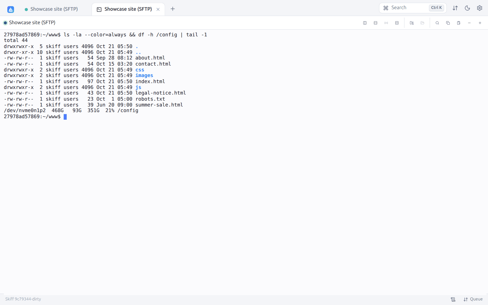

- Full xterm emulation (xterm.js): colors, 256 colors and true colors, mouse, full-screen applications (`vim`, `htop`, `mc`, `tmux`…), automatic resizing.
- Toolbar: **Search** in the scrollback (`Ctrl+Shift+F`), **Copy** the selection, **Paste**, **Smaller font** and **Larger font** (from 9 to 28 px, for this terminal).
- Copy and paste as in Windows Terminal (see [Copy, paste and right-click](#copy-paste-and-right-click)).
- **Copy on select** option (Preferences → Terminal): selecting text copies it.
- The terminal keeps running when you change tabs. When the interface reloads (in web mode, for one), the last 256 KiB shown are restored.
- When the shell ends, the terminal shows "The session has ended." and a **Reopen** button.
- With **agent forwarding** on in the site, `git`, `ssh` and `scp` started in the terminal use your keys (the Skiff keychain and the agent), without copying them to the server (see [§ 11.7](11-security.md#117-skiff-keychain-and-agent-forwarding)).

The shell is the login shell of the user (`$SHELL -l`), unless you choose another one (see below). The font, its size, the number of lines kept, the cursor and the `TERM` variable are set in **Preferences → Terminal**. A terminal also opens from the site list (**Open in terminal**), which connects and opens the terminal in a single step.

### Choosing the shell or the interpreter

The arrow on the right of the **Terminal** button (session bar) lists what is installed on the server, the container or the computer: the **Shells** (Bash, Zsh, Fish, Nushell, PowerShell, sh…) then the **Interpreters** (Python, IPython, Node.js, Deno, Bun, Ruby, PHP, Lua, R). The login shell is marked **default**. A click opens the terminal in the current folder of the panel, with this program; the tab bears its name ("skiff@server · Python", for one).

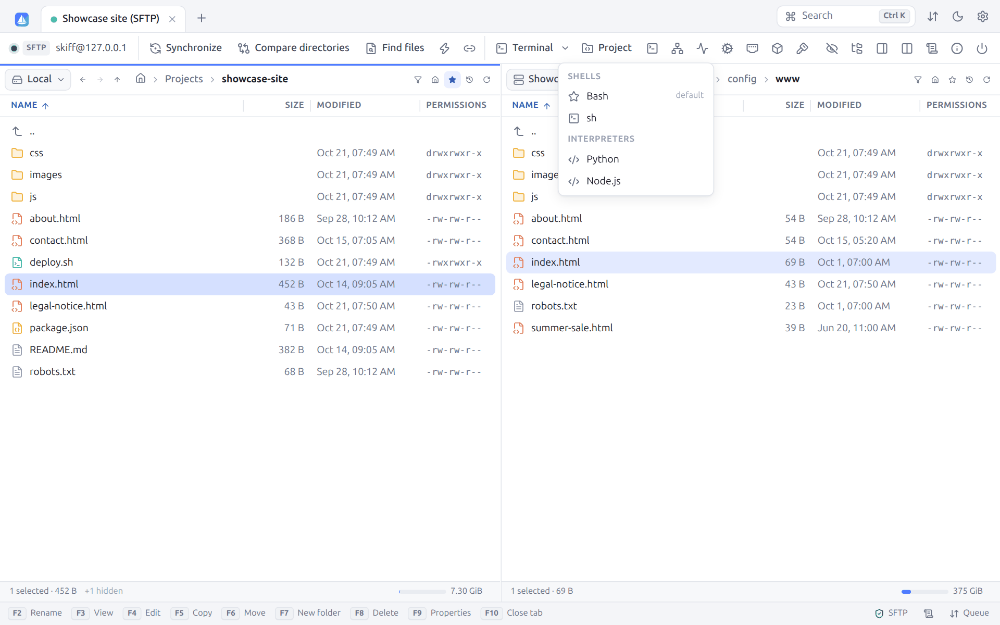

The list is made by a single command (`command -v`) the first time the menu opens, then kept for a minute. On a server whose shell is not POSIX (the OpenSSH server of Windows), only its shell is offered.

When the program ends (`exit()` in Python, `.exit` in Node.js), the terminal shows "The session has ended." and **Reopen** starts the same program again, in the same folder.

### Copy, paste and right-click

As in Windows Terminal and PowerShell:

| Gesture | Effect |
|---|---|
| `Ctrl+C` with a selection | Copies the selection (which goes away) |
| `Ctrl+C` without a selection | Interrupts the program, as usual |
| `Ctrl+V` | Pastes |
| `Ctrl+Shift+C`, `Ctrl+Shift+V` | Always copy and paste |
| Right-click with a selection | Copies the selection |
| Right-click without a selection | Pastes |

On macOS, `Cmd+C` and `Cmd+V` do the same. When you would rather have `Ctrl+C` and `Ctrl+V` always go to the program (for `Ctrl+V` in `vim` or `nano`, for one), choose **Ctrl+Shift+C / Ctrl+Shift+V only** in **Preferences → Terminal**. The **Right-click → Menu** setting replaces the paste with a menu: **Copy**, **Paste**, **Select all**, **Clear**, **Search**, **Split right**, **Split down**.

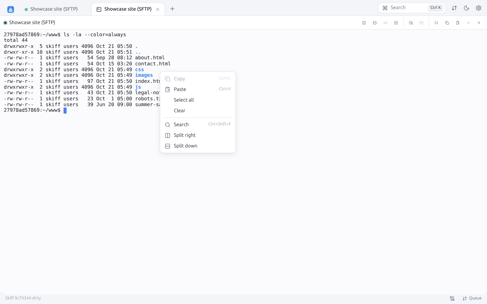

`Ctrl+V` uses the paste of the system: it works everywhere, without a permission. For the right-click, the **Paste** button and `Ctrl+Shift+V`, the application reads the clipboard of the system through its native window, even when that one refuses it to the page (WebKitGTK on Linux). In [web mode](14-web-mode.md) on an `http://` address other than `localhost`, the browser forbids the page to read the clipboard: `Ctrl+V` still pastes, but not the right-click nor the **Paste** button (a message recalls it). Serve Skiff over HTTPS to get them back.

### Several terminals in a tab

**Split right** and **Split down** (terminal bar) add a terminal to the tab, on the same server (in the same folder, with the same shell) or on another open connection, or even the local computer. The arrow on the right of each connection opens another shell or an interpreter of it. Two terminals share the tab side by side or one above the other, three or four in a grid. Each has its header (connection, current folder, **Close this terminal**); the one that has the keyboard is surrounded by the accent color.

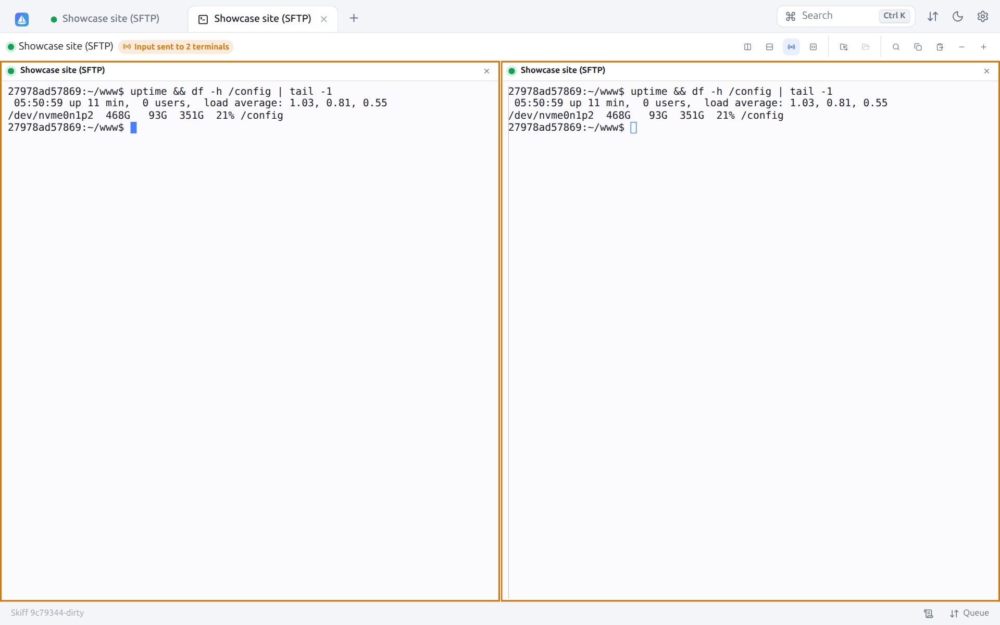

### Broadcasting the input

**Broadcast input to every terminal of the tab** (antenna icon, from two terminals) sends each keystroke to **every terminal of the tab**: the same command runs on several servers at once (an update, the restart of a service, a check). The terminals are then surrounded with orange and the bar says "Input sent to N terminals". A new click stops the broadcast. Pasting and the saved commands are broadcast the same way.

### Saved commands

The **Saved commands** button offers commands ready to type: **Disk space** (`df -h`), **Memory** (`free -h`), **Biggest files here**, **Last system logs**, and your own. A command marked **Run** is confirmed at once; otherwise it is only typed, to complete it. **Manage saved commands…** opens **Preferences → Terminal** ([§ 12.6](12-preferences.md#126-terminal)).

### Following the current folder

The terminal knows the current folder of the shell when the shell announces it (standard OSC 7 sequence): it shows in the bar and in the header of each terminal.

- **Show the current folder in the file panel** opens this folder in the panel of the same connection (or a new session tab).
- **The file panel follows the current folder**: each `cd` in the terminal changes the folder of the panel. When it is turned on, Skiff installs into the bash and zsh shells that do not announce their folder yet a small function that does it (the terminal is cleared once); fish and the configurations that already send OSC 7 do not need it. The installation lasts until the shell ends and changes no file of the server.

## 9.2 Local terminal

**Local terminal**, on the welcome screen or in the palette (`Ctrl+K`), opens a terminal on the computer; **Open terminal here** in the local panel opens it in the folder shown. The palette also offers each shell and interpreter installed ("Local terminal: Python"…), and the arrow of the **Terminal** button of the local panel lists them as for a server.

| System | Default shell | Also offered when installed |
|---|---|---|
| Linux, macOS, FreeBSD | `$SHELL` (pseudo-terminal) | Bash, Zsh, Fish, Nushell, Korn shell, PowerShell, sh, and the interpreters |
| Windows | PowerShell 7 (`pwsh.exe`), else Windows PowerShell, through ConPTY | Command Prompt (`cmd`), Git Bash, each WSL distribution ("Ubuntu (WSL)"), Python (`py`), Node.js… |

The default shell of the local terminals is changed in **Preferences → Terminal → Shell of local terminals**.

In [web mode](14-web-mode.md), the local terminal is turned off, except with the `--allow-local-terminal` option.

## 9.3 Tunnels (port forwarding)

Tunnels carry network connections through an SSH session. **Tunnels** (toolbar) opens the **Port forwarding** dialog:

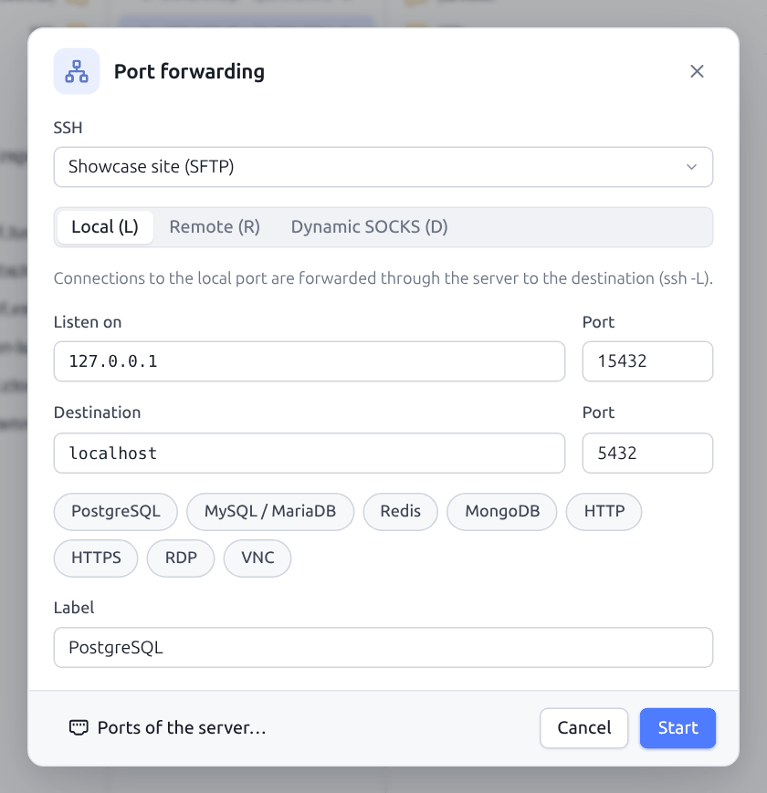

| Type | OpenSSH equivalent | Use |
|---|---|---|
| **Local (L)** | `ssh -L` | A port of your computer leads to a destination seen from the server. Example: `127.0.0.1:15432` → `localhost:5432` to reach the PostgreSQL database of the server with your usual client. |
| **Remote (R)** | `ssh -R` | A port of the server leads to a destination seen from your computer. Example: showing the server a local development service. |
| **Dynamic SOCKS (D)** | `ssh -D` | A local SOCKS4/5 proxy: any application set to this proxy goes out through the server. |

| Field | Description |
|---|---|
| **SSH** | SSH session (SFTP or SCP) to use |
| **Listen on**, **Port** | Listening address and port (`127.0.0.1` for an access kept to the computer) |
| **Destination**, **Port** | Host and port to reach (except for SOCKS) |
| Shortcuts | **PostgreSQL**, **MySQL / MariaDB**, **Redis**, **MongoDB**, **HTTP**, **HTTPS**, **RDP**, **VNC**: fill in the destination port, a free local port and the label |
| **Label** | Name shown in the list of the tunnels |

**Start** opens the tunnel. The active tunnels are listed in the **Tunnels** tab of the bottom panel:

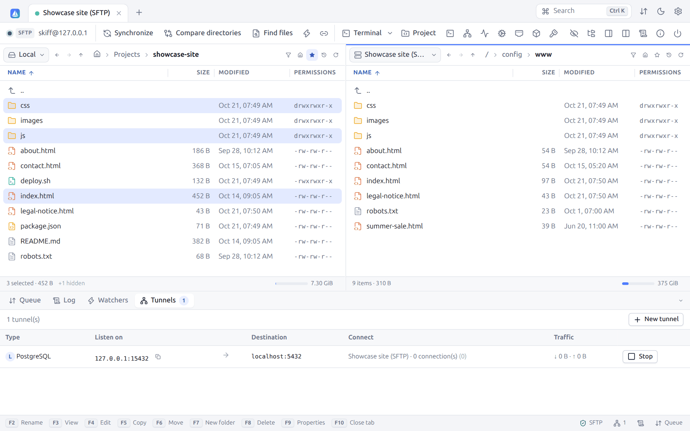

For each tunnel: the type and the label, the listening address (with a button to copy it), the destination, the session used with the number of connections open and in all, the traffic received and sent, and **Stop**. **New tunnel** opens the creation dialog. Tunnels stop when their session closes.

For a tunnel to open at each connection, define it in the site (**Port forwarding**, **Auto** box, see [Sites](03-sites.md#port-forwarding-ssh)). The `LocalForward`, `RemoteForward` and `DynamicForward` of the [OpenSSH configuration](03-sites.md#34-openssh-configuration-ssh_config) of a host open at the connection too, as long as the site does not have its own forwardings (and they become tunnels of the site when imported).

## 9.4 Jump hosts

A jump host (*bastion*) is an SSH server you must go through to reach the servers of a private network. In the site, **Jump hosts** section, add one or several jumps:

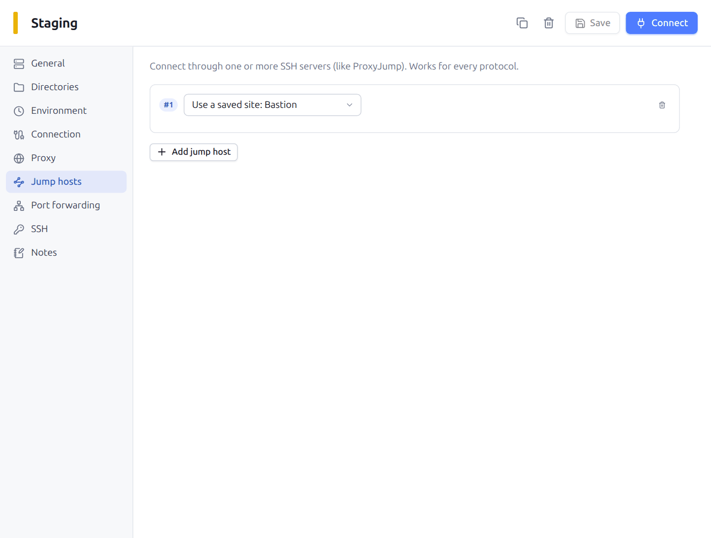

Skiff connects to the first jump, opens through it a connection to the next one, and so on up to the final server, exactly as `ssh -J bastion1,bastion2 server`. Each jump authenticates with its own credentials: use a **saved site** (recommended, it keeps its password, its key, its host key) or a **Custom host**.

Details:

- the host keys of each jump are checked as for a direct connection;
- the jumps serve **every protocol**: an FTP, a WebDAV or an S3 reachable only from the internal network is reached through the SSH tunnel;
- the number of jumps is given in the [server information](10-search-log.md#103-server-and-protocol-information);
- a jump can be an alias of `~/.ssh/config`: its address, port, user and keys then come from the file;
- without a jump or a proxy in the site, the `ProxyJump` (or `ProxyCommand`) of the [OpenSSH configuration](03-sites.md#34-openssh-configuration-ssh_config) of the host applies as it is; when imported, it becomes a chain of jumps.

## 9.5 Proxies

In the site, **Proxy** section:

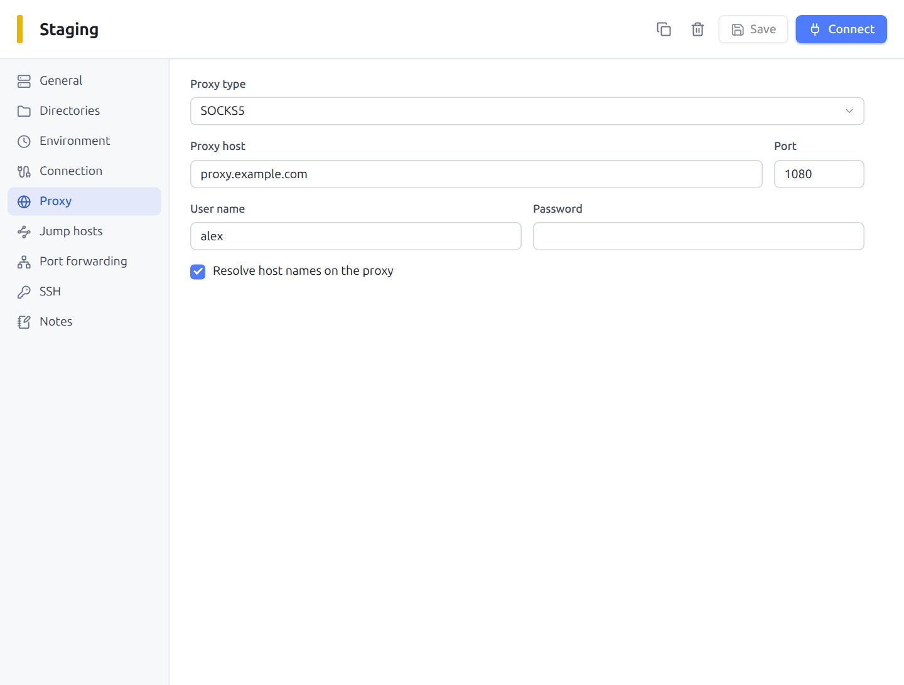

| Type | Description |
|---|---|
| **SOCKS4** | SOCKS4, or SOCKS4a when **Resolve host names on the proxy** is ticked |
| **SOCKS5** | With an optional authentication, names resolved locally or by the proxy |
| **HTTP** | `CONNECT` method, optional Basic authentication |
| **Telnet** | Sends a connection command to the proxy (old corporate proxies) |
| **Local command (ProxyCommand)** | Starts a command whose input and output serve as the connection, with the `%host`, `%port`, `%user`, `%pass`, `%proxyhost`, `%proxyport` variables. Examples: `ssh -W %host:%port gateway`, `nc -X 5 -x proxy:1080 %host %port`, `cloudflared access ssh --hostname %host` |

The proxy applies to the first network connection: straight to the server, or to the first jump host when there is one.

## 9.6 Server monitor

For an SFTP or SCP session to a Linux server, the **Server monitor** button (activity icon in the session toolbar, or the palette) opens a tab that shows the state of the server, live. Nothing is installed on the server: Skiff reads `/proc` through the connection already open, one command per measurement.

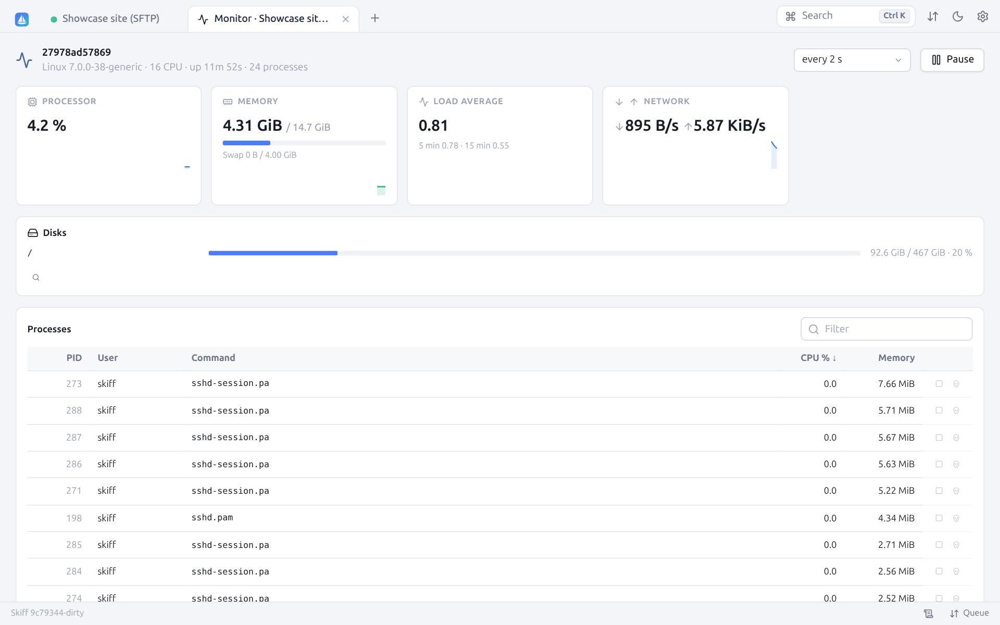

| Area | Content |
|---|---|
| Head | Name of the server, kernel, number of processors, time since the start, number of processes |
| **Processor** | Use of all the processors since the previous measurement, and its curve over the last 60 measurements |
| **Memory** | Memory used (without the cache) over the total, the swap, and the curve |
| **Load average** | Over 1, 5 and 15 minutes |
| **Network** | Speed received ↓ and sent ↑ of all the interfaces (but `lo`) |
| **Disks** | Each mounted file system (without the virtual systems nor the duplicate mounts), with its use: the bar turns orange above 75 %, red above 90 % |
| **Processes** | The 40 most active processes: PID, user, command, % CPU (share of one processor, as with `top`) and resident memory. A click on a header sorts the column; the **Filter** field looks into the name, the user and the PID. |

The buttons of a process line send **TERM** (**Stop (TERM)**, the process can end cleanly) or **KILL** (**Force stop (KILL)**), after a confirmation. They act with the permissions of the user of the session.

The magnifier of a disk shows [what takes room on it](05-files.md#513-what-takes-room). The refresh rate is set from 1 to 10 seconds; **Pause** freezes the display. The measurements stop when the tab is not shown and start again after a reconnection. A server without `/proc` (macOS, BSD) shows "the monitor needs a Linux server".

## 9.7 Services of the server

For an SFTP or SCP session to a Linux server that uses **systemd** (Debian, Ubuntu, Fedora, Rocky, Arch…), the **Services of the server** button (gear in the session toolbar, or the palette) lists its services: nginx, php-fpm, mariadb, ssh, cron… Nothing is installed: Skiff uses `systemctl` and `journalctl` through the connection.

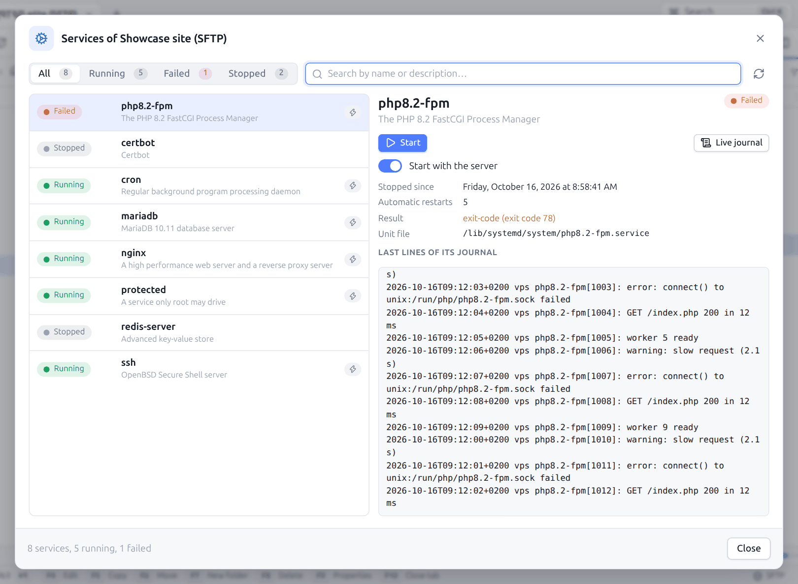

- At the top: **All**, **Running**, **Failed**, **Stopped**, with their number, and the search by name or description. The failed services come first; when opening, the first failed one is chosen.
- Each line shows the state (**Running**, **Failed**, **Stopped**, **Starting**…), the name and the description; the lightning marks a service that starts with the server.
- On the right, the chosen service:
  - **Start**, or **Restart**, **Reload** (reads its configuration again without a cut) and **Stop**;
  - **Start at boot** (enable or disable the service at start);
  - since when it runs or has been stopped, its PID, its memory, its automatic restarts, the result and the exit code of a failed service, its file;
  - the **Last lines of its journal**, to see at once why it failed;
  - **Live journal**, which opens its journal in a tab that updates itself ([§ 9.8](#98-following-a-log-live)).

Starting, stopping or enabling a service needs the permissions of **root**: connected with another account, Skiff shows "Only root can do this: connect to the server with a root account." Reading the journal of all the services needs root or a member of the `systemd-journal` (or `adm`) group; otherwise a message recalls it.

A server without systemd (Alpine with OpenRC, most containers, some NAS) shows "This server does not use systemd.": use the [terminal](#91-ssh-terminal).

## 9.8 Following a log live

Right-click a file → **Follow live** opens a tab that shows the end of the file (the last 500 lines), then each line added, as `tail -f`: ideal for `access.log`, `error.log` or the log of an application during a test. The journal of a service opens the same way from the [services of the server](#97-services-of-the-server).

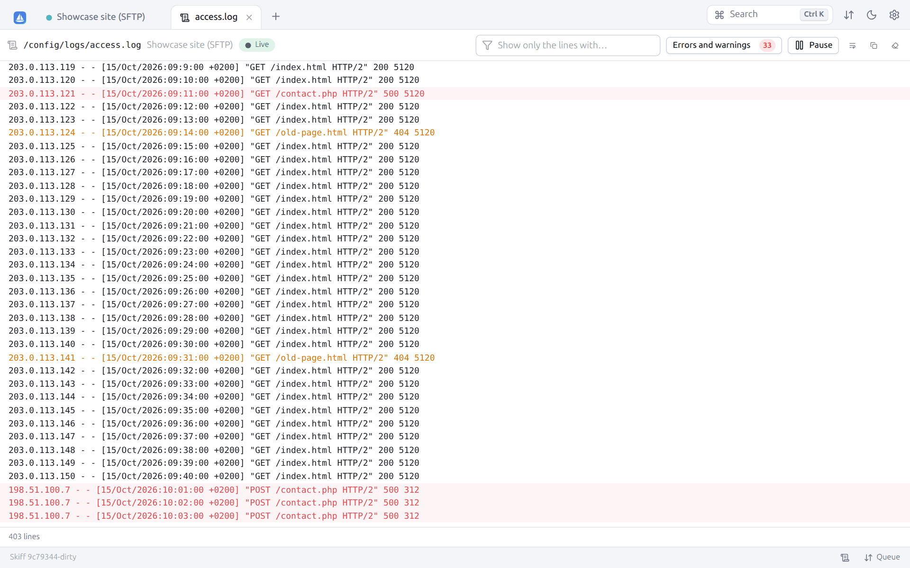

- On a connection with a shell, `tail -F` (or `journalctl -f` for a service) runs on the server: the lines arrive at once, and the following goes on after a rotation of the file.
- Without a shell (SFTP-only account, FTP, WebDAV, S3, local file), Skiff looks at the size of the file every second and reads what was added. When the file shrinks (replaced or emptied), the reading starts again at its beginning and a line says so.

The lines that look like an **error** (`error`, `failed`, `fatal`, `denied`, `exception`… and the HTTP 5xx codes of an access log) are in red, the **warnings** (`warning`, `timeout`… and the 4xx codes) in orange. In the bar:

| Item | Effect |
|---|---|
| State | **Live** (green), **Paused**, **Stopped** (with the error if there is one) |
| **Show only the lines with…** | Filters on a text, without stopping the following |
| **Errors and warnings** | Only the lines in red and orange, with their number |
| **Pause** / **Resume** | Freezes the display; the lines received during the pause are kept and added when resuming |
| **Follow again** | Starts a stopped following again (connection lost, file deleted) |
| **Word wrap**, **Copy the lines shown**, **Clear** | |

The display stays at the bottom as long as you do not scroll up; when you scroll up to read, it no longer moves, and **Go to the end** brings it back. The last 20,000 lines are kept. Closing the tab stops the following on the server.

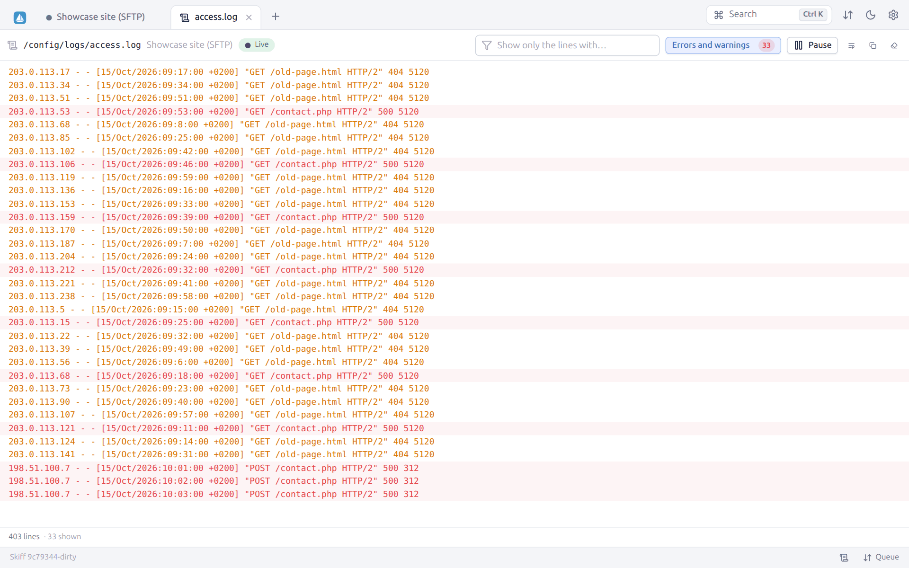

## 9.9 Ports of the server

**Ports of the server** (network port icon in the session toolbar, the palette, or **Ports of the server…** in the tunnel dialog) lists the TCP ports the server listens on, read by `ss`, `netstat` or `/proc/net/tcp` through the connection:

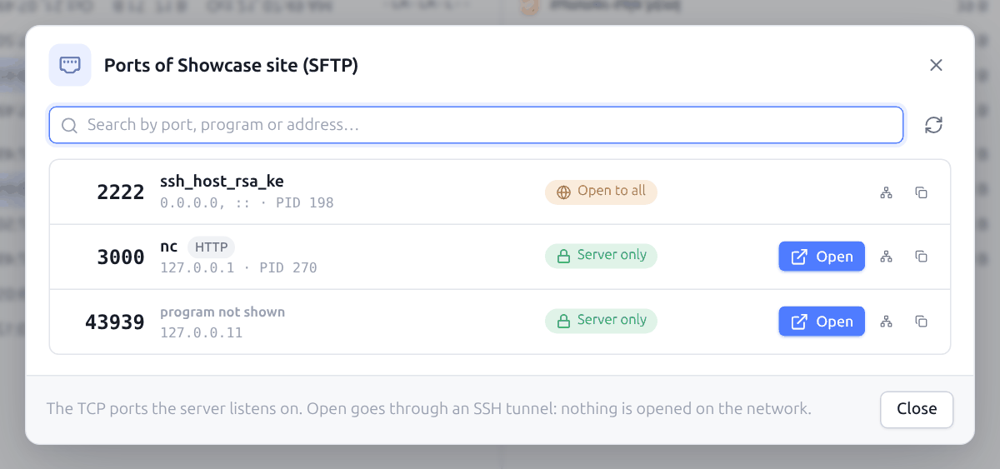

| Column | Content |
|---|---|
| Port | With the usual service of the port (HTTP, MySQL / MariaDB, PostgreSQL, Redis…) |
| Program | The program that listens and its PID, and the addresses. Only the programs of the connected account are shown: as root, all of them. |
| Scope | **Open to all** (every address: reachable from outside unless a firewall stops it), **Server only** (`127.0.0.1`, `::1`) or **One address** |

**Open** shows in the browser of this computer a web page served by the server, even when it listens only on `127.0.0.1`: a Node application on port 3000, phpMyAdmin, an administration dashboard… Skiff makes at once a [tunnel](#93-tunnels-port-forwarding) to this port on a free port of this computer, then opens `http://127.0.0.1:<port>/` (`https` for 443 and 8443). A tunnel already open to the same port is used again; it shows in the **Tunnels** panel, where it is stopped. Nothing is opened on the network of the server.

**Open** is not offered for the services that are not web pages (SSH, databases, Redis, mail, DNS…). For them, **Make a tunnel to this port** makes the tunnel and copies its local address (for a MySQL client of this computer, for one), and **Copy the address on the server** copies `127.0.0.1:3306`.

The browser is that of the system; the `SKIFF_BROWSER` environment variable names another one (`SKIFF_BROWSER=firefox`). In [web mode](14-web-mode.md), the tunnels leave from the machine that runs Skiff: **Open** is not offered there.

---

[← Editing, diff and preview](08-editing.md) · [Contents](README.md) · [Search, log and palette →](10-search-log.md) · 🇫🇷 [Français](../09-terminal-tunnels.md)
