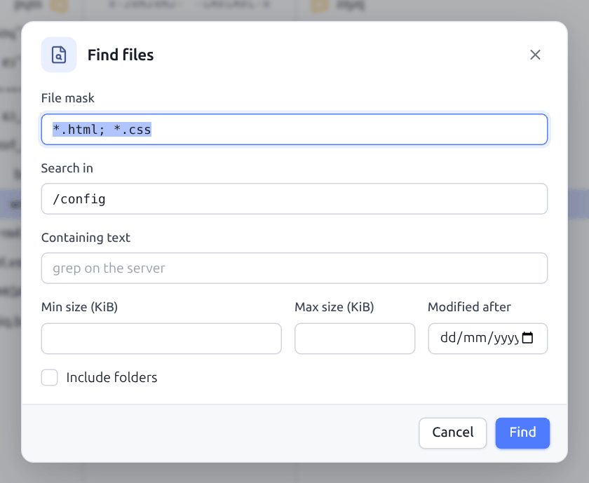
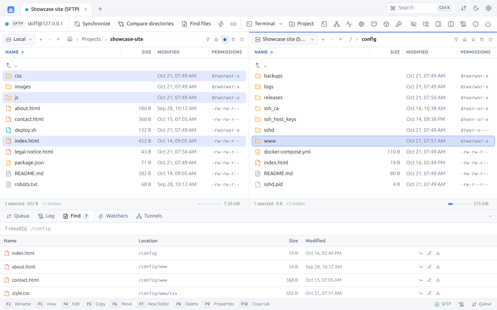
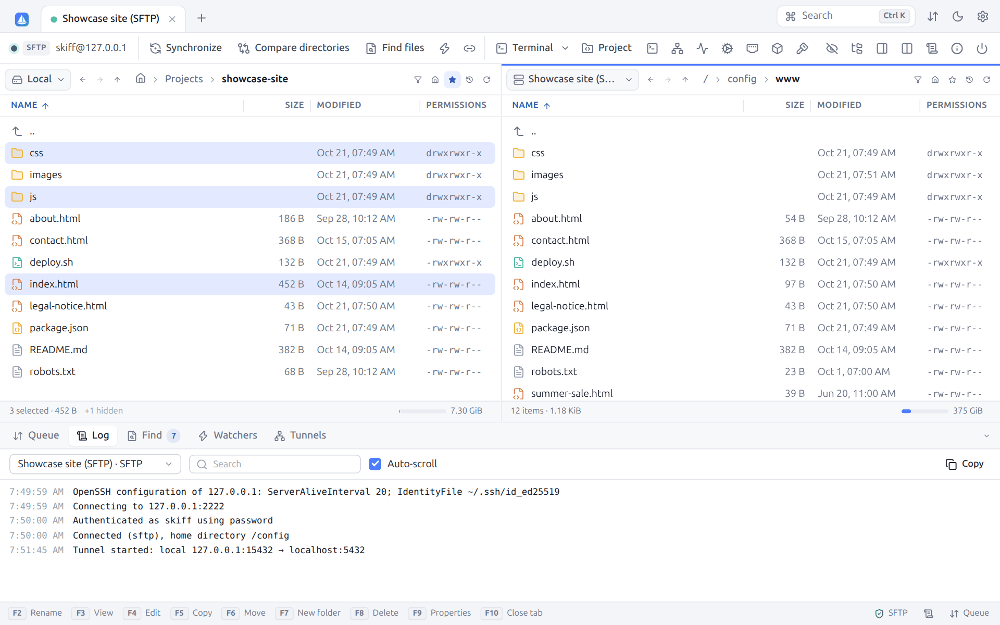
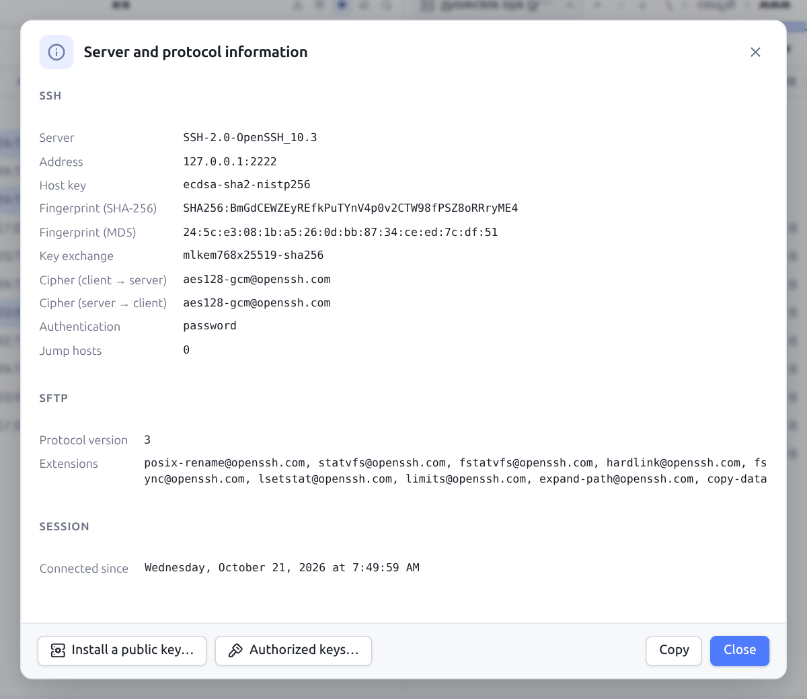
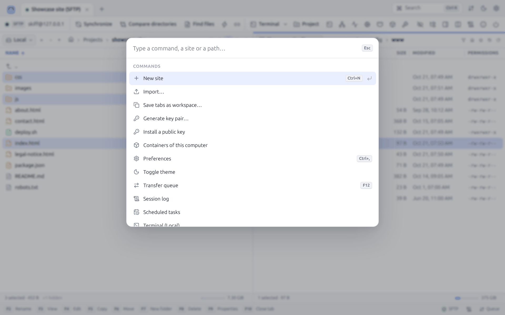
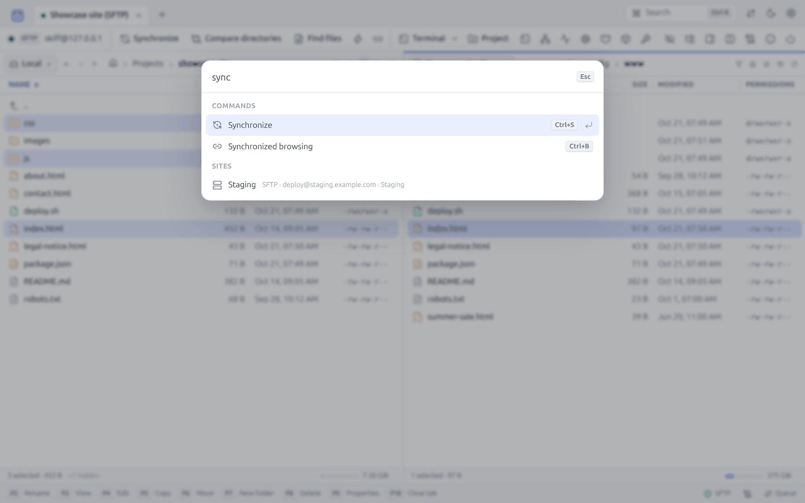

# 10. Search, log and palette

[← Terminal, tunnels, proxies and jumps](09-terminal-tunnels.md) · [Contents](README.md) · [Security →](11-security.md) · 🇫🇷 [Français](../10-recherche-journal.md)

## 10.1 Finding files

**Find files** (`Ctrl+Shift+F`, the toolbar, or **Find in this folder** in the context menu) walks through a folder and all its subfolders, locally or on the server.

| Field | Description |
|---|---|
| **File mask** | Names looked for, with the [mask syntax](06-transfers.md#63-file-masks): `*.html; *.css`, `report*`, `* \| node_modules/` |
| **Search in** | Starting folder (by default, the current folder of the panel) |
| **Containing text** | Keeps only the files holding this text. On an SSH server, the search is made on the server side with `grep` (case-sensitive), without downloading anything. Elsewhere, Skiff reads the files smaller than 50 MB (case-insensitive). |
| **Min size (KiB)**, **Max size (KiB)** | Size bounds |
| **Modified after** | Earliest modification date |
| **Include folders** | Also lists the folders whose name matches |

**Find** starts the search. The results come in as they are found, in the **Find** tab of the bottom panel, with the number of items scanned and a **Stop** button:

For each result: name, location, size, date, and three buttons: **Go to** (opens the folder in the panel and puts the cursor on the file), **Edit** and **Download** (remote files).

## 10.2 Session log

**Session log** (the toolbar, the status bar, or the palette) opens the **Log** tab of the bottom panel:

- The drop-down list chooses the connection whose log is shown.
- The **Search** field filters the lines.
- **Auto-scroll** follows the new lines.
- **Copy** copies the lines shown.

Each line is timestamped: connection, authentication, home folder, opening of tunnels, errors, and the commands sent to the server (FTP commands, WebDAV requests), preceded by `>`. At the **debug** level (Preferences → Logging), the log also holds the answers of the server, preceded by `<`. The level applies to the connections opened after the change.

To keep a trace on disk, turn on **Write session logs to files**: each session writes a `YYYYMMDD-HHMMSS_site-name.log` file in the `logs` folder of the configuration. Scripts have their own `/log=` option (see [Scripts](13-scripts-cli.md)).

## 10.3 Server and protocol information

**Server/protocol information** (ⓘ icon of the toolbar) gathers all that Skiff knows about the connection:

| Group | Information |
|---|---|
| **SSH** | Version of the server, address, host key type, SHA-256 and MD5 fingerprints, key exchange, ciphers in each direction, MAC, authentication method, fingerprint of the authentication key (when the session authenticated with a key), number of jump hosts |
| **SFTP** | Protocol version, extensions supported by the server (`posix-rename`, `statvfs`, `hardlink`, `fsync`, `limits`, `copy-data`…), SFTP server command |
| **SCP** | Listing method, shell |
| **FTP** | Server, system (`SYST`), welcome message, passive or active mode, listing method (MLSD or LIST), features (`FEAT`) |
| **TLS** | Version, cipher suite, subject, issuer, expiry date and fingerprint of the certificate |
| **WebDAV** | URL, server software, DAV compliance, authentication |
| **S3** | Endpoint, region, TLS, addressing |
| **Session** | Date and time of the connection |

**Copy** copies the whole as text, handy for a support ticket. For an SFTP or SCP session, **Install a public key** adds one of your keys to the server ([§ 11.6](11-security.md#installing-an-existing-key-on-a-server)), and **Authorized keys** lists those it accepts ([§ 11.6](11-security.md#the-authorized-keys-of-a-server)).

## 10.4 Command palette

`Ctrl+K` (or **Search** at the top right) opens the palette: a single field to find everything and start everything from the keyboard.

Without typing anything, the palette lists the commands. While you type, it filters loosely (the letters typed must appear in order) among:

| Group | Content |
|---|---|
| **Quick connect** | An `sftp://`, `scp://`, `ssh://`, `ftp://`, `ftps://`, `ftpes://`, `dav://`, `davs://` or `s3://` URL offers to connect to it |
| **Open directory** | A path starting with `/`, `~` or `C:\` offers to open it in the active panel |
| **Sites** | All the sites, with protocol, host and folder |
| **Workspaces** | The workspaces |
| **Terminal** | The open terminals |
| **Commands** | New site, Import…, Save tabs as workspace…, Generate key pair…, Preferences, Toggle theme, Transfer queue, Session log, Local terminal; in a session: Copy, Move, New folder, New file, Delete, Synchronize, Compare directories, Find files, Keep remote directory up to date, Synchronized browsing, Open terminal, New tunnel, Show hidden files |
| **Files in current folder** | The files and folders of the active panel: `Enter` opens them |

`↑` / `↓` move the selection, `Enter` runs, `Esc` closes. The shortcut of each command is shown on the right.

---

[← Terminal, tunnels, proxies and jumps](09-terminal-tunnels.md) · [Contents](README.md) · [Security →](11-security.md) · 🇫🇷 [Français](../10-recherche-journal.md)
