# 11. Security

[← Search, log and palette](10-search-log.md) · [Contents](README.md) · [Preferences →](12-preferences.md) · 🇫🇷 [Français](../11-securite.md)

## 11.1 SSH host keys

Each SSH server has a host key that proves its identity. Skiff checks it at each connection, for the server as for each jump host.

- The keys accepted are saved in the `known_hosts` file of Skiff (configuration folder, OpenSSH format).
- The `known_hosts` files of OpenSSH are read too, read-only: a server OpenSSH already knows asks no question. They are `~/.ssh/known_hosts` and `~/.ssh/known_hosts2`, then `/etc/ssh/ssh_known_hosts` (macOS, Linux) or `%ProgramData%\ssh\ssh_known_hosts` (Windows).
- The [OpenSSH configuration](03-sites.md#34-openssh-configuration-ssh_config) of a host is followed: `UserKnownHostsFile` and `GlobalKnownHostsFile` replace these files, `HostKeyAlias` gives the name looked up and saved, and `StrictHostKeyChecking` changes the question asked for an unknown server: `yes` refuses the connection, `accept-new` (and `no`) saves the key without asking anything, `ask` (the default) asks the question. A **changed** key is never accepted silently.

**Unknown server**: at the first connection, Skiff shows the host, the key type and the SHA-256 and MD5 fingerprints, and offers **Accept** (saves the key), **Connect once** (the key is accepted until Skiff closes, without being saved) or **Cancel**:

**Host key changed**: when a server shows a key that differs from the one saved, Skiff shows a red alert, with the old and the new fingerprint. It is the sign of a reinstalled server… or of an interception. The choices are **Update key**, **Connect once** and **Cancel**. When in doubt, cancel and check with the administrator.

**Pinning**: in the site (**SSH → Expected host key fingerprint**), a `SHA256:…` fingerprint fixes the key expected. Any other key is then refused without a question. In a script, the `-hostkey=` option of `open` does the same.

The list of the saved keys is in **Preferences → Security → Known host keys**. The trash of a line deletes the key (the question will be asked again at the next connection).

## 11.2 TLS certificates

For FTPS, WebDAV over HTTPS and S3 over HTTPS, Skiff checks the certificate of the server with the certification authorities of the system. A self-signed or expired certificate, or one issued for another name, brings up a question:

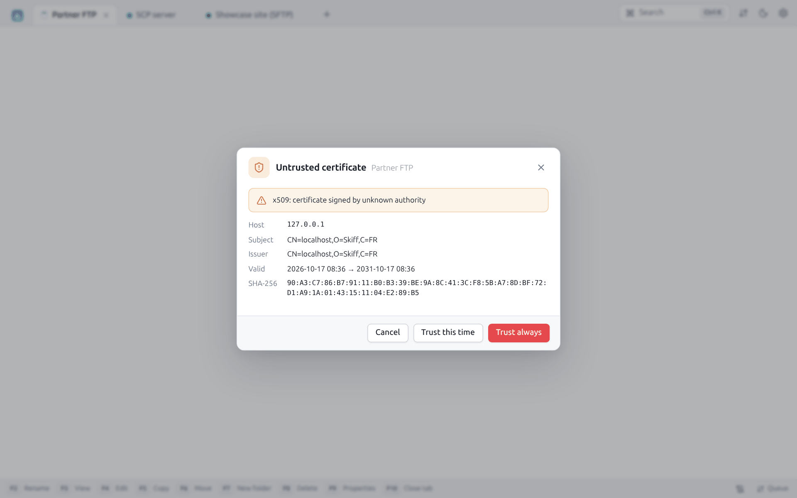

The dialog recalls the reason of the refusal ("certificate signed by unknown authority"), then the **Host**, the **Subject**, the **Issuer**, the **Names** covered, the **Valid** period and the SHA-256 fingerprint.

| Button | Effect |
|---|---|
| **Trust always** | Saves the certificate (`trusted_certs.json`): the next connections accept it without a question |
| **Trust this time** | Accepts the certificate for this connection only |
| **Cancel** | Gives up the connection |

In the site, **TLS** section, the **Expected certificate fingerprint** pins a given certificate, and **Do not verify certificates (insecure)** turns every check off (for tests only).

## 11.3 Saved passwords

The passwords, passphrases, proxy passwords and tokens saved are encrypted with **XChaCha20-Poly1305** before being written into `sites.json`.

- **Without a master password**, the encryption key is a random file, `secret.key`, readable by you alone (mode 600). `sites.json` can be backed up or synchronized: without `secret.key`, the passwords stay unreadable.
- **With a master password**, the key is derived from this password by **Argon2id** (3 passes, 64 MiB, 2 threads) and is never written on the disk.

In every case, the interface never gets the saved passwords: it only knows that a password exists ("Saved — type to replace"). Site exports never hold a password.

## 11.4 Master password

**Preferences → Security → Set master password**:

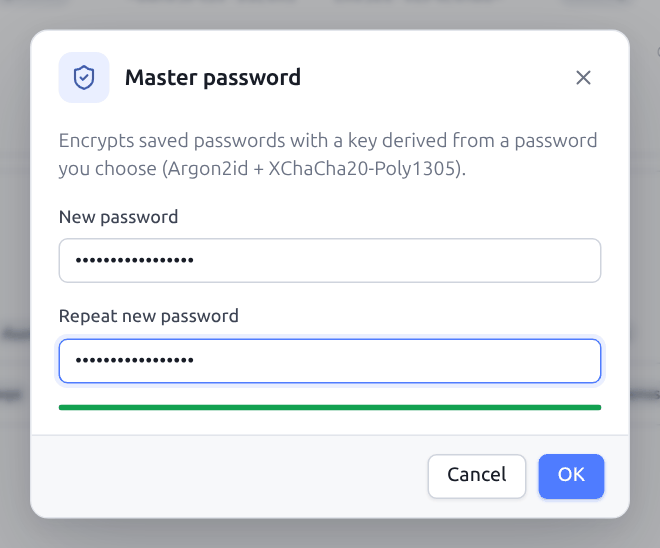

Type the password twice (8 characters at least). A gauge shows its strength. Once set, the Security section shows **On** and offers **Change master password**, **Remove master password** and **Lock saved passwords now**:

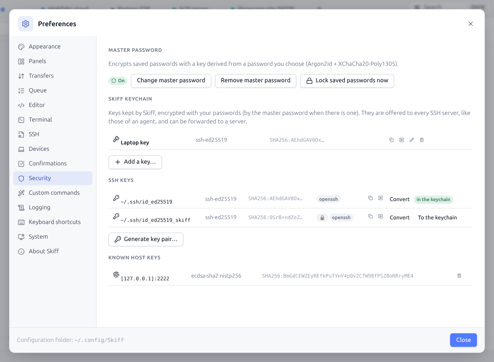

At the next start (or after **Lock saved passwords now**, also in the `Ctrl+K` palette), the saved passwords are **locked**. A banner says so at the top of the site list:

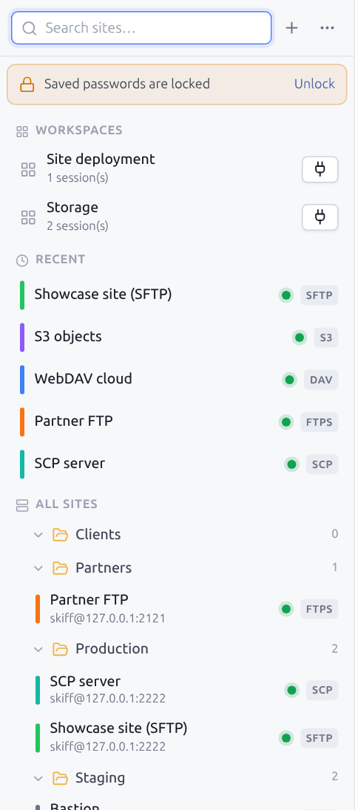

Click **Unlock** (or connect to a site that needs a password) to type the master password:

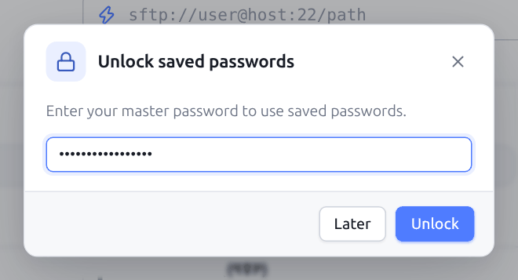

**Later** closes the dialog without unlocking (and does not open the connection asked for, if any). The sites without a saved password, which use a key or the SSH agent, stay usable while the passwords are locked. Changing the master password encrypts all the secrets again. Removing it goes back to the encryption by `secret.key`.

A forgotten master password cannot be recovered: the passwords of the sites must then be typed again.

## 11.5 SSH key generator

**Generate key pair…** (**New SSH key** on the welcome screen, the ⋯ menu of the sites, the palette, Preferences → Security, the **Choose** button of the key file of a site) makes a new key, as `ssh-keygen` or PuTTYgen do:

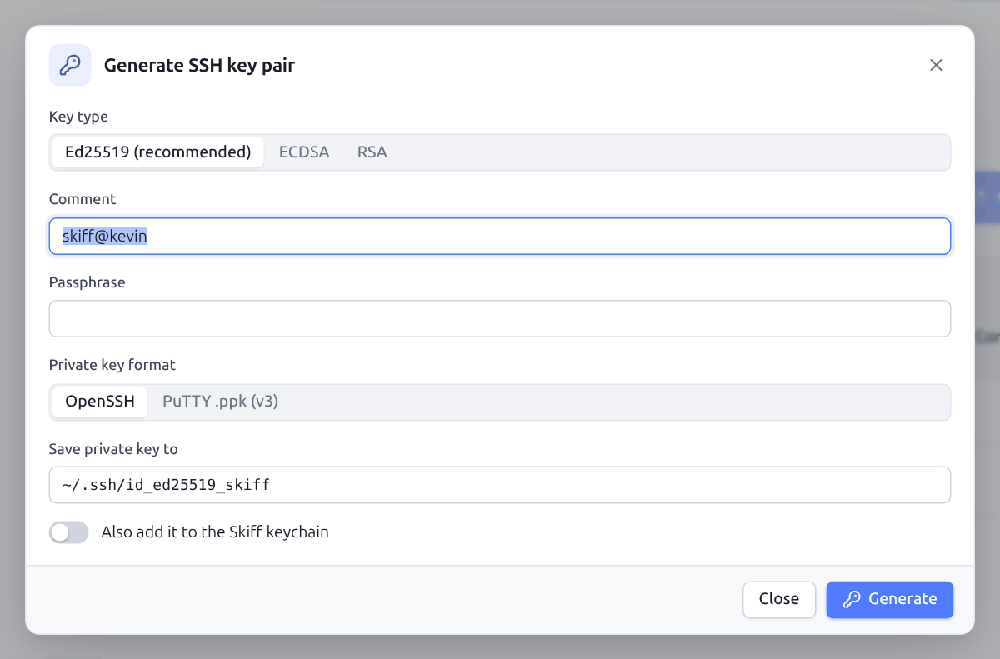

| Field | Description |
|---|---|
| **Key type** | **Ed25519 (recommended)**, **ECDSA** (256, 384 or 521 bits), **RSA** (2048, 3072, 4096 or 8192 bits) |
| **Comment** | Text added to the public key (`user@machine` by default) |
| **Passphrase** | Encrypts the private key (recommended). A gauge shows its strength. |
| **Private key format** | **OpenSSH** or **PuTTY .ppk (v3)** |
| **Save private key to** | Path of the file (`~/.ssh/id_ed25519_skiff` by default). The public key is written next to it with the `.pub` extension. An existing file is never overwritten. |

**Generate** shows the result:

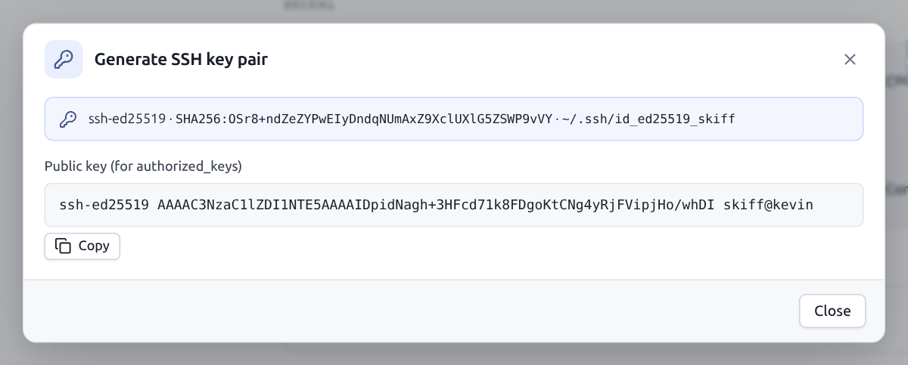

The type, the fingerprint and the location of the key, then the **Public key (for authorized_keys)** to copy. When an SFTP or SCP session is open, **Install on current server** adds the public key to the `~/.ssh/authorized_keys` file of the server (creating `~/.ssh` with the right permissions when needed), as `ssh-copy-id` does.

On the command line: `skiff keygen` (see [Scripts](13-scripts-cli.md#137-skiff-keygen)).

## 11.6 Existing keys and conversion

**Preferences → Security → SSH keys** lists the private keys of `~/.ssh` with their type, their fingerprint, their format (`openssh` or `ppk`) and a padlock when they are protected by a passphrase. **Convert** turns an OpenSSH key into a PuTTY `.ppk` key, or the other way round:

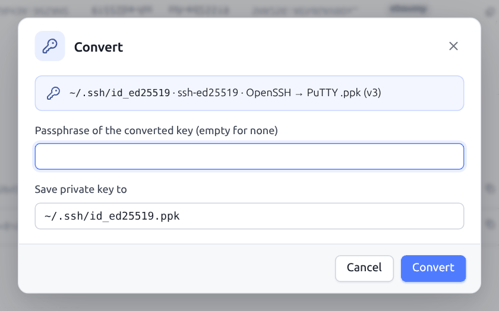

Give the current passphrase (when the key is encrypted), the passphrase of the converted key (empty: none) and the destination file. The original key is not changed. On the command line: `skiff keygen -convert`.

Skiff reads both formats directly to connect: the conversion only serves to exchange keys with other software (PuTTY, WinSCP, OpenSSH).

### Installing an existing key on a server

To go from a password to a key on a server (a VPS, for one): connect once with SFTP or SCP and the password, then open **Install a public key**. The dialog adds the public key to the `~/.ssh/authorized_keys` of the connected account, as `ssh-copy-id` does:

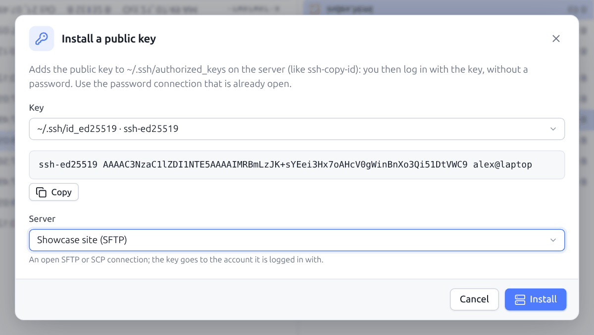

| Field | Description |
|---|---|
| **Key** | A key of the **Skiff keychain** ([§ 11.7](#117-skiff-keychain-and-agent-forwarding)), a key of `~/.ssh`, or **Another public key (paste it)…** (the key of a colleague, of another computer). The chosen public key shows under it, with **Copy**. |
| **Server** | An open SFTP or SCP connection; the key is added to the account it is connected with. From a session, it is the server of that session. |

**Install** creates `~/.ssh` (mode `700`) and `authorized_keys` (mode `600`) when needed, and does not add a key already there. Only file operations are used: it works for an SFTP-only account too.

The public key of a key of `~/.ssh` comes from its `.pub` file, or from the key itself: a recent OpenSSH key or a PuTTY `.ppk` holds its public part in clear, even when protected by a passphrase, which is therefore not asked for. Only the old encrypted PEM keys without a `.pub` are not offered (the dialog says so).

The dialog opens from:

- **Preferences → Security**: **Install on a server…** on each key of the keychain and of `~/.ssh`, next to **Copy the public key**;
- the palette (`Ctrl+K` → "Install a public key");
- the **⋯** menu of the site list;
- **Server/protocol information** of an SFTP or SCP session ([§ 10.3](10-search-log.md#103-server-and-protocol-information));
- the result of the key generator also offers **Install on current server** ([§ 11.5](#115-ssh-key-generator)).

Then check that a new connection goes through the key (the [log](10-search-log.md) says `publickey`) before turning the passwords off on the server (`PasswordAuthentication no` in `/etc/ssh/sshd_config`).

### The authorized keys of a server

**Authorized keys** (key icon of the toolbar of an SFTP or SCP session, the `Ctrl+K` palette, or **Server/protocol information**) lists the keys that let you log into the account: the `~/.ssh/authorized_keys` file, read and written by simple file operations, as for the installation.

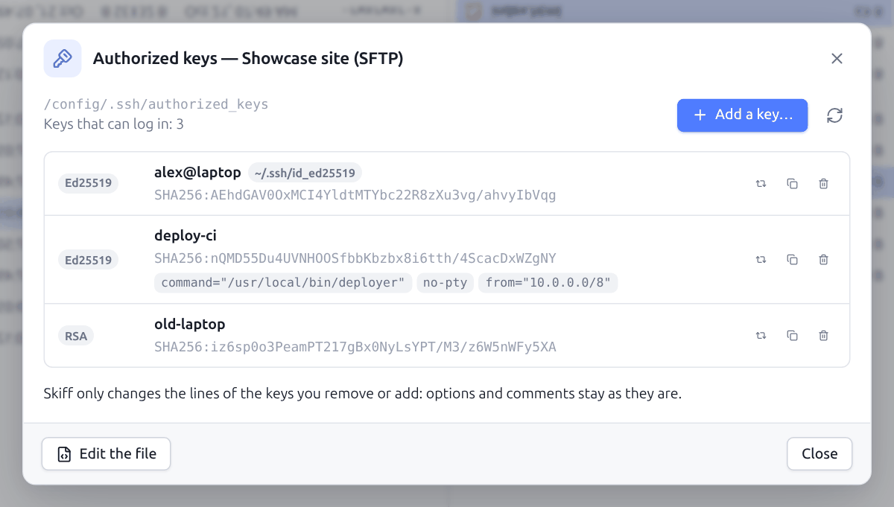

Each line shows the type of the key (Ed25519, RSA, ECDSA, `-SK` hardware keys), its comment, its SHA-256 fingerprint and its options (`from=`, `command=`, `no-pty`, `restrict`…). Badges tell:

| Badge | Meaning |
|---|---|
| **This connection** | The key the session authenticated with. Skiff knows it because the server only asks to sign with a key it accepts; it is also in the [server information](10-search-log.md#103-server-and-protocol-information) (**Authentication key**). |
| `~/.ssh/…` or **Keychain: …** | Its private key is on this computer |
| **Certificate authority** | A `cert-authority` line: it lets in the certificates signed by this authority |

For each key: **Replace with another key…** (see below), **Copy the line** and **Remove the key**, after a confirmation. Removing the key of the session asks for one more confirmation: without it, the session might no longer be able to reconnect. **Add a key…** opens the installation, **Edit the file** opens `authorized_keys` in the editor (a line sshd cannot read is marked there, and is fixed there).

Skiff rewrites only the lines of the keys removed or added: the other lines, their options and the comments stay as they are. The file is written next to it, then renamed: a connection cut in the middle leaves the old file, never a truncated one. When the file has changed since it was shown (another session, another administrator), the removal is refused and the list reloads.

sshd ignores `authorized_keys` when other users can write into the home folder, into `~/.ssh` or into the file (`StrictModes` option): Skiff says so in red, and **Fix the rights** takes these write permissions away. When the session authenticated with a key missing from this file, Skiff says so too: sshd may read another file (`AuthorizedKeysFile` in `sshd_config`), which Skiff does not manage.

### Installing or replacing a key on several servers

To put a key on a whole fleet, or to change keys (a lost laptop, a key too old), select the sites concerned ([§ 3.1](03-sites.md#selecting-several-sites)): the panel of the selection and its right-click offer **Install a key** and **Replace a key**. The right-click of a single SSH site offers **Install or replace a key**.

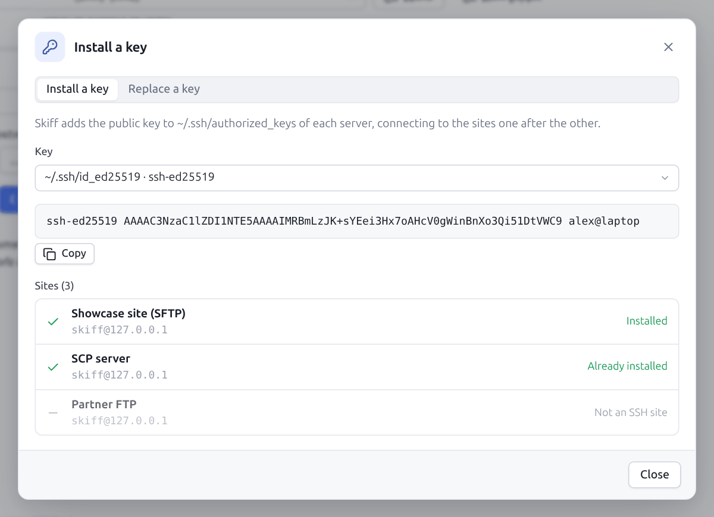

Skiff connects to the sites one after the other (a session already open on the site serves as it is), makes the operation, then closes the connections it opened. Each site shows its result: **Installed**, **Already installed**, **Replaced (new key checked)** or the error. The sites that are not SSH are left aside, and **Stop after this one** interrupts the series. A password or an unknown host key are asked for as for an ordinary connection; when the master password locks the saved passwords, it is asked for once at the start.

**Replace a key** goes in three steps, on each server: the new key is added; Skiff opens a second connection that offers **only** the new key (no password nor other key); only when the server accepts it is the old key removed. A server that refuses the new key keeps the old one: nobody is locked out. So the private part of the new key must be on this computer (Skiff keychain, SSH agent or `~/.ssh`).

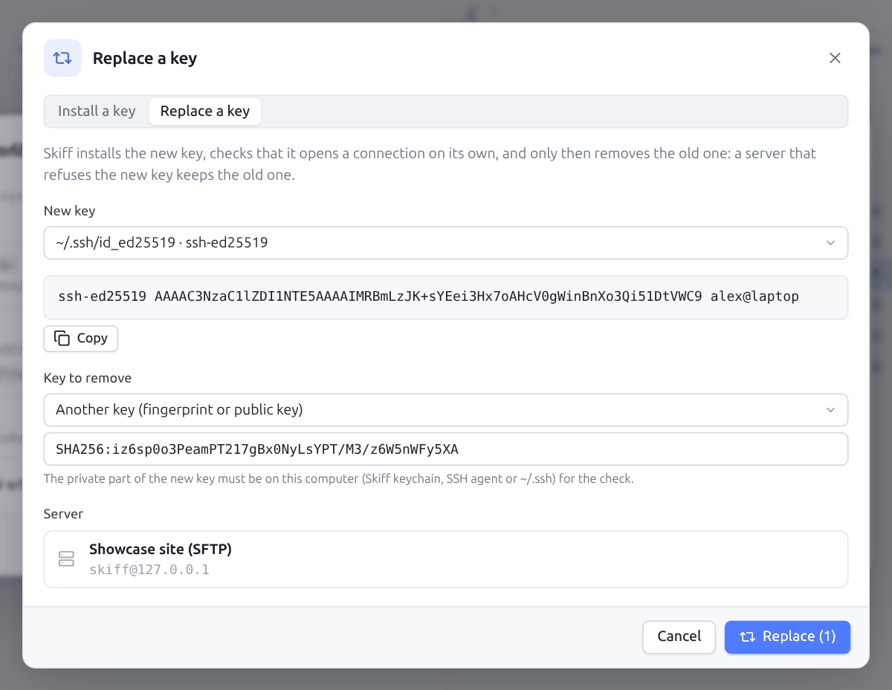

The **Key to remove** is chosen among the keys of the computer, or with **Another key (fingerprint or public key)**: the `SHA256:…` fingerprint or the public key line of a key that is no longer there. From the list of the authorized keys, **Replace with another key…** fills it with the key of the line.

## 11.7 Skiff keychain and agent forwarding

The **Skiff keychain** keeps your private keys in Skiff itself, encrypted as the saved passwords are: by the master password when there is one ([§ 11.4](#114-master-password)), otherwise by the local key of the computer. No need for an SSH agent on the computer, nor to leave an unencrypted key on the disk.

To put a key into it, in **Preferences → Security**:

- **To the keychain**, on a key of the **SSH keys** list (`~/.ssh`): the passphrase is asked for when the key has one;
- **Add a key…**: paste an OpenSSH, PEM or PuTTY `.ppk` key, with its name and its passphrase;
- in the [key generator](#115-ssh-key-generator), the **Also add it to the Skiff keychain** box.

A key protected by a passphrase is decrypted a single time, when added, then kept encrypted by Skiff: the passphrase is never asked for again. Each key of the keychain can be **renamed**, **removed** (the original file, if any, is not touched) and its public key **copied** (to paste it into an `authorized_keys`, or install it with the generator). The `keychain.json` file of the configuration folder holds only encrypted keys.

The keys of the keychain are **offered to every SSH server**, before those of the agent of the system, as soon as **Use the Skiff keychain and the SSH agent / Pageant** is ticked in the site (it is by default), jump hosts included. The session log says `Using 1 key(s) from the Skiff keychain`. While the master password is locked, the keychain is not used.

**Agent forwarding**: with **Forward the agent to the server (ForwardAgent)** (**SSH** section of the site), or `ForwardAgent yes` in [`~/.ssh/config`](03-sites.md#34-openssh-configuration-ssh_config), the SSH terminals of this site get an agent: `git pull`, `ssh` to another server or `scp` there use the keys of the keychain, then those of the agent of the system, without them leaving your computer (`ssh-add -l` lists them). The server can ask for signatures, never add nor remove keys. Turn the forwarding on only towards trusted servers: during the connection, their administrator can use your keys.

Through [jump hosts](09-terminal-tunnels.md#94-jump-hosts), the agent is forwarded only to the **final server**, as `ssh -A -J` does: each jump authenticates with the keychain and the agent (when its site allows it), but does not get the agent. The log says `Connecting to … through jump host …`, then `SSH agent forwarded to the server`.

## 11.8 Security of the application

- **Desktop window**: the interface talks with the engine of Skiff through an HTTP server that listens only on `127.0.0.1`, protected by a token drawn at random at each start, a check of the `Host` header (against *DNS rebinding*) and a mandatory anti-CSRF header.
- A content security policy (CSP) allows only the scripts and connections of Skiff itself: a script slipped into the page could not load code, send data elsewhere, nor put the page in a frame.
- The HTML and SVG files previewed are never run in the context of the application.
- **Names sent by the servers**: a server can announce any file name. A name holding a separator (`../../.bashrc`, `a/../../b`, or on Windows `..\..\x` and `file:stream`) is never written outside the destination folder: in a transfer, it is skipped and reported as an error, or the separator becomes `_`; in a synchronization, the file is reported and left aside.
- The dependencies are checked against the known vulnerabilities (`govulncheck`, `pnpm audit`), and the parsers of what the servers send (FTP and `ls` listings, `authorized_keys`, outputs of `du`, `ss`, `systemctl`…, session URLs) go through tests with random data. To report a flaw: [`SECURITY.md`](../../SECURITY.md).
- **Links** (`sftp://`… opened from a browser or an e-mail, [§ 12.14](12-preferences.md#1214-system)): Skiff always shows the server, the user and the folder of the link and waits for your agreement before connecting; a host key forced by the link (`;fingerprint=`, as WinSCP does) is ignored, the key of the server is checked as usual; only the `sftp`, `scp`, `ftp`, `ftps`, `ftpes`, `dav` and `davs` links are accepted (never a container of the computer, for one).
- **Single window**: a second start of Skiff hands its URL to the open window through a local address protected by a key drawn at random and kept in `instance.json` (mode 600); this key only allows asking for a URL to be opened, and a web page cannot use it.
- **Web mode**: see [Remote web mode](14-web-mode.md#143-security).

---

[← Search, log and palette](10-search-log.md) · [Contents](README.md) · [Preferences →](12-preferences.md) · 🇫🇷 [Français](../11-securite.md)
