# 12. Preferences

[← Security](11-security.md) · [Contents](README.md) · [Scripts and command line →](13-scripts-cli.md) · 🇫🇷 [Français](../12-preferences.md)

**Preferences** (`Ctrl+,`, the gear at the top right, or the palette) opens a window with fourteen sections. Each change applies **at once** and is saved in `settings.json`: there is no "Apply" button. The bottom of the window recalls the **Configuration folder**.

## 12.1 Appearance

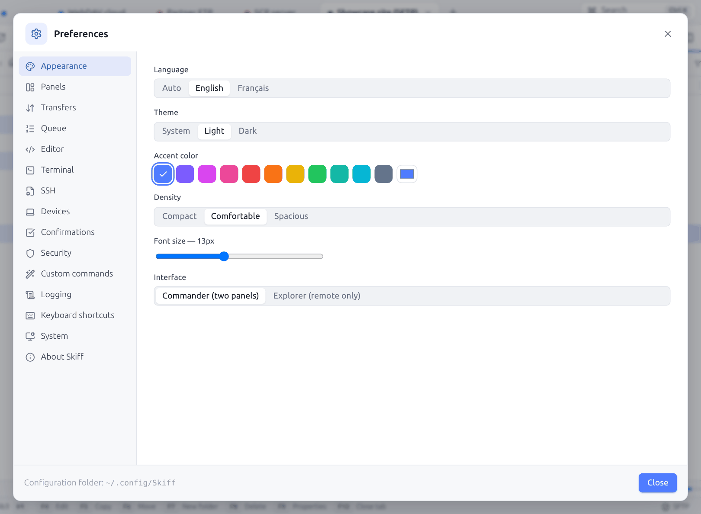

| Setting | Values |
|---|---|
| **Language** | **Auto** (language of the system), **English**, **Français** |
| **Theme** | **System** (follows the light or dark setting of the system), **Light**, **Dark** |
| **Accent color** | Eleven predefined colors, or any color with the picker on the right |
| **Density** | **Compact**, **Comfortable**, **Spacious**: height of the lines and spacing |
| **Font size** | From 11 to 16 px, by half pixels |
| **Interface** | **Commander (two panels)** or **Explorer (remote only)** for the new sessions |

The moon / sun button of the tab bar switches straight between light and dark. Here is the interface with the dark theme:

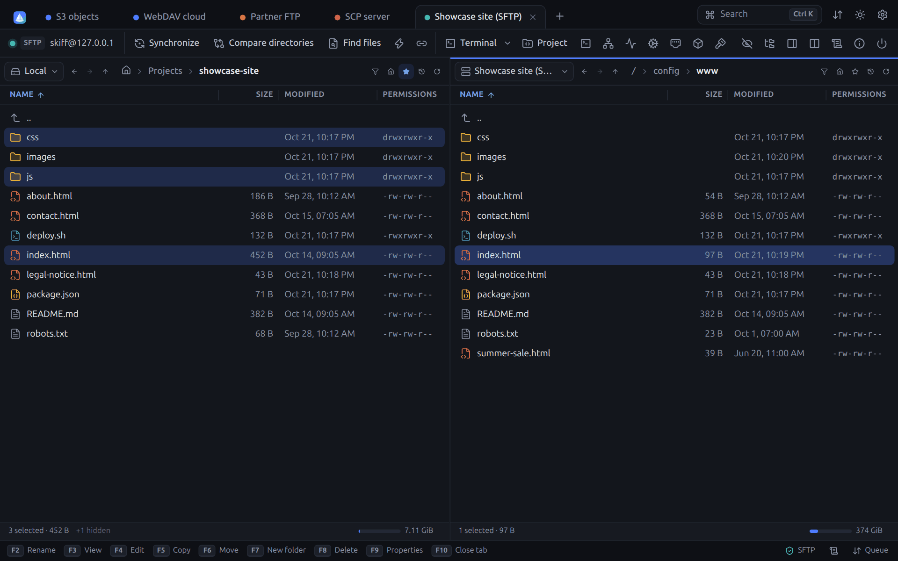

The same, in compact density with a turquoise accent:

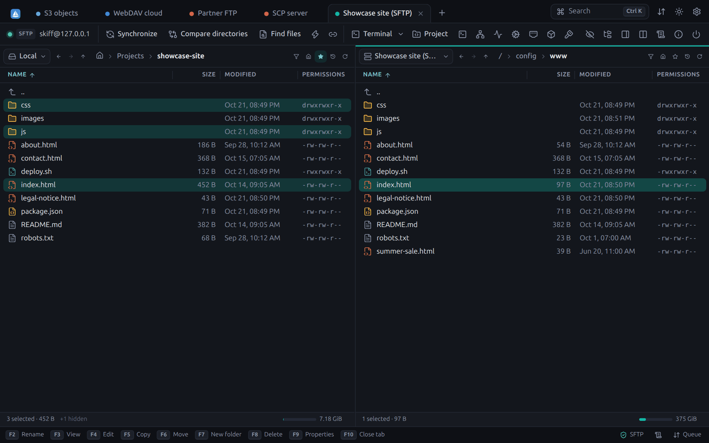

The command palette with the dark theme:

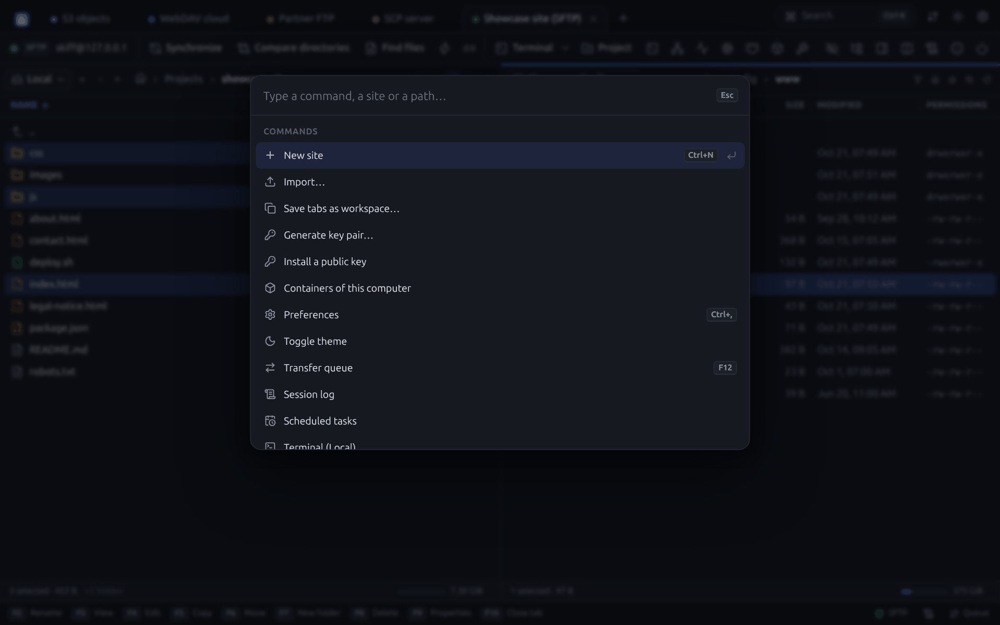

And the interface in French:

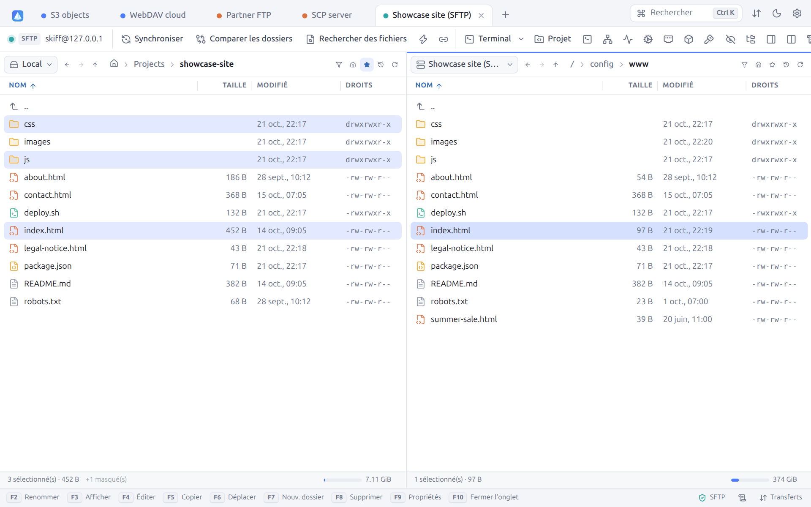

## 12.2 Panels

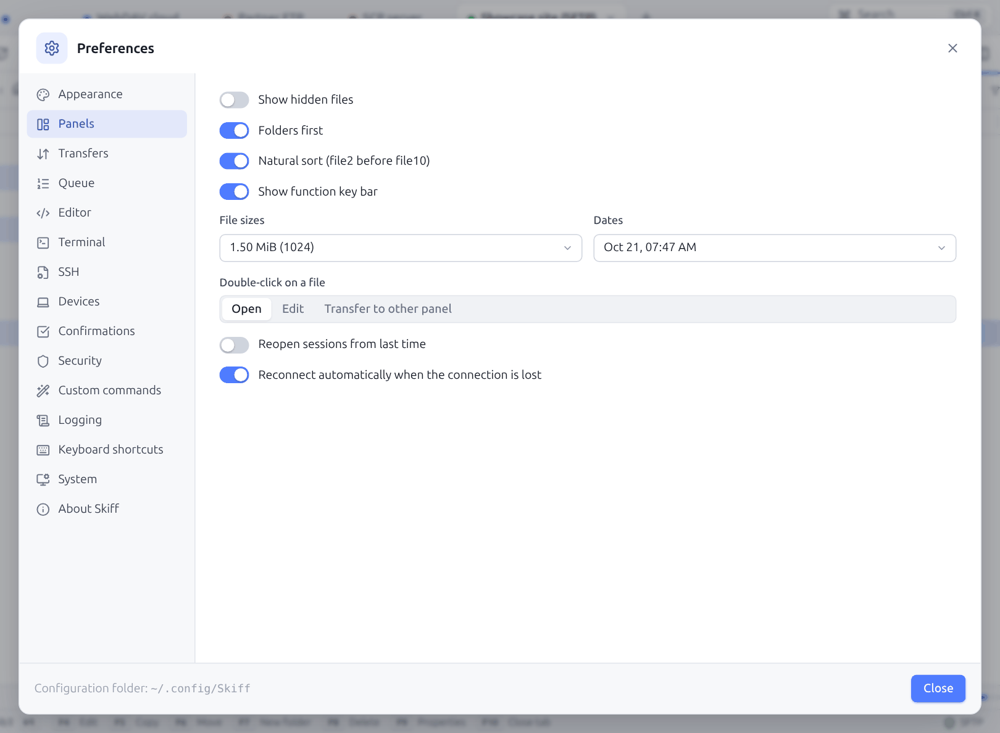

| Setting | Description |
|---|---|
| **Show hidden files** | Shows the files starting with a dot (also `Ctrl+Alt+H`) |
| **Folders first** | Sorts the folders before the files |
| **Natural sort (file2 before file10)** | Compares the numbers in the names by their value |
| **Show function key bar** | `F2`…`F10` bar at the bottom of the window |
| **File sizes** | `1.50 MiB (1024)` (binary units), `1.57 MB (1000)` (decimal units) or exact number of bytes |
| **Dates** | Short (`Oct 15, 08:12 AM`), relative (`5 minutes ago`) or ISO (`2026-10-15 08:12:44`) |
| **Double-click on a file** (and `Enter`) | **Open**: the text files smaller than 5 MB open in the editor, the others with the default application of the system (in the preview in web mode). **Edit**: always the editor. **Transfer to other panel**: as `F5` |
| **Reopen sessions from last time** | Restores the tabs at start |
| **Reconnect automatically when the connection is lost** | Starts the lost connection again (see [Troubleshooting](17-troubleshooting.md#172-connection-lost)) |

## 12.3 Transfers

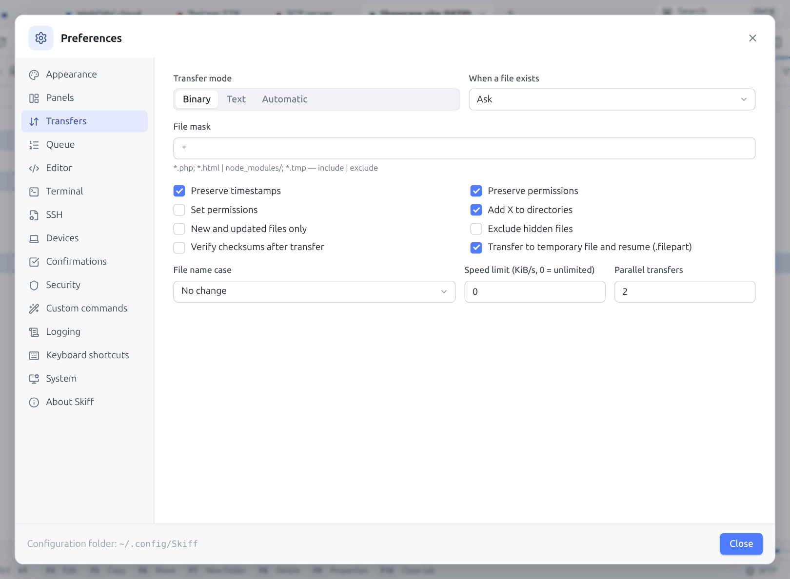

The default transfer options, the same as those of the [transfer dialog](06-transfers.md#62-the-transfer-dialog): transfer mode, overwrite policy, file mask, dates, permissions, new and updated files, hidden files, check, `.filepart`, name case, speed limit and parallel transfers.

## 12.4 Queue

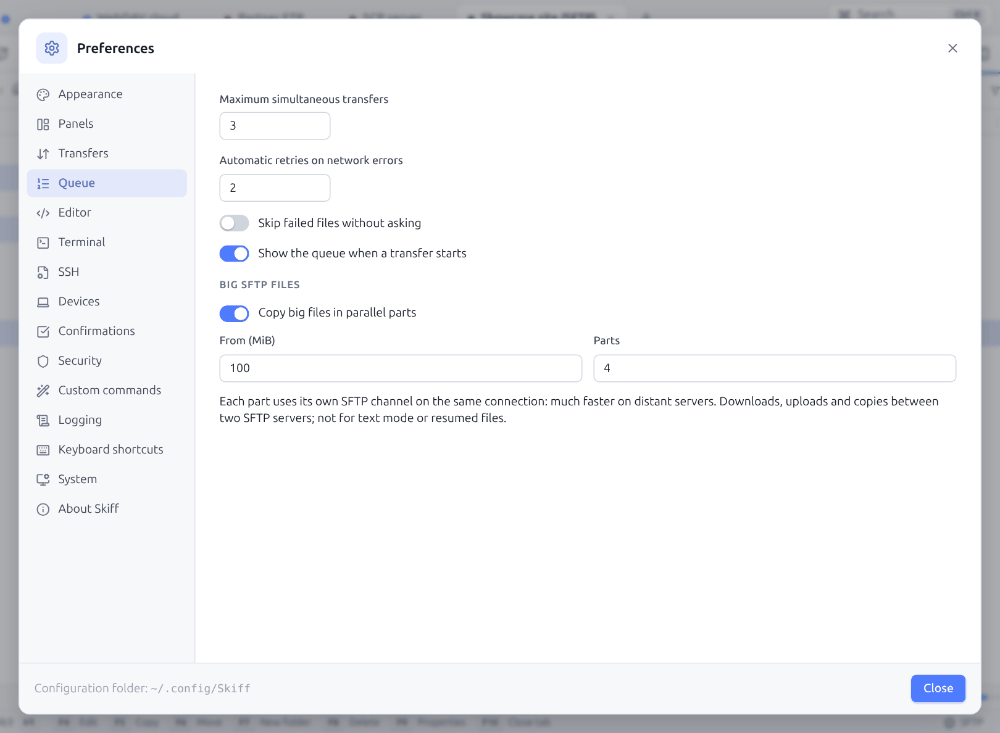

| Setting | Default | Description |
|---|---|---|
| **Maximum simultaneous transfers** | 3 | Tasks of the queue run at the same time; the others wait |
| **Automatic retries on network errors** | 2 | Number of automatic retries of a file after a network cut |
| **Skip failed files without asking** | no | Skips the failed files without showing the [error dialog](06-transfers.md#66-transfer-errors) |
| **Show the queue when a transfer starts** | yes | Opens the **Queue** panel automatically |
| **Copy big files in parallel parts** | yes | SFTP files copied in simultaneous parts ([§ 6.8](06-transfers.md#68-large-files-in-parallel-parts-sftp)) |
| **From (MiB)** | 100 | Size from which a file is split |
| **Parts** | 4 | Number of parts copied at the same time (2 to 8) |

## 12.5 Editor

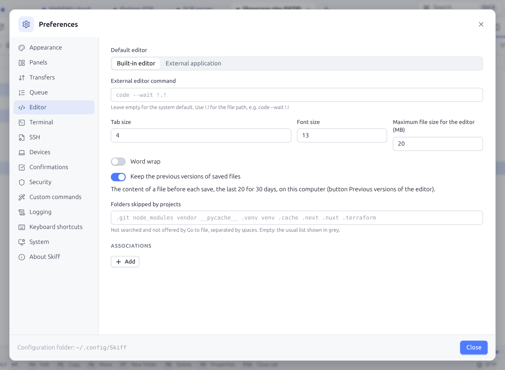

| Setting | Description |
|---|---|
| **Default editor** | **Built-in editor** or **External application** for `F4` and the double-click (the external application does not exist in web mode) |
| **External editor command** | Empty: the application of the system. Otherwise the command, with `!.!` for the path of the file: `code --wait !.!`, `notepad++.exe !.!`, `subl -w !.!` |
| **Tab size** | 1 to 8 spaces |
| **Font size** | Font of the editor, 9 to 24 px |
| **Maximum file size for the editor (MB)** | 20 by default |
| **Word wrap** | Wraps the long lines at the width of the window |
| **Keep the previous versions of saved files** | On by default: a copy before each save, on this computer ([§ 8.8](08-editing.md#88-previous-versions)) |
| **Folders skipped by projects** | Neither searched nor offered by **Go to file…** ([§ 8.7](08-editing.md#87-projects-editing-a-folder-without-installing-anything-on-the-server)), separated by spaces. Empty: `.git node_modules vendor __pycache__ .venv venv .cache .next .nuxt .terraform` |
| **Associations** | Mask → command pairs. **Add** creates a line: `*.psd` → `gimp !.!`, `*.log` → `internal` (forces the built-in editor) |

## 12.6 Terminal

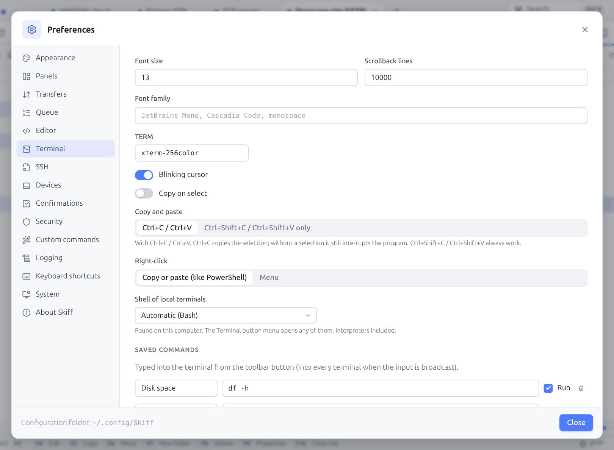

| Setting | Description |
|---|---|
| **Font size** | 9 to 24 px |
| **Scrollback lines** | Size of the scrollback history (10,000 by default) |
| **Font family** | List of CSS fonts, `JetBrains Mono, Cascadia Code, monospace` for one |
| **TERM** | Terminal type announced to the server (`xterm-256color`) |
| **Blinking cursor** | |
| **Copy on select** | Copies the text as soon as it is selected |
| **Copy and paste** | **Ctrl+C / Ctrl+V** (the default): `Ctrl+C` copies the selection, and without a selection interrupts the program; `Ctrl+V` pastes. **Ctrl+Shift+C / Ctrl+Shift+V only**: `Ctrl+C` and `Ctrl+V` always go to the program. `Ctrl+Shift+C` and `Ctrl+Shift+V` work in both cases ([§ 9.1](09-terminal-tunnels.md#copy-paste-and-right-click)). |
| **Right-click** | **Copy or paste (like PowerShell)** (the default): copies the selection, pastes when there is none. **Menu**: opens a menu (copy, paste, select all, clear, search, split). |
| **Shell of local terminals** | **Automatic** (the login shell, PowerShell on Windows) or one of the shells and interpreters found on the computer ([§ 9.2](09-terminal-tunnels.md#92-local-terminal)). Missing when the local terminal is turned off (web mode). |
| **Saved commands** | Name, command and **Run** (also press Enter) of the commands of the **Saved commands** button of the terminal ([§ 9.1](09-terminal-tunnels.md#91-ssh-terminal)). **Add** creates one, the trash deletes it. |

## 12.7 SSH

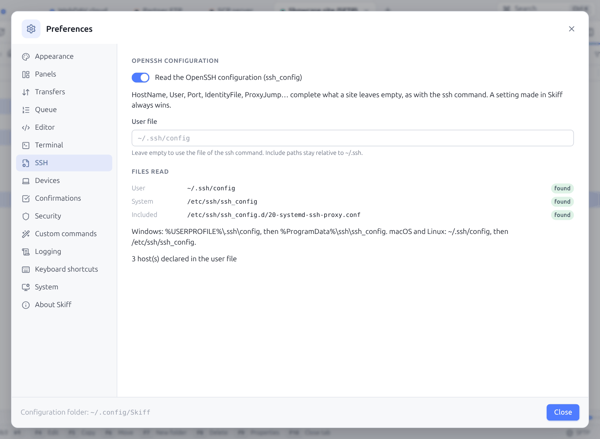

| Setting | Description |
|---|---|
| **Read the OpenSSH configuration (ssh_config)** | On by default: the hosts of `~/.ssh/config` show in the site list and their settings complete the SSH sites (see [OpenSSH configuration](03-sites.md#34-openssh-configuration-ssh_config)) |
| **User file** | Empty: the file of the `ssh` command of your system. Give another file to replace it (relative `Include`s are still looked for in `~/.ssh`). |
| **Files read** | The user file, the system file and those they include, with their state: **found**, **not found** or **unreadable** |

Locations by system: on Windows `%USERPROFILE%\.ssh\config` then `%ProgramData%\ssh\ssh_config`; on macOS and Linux `~/.ssh/config` then `/etc/ssh/ssh_config`.

## 12.8 Devices

Shares your settings between your computers (desktop, laptop, spare machine) through **a single encrypted file**, kept on one of your servers: an SFTP, SCP, FTP, WebDAV or S3 site you already have. The server sees only encrypted content (Argon2id and XChaCha20-Poly1305); the passphrase never leaves your devices.

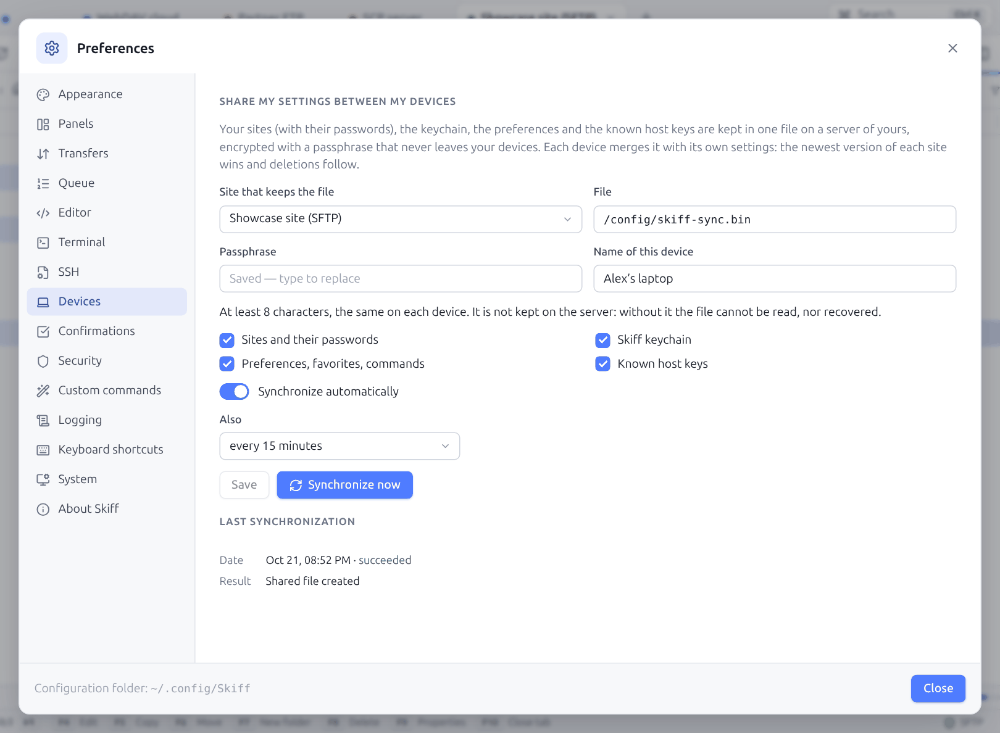

| Setting | Description |
|---|---|
| **Site that keeps the file** and **File** | Where the shared file is kept (`skiff-sync.bin` by default, in the folder the site opens; a path starting with `/` is absolute, with S3 it starts with the bucket) |
| **Passphrase** | At least 8 characters, the same on each device. It is kept here, encrypted as the passwords are; once lost, the file can no longer be read (make a new one). |
| **Name of this device** | Shown on the other devices ("Last written by") |
| What is shared | **Sites and their passwords**, **Skiff keychain**, **Preferences, favorites, commands** (without what belongs to the device: open tabs, layout, `ssh_config` file), **Known host keys** |
| **Synchronize automatically** | At start, some twenty seconds after each change, and **every N minutes** (or only after a change) |
| **Synchronize now** | Starts a synchronization at once |

**How the settings are merged**: each device downloads the file, merges it with its settings, then writes it again when it has changed.

- a site or a key: the version changed last wins, whether it comes from the file or from the device;
- a deletion (site, key of the keychain, folder) spreads to the other devices, unless the item was changed elsewhere after its deletion;
- the preferences: when only one side changed them since the last synchronization, that side wins; when both changed them, the device that synchronizes keeps its own;
- the host keys: those known by a device are added to the others.

**Adding a device**: on the new computer, create the site of the storage (the same server), connect once to accept its host key, then in **Preferences → Devices** choose this site, the same file and the same passphrase, and **Synchronize now**: all the sites, passwords, keys and preferences arrive. The site of the storage does not show twice: it is recognized as the one already shared.

The synchronization runs without asking any question: an unknown host key or a missing password for the site of the storage make it fail, and the error shows under **Last synchronization**. With a locked master password, it waits for the unlocking.

## 12.9 Confirmations

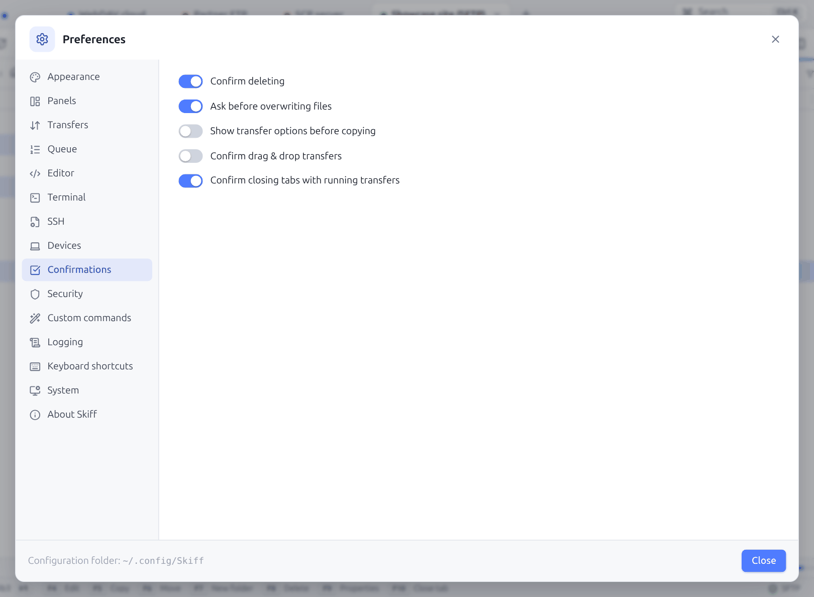

| Setting | Default |
|---|---|
| **Confirm deleting** | yes |
| **Ask before overwriting files** | yes |
| **Show transfer options before copying** (transfer dialog at each `F5`) | no |
| **Confirm drag & drop transfers** | no |
| **Confirm closing tabs with running transfers** | yes |

## 12.10 Security

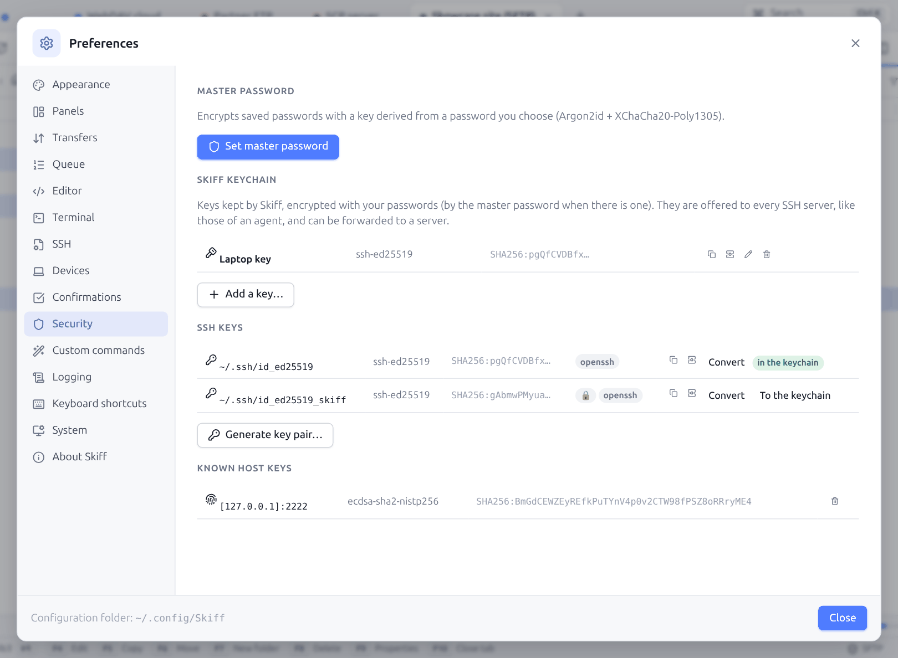

- **Master password**: set, change, remove, lock (see [§ 11.4](11-security.md#114-master-password)).
- **Skiff keychain**: the keys kept by Skiff, with **Add a key…**, **Copy the public key**, **Install on a server…**, **Rename** and **Delete** (see [§ 11.7](11-security.md#117-skiff-keychain-and-agent-forwarding)).
- **SSH keys**: the private keys of `~/.ssh`, with **Copy the public key**, **Install on a server…** ([§ 11.6](11-security.md#installing-an-existing-key-on-a-server)), **Convert** (see [§ 11.6](11-security.md#116-existing-keys-and-conversion)), **To the keychain**, and **Generate key pair…**.
- **Known host keys**: host, key type, fingerprint, and the trash to forget a key.

## 12.11 Custom commands

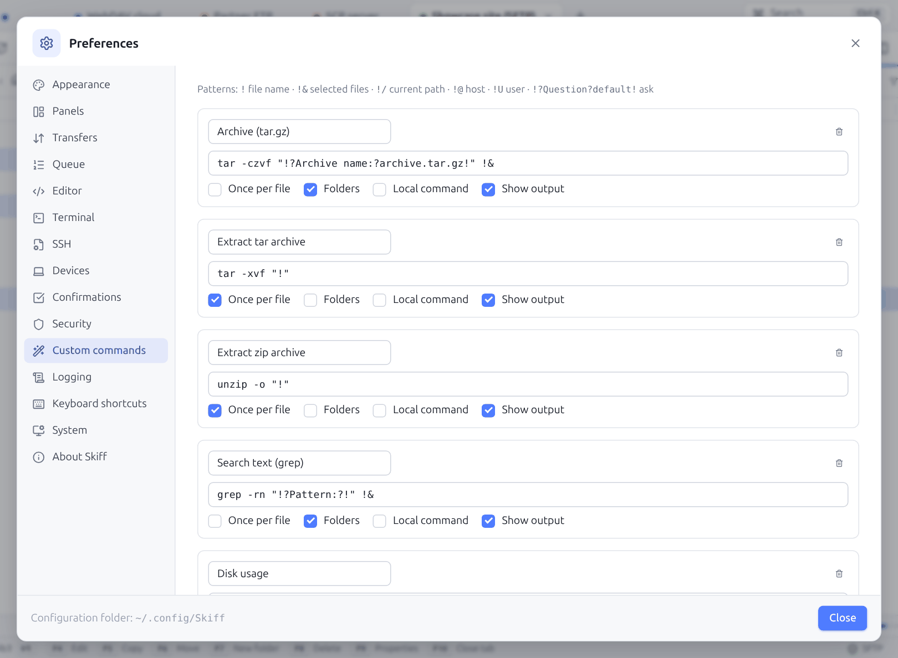

Each command has a name, a command line with the patterns of WinSCP (recalled at the top: `!` file name, `!&` selected files, `!/` current path, `!@` host, `!U` user, `!?Question?default!` ask), and four options: **Once per file**, **Directories**, **Local command**, **Show output**. The trash deletes the command and **Add command** creates one. See [§ 5.10](05-files.md#510-custom-commands).

## 12.12 Logging

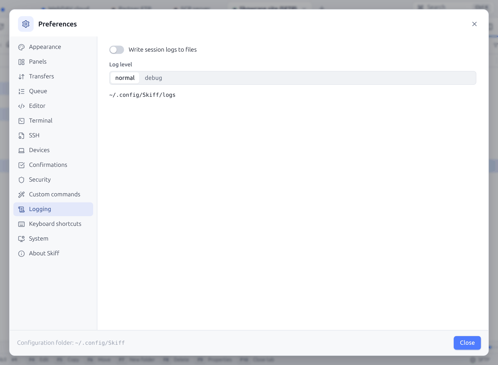

| Setting | Description |
|---|---|
| **Write session logs to files** | One file per session in the `logs` folder given below |
| **Log level** | **normal** (commands and events) or **debug** (with the answers of the server) |

## 12.13 Keyboard shortcuts

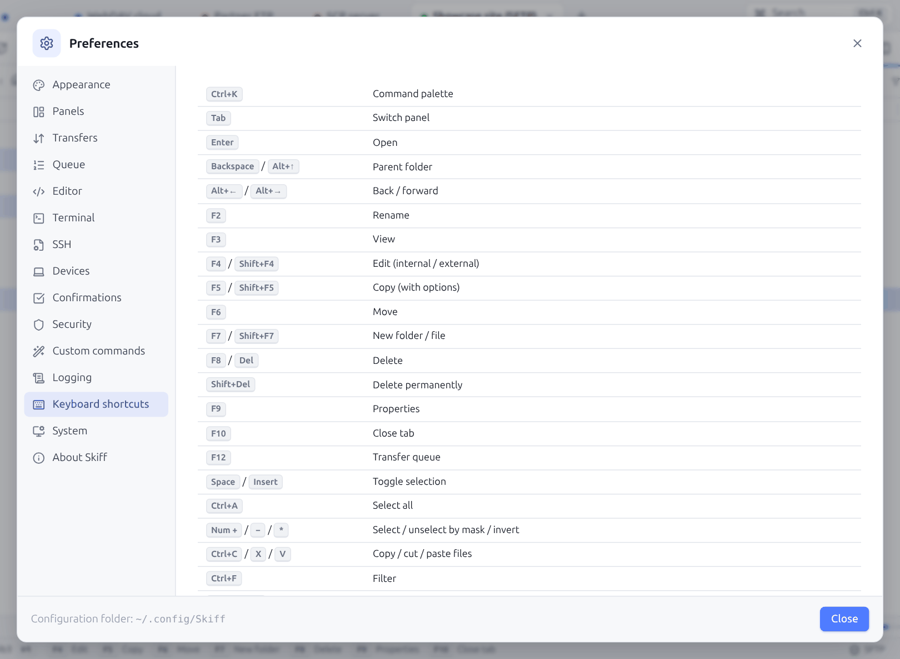

The list of all the shortcuts. It is repeated in the chapter [Keyboard shortcuts](16-shortcuts.md).

## 12.14 System

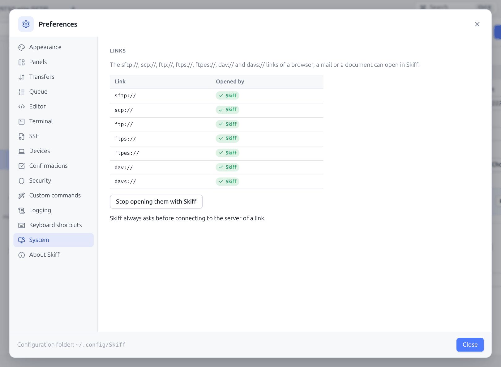

**Links**: the `sftp://`, `scp://`, `ftp://`, `ftps://`, `ftpes://`, `dav://` and `davs://` links of a browser, an e-mail or a document can open in Skiff, as with WinSCP. The table gives the application that opens each of them today; **Open these links with Skiff** makes Skiff that application, **Stop opening them with Skiff** gives them back.

When a link is clicked, Skiff (already open, or started for the occasion) shows the connection asked for and waits for your agreement:

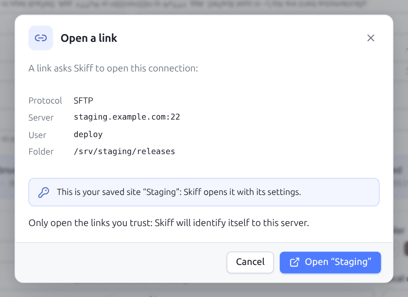

When the link points to a saved site (same protocol, server, port and user), Skiff offers to open that site, with its settings and its passwords, in the folder of the link. A password held in the link is pointed out; a host key forced by the link is ignored ([§ 11.8](11-security.md#118-security-of-the-application)).

| System | Where Skiff registers |
|---|---|
| Linux, FreeBSD | The `mimeapps.list` file of the user (`~/.config`), following the freedesktop standard; the menu entry of Skiff lists these links. Without the `.deb` package, the menu entry of the user is created when needed. |
| Windows | The registry of the user (without administrator rights), and **Settings → Apps → Default apps**, where Skiff shows. An application chosen in these settings keeps its links: **Windows default apps…** opens them to choose Skiff there. The installer offers the same (ticked box). The Microsoft Store version declares these links itself in its package: only the default apps of Windows give them to it, and the section says so. |
| macOS | `Skiff.app` declares these links; the button makes Skiff their application. To give them back, choose another application from that one: macOS keeps the last one chosen. |

In web mode, this section does not exist: the links are those of the server.

## 12.15 About Skiff

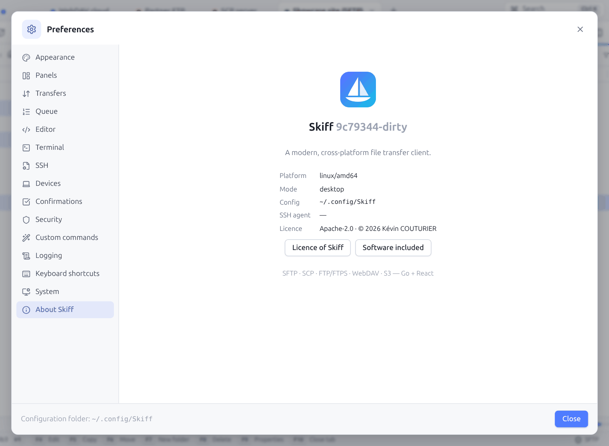

The version, the **Platform** (system and architecture), the **Mode** (desktop or web), the **Configuration** folder, whether there is an **SSH agent**, and the **Licence**. **Licence of Skiff** shows the Apache 2.0 licence and the `NOTICE` file; **Software included** lists the libraries Skiff holds, with the licence and the text of each (a search filters the list). The same texts show with `skiff licenses` ([§ 13.12](13-scripts-cli.md#1312-skiff-licenses)).

---

[← Security](11-security.md) · [Contents](README.md) · [Scripts and command line →](13-scripts-cli.md) · 🇫🇷 [Français](../12-preferences.md)
