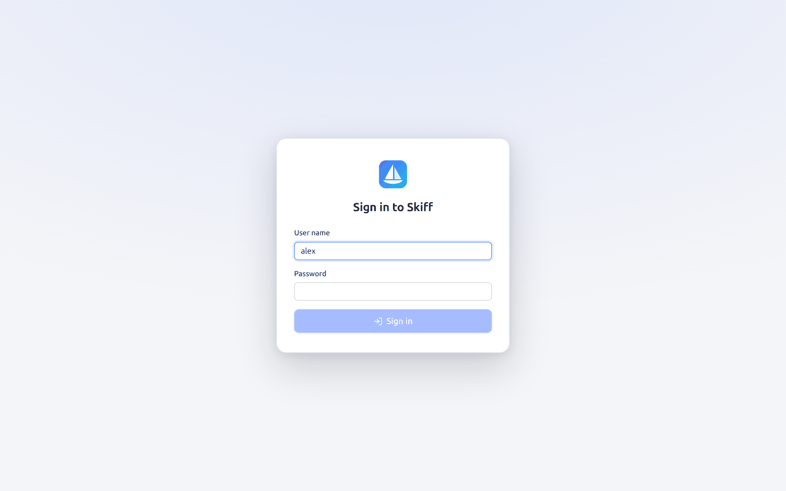
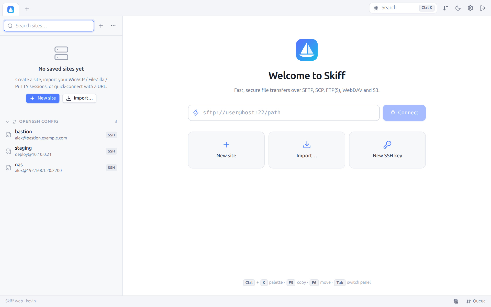

# 14. Remote web mode

[← Scripts and command line](13-scripts-cli.md) · [Contents](README.md) · [Protocols →](15-protocols.md) · 🇫🇷 [Français](../14-mode-web.md)

`skiff serve` starts Skiff without a window and serves its interface over HTTPS. It is used from any browser: Skiff installed on a server, a NAS or a jump machine becomes a transfer client reachable from anywhere, to transfer between two remote servers without the data going through your laptop, for one.

## 14.1 Starting

```bash
skiff serve --set-password                              # choose the password, then quit
skiff serve --listen 0.0.0.0:8443                       # HTTPS with a self-signed certificate
skiff serve --listen 0.0.0.0:8443 --root /srv/data      # local panel kept to /srv/data
skiff serve --tls-cert cert.pem --tls-key key.pem       # your own certificate
skiff serve --no-tls --listen 127.0.0.1:8080            # behind a TLS reverse proxy
WEBPW=… skiff serve --password-env WEBPW --user alex    # password given by the environment
```

| Option | Default | Description |
|---|---|---|
| `--listen address:port` | `127.0.0.1:8443` | Listening address. `0.0.0.0:8443` for an access from the network. |
| `--user name` | the saved user, or `admin` | Login |
| `--set-password` | | Asks for the password (twice, 8 characters at least), saves it (hashed with Argon2id) and quits |
| `--password-env VAR` | | Reads the password from the `VAR` environment variable (containers, services) |
| `--tls-cert`, `--tls-key` | | PEM certificate and key. Without them, Skiff makes a self-signed certificate (`web-cert.pem`) and shows its SHA-256 fingerprint at start. |
| `--no-tls` | | HTTP without encryption, only for a local listening address behind an HTTPS reverse proxy. A warning shows when the address is public. |
| `--root folder` | | Keeps the **Local** panel to this folder |
| `--allow-local-terminal` | | Allows terminals on the machine that runs Skiff (no effect with `--root`) |

At the first start, when no password is saved, Skiff asks for it in the terminal.

## 14.2 Signing in

Open `https://server:8443/` in a browser. With the self-signed certificate, the browser first shows a warning: check that the fingerprint matches the one shown by `skiff serve`.



Once signed in, the interface is exactly that of the desktop application. The **Sign out** button shows on the right of the tab bar, and the status bar recalls the name of the machine that runs Skiff ("Skiff web · server-name"):



The browser session lasts seven days. The sites, preferences, passwords, host keys and transfers are those of the Skiff that runs on the server. Closing the browser tab cuts neither the connections, nor the transfers, nor the terminals: when you come back, everything is there, terminals included (with their recent history).

## 14.3 Security

- Password stored hashed with **Argon2id**.
- `HttpOnly`, `SameSite=Strict` session cookie, `Secure` over HTTPS.
- **Rate limiting**: five failures per minute and per IP address, then a temporary refusal.
- Mandatory **anti-CSRF header** on every API request, check of the `Origin` of the WebSockets.
- `--root` confines the local panel to the folder given, symbolic links that would leave it included.

## 14.4 Differences with the desktop application

| Feature | In web mode |
|---|---|
| **Local** panel | The disk **of the server** that runs Skiff (kept by `--root`) |
| Uploading files of your computer | Drag them from your desktop onto a panel: the browser uploads them |
| Getting a file on your computer | **Save to computer** (context menu, preview): a download by the browser |
| **Open with default app** | Replaced by a download, or the preview for images, videos and PDF |
| External editor, **Show in file manager** | Not available |
| Local terminal | Turned off, except with `--allow-local-terminal`. Never available with `--root`: a shell cannot be confined to a folder. |
| Containers of the server machine | As the local terminal (the `docker`, `podman`, `kubectl` commands of the machine). Those of the SSH servers stay available. |
| Local commands (custom commands marked **Local command**) | Turned off |
| Import from a file | Paste the content of the file or upload it through the browser (only the `~/.ssh/config` of the server is read directly) |
| OpenSSH configuration | That **of the server** (the `~/.ssh/config` of the user who runs `skiff serve`) |
| Key conversion | Not available |
| Local trash | Local deletions are for good |
| Key generator | The keys are saved on the server |

## 14.5 Deployment

### systemd service

```ini
# /etc/systemd/system/skiff.service
[Unit]
Description=Skiff (web interface)
After=network-online.target

[Service]
User=skiff
Environment=SKIFF_WEB_PASSWORD=change-me
ExecStart=/usr/local/bin/skiff serve --listen 127.0.0.1:8080 --no-tls --password-env SKIFF_WEB_PASSWORD
Restart=on-failure

[Install]
WantedBy=multi-user.target
```

### Reverse proxy (nginx)

```nginx
location / {
    proxy_pass http://127.0.0.1:8080;
    proxy_http_version 1.1;
    proxy_set_header Upgrade $http_upgrade;     # WebSocket (events, terminals)
    proxy_set_header Connection "upgrade";
    proxy_set_header Host $host;
    client_max_body_size 0;                     # large file uploads
    proxy_request_buffering off;
}
```

The portable variant of the binary (without dependencies) suits servers, NAS and containers.

---

[← Scripts and command line](13-scripts-cli.md) · [Contents](README.md) · [Protocols →](15-protocols.md) · 🇫🇷 [Français](../14-mode-web.md)
