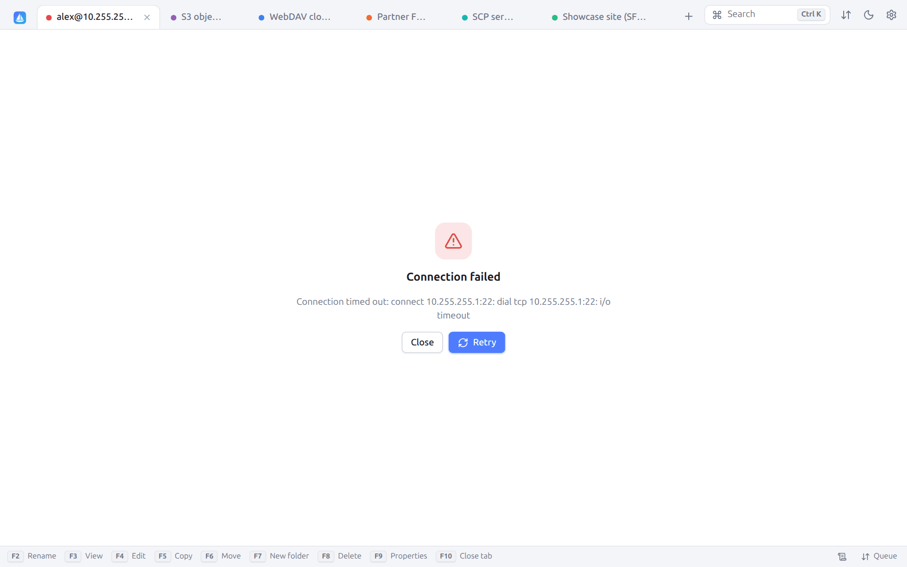
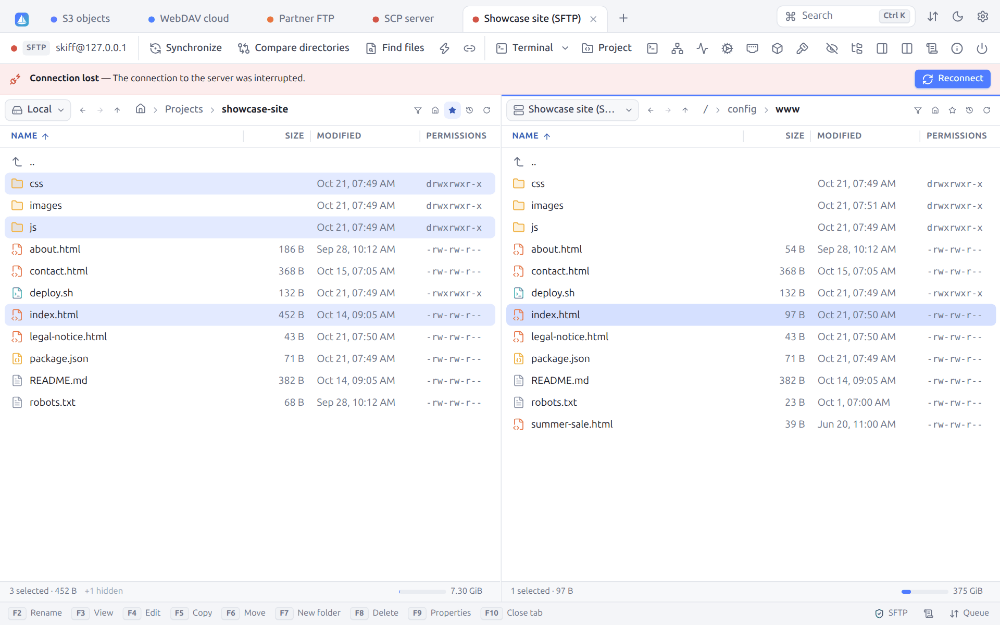

# 17. Troubleshooting

[← Keyboard shortcuts](16-shortcuts.md) · [Contents](README.md) · [WinSCP → Skiff map →](18-winscp.md) · 🇫🇷 [Français](../17-depannage.md)

## 17.1 Connection failure

While connecting, the tab shows the host contacted and an **Abort** button:

When the connection fails, the tab shows the error, with **Retry** and **Close**:

| Message | Likely cause | What to do |
|---|---|---|
| `i/o timeout`, `Connection timed out` | Host unreachable, firewall, wrong port | Check the address and the port, the VPN, or go through a [jump host](09-terminal-tunnels.md#94-jump-hosts) or a [proxy](09-terminal-tunnels.md#95-proxies). Raise the **Timeout (seconds)** of the site. |
| `connection refused` | No service on this port | Check the port (22 for SSH, 21 for FTP, 990 for implicit FTPS) |
| `no such host` | Unknown DNS name | Check the spelling, or tick **Resolve host names on the proxy** |
| `unable to authenticate`, `530 Login incorrect` | Credentials refused | Check the user, the password, the key (format, passphrase); for a key, check `~/.ssh/authorized_keys` on the server |
| `no common algorithm` | Old server | Tick **Allow legacy algorithms (old servers)** (SSH section of the site) |
| `subsystem request failed` | SFTP turned off on the server | Skiff switches to SCP by itself; otherwise choose the SCP protocol |
| `x509: certificate signed by unknown authority` | Self-signed certificate | See [TLS certificates](11-security.md#112-tls-certificates) |
| `the master password is required…` | Passwords locked | [Unlock](11-security.md#114-master-password) them with the master password |
| `… StrictHostKeyChecking is yes` | Unknown host key and `StrictHostKeyChecking yes` in `~/.ssh/config` | Connect once with `ssh`, or change this setting for this host (see [Host keys](11-security.md#111-ssh-host-keys)) |
| `ProxyUseFdpass is not supported` | The host goes through a proxy command that hands over a descriptor (`systemd-ssh-proxy`, for one) | Host kept for `ssh`; turn the OpenSSH configuration off for this site when it is another server |

The [session log](10-search-log.md#102-session-log) details each step; set the level to **debug** to see the answers of the server too.

## 17.2 Connection lost

When the connection drops (network cut, server restarted, sleep mode), a banner says so above the panels, with the reason and a **Reconnect** button:

- **Reconnect** opens the session again, in the same folders.
- With **Reconnect automatically when the connection is lost** (on by default, Preferences → Panels), just go on: the next operation (browsing, refresh, transfer) reconnects by itself.
- The interrupted transfers retry automatically (twice by default) and resume their `.filepart` files.
- A right-click on the tab also offers **Reconnect**.

To avoid the cuts due to the firewalls that close idle connections, lower the **Keepalive interval** of the site (Connection section).

## 17.3 Frequently asked questions

**File names with accents show badly with FTP.**
The server does not use UTF-8: choose its encoding in the site (**Environment → File name encoding**, often Windows-1252).

**The dates of the FTP files are one or two hours off.**
The server gives its local time without a time zone. Set **Environment → Time zone offset (minutes)**: the value is added to the dates shown (`-120` when they are two hours ahead, for one).

**The synchronization transfers identical files again.**
The server does not keep the dates (S3, some WebDAV servers) or knows them only to the minute (FTP without MLSD). Compare by **Size** or by **Checksum**.

**The line ends of scripts uploaded from Windows break everything on the server.**
Use the **Automatic** or **Text** transfer mode (see [Transfers](06-transfers.md#62-the-transfer-dialog)), or fix the file in the editor (**Line endings → LF**).

**The FTP panel stays empty although the folder holds files.**
Turn off **Use MLSD listings** (FTP section of the site) and, for the hidden files, turn on **Use "LIST -a" to show hidden files**.

**FTP transfers hang in passive mode.**
Turn on **Force IP address for passive connections**, or switch to active mode (untick **Passive mode**).

**I want to browse as root on a server where I only have a sudo account.**
In the site, **SSH → SFTP server command**: `sudo /usr/lib/openssh/sftp-server` (sudo must be possible without a password for this command; the path depends on the distribution, `/usr/libexec/openssh/sftp-server` for one).

**A host of my `~/.ssh/config` does not show, or connects with the wrong settings.**
Open **Preferences → SSH**: the reading must be on and the user file marked **found**. Only the hosts without a wildcard (`Host server`, not `Host *.lan`) are listed, but all of them apply. Click the host (or open the **SSH** section of the site): each setting is shown there with the line it comes from. Remember that the first value found wins: put `Host *` at the end of the file; and that a setting made in the site replaces that of the file (see [OpenSSH configuration](03-sites.md#34-openssh-configuration-ssh_config)).

**Where are my settings?**
In the [configuration folder](01-installation.md#14-configuration-folder), shown at the bottom of the preferences.

**How do I start from scratch?**
Quit Skiff and rename the configuration folder. To reset only the host keys, delete `known_hosts` (or the lines concerned in **Preferences → Security**).

**The native window does not open on Linux.**
Install `libwebkit2gtk-4.1` (the `libwebkit2gtk-4.1-0` package on Debian and Ubuntu), or use the portable variant, which opens a browser window. The AppImage chooses between both by itself.

**Windows refuses to start the installer ("Windows protected your PC").**
The installer is not signed yet: click **More info**, then **Run anyway**.

**macOS refuses to open Skiff.**
The application is not signed by an identified developer yet: open **System Settings → Privacy & Security** and click **Open Anyway** next to Skiff.

**The AppImage does not open ("AppImages require FUSE to run").**
Install FUSE (the `fuse3` package), or start it with the `--appimage-extract-and-run` option.

**An `sftp://` link does not open Skiff.**
Open **Preferences → System**: the table gives the application that opens each link, and **Open these links with Skiff** takes them back. On Windows, an application chosen in **Settings → Apps → Default apps** keeps its links: choose Skiff there (**Windows default apps…** button). A browser may also ask once whether to open the application.

**Starting Skiff a second time only brings the window back.**
That is on purpose: one window per configuration folder ([§ 1.3](01-installation.md#13-starting-skiff)). Open a new tab instead (`Ctrl+N` or the **Sites** tab). After a crash, the `instance.json` file left in the configuration does not prevent the next start.

**Replacing a key fails with "the new key is installed, but the old one stays".**
The server did not accept the new key alone, or its private part is not on this computer: the old key was kept ([§ 11.6](11-security.md#installing-or-replacing-a-key-on-several-servers)). Check that the private key is in the keychain, the agent or `~/.ssh`, and that `sshd_config` does not read another file (`AuthorizedKeysFile`).

**Two Skiff entries in the menu, or an entry that no longer works.**
Run `skiff desktop-entry -remove` to remove the one Skiff added for your user; that of the `.deb` package, if you installed it, stays.

## 17.4 Reporting a problem

Attach:

1. the version (`skiff version`, or **Preferences → About Skiff**) and the system;
2. the session log at the **debug** level (**Copy** in the Log tab), with the sensitive information taken out;
3. the content of **Server/protocol information** (**Copy** button).

---

[← Keyboard shortcuts](16-shortcuts.md) · [Contents](README.md) · [WinSCP → Skiff map →](18-winscp.md) · 🇫🇷 [Français](../17-depannage.md)
